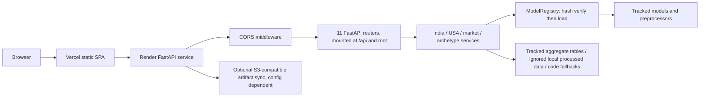

# M0 Current Architecture

Evidence: source code and configuration inspection. Runtime deployment and browser behavior were not live-verified.

## Frontend

`main.tsx` → `App` → `MarketProvider` + hand-written History API route map. Pages are `HomePage`, `PredictorPage`, `ExploreMarketPage`, `SkillsPage`, `ArchetypesPage`, `CrossMarketPage`, `MethodologyPage`. `services/api.ts` uses fetch and `VITE_API_BASE_URL` (default `/api`). Recharts, Framer Motion, Lucide React. Current market context is USA/India only.

## Backend

`main.py` → CORS and lifespan → optional artifact sync → registry verification/loading → 11 routers. Routers call market services/data service/inference service. Public, unauthenticated route registration is evidenced in source; deployed access controls are unknown.

## Artifact lifecycle

Tracked model files + metadata → registry hard-coded expected SHA-256 → optional remote sync helper → local hash verification → pickle/joblib load → singleton memory → `/health`, `/ready`, and prediction handlers. SHA values matched locally. JSON manifest and Python registry are separate lists. Render deployment config starts one Uvicorn worker and probes `/api/ready`; actual service behavior is not verified live.

## Data flow

Local raw research data → market preprocessing scripts/notebooks → frozen model/aggregates → API payloads. India and USA have separate raw feature builders and model pipelines. Frontend renders native currency market figures and has a current USA/India cross-market comparison. There is no canonical cross-country occupation service or ingestion registry in current source.

Historical AWS architecture in `docs/deployment/cloud-architecture.md` conflicts with current Render/Vercel config and should be read as archived/stale.
