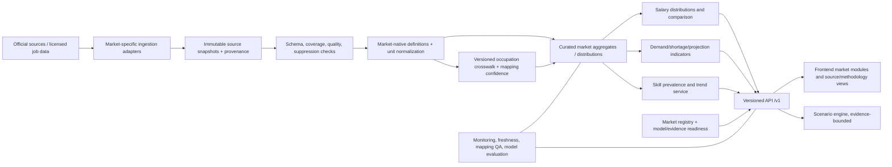
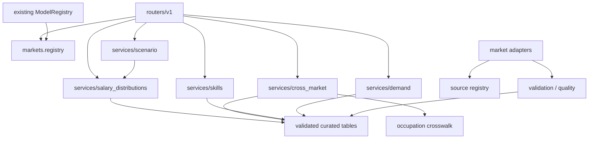
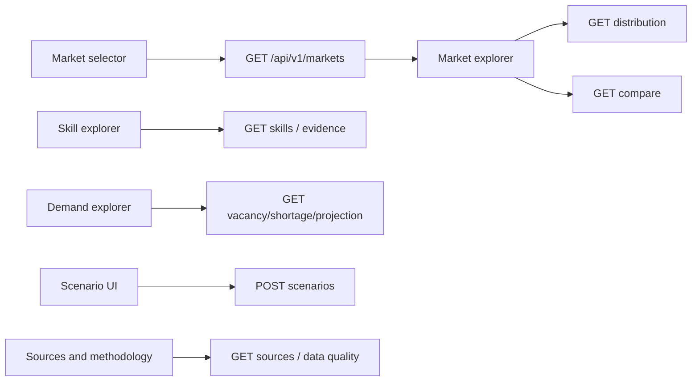
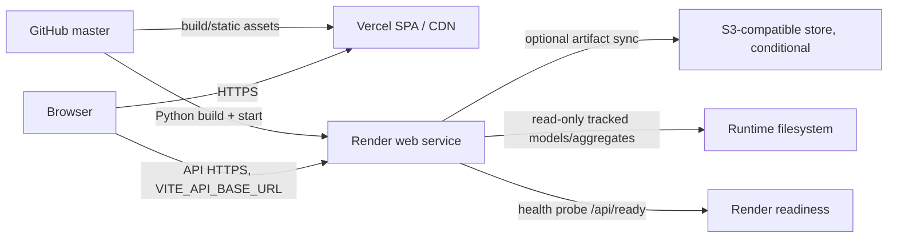

# M0 Target Architecture Proposal

This is a proposal only. It preserves current India and USA behavior behind adapters and introduces new modules additively. It does not authorize implementation.

## Target system



## Proposed modules

| Module | Responsibility / input → output | Dependencies / interactions / risk |
|---|---|---|
| Market registry | Market ID, currency, locale, occupation scheme, capabilities, readiness → market metadata | New `src/backend/markets/registry.py`; interacts with API and UI. Risk: treats market presence as capability. Keep feature flags/capability status separate. No dependency required. |
| Market adapters | Source-specific files/API → source-native normalized tables | `src/backend/markets/{au,uk,sg}/`; ingestion scripts/workflows. Dependencies depend on CSV/XLSX/API format; avoid new dependency until source choice. Risk: licensing/update drift. |
| Provenance/source registry | Source ID, URL, license/access, publisher, vintage, retrieved date, schema → lineage records | New `src/backend/data/provenance.py` and versioned source metadata. Risk: metadata omitted during derived transformations. |
| Validation/quality | Raw schemas, counts, suppression, units, duplicates → quality report/accept/reject | `src/backend/data/validation.py`; test fixtures. Risk: silently accepting incompatible new release. |
| Occupation crosswalk | Source code/version → canonical occupation candidates, confidence, method → linked occupation records | `src/backend/occupations/`; may use official correspondences, no probabilistic NLP dependency initially. Risk: false equivalence. |
| Salary normalization | Native pay definition, period, currency, employment population → source-native plus normalized comparable metrics | `src/backend/intelligence/salary.py`; preserve raw values and annotate assumptions. Risk: false precision from annualization/FX. |
| Distribution service | Market/occupation/region/time → counts, percentiles, intervals, quality flags | Uses curated aggregates; never infers percentiles from a single median. |
| Comparison service | Canonical occupations, aligned reference period, compatible population → side-by-side local currencies/optional FX | New service; current `market_service.py` may remain for compatibility. Risk: population and currency comparability. |
| Skill intelligence | Jobs/official skills where supported → skills, prevalence, evidence/source windows | New module; do not infer missing skills from wage tables. |
| Demand intelligence | Vacancy ads, vacancy surveys, shortage lists, projections → distinct indicator series | Keep different concepts separate. Risk: a shortage score can be misrepresented as vacancy volume. |
| Scenario service | User-declared changes + empirical transitions/evidence → scenario ranges with uncertainty | Only after adequate longitudinal/transition evidence. Avoid causal salary uplift claims. |
| API versioning | Market/readiness/capabilities and intelligence payloads → `/api/v1/...` contracts | Keep current routes and consumers during compatibility window; additive versioned routers. |
| Frontend modules | Selected market capability → explorer, salary, demand, skills, scenario, methodology pages | Market selector consumes registry; pages show definitions, date, source, limitations, quality. Avoid implying predictions in descriptive-only markets. |
| Monitoring/evaluation | Ingestion health, freshness, source version, map coverage, drift, model validity → release gates | CI and runtime observability; thresholds require approval. |

## Backend module view



## Frontend and API dependency view



## Deployment/data flow/model lifecycle

Keep Vercel SPA + Render FastAPI while current product requirements and measured resource limits fit. Backend remains stateless; curated aggregates and model artifacts are built/released as versioned files, with checksum and provenance. Private row data must not enter frontend build artifacts. Ingestion should be separate from request-time service; API reads validated aggregate snapshots. Existing India/USA serialized artifacts remain frozen and tested by legacy parity. New models (if ever approved) require per-market training/evaluation, provenance, independent test, manifest publication, rollout and rollback. New country features need not imply new models.

## Explicit unknowns

Exact storage/vendor choices, refresh cadence, data licensing, regional units, source-specific publication permissions, FX policy, canonical ontology granularity, predictive launch bar, and Render capacity require approval/research. No new runtime dependency is required for the conceptual design, but source formats may require parsers/API clients; defer until sources and deployment impact are selected.

## Deployment diagram



## Model artifact lifecycle

```mermaid
flowchart LR
  Train[Research notebooks/scripts] --> Freeze[Frozen model + preprocessing + metadata]
  Freeze --> Manifest[Python SHA table + JSON manifest]
  Manifest --> Package[Git / deployment image or optional object sync]
  Package --> Verify[SHA-256 verification]
  Verify --> Deserialize[joblib / pickle load]
  Deserialize --> Inference[Market-specific prediction service]
  Verify --> Ready[/ready status]
  Inference --> QA[Golden / parity / holdout regression]
```

The apparent SHA match at this checkout is verified by local hashing; storage sync and deployed artifact equality are not.
