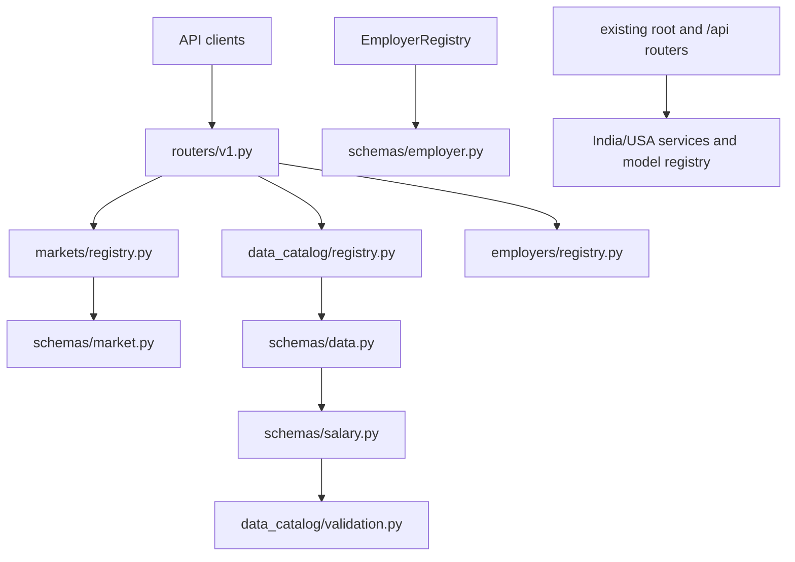

# Sprint 1 Architecture Design

## Objectives and boundaries

Add typed market metadata for IN, US, UK, AU, and SG; a source catalog with explicit reuse/validation status; source provenance and salary observation contracts; a structured quality validator; an evidence-backed employer registry foundation; and additive read-only `/api/v1` endpoints. Existing India/USA prediction code, feature dimensions, artifact loading, frontend pages, and deployment files stay unchanged.

## Package design

New global catalog modules do not import model artifacts or market prediction services. Existing routers remain as-is. New router is registered only once at `/api/v1`; existing routers remain at both root and `/api` paths.

## Registry policy

- Market ID is a strict enum: `IN`, `US`, `UK`, `AU`, `SG`; currencies use an explicit enum: INR, USD, GBP, AUD, SGD.
- Capabilities use `AVAILABLE`, `PARTIAL`, `NOT_IMPLEMENTED`, or `UNAVAILABLE`. Existing IN/US prediction and current analytics are marked available. New market capabilities remain `NOT_IMPLEMENTED` until integrated. Official source references are catalog entries, not evidence of in-product data availability.
- Market/source `last_successful_update` and `collected_at` remain null when not observed. No freshness is invented.
- Source reuse review uses `APPROVED`, `REVIEW_REQUIRED`, `RESTRICTED`, or `UNKNOWN`. External official-source records default to `REVIEW_REQUIRED`; existing project source reuse is `UNKNOWN`. No source is approved by this sprint.
- Employer registry starts empty. Profile/location schemas require source references; verified status requires verification evidence. No company or office is invented.

## Capability evidence

Every `AVAILABLE` IN/US capability is backed by an existing API route: salary prediction uses `POST /api/{india,usa}/predict`, salary analytics uses `GET /api/{india,usa}/market-summary`, and skills analytics uses `GET /api/{india,usa}/skills`. On 2026-11-10, all six existing handler/service paths were invoked successfully using the repository's local data and model artifacts; the salary services loaded the frozen models and returned prediction results, and each analytics/skills handler returned its response shape. Tests assert the capability-to-route mappings against the generated OpenAPI paths. These are existing prediction/analytics surfaces; the new `/api/v1` API only reports metadata. Demand analytics remains `PARTIAL`; occupation mapping and employer intelligence remain `NOT_IMPLEMENTED`.

## Contracts and validation

Pydantic v2 models capture market metadata, source metadata, provenance, native salary values/definitions, occupation scheme/version, region, period, currency, and employer data. Salary amounts remain in source currency and reporting period; no FX or annualization occurs. Batch validation returns accepted/rejected counts and per-row issue codes; it does not mutate, discard, or echo rejected source records.

## Deployment and compatibility

No added package, database, paid service, frontend work, or deployment configuration. Registries are in-process immutable metadata and read-only GET endpoints. When real data is integrated later, persistence and refresh scheduling require a separate design. Existing production endpoints retain method, path, request/response payload, and startup/model behavior.
