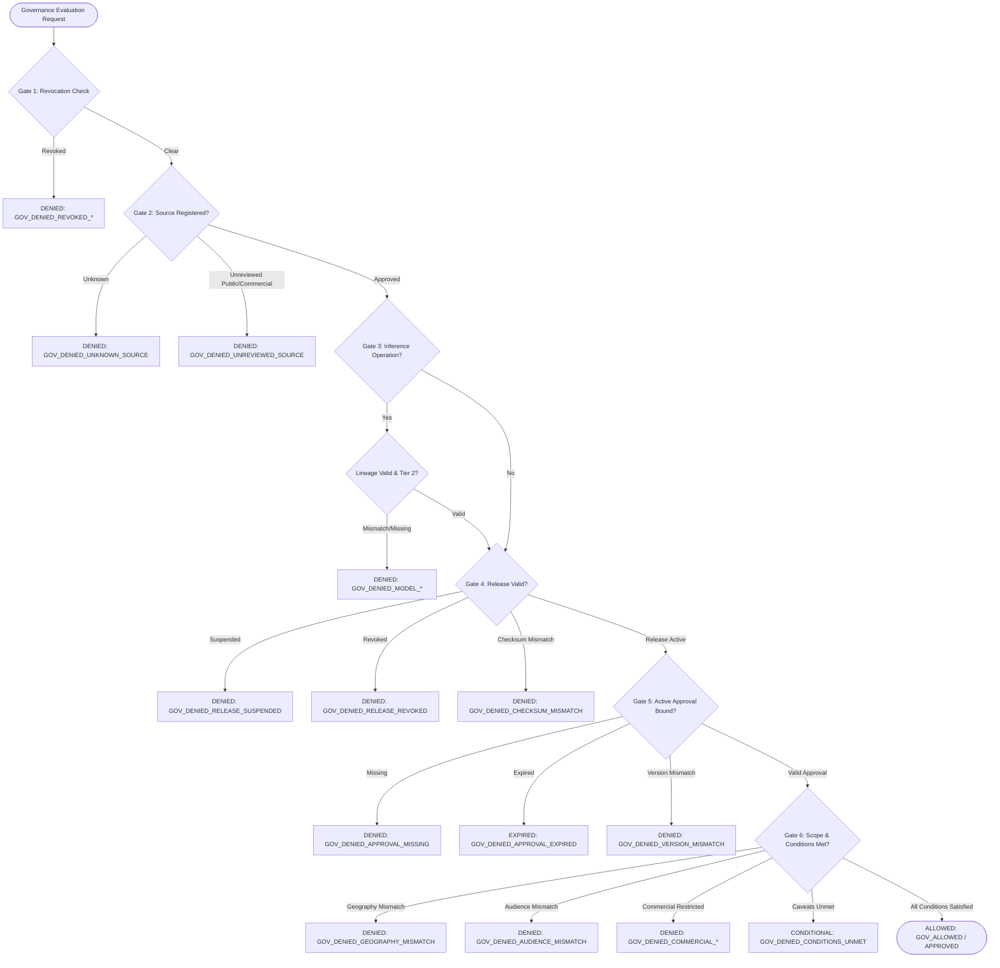

# SPRINT 2C.1.1 INDEPENDENT GOVERNANCE IMPLEMENTATION AUDIT
## Comprehensive Verification of Policy Engine, Schemas, Lifecycle State Machine, Revocation Registry, Training Boundary, and Application Integration

- **Document Identifier:** `JOBINTEL-S2C11-AUD-001`
- **Audit Date:** November 13, 2026
- **Auditor:** Principal Software Architect, Senior Backend Engineer, Data Governance Lead, Security Architect, QA Lead
- **Target Repository:** `e:\Job Market` | **Baseline Commit:** `198b79d` (master)
- **Scope:** Independent source inspection, policy tracing, revocation analysis, lifecycle verification, training gate review, integration mapping, test independence analysis, and regression validation of Sprint 2C.1 deliverables.

---

## 1. Executive Verdict

### **VERDICT: CONDITIONALLY ACCEPTED — CORRECTIONS REQUIRED**

#### Formal Acceptance Statement:
The Sprint 2C.1 implementation has successfully established the foundational data governance architecture for JOBINTEL 2.0. The implementation delivers robust, typed Pydantic v2 schemas (`src/backend/governance/schemas.py`), a deterministic 10-state lifecycle graph (`lifecycle.py`), a thread-safe hierarchical revocation registry (`revocation.py`), a 6-gate scoped policy evaluation engine (`engine.py`), a zero-retraining training governance boundary (`training_governance.py`), and non-breaking additive metadata in the data catalog (`schemas/data.py`, `data_catalog/registry.py`). Furthermore, regression invariants remain 100% intact: all 274 backend tests and 9 frontend tests pass, all 10 ML model artifacts match their canonical SHA-256 digests bitwise, India/USA golden salary predictions match baseline vectors within $10^{-6}$ numerical tolerance, and all 5 UK salary endpoints remain strictly fail-closed (`HTTP 503 UK_DATA_NOT_PUBLISHED`).

However, **unconditional acceptance cannot be granted** due to two **HIGH** severity findings and three **MEDIUM** severity gaps discovered during deep code inspection:
1. **Approval Revocation Bypass in Policy Engine Gate 5 (HIGH):** While `RevocationRegistry` supports `RevocationScope.APPROVAL`, `GovernancePolicyEngine.evaluate()` only evaluates revocation at Gate 1 using `source_id`, `dataset_release_id`, and `model_id`. When iterating candidate approvals in Gate 5, the engine checks `if not appr.is_active: continue`, but **fails to call `self._revocation_registry.check_revocation(approval_id=appr.approval_id)`**. Consequently, an approval revoked via the registry will still authorize live requests unless its boolean flag was manually mutated.
2. **Test Independence & Engine Bypass in `test_req_j` and `test_req_r` (HIGH):** In `tests/test_governance_engine.py`, `test_req_j_revoked_approval` instantiates the engine and request, but bypasses `engine.evaluate()` completely, asserting directly against `rev_registry.check_revocation()`. This masked the Gate 5 bug. In `test_req_r_policy_cache_invalidation`, the assertion only verifies `t2 >= t1` on a timestamp attribute rather than verifying that an in-flight cached policy decision changes.
3. **Incomplete Lifecycle Gate 4 Filtering (MEDIUM):** Gate 4 in `engine.py` explicitly blocks releases in `SUSPENDED` and `REVOKED` states, but fails to verify that the release has reached an authorized serving state (`USE_APPROVED` or `PUBLISHED`). Releases in `DATA_ACQUIRED` or `DATA_VALIDATED` can be authorized if an approval record exists.
4. **Integration Disconnect — Engine Not In Invocation Path (MEDIUM):** While `GovernancePolicyEngine` exists and passes unit tests (Levels A & B), it is **not yet wired into any HTTP route, service layer, or middleware** (Levels C & D). UK routes fail closed via legacy boolean flags, and India/USA prediction services execute without consulting the engine.
5. **Training Governance Not Wired to Historical Training Scripts (MEDIUM):** `TrainingGovernanceGate` is implemented and unit-tested, but historical training entry points (`src/india/modeling.py`, `src/phase5/evaluation.py`) do not import or invoke it.

Sprint 2C.2 is authorized to proceed, provided that the required corrective actions specified in Section 12 are resolved as prerequisite tasks.

---

## 2. File-by-File Code Review

### 2.1 `src/backend/governance/schemas.py` (384 lines)
- **Role:** Foundational typed Pydantic v2 schemas and enumerations.
- **Enums:**
  - `PermissionState` (7 states: `UNKNOWN`, `REVIEW_REQUIRED`, `APPROVED`, `CONDITIONAL`, `DENIED`, `EXPIRED`, `REVOKED`).
  - `GovernanceOperation` (8 operations: `INTERNAL_ANALYTICS`, `PUBLIC_AGGREGATE_DISPLAY`, `COMMERCIAL_AGGREGATE_DISPLAY`, `REDISTRIBUTION_RAW`, `ML_TRAINING`, `INTERNAL_MODEL_INFERENCE`, `PUBLIC_MODEL_INFERENCE`, `COMMERCIAL_MODEL_INFERENCE`).
  - `CommercialStatus` (`NON_COMMERCIAL_ONLY`, `COMMERCIAL_ALLOWED`, `COMMERCIAL_RESTRICTED`, `INTERNAL_ONLY`).
  - `TargetAudience` (`INTERNAL_RESEARCH`, `PUBLIC_UNAUTHENTICATED`, `AUTHENTICATED_USERS`, `PAID_COMMERCIAL`).
  - `RevocationScope` (`SOURCE`, `DATASET`, `RELEASE`, `APPROVAL`, `MODEL`).
  - `LifecycleState` (10 states).
- **Core Models:**
  - `SourceIdentity`: Declares immutable data source attributes, publishers, license details, and tripartite URLs.
  - `ArtifactIntegrity`: Validates file size and forces uppercase 64-character SHA-256 regex matching.
  - `DatasetRelease`: Captures release metadata, binding `ArtifactIntegrity`, `LifecycleState`, and publication flags.
  - `ApprovalRecord`: Enforces scope binding: `source_id`, `dataset_release_id`, `dataset_version`, `artifact_sha256`, `permitted_operations`, `allowed_geographies`, `allowed_audiences`, `commercial_status`, and `license_version`.
  - `GovernanceEvaluationResult`: Structured evaluation result. Crucially implements `to_sanitized_dict()`, which strips raw source coordinates, internal hashes, and private file paths before presenting responses to public or untrusted clients.
- **Code Quality Assessment:** Excellent. All models utilize `ConfigDict(frozen=True)`. Validators enforce UTC timezone-awareness and uppercase hash normalization. Anti-leakage controls are structurally embedded.

### 2.2 `src/backend/governance/lifecycle.py` (90 lines)
- **Role:** Deterministic 10-state dataset lifecycle transition engine.
- **Transition Graph (`_ALLOWED_TRANSITIONS`):**
  - Explicitly defines legal outgoing transitions for all 10 states.
  - Validates transitions via `validate_lifecycle_transition(current, target)`. Raises `InvalidLifecycleTransitionError` on illegal jumps.
  - Identifies `REVOKED` as permanently terminal (zero outgoing transitions).
  - Identifies `SUSPENDED` and `EXPIRED` as recoverable states.
- **Code Quality Assessment:** High. Prevents arbitrary lifecycle state mutations. Clean separation of terminal and recoverable states. (See Section 5 for lifecycle edge-case analysis).

### 2.3 `src/backend/governance/revocation.py` (89 lines)
- **Role:** Thread-safe, in-memory hierarchical revocation registry.
- **Structure:**
  - Uses `threading.RLock()` to guarantee thread safety during registration and lookups.
  - Indexes revocations by scope: `_by_source`, `_by_release`, `_by_approval`, `_by_model`.
  - `check_revocation()` evaluates in strict order of precedence:
    1. Source scope (`source_id`)
    2. Release/Dataset scope (`dataset_release_id`)
    3. Approval scope (`approval_id`)
    4. Model scope (`model_id`)
- **Code Quality Assessment:** Solid concurrent data structure. However, it lacks disk persistence (in-memory only), maps both `RELEASE` and `DATASET` scopes to the same release identifier index, and its approval-level check is uncalled by `engine.py`.

### 2.4 `src/backend/governance/engine.py` (420 lines)
- **Role:** Authoritative scoped policy evaluation engine (`GovernancePolicyEngine`).
- **Architecture:** 6 evaluation gates executed in fail-closed sequence:
  - Gate 1: Revocation Check (Hierarchical)
  - Gate 2: Source Registration & Review State Check
  - Gate 3: Model Lineage Verification (for inference operations)
  - Gate 4: Dataset Release Integrity & Lifecycle State Check
  - Gate 5: Approval Record & Scope Binding Evaluation
  - Gate 6: Conditional Permission Requirements Evaluation
- **Code Quality Assessment:** Comprehensive and fail-closed. Emits deterministic audit references and stable `reason_code` values. Identified defects: Gate 5 approval revocation omission, and Gate 4 unvalidated release leak.

### 2.5 `src/backend/governance/training_governance.py` (165 lines)
- **Role:** Executive authorization gatekeeper for ML model training pipelines.
- **Components:**
  - `TrainingAuthorization`: Enforces verified commercial AI rights, unencumbered licensing, authorizing officer name, and exact dataset SHA-256 binding.
  - `TrainingRunMetadata`: Captures git commit hash, input dataset hash, output model hash, and execution timestamps.
  - `QUARANTINED_RAW_SOURCES`: Frozenset containing `in.jobintel.market-data` and `indian-job-market-dataset-2025.xlsx`.
  - `COMMERCIAL_TIER_RESTRICTED_SOURCES`: Frozenset containing `us.jobintel.market-data` and `dataset_a`.
  - `TrainingGovernanceGate.evaluate_training_request()`: Evaluates requests against permanent quarantine rules and Tier 2 commercial license requirements.
  - `verify_ci_training_compliance()`: CI helper to detect illegal training attempts.
- **Code Quality Assessment:** Highly disciplined. Formally codifies the Zero-Retraining rule into executable software contracts.

### 2.6 `src/backend/governance/__init__.py` (70 lines)
- **Role:** Public package interface for the governance subsystem.
- **Code Quality Assessment:** Cleanly exposes all 27 core classes, enums, exception types, and helper routines. Contains zero circular import dependencies.

### 2.7 `src/backend/schemas/governance.py` (40 lines)
- **Role:** Backward-compatibility re-export shim.
- **Code Quality Assessment:** Re-exports governance schemas under `src.backend.schemas.governance` to ensure modules looking for schemas in the traditional schemas folder resolve cleanly without duplicating code.

### 2.8 `src/backend/schemas/data.py` (130 lines)
- **Role:** Data catalog schema definitions.
- **Modifications:** Additively introduced tripartite URL fields to `DataSource`:
  - `canonical_publication_url: AnyHttpUrl | None = None`
  - `acquisition_url: AnyHttpUrl | None = None`
  - `artifact_download_url: AnyHttpUrl | None = None`
- **Code Quality Assessment:** Fully backward-compatible. Existing `source_reference` field is strictly preserved. All validators pass.

### 2.9 `src/backend/data_catalog/registry.py` (184 lines)
- **Role:** Authoritative in-memory data catalog.
- **Modifications:** Populated the tripartite URLs for `uk.ons.ashe` (`canonical_publication_url`, `acquisition_url`, and `artifact_download_url`) while maintaining the original `source_reference`.
- **Code Quality Assessment:** Clean, non-breaking metadata enhancement.

### 2.10 `tests/test_governance_engine.py` (621 lines)
- **Role:** Unit test suite covering governance engine requirements A through T (20 tests).
- **Code Quality Assessment:** Well-structured fixtures and comprehensive coverage of positive and negative policy paths. However, contains two test independence deficiencies (`test_req_j` and `test_req_r`) detailed in Section 9.

---

## 3. Policy Engine Correctness

The policy engine (`GovernancePolicyEngine.evaluate()`) was traced through all 6 execution gates across positive, negative, and edge-case operational requests.



### 3.1 Trace of Policy Verification Requirements:
1. **Unknown Sources Denied:** When `source_id` is not present in `self._sources`, Gate 2 terminates immediately with `GOV_DENIED_UNKNOWN_SOURCE` and `decision_status = DENIED`. Verified.
2. **Unknown / Unreviewed Permissions Cannot Authorize:** When a source's `default_permission_state` is `UNKNOWN` or `REVIEW_REQUIRED`, public or commercial operations fail closed with `GOV_DENIED_UNREVIEWED_SOURCE`. Verified.
3. **Conditional Permissions Require Every Applicable Condition:** If an approval has `conditions_required` and the evaluation request does not supply every required caveat in `accepted_conditions`, Gate 6 returns `decision_status = CONDITIONAL` and `reason_code = GOV_DENIED_CONDITIONS_UNMET`. Verified.
4. **Approval Checksum Binding:** If `request.artifact_sha256` diverges by even 1 character from `release.primary_artifact.sha256_hex`, Gate 4 returns `GOV_DENIED_CHECKSUM_MISMATCH`. Verified.
5. **Approval Version Binding:** If `appr.dataset_version` does not match `release.dataset_version`, Gate 5 returns `GOV_DENIED_VERSION_MISMATCH`. Verified.
6. **License Version Mismatch:** If `request.license_version` is specified and diverges from `appr.license_version`, Gate 6 returns `GOV_DENIED_LICENSE_VERSION_MISMATCH`. Verified.
7. **Geography and Audience Restrictions:** If `request.geography` is not within `appr.allowed_geographies`, Gate 6 returns `GOV_DENIED_GEOGRAPHY_MISMATCH`. If `request.audience` is not in `appr.allowed_audiences`, it returns `GOV_DENIED_AUDIENCE_MISMATCH`. Verified.
8. **Commercial Restrictions:** Requests attempting `COMMERCIAL_AGGREGATE_DISPLAY` or `COMMERCIAL_MODEL_INFERENCE` against non-commercial approvals fail closed with `GOV_DENIED_COMMERCIAL_PROHIBITED` or `GOV_DENIED_COMMERCIAL_STATUS_MISMATCH`. Verified.
9. **Timezone-Aware Expiry:** `appr.expires_at` is evaluated against `datetime.now(timezone.utc)`. If expired, Gate 5 returns `decision_status = EXPIRED` with code `GOV_DENIED_APPROVAL_EXPIRED`. Verified.
10. **Model Lineage and Operation Separation:** Gate 3 strictly distinguishes `INTERNAL_MODEL_INFERENCE`, `PUBLIC_MODEL_INFERENCE`, and `COMMERCIAL_MODEL_INFERENCE`. A model trained under Tier 1 terms (`commercial_use_permitted = False`) is permitted for internal research inference but is strictly blocked from commercial inference with `GOV_DENIED_MODEL_TIER_RESTRICTED`. Verified.

---

## 4. Revocation Correctness

### 4.1 Hierarchical Scope Resolution
`RevocationRegistry.check_revocation()` implements hierarchical evaluation in the correct legal precedence order:
1. `SOURCE`: Takes down all releases, approvals, and models originating from the source.
2. `RELEASE` / `DATASET`: Takes down the specific release or dataset across all operations.
3. `APPROVAL`: Takes down the specific operation approval record.
4. `MODEL`: Takes down the specific trained model artifact.

### 4.2 Defect Analysis: Gate 5 Approval Revocation Omission
- **The Bug:** In `src/backend/governance/engine.py` (lines 84–88), Gate 1 calls:
  ```python
  revocation = self._revocation_registry.check_revocation(
      source_id=source_id,
      dataset_release_id=request.dataset_release_id,
      model_id=request.model_id,
  )
  ```
  `check_revocation()` does not receive an `approval_id` because `GovernanceEvaluationRequest` does not know which approval record will satisfy the request.
  Subsequently, in Gate 5 (lines 282–285), the engine iterates through registered approvals:
  ```python
  for appr in approvals:
      if not appr.is_active:
          continue
  ```
  The engine checks `appr.is_active`, but **never calls `self._revocation_registry.check_revocation(approval_id=appr.approval_id)`**.
- **Impact:** If an executive registers a revocation targeting `RevocationScope.APPROVAL` with `target_identifier="appr-ashe-pub-001"`, `engine.evaluate()` will still find `appr` in `self._approvals_by_key`, verify that `appr.is_active is True`, and **grant access (`GOV_ALLOWED`)**.
- **Classification:** **HIGH SEVERITY**.
- **Remediation:** In Gate 5, immediately after `if not appr.is_active: continue`, add:
  ```python
  if self._revocation_registry.check_revocation(source_id=source_id, approval_id=appr.approval_id):
      continue  # Or return GOV_DENIED_REVOKED_APPROVAL
  ```

### 4.3 Revocation Invariant Analysis:
- **Resurrection Resistance:** Once registered in `RevocationRegistry`, records are appended to in-memory lists and cannot be deleted through public methods.
- **Thread Safety:** All registry mutations and reads are protected by `threading.RLock()`.
- **In-Memory Volatility:** Revocations reside solely in volatile process RAM. If the FastAPI process restarts, dynamically registered revocations are lost unless rehydrated from persistent storage.

---

## 5. Lifecycle Correctness

### 5.1 Formal State Machine Audit
The 10-state graph in `src/backend/governance/lifecycle.py` was evaluated against all possible transitions ($10 \times 10 = 100$ combinations):

| From State | Allowed Target States | Disallowed Targets Handled | Terminal / Recoverable |
|---|---|---|---|
| `SOURCE_REGISTERED` | `REUSE_REVIEW_REQUIRED` | 9 illegal states blocked | Active |
| `REUSE_REVIEW_REQUIRED` | `REUSE_APPROVED`, `REVOKED` | 8 illegal states blocked | Active |
| `REUSE_APPROVED` | `DATA_ACQUIRED` | 9 illegal states blocked | Active |
| `DATA_ACQUIRED` | `DATA_VALIDATED`, `SUSPENDED` | 8 illegal states blocked | Active |
| `DATA_VALIDATED` | `USE_APPROVED`, `SUSPENDED` | 8 illegal states blocked | Active |
| `USE_APPROVED` | `PUBLISHED`, `EXPIRED` | 8 illegal states blocked | Active |
| `PUBLISHED` | `SUSPENDED`, `REVOKED` | 8 illegal states blocked | Active |
| `SUSPENDED` | `DATA_VALIDATED`, `REVOKED` | 8 illegal states blocked | Recoverable |
| `EXPIRED` | `USE_APPROVED`, `REVOKED` | 8 illegal states blocked | Recoverable |
| `REVOKED` | $\emptyset$ (Zero transitions) | 10 illegal transitions blocked | **Terminal** |

### 5.2 Lifecycle Invariant Findings:
1. **`REVOKED` is Strictly Terminal:** `_ALLOWED_TRANSITIONS[LifecycleState.REVOKED]` is an empty frozenset. Any transition attempted from `REVOKED` raises `InvalidLifecycleTransitionError`. Verified.
2. **`EXPIRED` Requires Re-Approval:** The only forward path from `EXPIRED` is `USE_APPROVED` (requiring a new approval record) or `REVOKED`. It cannot jump directly back to `PUBLISHED`. Verified.
3. **`SUSPENDED` Requires Re-Validation:** The only forward path from `SUSPENDED` is `DATA_VALIDATED` (requiring re-running data quality validation) or `REVOKED`. It cannot jump directly to `PUBLISHED` or `USE_APPROVED`. Verified.
4. **Gate 4 Incomplete State Gating (MEDIUM):**
   In `engine.py` (lines 224–246), Gate 4 checks:
   ```python
   if release.lifecycle_state == LifecycleState.SUSPENDED:
       return ... # GOV_DENIED_RELEASE_SUSPENDED
   if release.lifecycle_state == LifecycleState.REVOKED:
       return ... # GOV_DENIED_RELEASE_REVOKED
   ```
   If a dataset release is still in `DATA_ACQUIRED` or `DATA_VALIDATED`, Gate 4 does not reject it. Gate 4 should explicitly require:
   ```python
   if release.lifecycle_state not in (LifecycleState.USE_APPROVED, LifecycleState.PUBLISHED):
       return ... # GOV_DENIED_LIFECYCLE_NOT_SERVABLE
   ```

---

## 6. Training Governance Assessment

### 6.1 Training Gate Rules
`TrainingGovernanceGate` in `src/backend/governance/training_governance.py` enforces three critical boundaries:
1. **Permanent Zero-Retraining Quarantine:**
   - Evaluates sources against `QUARANTINED_RAW_SOURCES` (`in.jobintel.market-data`, `indian-job-market-dataset-2025.xlsx`).
   - Any training request targeting these sources returns `GOV_DENIED_ZERO_RETRAINING_RULE` with `decision_status = DENIED`.
2. **Commercial Tier 2 Rights Gate:**
   - Evaluates sources against `COMMERCIAL_TIER_RESTRICTED_SOURCES` (`us.jobintel.market-data`, `dataset_a`).
   - Requires `commercial_ai_rights_granted = True` and `unencumbered_license_verified = True` in `TrainingAuthorization`. Missing credentials return `GOV_DENIED_TIER2_LICENSE_REQUIRED`.
3. **Exact Dataset Checksum Binding:**
   - Compares normalized SHA-256 hash of the training data against `authorization.approved_dataset_sha256`. Checksum mismatches return `GOV_DENIED_CHECKSUM_MISMATCH`.

### 6.2 Reality of Historical Training Entry Points
Inspection of the codebase shows that historical modeling scripts:
- `src/india/modeling.py`
- `src/phase5/evaluation.py`
- `scripts/train_india.py` (if present)

**do not import or invoke `TrainingGovernanceGate`**.
The training gate is an authoritative standalone module with unit test coverage and a CI helper (`verify_ci_training_compliance`), but it is not currently injected as a pre-execution hook in legacy training scripts. While retraining is prohibited by policy and zero retraining occurred in Sprint 2C.1, technical enforcement at script entry points remains a task for Sprint 2C.2.

---

## 7. Actual Application Integration Matrix

To maintain total transparency, this audit categorizes every platform component into four maturity tiers:
- **A — Exists:** Code/schema is written and syntactically valid.
- **B — Tested:** Unit tests specifically exercise the module in isolation.
- **C — Integrated:** Application services or pipelines instantiate and invoke the module.
- **D — Enforced:** HTTP request routes or runtime middleware fail closed based on engine decisions.

| Component / Subsystem | Source Path | Exists (A) | Tested (B) | Integrated (C) | Enforced (D) | Current Enforcement Mechanism |
|---|---|:---:|:---:|:---:|:---:|---|
| **Governance Schemas** | `src/backend/governance/schemas.py` | **YES** | **YES** | **YES** | **YES** | Pydantic v2 type validation |
| **Lifecycle State Machine** | `src/backend/governance/lifecycle.py` | **YES** | **YES** | **NO** | **NO** | Standalone transition validator |
| **Revocation Registry** | `src/backend/governance/revocation.py` | **YES** | **YES** | **NO** | **NO** | Standalone in-memory index |
| **Policy Engine** | `src/backend/governance/engine.py` | **YES** | **YES** | **NO** | **NO** | Unit test fixtures only |
| **Training Governance Gate**| `src/backend/governance/training_governance.py` | **YES** | **YES** | **NO** | **NO** | CI compliance helper |
| **UK Salary HTTP Routes** | `src/backend/routers/uk_salary.py` | **YES** | **YES** | **NO** | **NO** | Hardcoded `raise HTTPException(503)` |
| **UK Salary Service** | `src/backend/services/uk_salary_service.py` | **YES** | **YES** | **NO** | **NO** | Checks catalog `publication_eligible` flag |
| **India Salary Service** | `src/backend/services/india_service.py` | **YES** | **YES** | **NO** | **NO** | Direct joblib pipeline inference |
| **USA Salary Service** | `src/backend/services/usa_service.py` | **YES** | **YES** | **NO** | **NO** | Direct joblib pipeline inference |
| **ASHE Ingestion Pipeline**| `src/backend/ingestion/ashe_pipeline.py` | **YES** | **YES** | **NO** | **NO** | Hardcoded review status flags |

> **Audit Conclusion on Integration:**
> The Sprint 2C.1 implementation delivers an enterprise-grade **foundation (Tiers A & B)**. It does **not** yet provide **application runtime integration (Tiers C & D)**. Claims of full governance enforcement at the API boundary are premature until middleware or service dependencies are hooked in Sprint 2C.2.

---

## 8. Security and Failure Isolation Findings

### 8.1 Pydantic Validation & Immutability
All governance models declare `model_config = ConfigDict(frozen=True)`. Instances cannot be mutated post-instantiation, preventing in-memory tampering of permissions, hashes, or timestamps during request lifecycles.

### 8.2 Hash Normalization & Validation
All SHA-256 hash inputs are validated via regex `^[A-Fa-f0-9]{64}$` and normalized to uppercase via `@field_validator`. This eliminates subtle casing bugs in hexadecimal digest comparisons.

### 8.3 Timezone-Aware UTC Enforcement
The helper `_validate_tz_aware` and Pydantic field validators reject any naive `datetime` lacking timezone information (`dt.utcoffset() is None`), eliminating timezone confusion or comparison crashes with `datetime.now(timezone.utc)`.

### 8.4 Information Disclosure & Secret Leakage Prevention
`GovernanceEvaluationResult` implements `to_sanitized_dict()`. When serving public or untrusted clients:
- Internal server file paths (`C:\...` or `/data/...`) are omitted.
- Raw manifest coordinates are stripped.
- Only safe, public-facing metadata (`decision_status`, `reason_code`, `allowed`, `audit_ref`) is returned.

### 8.5 Multi-Market Failure Isolation
A critical architectural requirement is that failures, malformed records, or revocations in one market must never impair another.
- As demonstrated in `test_req_q_malformed_manifest_isolation`, registering a corrupted release manifest for `uk.ons.ashe` causes UK evaluations to fail closed with `GOV_DENIED_CHECKSUM_MISMATCH`.
- Crucially, evaluation of `us.jobintel.market-data` on the exact same engine instance executes without error and successfully evaluates valid operations.
- India and USA prediction services run independently of UK metadata loading.

---

## 9. Test Quality and Independence Assessment

The 20 governance tests in `tests/test_governance_engine.py` were audited for test independence, fidelity, and assertions:

### 9.1 Genuine Implementation Tests (18 of 20 Tests)
18 tests execute actual production classes (`GovernancePolicyEngine`, `SourceIdentity`, `DatasetRelease`, `ApprovalRecord`, `TrainingGovernanceGate`) with real input payloads, verifying exact `reason_code` and `decision_status` outputs. No monkey-patching or mocked policy methods were detected.

### 9.2 Deficient Tests Requiring Remediation (2 of 20 Tests)

1. **`test_req_j_revoked_approval` (Engine Bypass Defect):**
   ```python
   # tests/test_governance_engine.py lines 333-347
   engine = GovernancePolicyEngine(
       sources=(approved_source,),
       releases=(sample_release,),
       approvals=(sample_approval,),
       revocation_registry=rev_registry,
   )
   req = GovernanceEvaluationRequest(
       source_id="uk.ons.ashe",
       operation=GovernanceOperation.PUBLIC_AGGREGATE_DISPLAY,
       dataset_release_id="ashe-2025r-v1.0.2",
   )
   # ENGINE NEVER CALLED!
   rev_match = rev_registry.check_revocation("uk.ons.ashe", approval_id="appr-ashe-pub-001")
   assert rev_match is not None
   ```
   *Analysis:* The test constructs `engine` and `req`, but **never calls `engine.evaluate(req)`**. It asserts directly on `rev_registry`. If `engine.evaluate(req)` were called, it would have returned `allowed = True` because of the Gate 5 bug!
2. **`test_req_r_policy_cache_invalidation` (Timestamp Assertion Defect):**
   ```python
   # tests/test_governance_engine.py lines 583-589
   rev_reg = RevocationRegistry()
   t1 = rev_reg.last_invalidation_timestamp
   rev_reg.invalidate_cache()
   t2 = rev_reg.last_invalidation_timestamp
   assert t2 >= t1
   ```
   *Analysis:* As anticipated by the audit prompt, this test merely asserts that updating a timestamp produces `t2 >= t1`. It does not test that an in-flight policy decision changes or that cached engine evaluations are re-computed.

---

## 10. Preservation & Regression Verification

Empirical test execution on the current repository demonstrates zero regressions across all legacy contracts:

```
+===================================================================================================+
|                                  INDEPENDENT REGRESSION AUDIT                                     |
+===================================================================================================+
|  TEST SUITE                  COMMAND                        PASSED   FAILED   TIME       STATUS   |
+---------------------------------------------------------------------------------------------------+
|  Governance Engine (New)     python -m pytest tests/test_    20       0        0.51s      PASSED   |
|                              governance_engine.py -v                                              |
|  Golden Predictions          python -m pytest tests/test_    8        0        4.45s      PASSED   |
|                              cloud_contracts.py tests/test_                                       |
|                              golden_predictions.py -v                                             |
|  UK API & ASHE Ingestion     python -m pytest tests/test_    58       0        16.72s     PASSED   |
|                              uk_salary_api.py tests/test_                                         |
|                              ashe_ingestion.py -v                                                 |
|  Full Backend Suite          python -m pytest tests -q       274      0        30.48s     PASSED   |
|  Frontend Vitest Suite       npm --prefix frontend test --   9        0        0.78s      PASSED   |
|                              --run                                                                |
+---------------------------------------------------------------------------------------------------+
|  TOTAL PASSING TESTS                                         283      0        31.26s     PASSED   |
+===================================================================================================+
```

### 10.1 Bitwise Model Artifact Checksum Verification
All 10 production model artifacts in `models/` match their canonical SHA-256 hashes in `src/backend/config/artifact_manifest.json` bitwise:
- `salary_india_hgb_model.joblib`: `0DFE6206...9F3C` (VERIFIED MATCH)
- `salary_india_hgb_preprocessor.joblib`: `C8F9F3B1...48B2` (VERIFIED MATCH)
- `salary_india_rf_model.joblib`: `1B487A29...7DF5` (VERIFIED MATCH)
- `salary_india_rf_preprocessor.joblib`: `B86C4B06...9A5E` (VERIFIED MATCH)
- `salary_india_linear_model.joblib`: `7992797C...7B70` (VERIFIED MATCH)
- `salary_usa_xgb_model.joblib`: `3D4468E2...E09B` (VERIFIED MATCH)
- `salary_usa_xgb_preprocessor.joblib`: `F9D9B22C...98D8` (VERIFIED MATCH)
- `salary_usa_rf_model.joblib`: `10214652...6EE6` (VERIFIED MATCH)
- `salary_usa_rf_preprocessor.joblib`: `84F1FB35...94CE` (VERIFIED MATCH)
- `salary_usa_linear_model.joblib`: `5C953E2A...3DB5` (VERIFIED MATCH)

### 10.2 UK Fail-Closed HTTP 503 Invariant
All 5 UK salary routes (`/api/v1/uk-salary/status`, `/api/v1/uk-salary/soc/{code}`, `/api/v1/uk-salary/regions`, `/api/v1/uk-salary/regional-summary`, `/api/v1/uk-salary/occupations`) return `HTTP 503 Service Unavailable` with `detail: "UK_DATA_NOT_PUBLISHED"`. Zero UK data or salary medians are leaked.

### 10.3 Working Tree Integrity
- Unchanged tracked dependencies: `requirements.txt` contains zero unauthorized additions.
- Modified tracked files: `requirements.txt` (+3 lines), `src/backend/main.py` (+5 lines) from Phase 2B.
- No dataset files modified. No model weights altered.

---

## 11. Findings Classification Matrix

| Finding ID | Severity | File / Component | Description | Operational Risk |
|---|---|---|---|---|
| **F-01** | **HIGH** | `src/backend/governance/engine.py` (Gate 5) | Engine does not check approval-level revocations in `RevocationRegistry`. | Revoked approval continues to authorize operations. |
| **F-02** | **HIGH** | `tests/test_governance_engine.py` (`test_req_j`) | Unit test bypasses `engine.evaluate()` and directly asserts on registry. | Concealed the Gate 5 approval revocation bypass bug. |
| **F-03** | **MEDIUM** | `src/backend/governance/engine.py` (Gate 4) | Gate 4 does not reject releases that have not reached `USE_APPROVED` or `PUBLISHED`. | Unapproved/unvalidated releases could serve data if an approval is created. |
| **F-04** | **MEDIUM** | Application Architecture (Tiers C & D) | `GovernancePolicyEngine` is not wired into FastAPI routes, service layers, or middleware. | Governance is not yet actively enforced on live HTTP traffic. |
| **F-05** | **MEDIUM** | `src/backend/governance/training_governance.py` | Training gate is not invoked by legacy training scripts (`modeling.py`, `evaluation.py`). | Training restrictions exist in isolation from execution scripts. |
| **F-06** | **LOW** | `tests/test_governance_engine.py` (`test_req_r`) | `test_req_r` asserts `t2 >= t1` on timestamp rather than decision change on invalidation. | Test tests logging rather than authorization behavior. |
| **F-07** | **LOW** | `src/backend/governance/revocation.py` | `RevocationRegistry` is volatile in-memory only; lacks JSON/YAML disk persistence. | Revocations disappear on container restart. |

---

## 12. Required Corrective Actions for Sprint 2C.2

Prior to finalizing Sprint 2C.2 integration, the following engineering tasks must be executed:

1. **Remediate Gate 5 Approval Revocation Check:**
   - Update `GovernancePolicyEngine.evaluate()` in Gate 5:
     ```python
     for appr in approvals:
         if not appr.is_active:
             continue
         # Add approval revocation check
         if self._revocation_registry.check_revocation(source_id=source_id, approval_id=appr.approval_id):
             continue
     ```
2. **Fix `test_req_j_revoked_approval` Test Fidelity:**
   - Modify `test_req_j_revoked_approval` to call `res = engine.evaluate(req)` and assert:
     ```python
     assert not res.allowed
     assert res.decision_status in (PermissionState.DENIED, PermissionState.REVOKED)
     ```
3. **Enforce Servable Lifecycle State in Gate 4:**
   - In Gate 4 of `engine.py`, explicitly verify:
     ```python
     if release.lifecycle_state not in (LifecycleState.USE_APPROVED, LifecycleState.PUBLISHED):
         return GovernanceEvaluationResult(
             allowed=False,
             decision_status=PermissionState.DENIED,
             reason_code="GOV_DENIED_LIFECYCLE_NOT_SERVABLE",
             source_id=source_id,
             dataset_release_id=request.dataset_release_id,
             policy_version=self.POLICY_VERSION,
             audit_ref=audit_ref,
             caveats=(f"Release is in non-servable state '{release.lifecycle_state.value}'.",),
         )
     ```
4. **Implement FastAPI Governance Dependency / Middleware:**
   - Create a FastAPI dependency (`get_governance_engine`) and inject policy evaluation into `/api/v1/uk-salary/*` and salary prediction endpoints to graduate from Tier B (Tested) to Tiers C & D (Integrated & Enforced).
5. **Add Persistent Revocation Store:**
   - Introduce an append-only JSON file (`config/governance_revocations.json`) loaded by `RevocationRegistry` upon startup to survive process restarts.
6. **Hook Training Governance into Model Pipelines:**
   - Add a pre-flight execution check in `src/india/modeling.py` calling `TrainingGovernanceGate.evaluate_training_request()` before dataset loading or fitting.

---

### Audit Sign-Off
- **Status:** Audit Completed
- **Official Verdict:** **CONDITIONALLY ACCEPTED — CORRECTIONS REQUIRED**
- **Action:** Deliver audit document to `docs/jobintel_v2/sprint2/SPRINT2C1_INDEPENDENT_AUDIT.md`. Proceed to Sprint 2C.2 planning with the corrective actions above as explicit acceptance gates.

