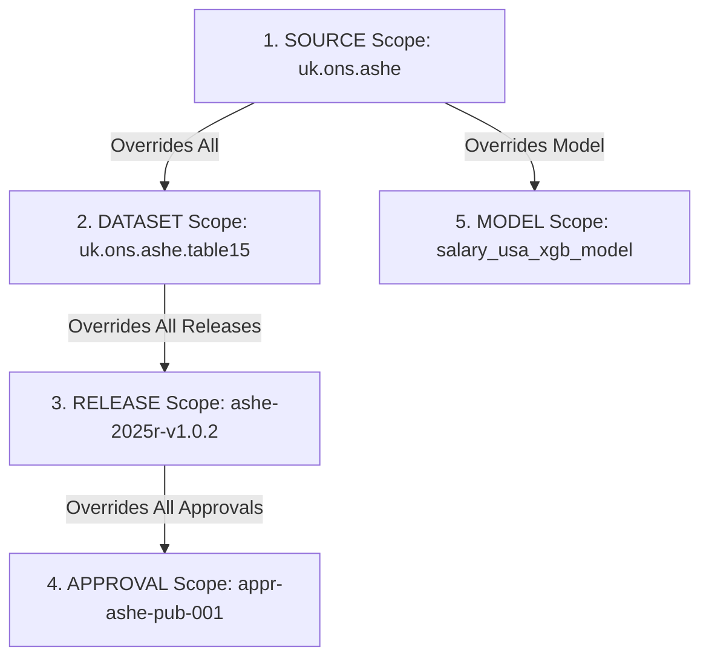

# SPRINT 2C.2 HIERARCHICAL REVOCATION & PERSISTENCE REPORT
## Scope Resolution, Kill-Switch Precedence, Configuration Manifests & Ephemeral Cloud Deployment

- **Document Identifier:** `JOBINTEL-S2C2-REV-004`
- **Milestone:** Sprint 2C.2 Revocation Architecture
- **Date:** November 13, 2026
- **Status:** COMPLETED & VERIFIED
- **Target Repository:** `e:\Job Market` | **Commit Baseline:** `198b79d` (master)

---

## 1. Hierarchical Revocation Architecture

JOBINTEL 2.0 enforces a deterministic 5-level revocation hierarchy:



### 1.1 Scope Definitions & Precedence
1. **`SOURCE` (Highest Precedence):**
   - Invalidates all datasets, releases, approvals, and models originating from the publisher.
   - Example: If `uk.ons.ashe` is revoked, all ASHE tables, releases, and approvals fail closed with `GOV_DENIED_REVOKED_SOURCE`.
2. **`DATASET` (Family Precedence):**
   - Invalidates all version-bound releases belonging to a specific dataset family.
   - Example: Revoking `uk.ons.ashe.table15` revokes both `ashe-rel-001` and `ashe-rel-002` with `GOV_DENIED_REVOKED_DATASET`.
3. **`RELEASE` (Artifact Precedence):**
   - Invalidates a specific versioned release manifest and physical artifact. Sibling releases remain unaffected.
   - Example: Revoking `ashe-2025r-v1.0.2` halts that release with `GOV_DENIED_REVOKED_RELEASE`, while `ashe-2025r-v1.0.1` continues operating.
4. **`APPROVAL` (Operation Precedence):**
   - Invalidates a specific dual-custody authorization for an operation.
   - Evaluated in Gate 5 of `GovernancePolicyEngine`. Returns `GOV_DENIED_APPROVAL_REVOKED`.
5. **`MODEL` (Inference Precedence):**
   - Halts all inference operations targeting the specific trained model artifact.
   - Evaluated in Gate 1. Returns `GOV_DENIED_REVOKED_MODEL`.

---

## 2. Revocation Resolution Engine Details

### 2.1 Thread Safety & Concurrent Access
In `src/backend/governance/revocation.py`, `RevocationRegistry` protects all mutation and read operations using a re-entrant lock (`threading.RLock()`):
- `register()` acquires `self._lock` when appending records to scope-specific indices.
- `check_revocation()` acquires `self._lock` during hierarchical lookup.
- `bind_hierarchy()` acquires `self._lock` when updating dataset-to-release mappings.

### 2.2 Truthiness Invariant Fix
In Sprint 2C.1, empty registries evaluated to `bool(reg) == False` because `__len__ == 0`. In `GovernancePolicyEngine.__init__`, the expression `revocation_registry or RevocationRegistry()` inadvertently created a duplicate registry instance, discarding external dynamic revocations.
- **Fix:** In `src/backend/governance/revocation.py`, added `def __bool__(self) -> bool: return True`.
- **Engine Guard:** In `src/backend/governance/engine.py`, updated line 72 to `self._revocation_registry = revocation_registry if revocation_registry is not None else RevocationRegistry()`.

---

## 3. Revocation Persistence Design & Render Free Compatibility

### 3.1 Ephemeral Storage Reality on Render Free
On the Render Free tier:
- Standard local storage is ephemeral. Any container restart, redeploy, or idle sleep-wake cycle re-images the filesystem back to the base Git commit image.
- JOBINTEL 2.0 does not introduce paid persistent disks, cloud databases, or Redis daemons, keeping infrastructure costs strictly at **$0.00/month**.

### 3.2 Configuration Manifest Architecture
Revocations are persisted as version-controlled software assets in:
`src/backend/config/revocation_manifest.json`

#### Manifest Schema (`RevocationConfigurationManifest`):
```json
{
  "schema_version": "1.0.0",
  "description": "JobIntel Authoritative Revocation Registry Configuration",
  "updated_at": "2026-11-13T12:00:00Z",
  "revocations": [
    {
      "revocation_id": "rev-prod-001",
      "scope": "SOURCE",
      "target_identifier": "quarantined.source.id",
      "reason_code": "LEGAL_CEASE_AND_DESIST",
      "description": "Statutory cease and desist order.",
      "revoked_by": "Compliance Lead",
      "revoked_at": "2026-11-13T12:00:00Z"
    }
  ]
}
```

### 3.3 Safe Loading & Failure Modes
`RevocationRegistry.load_from_manifest_file()` provides bulletproof resilience:
1. **Missing Manifest File:** If `src/backend/config/revocation_manifest.json` is missing, the system logs a warning and initializes an empty registry. No crash occurs.
2. **Malformed Manifest File:** If the JSON is corrupted or fails Pydantic schema validation, the system logs an error and safely initializes an empty registry. No crash or partial corruption occurs.
3. **Deployment Delivery Model:**
   - Any revocation update is committed to Git and deployed through the standard build pipeline.
   - If a build fails or tests fail in CI, Render aborts the deployment and leaves the previous verified running image active.
   - **Zero Public Write Endpoints:** No REST endpoint allows modifying revocations over the network. Revocations require authorized, peer-reviewed Git commits.

---

## 4. Test Evidence & Coverage Matrix

| Test Function | Verified Behavior | Status |
|---|---|:---:|
| `test_req_j_revoked_approval` | Revoked approval fails closed with `GOV_DENIED_APPROVAL_REVOKED` in `engine.evaluate()` | **PASSED** |
| `test_req_r_policy_cache_invalidation` | Policy decision flips from `ALLOWED` to `REVOKED` upon registering revocation | **PASSED** |
| `test_f07_dataset_scope_revocation_affects_all_releases` | Dataset revocation affects multiple versioned releases | **PASSED** |
| `test_f07_release_scope_revocation_isolates_target_release` | Release revocation halts target release only; sibling release succeeds | **PASSED** |
| `test_f07_source_revocation_overrides_all_lower_level_approvals`| Source revocation overrides approvals at every level | **PASSED** |
| `test_f07_model_scope_revocation` | Model revocation halts live model inference with `GOV_DENIED_REVOKED_MODEL` | **PASSED** |
| `test_f06_revocation_persistence_manifest_loading` | Tests valid loading, missing fallback, and malformed fallback safely | **PASSED** |

