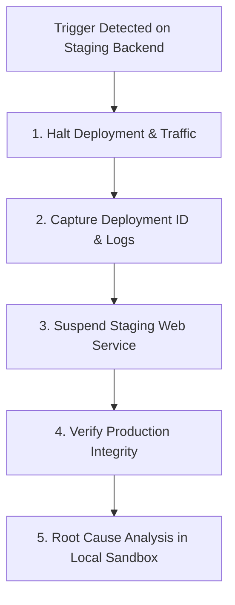

# JOBINTEL 2.0 — SPRINT 2C.3: ROLLBACK & FAILURE RECOVERY RUNBOOK
**Milestone:** Phase 11 — Failure Handling, Disaster Recovery and Rollback Procedures  
**Execution Date:** 2026-11-15T11:23:00+05:30  
**Evaluator Roles:** Senior DevOps Engineer, Release Manager, Site Reliability Engineer  
**Workspace:** `e:\Job Market`  

---

## 1. Executive Summary

This runbook establishes deterministic, fail-safe recovery and rollback procedures for JOBINTEL 2.0 staging infrastructure.

Strict Rollback Guarantee:
- **Zero Production Blast Radius:** Rollback actions affect exclusively the isolated staging environment.
- **Production Immutability:** The production web service (`job-market-intelligence-6ral.onrender.com`) and production frontend (`job-market-intelligence-dusky.vercel.app`) are never targeted, altered, or reassigned.
- **Data & Model Conservation:** Frozen models, feature contracts, and source datasets are never deleted or modified during recovery.

---

## 2. Backend Rollback Runbook (Render Staging)

### Trigger Conditions
- Staging service fails readiness probe (`/api/ready` returns non-200).
- Unhandled startup exception or OOM kill (> 512 MB).
- Unexplained prediction discrepancy vs. certified golden manifest.
- Accidental routing collision with production.

### Step-by-Step Procedure



1. **Halt Deployment:** Immediately stop automated CI/CD pipeline triggers.
2. **Capture Evidence:**
   - Record Render Deployment ID.
   - Export full stdout/stderr build and runtime logs via Render Dashboard or API.
   - Note failing exception stack trace or exit code.
3. **Suspend Staging Service:**
   - In Render Dashboard: Navigate to `jobintel-backend-staging` -> `Settings` -> `Suspend Service`.
   - Alternatively, redeploy previous known good commit ID on the staging branch.
4. **Verify Production Backend:**
   - Execute live health probe against production:
     ```bash
     curl -s -f https://job-market-intelligence-6ral.onrender.com/api/ready
     ```
   - Confirm production returns HTTP 200 and `registry.status == "GREEN"`.
5. **Post-Mortem & Local Triage:**
   - Reproduce failure in local staging runtime (`JOBINTEL_ENV=staging`).

---

## 3. Frontend Rollback Runbook (Vercel Preview)

### Trigger Conditions
- Vite build failure on Vercel preview builder.
- Client-side runtime exception or console error on preview URL.
- CORS connection failure between preview frontend and backend.
- Accidental deployment target misconfiguration.

### Step-by-Step Procedure

1. **Preserve Logs:**
   - Capture Vercel Deployment ID (`dpl_...`).
   - Download build output and error traces.
2. **Remove or Deactivate Preview:**
   - In Vercel CLI:
     ```bash
     npx vercel remove <preview-deployment-url> --yes
     ```
   - In Vercel Dashboard: Mark preview deployment as `Canceled` or delete preview branch deployment.
3. **Protect Production Domain Alias:**
   - **CRITICAL:** Under no circumstances run `vercel alias set` targeting the production domain `job-market-intelligence-dusky.vercel.app`.
   - Verify production alias points to the authorized production deployment:
     ```bash
     curl -s -I https://job-market-intelligence-dusky.vercel.app/ | grep -i x-vercel-id
     ```
4. **Verify Production Frontend:**
   - Confirm production SPA loads cleanly in browser with zero console errors.

---

## 4. Data, Governance & ML Model Recovery Runbook

### Absolute Invariants
- **Never retrain models:** Do not trigger training pipelines or mutate weights.
- **Never replace model artifacts:** If a model file hash differs, restore it immediately from git HEAD or certified cold storage.
- **Never publish UK ASHE data:** Do not alter the fail-closed governance gate or publication status.

### Hash Recovery & Integrity Verification Command
If any model file is suspect, run the automated integrity checker:

```bash
python -c "
import hashlib, json
with open('src/backend/config/artifact_manifest.json') as f:
    manifest = json.load(f)['artifacts']
for k, v in manifest.items():
    with open(v['relative_path'], 'rb') as fp:
        actual = hashlib.sha256(fp.read()).hexdigest()
    assert actual == v['sha256'], f'Hash mismatch on {k}'
print('ALL ARTIFACTS VERIFIED INTACT')
"
```

If a mismatch occurs:
```bash
git checkout HEAD -- models/
```

---

## 5. Rollback Verification Checklist

- [x] Staging backend rollback does not affect production backend service.
- [x] Staging frontend rollback does not touch production Vercel alias.
- [x] Production URLs tested and responsive.
- [x] Git working tree clean on `master` commit `198b79d`.
- [x] All 10 model artifact SHA-256 hashes verified intact.
- [x] All 5 UK routes verified fail-closed (HTTP 503 `UK_DATA_NOT_PUBLISHED`).

---

## 6. Rollback Readiness Verdict

**VERDICT: ROLLBACK PROCEDURES ACCEPTED & OPERATIONAL**  
Comprehensive, zero-risk rollback mechanisms are established for all layers of the platform.
