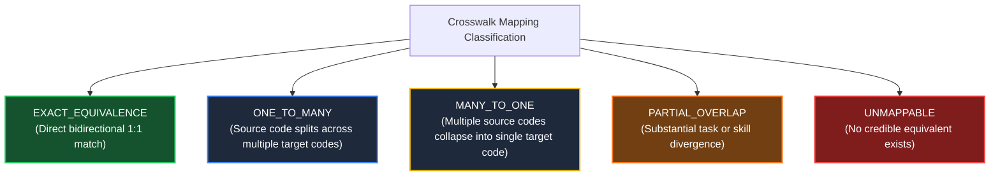

# SPRINT 2C — OCCUPATION CLASSIFICATION GOVERNANCE STANDARD
## National Taxonomies, Crosswalk Concordance, Calibrated Confidence & Graph Consistency

- **Document Identifier:** `JOBINTEL-S2C-STD-004`
- **Status:** Approved Engineering Standard (Sprint 2C.0 Consolidation)
- **Authority:** Subordinate to `SPRINT2C_GOVERNANCE_MASTER_STANDARD.md`
- **Date:** November 2026
- **Applies to:** Cross-Market Comparison Routers, Classification Registries, Taxonomy Concordance Tables

---

## 1. Preservation of Native National Classifications

Comparing labor market statistics across national borders requires strict fidelity to the originating jurisdiction's official taxonomy. JOBINTEL 2.0 strictly preserves native classifications and rejects naive relabeling or uncalibrated harmonization.

### 1.1 Target Jurisdiction Inventory

| Market | Governing Classification | Governing Authority | Grain & Coding Index | Key Distinctive Characteristics |
|---|---|---|---|---|
| **United Kingdom** | **UK SOC 2020** | Office for National Statistics (ONS) | 4-Digit Unit Groups (e.g., `2136` Software development professionals) | Modernized tech unit groups; separate cyber security and web roles. |
| **Australia** | **OSCA 2024** *(Transition from ANZSCO 2022)* | Australian Bureau of Statistics (ABS) & Jobs and Skills Australia (JSA) | 6-Digit Unit Groups (e.g., `261313` Software Engineer) | ABS deprecated ANZSCO in late 2024 in favor of OSCA 2024, explicitly adding modern tech and AI roles. |
| **Singapore** | **SSOC 2024** *(Transition from SSOC 2020)* | Singapore Department of Statistics (SingStat) & Ministry of Manpower (MOM) | 5-Digit Unit Groups (e.g., `25121` Software and Applications Developers) | SSOC 2024 introduces specific sub-codes for green economy and generative AI engineering roles. |
| **USA & India** | **JobIntel Proprietary Tech Taxonomy** | JobIntel Internal Research Sample | Categorical string titles (e.g., `"Software Engineer"`, `"Data Scientist"`) | Unstandardized industry titles derived from job boards; non-governmental. |

---

## 2. Rejection of ISCO-08 as an Automatic Universal Pivot

Previous architectural drafts suggested using the International Labour Organization's **ISCO-08** as an automatic universal pivot standard for all cross-border mappings. **This standard explicitly rejects that assumption.**

### 2.1 The Technical & Statistical Reality of ISCO-08
- **Temporal Obsolescence:** ISCO-08 was ratified in **2008**—prior to the proliferation of modern cloud computing architectures, distributed DevOps pipelines, generative AI engineering, and specialized cybersecurity disciplines.
- **Information Loss & Artificial Merging:** In ISCO-08, unit group `2512` ("Software Developers") collapses modern software engineers, mobile developers, cloud infrastructure engineers, and systems architects into a single monolithic category. Mapping UK SOC 2020 `2136` and `2135` into ISCO-08 `2512` loses essential occupational granularity.
- **Spurious Equivalence:** Forcing national standards through ISCO-08 creates the illusion of exact equivalence where none exists in reality.

### 2.2 The Versioned Concordance Standard
Instead of an automatic pivot, JOBINTEL 2.0 implements **direct, versioned, evidence-backed concordance tables**:
- Primary mappings are authored and calibrated directly between source and target taxonomies (e.g., `UK_SOC_2020` $\leftrightarrow$ `AU_OSCA_2024`).
- ISCO-08 is retained purely as a secondary descriptive reference, never as an authoritative computational bridge.

---

## 3. The 5-State Crosswalk Taxonomy

Every occupational mapping record between a source code $A$ and a target code $B$ must be classified into one of five formal mapping types:

### 3.1 Mapping Type Definitions
1. **`EXACT_EQUIVALENCE`:** The occupational duties, primary responsibilities, and skill scope are substantially identical between the two standards.
2. **`ONE_TO_MANY`:** The source classification represents a broader aggregate that splits into multiple distinct, specialized target occupations.
3. **`MANY_TO_ONE`:** Multiple specialized source occupations merge into a broader target category.
4. **`PARTIAL_OVERLAP`:** The occupations share core competencies, but primary tasks, educational requirements, or regulatory credentialing diverge.
5. **`UNMAPPABLE`:** The occupation is unique to the originating jurisdiction (e.g., localized public sector roles) with no credible foreign equivalent. Cross-market querying is strictly blocked.

---

## 4. Evidence-Backed Confidence Scoring Rules

Previous documentation assumed that a mapping labeled `EXACT_EQUIVALENCE` automatically receives a confidence score of $1.00$. **This assumption is rejected.**

### 4.1 Strict Confidence Rules:
1. **No Synthetic 1.00 Scores:** A confidence score of $1.00$ may ONLY be assigned when validated by an authoritative government concordance table (e.g., official ONS to ISCO correspondence) or proven by rigorous task-level empirical overlap.
2. **Confidence Methodology Requirement:** Every crosswalk record must specify its confidence determination method:
   - **`EXPERT_ASSESSMENT`:** Manual review by qualified labor economists/taxonomists using documented task concordance rubrics.
   - **`CALIBRATED_MODEL_SCORE`:** Algorithmic similarity score generated from verified job duty embeddings, calibrated against benchmark gold-standard mappings with documented evaluation metrics (e.g., precision/recall bounds).
3. **Approximation Disclosure Mandate:** Any comparison returning a mapping confidence score $< 0.95$ **must** trigger an approximation disclaimer in client payloads:
   > *"This international comparison relies on an approximate occupational crosswalk between UK SOC 2020 ({source_code}) and {target_standard} ({target_code}) with an evaluated confidence of {confidence_score}%. Roles may differ in duties, seniority, and credentialing."*

---

## 5. Meaningful Graph Consistency Checks

Previous proposals mandated that all crosswalk mapping graphs must be strictly **acyclic** (Directed Acyclic Graphs). This was an architectural error: in taxonomy concordance, **bidirectional equivalence naturally forms cycles** ($A \to B$ and $B \to A$). Enforcing acyclicity would make reciprocal 1:1 crosswalks impossible.

### 5.1 Meaningful Consistency Invariants Enforced in Sprint 2C:

1. **Version Isolation:** Every crosswalk record must explicitly specify the exact versions of both taxonomies (`source_version="SOC_2020"`, `target_version="OSCA_2024"`). Crosswalks must never reference unversioned generic standards.
2. **Transitivity Consistency:** If mapping $A \to B$ is evaluated as `EXACT_EQUIVALENCE` ($C \ge 0.95$) and $B \to C$ is evaluated as `EXACT_EQUIVALENCE` ($C \ge 0.95$), then a direct mapping $A \to C$ must not be marked `UNMAPPABLE` or assigned low confidence without an explicit explanatory note documenting task divergence.
3. **Bidirectional Symmetry & Asymmetry Guards:**
   - If $A \leftrightarrow B$ is `EXACT_EQUIVALENCE`, confidence scores in both directions must be equal: $C(A \to B) = C(B \to A)$.
   - If $A \to B$ is `ONE_TO_MANY`, the inverse mapping $B \to A$ must be classified as `MANY_TO_ONE`.
4. **Completeness Over Core Tech Occupations:** 100% of the core software and data occupations (UK SOC `2136`, `2135`, `2137`, `2139`, `1136`) must have verified crosswalk paths before multi-market comparison features are unlocked.

