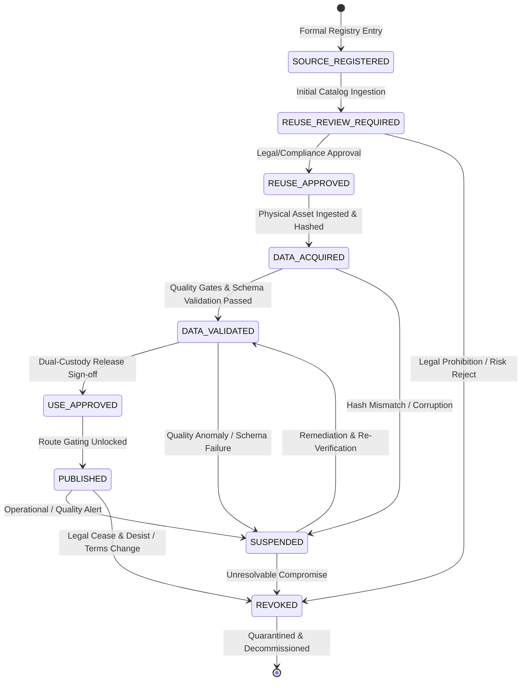

# SPRINT 2C — DATA GOVERNANCE MASTER STANDARD
## Authoritative Enterprise Governance Policy, Data Lifecycle & Regulatory Invariants

- **Document Identifier:** `JOBINTEL-S2C-STD-001`
- **Status:** Canonical Master Standard (Sprint 2C.0 Consolidation)
- **Authority:** Highest Architectural Authority for Data & Model Governance
- **Date:** November 2026
- **Applies to:** All Data Ingestion Pipelines, Model Registries, Data Catalogs, Routers, and Future Policy Engines across `e:\Job Market`

---

## 1. Scope, Purpose & Precedence

### 1.1 Purpose
This standard establishes the non-negotiable principles, operational rules, and formal lifecycles governing the acquisition, validation, storage, modeling, and distribution of data and intelligence within JOBINTEL 2.0.

### 1.2 Strict Precedence Rule
This document is the **authoritative master standard**. All companion documents—including provenance standards, permission models, crosswalk specifications, ML governance policies, employer intelligence designs, and policy engine specifications—**must conform to this standard without contradiction**. In any conflict between this document and any other architectural, design, or implementation artifact, **this document prevails**.

### 1.3 Immutable Operating Constraints
During Sprint 2C.0 and all subsequent Sprint 2C phases:
1. **Model Invariance:** Existing India and USA salary prediction models (`HistGradientBoostingRegressor`, `RandomForestRegressor`, `Ridge`, `XGBRegressor`) remain strictly frozen. No retraining, weight modification, or pipeline reconfiguration is authorized.
2. **Contract Isolation:** Existing model prediction schemas (`SalaryPredictionRequest`, `SalaryResponse` in `src/backend/schemas/salary.py`) must remain unchanged in their prediction semantics. Model contracts must NEVER be broken or altered to accommodate statistical observations.
3. **UK ASHE Fail-Closed Lock:** The UK ASHE 2025 revised dataset remains unapproved for public release. All five UK salary endpoints (`/api/v1/uk-salary/*`) must remain fail-closed, returning `HTTP 503` with code `UK_DATA_NOT_PUBLISHED`.
4. **Data Acquisition Freeze:** No new external datasets may be collected or pulled into the repository during this architectural consolidation.
5. **No Code/Deployment Mutations:** This is an architecture and documentation milestone. No application source code, API routes, dependencies, frontend components, or deployment configurations may be committed, pushed, or deployed.

---

## 2. Fundamental Governance Principles

### Principle 1: Purpose-Specific and Scope-Specific Permissions
Permission to perform one operation on a dataset **never implies permission to perform another**. A data source that is legally accessible on the public web does NOT automatically carry permission to:
- Download in bulk;
- Store locally beyond temporary cache;
- Adapt or transform;
- Compute aggregate benchmarks;
- Train or fine-tune machine learning models;
- Serve model inferences publicly;
- Display aggregate metrics on a public dashboard;
- Charge commercial fees for access;
- Redistribute raw or substantially intact records.

Every data operation must be independently authorized by an explicit, auditable permission grant.

### Principle 2: Unknown Permissions Must Fail Closed
An absent, unrecorded, or ambiguous permission state is **strictly equivalent to DENIED**. The system must never interpret an `UNKNOWN` status as permissive. All policy enforcement components must fail closed.

### Principle 3: Multi-Market Independence & Failure Isolation
Governance failures, license revocations, or metadata validation errors in one jurisdiction or source **must never compromise operational availability in unrelated markets**. Specifically, governance locks on UK ASHE data must not impact the operational availability of India or USA salary estimation endpoints.

### Principle 4: Strict Anti-Conflation Invariants
The architecture strictly forbids conflating fundamentally distinct operational and analytical concepts:
- **Public Accessibility $\ne$ Permission to Reuse or Sublicense:** The fact that a webpage, JSON endpoint, or government table is unauthenticated does not convey copyright, database rights, or terms-of-service authorization.
- **Job Postings $\ne$ Actual Hires:** Online job advertisements measure recruitment effort and marketing intent, subject to severe distortions (ghost jobs, evergreen ads, multi-posting). They do not measure finalized employment contracts, net headcount additions, or official payroll statistics.
- **Model Inferences $\ne$ Raw Data Distribution:** Serving non-invertible mathematical outputs from frozen model weights is distinct from redistributing raw tabular records, subject to specific contractual tier grants.
- **Statistical Suppressions $\ne$ Zero or Blank:** A suppressed statistical cell (e.g., ONS `x` for high sampling variability or `..` for confidentiality) conveys vital quality information. It must never be coerced to zero, blank, or an imputed value.

---

## 3. The Canonical 9-State Data Lifecycle

Every dataset in JOBINTEL 2.0 progresses through a rigorous 9-state state machine. State transitions are deterministic, audited, and reversible where required by compliance or quality events.

### 3.1 State Definitions and Transition Rules

| State | Definition | Entry Conditions | Permitted System Actions | Prohibited System Actions |
|---|---|---|---|---|
| **1. `SOURCE_REGISTERED`** | Source identity and publisher declared in catalog. | Source ID, publisher, canonical URL, and category documented. | Metadata inspection, documentation review. | Physical acquisition, file storage, network pulls. |
| **2. `REUSE_REVIEW_REQUIRED`** | Source cataloged; legal reuse terms under evaluation. | Transition from registered state; default state for unvetted sources. | Legal term analysis, license document parsing. | Production transformation, public display, ML training. |
| **3. `REUSE_APPROVED`** | Legal license terms verified and approved for defined scopes. | Compliance officer approval recorded with license version & terms. | Controlled acquisition, pipeline development in isolation. | Public serving, production deployment. |
| **4. `DATA_ACQUIRED`** | Raw asset ingested into isolated staging; SHA-256 sealed. | Raw download completed; bitwise hash matches publisher manifest. | Quarantine storage, checksum verification, member listing. | Serving to users, direct API access, unvalidated transformation. |
| **5. `DATA_VALIDATED`** | Extraction completed; schema and statistical gates passed. | All records pass type contracts; CV limits checked; zero fatal errors. | Internal analytical inspection, candidate release generation. | Public route activation, client UI rendering. |
| **6. `USE_APPROVED`** | Specific release version approved for production serving. | Dual-custody sign-off by Governance Lead & Compliance Officer. | Serving configuration generation, route unmasking. | Unrestricted raw redistribution (unless explicitly licensed). |
| **7. `PUBLISHED`** | Active in production serving layer; available to clients. | Service verifies artifact SHA-256 against approved release manifest. | Public/commercial query serving, aggregate display. | Modification of underlying data files in-place. |
| **8. `SUSPENDED`** | Serving temporarily halted due to quality anomaly or review. | Manual intervention or automated monitor detects integrity drift. | Internal diagnostic debugging, remediation. | Public route serving (fails closed with HTTP 503). |
| **9. `REVOKED`** | Permanently decommissioned due to legal demand or fatal breach. | Formal cease-and-desist, license revocation, or PII leak. | Immediate asset quarantine, deletion of raw data. | All serving, all analytical use, all model training. |

### 3.2 Blocking and Reversal Rules
1. **Automated Blocking:** If any transformation produces records violating schema constraints or statistical quality thresholds, the dataset is automatically blocked from advancing from `DATA_ACQUIRED` to `DATA_VALIDATED`.
2. **Reversibility of Publication:** A dataset in `PUBLISHED` status can be immediately transitioned to `SUSPENDED` (temporary lock) or `REVOKED` (permanent lock) via the policy engine without requiring code re-deployments.
3. **No Skip-Transitions:** A dataset cannot jump directly from `SOURCE_REGISTERED` to `PUBLISHED` or `USE_APPROVED`. Every intermediate gate must produce an immutable audit artifact.

---

## 4. Dual-Custody Approval and Cryptographic Binding

### 4.1 Dual-Custody Requirement
No dataset or derived model may enter `USE_APPROVED` or `PUBLISHED` status without formal **dual-custody approval**:
1. **Data Governance & Quality Lead:** Attests that data extraction, transformation, statistical suppression, and quality reports conform to analytical integrity standards.
2. **Compliance & Licensing Officer:** Attests that collection methods, source terms of service, intellectual property rights, and commercial usage scopes are fully compliant with governing law.

### 4.2 Exact Version-Binding
Approvals are strictly bound to an immutable tuple:
$$\text{Approval} = f(\text{SourceID}, \text{ReleaseID}, \text{ArtifactSHA256}, \text{LicenseVersion}, \text{TargetScope})$$
If the underlying data file is modified by even one byte, its SHA-256 digest changes, **instantly and automatically invalidating the approval**.

### 4.3 Honest Cryptographic Specification
- The architecture specifies that all releases and manifests must be signed using standard asymmetric cryptography (e.g., Ed25519 or ECDSA SHA-256 signatures) or authenticated via HMAC-SHA256 with secrets managed outside the codebase.
- **Governance Invariant:** No documentation or report shall claim that an artifact is "cryptographically signed" unless the public key infrastructure, key management service, and verification routine are physically implemented and executed in code. In the current baseline, artifacts are **cryptographically hashed** (SHA-256), not digitally signed.

---

## 5. Summary of Governance Invariants for Sprint 2C

1. `uk.ons.ashe` remains in `REUSE_REVIEW_REQUIRED` / `LOCAL_PREPARATION_ONLY`; endpoints fail closed with HTTP 503.
2. `us.jobintel.market-data` predictions remain classified as `RESEARCH_DERIVED_MATERIALS`; commercial monetization is blocked pending Tier 2 legal review.
3. `in.jobintel.market-data` remains under strict `ZERO_RETRAINING_GOVERNANCE_RULE`.
4. Statistical salary observations and ML model predictions maintain separate, non-overlapping API schemas.
5. All 11 registered sources in `src/backend/data_catalog/registry.py` are mapped to explicit 7-state permission matrices.

