# SPRINT 2C — ML & EMPLOYER GOVERNANCE STANDARD
## Separation of Model vs. Data Contracts, Zero-Retraining Policy & Responsible Employer Intelligence

- **Document Identifier:** `JOBINTEL-S2C-STD-005`
- **Status:** Approved Engineering Standard (Sprint 2C.0 Consolidation)
- **Authority:** Subordinate to `SPRINT2C_GOVERNANCE_MASTER_STANDARD.md`
- **Date:** November 2026
- **Applies to:** ML Serving Pipeline (`src/backend/models/`, `src/backend/services/`), Employer Registry (`src/backend/employers/`), Future Scraper Ingestion

---

# PART 1: MACHINE LEARNING MODEL GOVERNANCE & CONTRACT SEPARATION

## 1.1 Strict Separation: Model Prediction vs. Statistical Observation Contracts

In previous proposals, an architectural defect was suggested: refactoring the shared `SalaryResponse` schema in `src/backend/schemas/salary.py` to make `salary_value` nullable, in order to accommodate suppressed government statistics. **This standard explicitly forbids that refactor.**

### The Core Architectural Boundary:

```
+---------------------------------------------------------------------------------------------------+
| CONTRACT SEPARATION INVARIANT                                                                    |
+-------------------------------------------------+-------------------------------------------------+
| A. MODEL PREDICTION CONTRACTS (IN & US ML)      | B. STATISTICAL SALARY OBSERVATION CONTRACTS     |
+-------------------------------------------------+-------------------------------------------------+
| • Machine Learning regression inference outputs | • Direct observations from national statistics  |
| • Target: Point estimates & confidence intervals| • Target: Official published survey cells       |
| • Schema: src/backend/schemas/salary.py         | • Schema: src/backend/schemas/uk_salary.py      |
| • Value: Always finite, strictly positive (> 0) | • Value: Nullable (Decimal | None)              |
| • Status: Guaranteed deterministic computation  | • Status: REPORTED, SUPPRESSED_QUALITY, BLANK   |
| • Currency: Market-bound (INR, USD)             | • Currency: Source-native (GBP, AUD, SGD)       |
| • Lineage: Artifact SHA-256 & Feature Encoders  | • Lineage: Raw Workbook Cell & Sheet Coordinate |
+-------------------------------------------------+-------------------------------------------------+
```

### Mandatory Invariant:
The existing prediction response schemas (`SalaryPredictionRequest`, `SalaryResponse`, `PredictionBounds`) must **remain 100% stable and unchanged**. Model prediction endpoints MUST NEVER return null salaries. Statistical observations from official agencies (which require nullability and suppression markers) must be served through dedicated schemas (`ASHEAggregateRecord`, `UKSalaryResponse`) without polluting model contracts.

---

## 1.2 Preservation of Existing India & USA ML Model Artifacts

All 10 frozen scikit-learn and XGBoost model artifacts across India and USA are verified bitwise intact against `src/backend/config/artifact_manifest.json` and pass 100% of mathematical parity tests in `tests/test_golden_predictions.py`:

```
+---------------------------------------------------------------------------------------------------+
| VERIFIED ML ARTIFACT REGISTRY                                                                     |
+--------+---------------------------------------+-----------------------------+--------------------+
| Market | Artifact File Name                    | Model / Preprocessor Type   | Status             |
+--------+---------------------------------------+-----------------------------+--------------------+
| India  | salary_india_hgb_model.joblib         | HistGradientBoosting        | Frozen / Verified  |
| India  | salary_india_hgb_preprocessor.joblib  | ColumnTransformer Pipeline  | Frozen / Verified  |
| India  | salary_india_rf_model.joblib          | RandomForestRegressor       | Frozen / Verified  |
| India  | salary_india_rf_preprocessor.joblib   | ColumnTransformer Pipeline  | Frozen / Verified  |
| India  | salary_india_linear_model.joblib      | Ridge Regression Pipeline   | Frozen / Verified  |
| USA    | salary_usa_xgb_model.joblib           | XGBRegressor (v2.0+)        | Frozen / Verified  |
| USA    | salary_usa_xgb_preprocessor.joblib    | ColumnTransformer Pipeline  | Frozen / Verified  |
| USA    | salary_usa_rf_model.joblib            | RandomForestRegressor       | Frozen / Verified  |
| USA    | salary_usa_rf_preprocessor.joblib     | ColumnTransformer Pipeline  | Frozen / Verified  |
| USA    | salary_usa_linear_model.joblib        | Ridge Regression Pipeline   | Frozen / Verified  |
+--------+---------------------------------------+-----------------------------+--------------------+
```

---

## 1.3 Decoupling Training Rights vs. Prediction Serving Rights

Compliance governance strictly separates the legal rights governing the **input training dataset** from the legal rights governing the **compiled model weights and output predictions**:

```mermaid
flowchart LR
    subgraph DataRights ["Input Data Rights"]
        RawData["Raw Training Records\n(Dataset A / India Excel)"]
        TrainRight["Right to Ingest, Parse\n& Fit Parameters"]
    end
    subgraph ModelRights ["Model Artifact Rights"]
        Weights["Compiled Binary Weights\n(Joblib Artifacts)"]
        ServeRight["Right to Evaluate\n& Serve Inferences"]
    end
    subgraph OutputRights ["Output Prediction Rights"]
        Inference["Point Estimates / Bounds\n(JSON API Response)"]
        RedistRight["Right to Redistribute\nor Monetize SaaS"]
    end

    RawData --> TrainRight
    TrainRight --> Weights
    Weights --> ServeRight
    ServeRight --> Inference
    Inference --> RedistRight

    style RawData fill:#1e293b,stroke:#ef4444,stroke-width:2px,color:#fff
    style Weights fill:#1e293b,stroke:#3b82f6,stroke-width:2px,color:#fff
    style Inference fill:#1e293b,stroke:#22c55e,stroke-width:2px,color:#fff
```



### Analysis of Current Training Assets:

#### 1. USA DataForge Dataset A (`data/raw/dataset_A/`):
- **Contract Evidence:** `data/raw/dataset_A/LICENSE.md`.
- **Definition (Section 1.2):** Explicitly defines "Derived Materials" to include "machine-learning model weights".
- **Purchased Tier (Schedule A):** **Tier 1 (Internal Analytics) is checked (`☑`)**; **Tier 2 (AI/ML Training & Commercial Model Deployment) is unchecked (`☐`)**.
- **Governance Ruling:**
  - Serving predictions for internal analytics, evaluation, and research is legally defensible under Section 3.1.
  - Commercial monetization or public paid API distribution of predictions requires upgrading to **Tier 2** or migrating training to the public-domain **US BLS OEWS** dataset.

#### 2. India Job Market Dataset (`data/raw/india/`):
- **Contract Evidence:** No license or documentation exists.
- **Catalog Status:** Marked `UNKNOWN` in `src/backend/data_catalog/registry.py:21`.
- **Governance Ruling:** The compiled weights represent non-invertible statistical functions. Serving non-commercial predictions is permitted as research outputs, but the raw Excel dataset is permanently quarantined.

---

## 1.4 The Zero-Retraining Policy: A Governance Rule

Previous documentation inaccurately referred to the zero-retraining policy as an "implemented technical safeguard". **This standard clarifies the technical reality:**
- **The Reality:** There is currently no pre-commit hook or kernel-level sandbox preventing an engineer from executing `.fit()` on `indian-job-market-dataset-2025.xlsx`.
- **The Standard:** The Zero-Retraining Policy is a **MANDATORY GOVERNANCE RULE**. Any engineer or automated process that retrains, refits, or alters the existing India or USA models using the current raw files violates enterprise compliance policy.
- **Sprint 2C.1 Action:** Implement a physical pre-commit hook and CI pipeline gate that detects and aborts any execution of `model.fit()` or `pipeline.fit()` within the repository.

---

# PART 2: EMPLOYER INTELLIGENCE GOVERNANCE

## 2.1 The Employer Evidence Multi-Tier Model

Employer intelligence in JOBINTEL 2.0 must never be modeled as a single monolithic "company score". It must be structured into **eight distinct, verifiable evidence tiers**:

```
+---------------------------------------------------------------------------------------------------+
| THE EIGHT EMPLOYER EVIDENCE TIERS                                                                 |
+------------------------------------+--------------------------------------------------------------+
| Evidence Tier                      | Source Authority & Methodological Definition                 |
+------------------------------------+--------------------------------------------------------------+
| 1. Official Corporate Identity     | Statutory government registers (UK Companies House, ACRA).   |
| 2. Operating Presence              | Verified corporate locations, physical offices, subsidiaries.|
| 3. Job Advertisements              | Online recruitment postings (Textkernel, corporate portals). |
| 4. Observed Hiring Activity        | Aggregate vacancy velocity, duration-to-fill trends.         |
| 5. Actual Hires                    | Finalized payroll additions (Official government statistics).|
| 6. Net Headcount Changes           | Statutory annual filings, audited balance sheet reports.     |
| 7. Salary Evidence                 | Benchmark compensation disclosures (Statutory filings).      |
| 8. Skills & Qualification Demand   | Explicit technology/competency keywords extracted from ads.  |
+------------------------------------+--------------------------------------------------------------+
```

---

## 2.2 Strict Anti-Conflation: Job Postings $\ne$ Actual Hires

The platform strictly enforces methodological segregation between **recruitment advertising volume** and **actual employment levels**:

1. **Analytical Divergence:**
   - **Postings (Intent):** Reflect employer talent search, marketing effort, candidate pipeline construction, or brand visibility. Distorted by "ghost jobs" (unfilled postings), evergreen ads (year-round listings), and multi-board duplication.
   - **Hires (Reality):** Reflect actual executed employment contracts and payroll additions.
2. **Mandatory UI / API Labeling:**
   - Vacancy counts must ALWAYS be explicitly labeled as *"Online Job Advertisements"* or *"Recruitment Demand"*.
   - The platform is strictly prohibited from labeling posting counts as *"New Jobs Created"*, *"Hires"*, or *"Employment Growth"*.

---

## 2.3 Permitted vs. Prohibited Data Sources

The platform establishes strict legal and operational boundaries for employer data collection:

```
+---------------------------------------------------------------------------------------------------+
| EMPLOYER SOURCE GOVERNANCE MATRIX                                                                 |
+-------------------------------------------------+-------------------------------------------------+
| PERMITTED SOURCES (WHITELIST)                   | PROHIBITED SOURCES (BLACKLIST)                 |
+-------------------------------------------------+-------------------------------------------------+
| • Official Statutory Company Registers:         | • Gated / Authenticated Platforms:              |
|   - UK Companies House API (OGL v3.0)           |   - LinkedIn (Strict ToS prohibition; CFAA risk)|
|   - Singapore ACRA Open Data                    |   - Glassdoor (Anti-scraping terms & copyright) |
|   - US SEC EDGAR Public Filings                 |   - Indeed (Direct litigation precedent)        |
| • Corporate Career Portals (robots.txt ok)      | • Bypassing Technical Defenses:                 |
| • Licensed B2B Commercial Data Vendors          |   - Solving or bypassing CAPTCHAs               |
|                                                 |   - Rotating residential proxy botnets          |
|                                                 | • Employee / Recruiter Personal Data (PII)      |
+-------------------------------------------------+-------------------------------------------------+
```

> [!CAUTION]
> **Robots.txt & Public Registries Do Not Equal License Rights:** An unauthenticated corporate page or permissive `robots.txt` does not grant copyright or database reuse rights. Scraped postings may be used for internal keyword analysis and aggregate statistics, but raw job descriptions must never be republished or redistributed.

---

## 2.4 Privacy Safeguards & The $k \ge 5$ Screening Threshold

1. **Absolute PII Prohibition:** Under no circumstances shall JOBINTEL ingest, parse, store, or display the names, personal email addresses, phone numbers, or social media profiles of employees, recruiters, or applicants.
2. **The $k \ge 5$ Rule as a Minimum Screen:**
   - Previous proposals treated $k \ge 5$ as a "universal anonymity guarantee". **This standard clarifies that $k=5$ is merely a minimum statistical screening threshold, not a mathematical proof of differential privacy.**
   - If an employer has fewer than 5 observed postings or data points for a specific occupation-region cell, the cell must be suppressed (`SUPPRESSED_DISCLOSURE`) to prevent re-identification of individual role salaries.
   - For executive roles or small enterprises, additional manual disclosure reviews are required.

