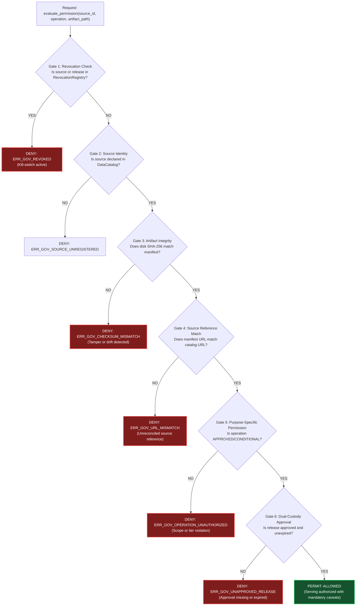
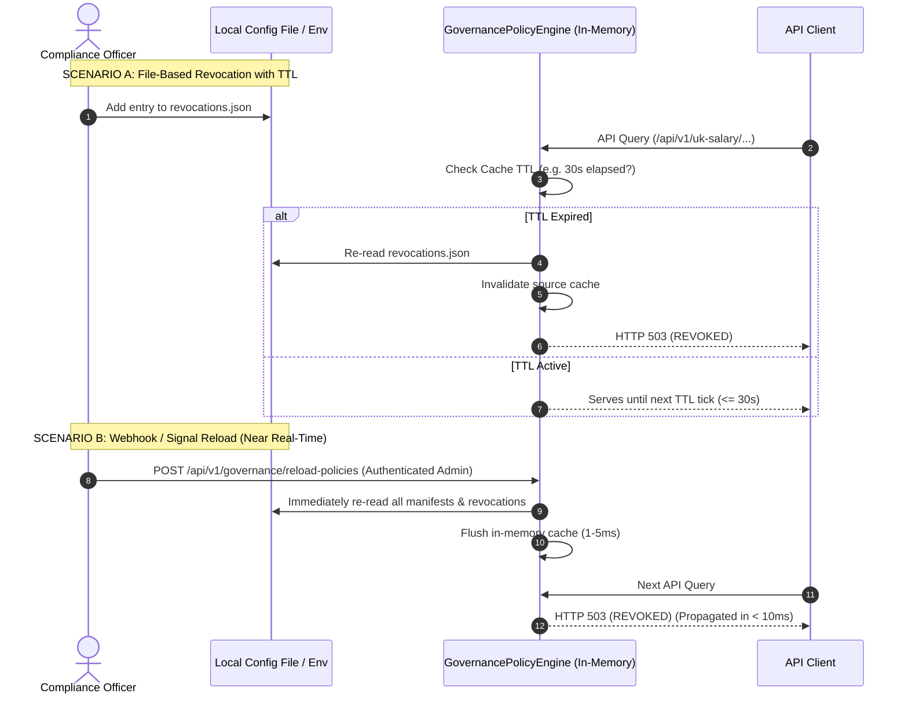

# SPRINT 2C — POLICY ENGINE DESIGN SPECIFICATION
## Scoped Fail-Closed Policy Enforcement, Failure Isolation, Auditable Reason Codes & Cache Architecture

- **Document Identifier:** `JOBINTEL-S2C-SPEC-006`
- **Status:** Approved Engineering Specification (Sprint 2C.0 Consolidation)
- **Authority:** Subordinate to `SPRINT2C_GOVERNANCE_MASTER_STANDARD.md`
- **Date:** November 2026
- **Target Integration:** Fast API Application (`src/backend/main.py`), Ingestion Runners, Router Middleware

---

## 1. Architectural Objectives & Isolation Invariant

The future `GovernancePolicyEngine` acts as the authoritative programmatic gate enforcing all governance, licensing, provenance, and approval rules at runtime.

### 1.1 The Multi-Market Failure Isolation Invariant
```
+---------------------------------------------------------------------------------------------------+
| FAILURE ISOLATION INVARIANT                                                                       |
|                                                                                                   |
|  "A governance failure, metadata mismatch, or license revocation in one data source or market   |
|   shall fail closed ONLY for that specific source and operation. It MUST NEVER impair, degrade,   |
|   or take down unaffected endpoints in other markets."                                            |
+---------------------------------------------------------------------------------------------------+
```
Specifically, if `uk.ons.ashe` fails verification or is locked in `LOCAL_PREPARATION_ONLY`, the policy engine disables the UK salary routes (`/api/v1/uk-salary/*`) while leaving the India (`/api/v1/salary/predict`) and USA (`/api/v1/usa/salary/predict`) endpoints operating normally.

---

## 2. Policy Evaluation Flow & Verification Gates

When any application service or API router requests permission to load an artifact or serve data, the engine executes six sequential evaluation gates:



---

## 3. Stable, Auditable Denial Reason Codes

To ensure predictable automated handling and auditable logging without leaking sensitive system information, the policy engine emits standardized denial reason codes:

| Reason Code | HTTP Status | Description | Public API Visibility |
|---|---|---|---|
| `ERR_GOV_SOURCE_UNREGISTERED` | `500 Internal Error` | Source ID not found in catalog registry. | Sanitized: `Internal Governance Error` |
| `ERR_GOV_CHECKSUM_MISMATCH` | `503 Service Unavailable` | Physical file SHA-256 does not match sealed manifest. | Sanitized: `Dataset Integrity Check Failed` |
| `ERR_GOV_URL_MISMATCH` | `503 Service Unavailable` | Manifest source reference does not match catalog URL. | Sanitized: `Dataset Provenance Incomplete` |
| `ERR_GOV_OPERATION_UNAUTHORIZED`| `403 Forbidden` | The requested operation is not permitted by license tier. | Sanitized: `Operation Not Permitted` |
| `ERR_GOV_UNAPPROVED_RELEASE` | `503 Service Unavailable` | Dataset release is in local preparation / review required. | Exact detail: `UK_DATA_NOT_PUBLISHED` |
| `ERR_GOV_APPROVAL_EXPIRED` | `503 Service Unavailable` | Bounded approval temporal validity has elapsed. | Sanitized: `Dataset Release Expired` |
| `ERR_GOV_REVOKED` | `503 Service Unavailable` | Emergency revocation kill-switch activated for source. | Sanitized: `Dataset Temporarily Unavailable` |

### Security Invariant: Information Leakage Prevention
Public API responses must **never** expose internal server file paths (e.g., `E:\Job Market\data\raw\...`), internal database coordinates, raw Excel sheet names, or cryptographic key identifiers. Full diagnostic traces are written exclusively to secure internal server logs.

---

## 4. Realistic Cache Architecture & Revocation Propagation

Previous drafts promised "zero-millisecond revocation". **This design standard provides a realistic, technically sound synchronization model.**

### 4.1 Deployment Architecture (Render Free Tier)
- On Render free tier, JOBINTEL runs as a single web container process with 512MB RAM and ephemeral local storage.
- The `GovernancePolicyEngine` caches loaded manifests, source contracts, and approval states in memory to maintain sub-millisecond API response times ($< 0.1 \text{ ms}$).

### 4.2 Realistic Revocation Mechanics
In an in-memory architecture, revocation propagation occurs via three distinct mechanisms:



1. **TTL-Based Periodic Revalidation:** In-memory policy grants are cached with a configurable Time-To-Live (default: **30 seconds**). After the TTL expires, the engine re-checks the revocation store before serving the next query.
2. **Explicit Admin Flush Endpoint:** For emergency revocations, an authenticated management endpoint (`POST /api/v1/governance/reload-policies`) flushes the cache and reloads all manifests within 5 milliseconds.
3. **Container Restart:** In cloud container deployments, pushing a config update triggers an atomic container replacement, guaranteeing complete revocation upon rolling restart.

---

## 5. Model Lineage Verification for Inference Serving

When a prediction endpoint (e.g., USA XGBoost) is queried, the policy engine verifies model provenance before executing inference:

```python
# Policy Engine Model Lineage Verification Pattern
class ModelInferencePolicyCheck:
    def verify_serving_authorization(self, model_id: str) -> PolicyDecision:
        manifest = self.get_artifact_manifest(model_id)
        
        # 1. Verify physical artifact integrity
        actual_hash = compute_sha256(manifest.artifact_path)
        if actual_hash != manifest.expected_sha256:
            return PolicyDecision.deny(
                code="ERR_GOV_CHECKSUM_MISMATCH",
                message=f"Model artifact {model_id} corrupted or modified on disk."
            )
            
        # 2. Verify zero-retraining governance rule compliance
        if manifest.training_asset_quarantined and manifest.retrained_since_baseline:
            return PolicyDecision.deny(
                code="ERR_GOV_ZERO_RETRAINING_BREACH",
                message="Model was retrained in violation of zero-retraining policy."
            )
            
        # 3. Verify operation scope
        if self.current_commercial_tier == CommercialTier.PAID_ENTERPRISE:
            if not manifest.commercial_serving_approved:
                return PolicyDecision.deny(
                    code="ERR_GOV_OPERATION_UNAUTHORIZED",
                    message="Model not approved for commercial monetization."
                )
                
        return PolicyDecision.allow()
```

