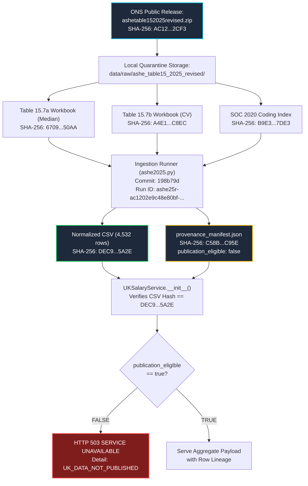

# SPRINT 2C — DATA PROVENANCE & RELEASE STANDARD
## Cryptographic Lineage, Verified Checksums, Row Attribution & Version-Bound Approvals

- **Document Identifier:** `JOBINTEL-S2C-STD-002`
- **Status:** Approved Engineering Standard (Sprint 2C.0 Consolidation)
- **Authority:** Subordinate to `SPRINT2C_GOVERNANCE_MASTER_STANDARD.md`
- **Date:** November 2026
- **Applies to:** UK Ingestion Pipeline (`src/backend/ingestion/`), Processed Datasets (`data/processed/`), Service Layer Checksum Validators

---

## 1. Verified Repository Evidence & Physical Hash Reconciliation

To eliminate ambiguity and resolve historical documentation discrepancies, all files and datasets in the repository were directly re-verified using bitwise SHA-256 analysis on November 13, 2026.

### 1.1 Physical File Hash Reconciliation

```
+-------------------------------------------------------------------------------------------------------------------------+
| ASHE 2025 REVISED TABLE 15 — PHYSICAL REPOSITORY CHECKSUM AUDIT                                                          |
+------------------------------+-------------------------------------------------------------------+----------------------+
| Artifact Description         | Relative Repository Path                                          | Verified SHA-256     |
+------------------------------+-------------------------------------------------------------------+----------------------+
| Primary Distribution Archive | data/raw/ashe_table15_2025_revised/ashetable152025revised.zip      | AC1202E9...2CF3      |
| Table 15.7a (Median Pay)     | .../extracted/Table 15 (4)/...Table 15.7a   Annual pay...xlsx     | 670924CA...50AA      |
| Table 15.7b (CV Quality)     | .../extracted/Table 15 (4)/...Table 15.7b   Annual pay...CV.xlsx  | A4E18B88...C8EC      |
| SOC 2020 Coding Index        | .../soc2020_reference/...descriptionofunitgroupsexcel20260827.xlsx| B9E3E464...7DE3      |
| Processed Dataset CSV        | data/processed/ashe_2025_revised/...full_time_annual_gross_gb.csv | DEC9D305...5A2E      |
| Provenance Manifest JSON     | data/processed/ashe_2025_revised/.../provenance_manifest.json     | C58B143B...C95E      |
| Quality Report Markdown      | data/processed/ashe_2025_revised/.../quality_report.md            | A04917EF...B0A5      |
+------------------------------+-------------------------------------------------------------------+----------------------+
```

#### Full 64-Character Hexadecimal Checksums:
1. **Archive SHA-256:**  
   `AC1202E9C48E80BF0EE4F8C35BF869ADE6A72540F88F44E1E91C0F32564B2CF3`
2. **Processed CSV SHA-256:**  
   `DEC9D305603FBF2B843D250B8CDD08317896F4331668122FBF3484AD35B15A2E`
3. **Provenance Manifest SHA-256:**  
   `C58B143BCA23849B5BCE762E42677AEE5A41FB2715A40D2054CA6059206FC95E`
4. **Estimate Workbook (Table 15.7a) SHA-256:**  
   `670924CAA882B8D2723D812F0B03B0DD4A40B145EA00F07DD3F0C9A7619250AA`
5. **CV Workbook (Table 15.7b) SHA-256:**  
   `A4E18B88E39C8F7E47EAA7DDECE24FE6F8373332D2315CA76B575F7CC7B2C8EC`
6. **SOC 2020 Reference Workbook SHA-256:**  
   `B9E3E464B877418EF1258AB4CB9E3B0FFE43EE9FD418D872068C2749B2337DE3`

> [!IMPORTANT]
> **Resolution of Historical Discrepancy:** Certain early draft documentation illustrated provenance examples using synthetic placeholder digests (e.g., `7BC6...`, `C3D8...`, `9B2F...`, `D78A...`). This standard formally supersedes those drafts. The verified digests listed above are the **sole physical ground truth** of the repository.

---

### 1.2 Verified Dataset Dimensions & Statistical Characteristics

Execution of `docs/jobintel_v2/sprint2/ashe_coverage_audit.py` and Pandas verification of the processed dataset confirm the exact statistical dimensions:

| Dimension / Metric | Verified Value | Analytical Interpretation |
|---|---|---|
| **Total Occupation-Region Cells** | **4,532** | Exactly $412 \text{ Unit Groups} \times 11 \text{ GB Work Regions}$. |
| **Unique SOC 2020 Unit Groups** | **412** | 100% exact match to official ONS SOC 2020 4-digit unit groups. |
| **Unique Geographic Regions** | **11** | East, East Midlands, London, North East, North West, Scotland, South East, South West, Wales, West Midlands, Yorkshire and The Humber. |
| **Reported Numeric Medians** | **1,339** (29.55%) | Finite positive numbers ($> 0$). Zero negative or non-finite values. |
| **Quality Suppressions (`x`)** | **2,818** (62.18%) | Suppressed by ONS due to high sampling variability ($CV > 20\%$). |
| **Blank / Undefined Cells (`""`)** | **375** (8.27%) | Empty cells in ONS source; cause undefined. |
| **Percentile Coverage (P10–P90)** | **0** numeric cells | All 4,532 rows have zero usable numeric percentile estimates in Table 15 (4). |

#### CV Quality Distribution (Among 1,339 Numeric Medians):
- **Precise ($CV \le 5\%$):** 134 cells (10.0%)
- **Reasonably Precise ($5\% < CV \le 10\%$):** 502 cells (37.5%)
- **Acceptable ($10\% < CV \le 20\%$):** 703 cells (52.5%)

> [!WARNING]
> Over 52% of all published numeric medians have a CV between 10% and 20%, representing significant sampling variance. These estimates are valid descriptive statistics of HMRC PAYE samples, but **must not be used to assert statistically significant differences between regions without formal hypothesis testing**.

---

## 2. End-to-End Cryptographic Lineage Topology

Lineage in JOBINTEL 2.0 forms an unbroken mathematical graph connecting the public government release to the client API response:



---

## 3. Row-Level Coordinate Attribution Specification

Every normalized record emitted by an ingestion runner must embed coordinates allowing immediate physical verification in the original source spreadsheets.

### Concrete Record Attribution: Software Development Professionals (SOC 2136), London
```json
{
  "observation_id": "ashe25r-ac1202e9c48e80bf-2136-london",
  "run_id": "ashe25r-ac1202e9c48e80bf-ashe-table15-2025r-v1.0.2",
  "market_id": "UK",
  "occupation_code": "2136",
  "occupation_description": "Software development professionals",
  "geography_label": "London",
  "salary_value": "57500.00",
  "original_ons_median_cell": "57500",
  "original_ons_cv": "4.2",
  "cv_quality_band": "PRECISE",
  "value_status": "REPORTED",
  "source_archive_sha256": "AC1202E9C48E80BF0EE4F8C35BF869ADE6A72540F88F44E1E91C0F32564B2CF3",
  "source_estimate_workbook": "Work Region Occupation SOC20 (4) Table 15.7a   Annual pay - Gross 2025.xlsx",
  "source_estimate_sha256": "670924CAA882B8D2723D812F0B03B0DD4A40B145EA00F07DD3F0C9A7619250AA",
  "source_cv_workbook": "Work Region Occupation SOC20 (4) Table 15.7b   Annual pay - Gross 2025 CV.xlsx",
  "source_cv_sha256": "A4E18B88E39C8F7E47EAA7DDECE24FE6F8373332D2315CA76B575F7CC7B2C8EC",
  "classification_reference_file": "soc2020volume1structureanddescriptionofunitgroupsexcel20260827.xlsx",
  "classification_reference_sha256": "B9E3E464B877418EF1258AB4CB9E3B0FFE43EE9FD418D872068C2749B2337DE3",
  "source_reference": "https://www.ons.gov.uk/employmentandlabourmarket/peopleinwork/earningsandworkinghours/datasets/regionbyoccupation4digitsoc2010ashetable15",
  "catalog_source_reference": "https://www.ons.gov.uk/employmentandlabourmarket/peopleinwork/earningsandworkinghours/datasets/regionbyoccupation4digitsocashetable15",
  "source_reference_matches_catalog": false,
  "source_attribution": "Source: Office for National Statistics licensed under the Open Government Licence v.3.0"
}
```

---

## 4. Version-Bound Approval Architecture

### 4.1 The Approval Contract
An approval is an explicit, immutable record binding an authorization to a specific physical artifact. Approvals cannot be issued globally or generically.

Every approval record must identify:
1. **`source_id`:** Canonical catalog identifier (e.g., `uk.ons.ashe`).
2. **`dataset_release_id` & `version`:** Unique release slug (e.g., `ashe-2025r-v1.0.2`).
3. **`artifact_sha256`:** Exact bitwise SHA-256 digest of the file to be served (`DEC9D305...5A2E`).
4. **`source_reference` & canonical identity:** Official publisher URL matching the catalog entry.
5. **`license_terms_version`:** Exact license governing reuse (`OGL-v3.0`).
6. **`intended_operation`:** Specific permitted use (e.g., `PUBLIC_AGGREGATE_DISPLAY`).
7. **`target_audience`:** Intended consumer group (`PUBLIC_UNAUTHENTICATED`).
8. **`commercial_status`:** Commercial exploitation tier (`NON_COMMERCIAL_RESEARCH` or `COMMERCIAL_SAAS`).
9. **`geography_scope`:** Approved jurisdictions (`GB_WORK_REGIONS`).
10. **`reference_period`:** Time window represented (`Tax year ending 5 April 2025`).
11. **`conditions_and_restrictions`:** Mandatory caveats, attribution notices, and suppression rules.
12. **`approval_evidence`:** Reference to legal review ticket or formal sign-off document.
13. **`approval_date` & `expiry_date`:** Temporal window of authorization.
14. **`revocation_status`:** Binary status flag (`ACTIVE` or `REVOKED`).

### 4.2 Deterministic Invalidation Rules
An approval is **instantly and automatically invalidated** if any bound attribute diverges:
- **Bitwise Alteration:** If the physical CSV on disk is re-saved, formatted, or modified by 1 byte, its SHA-256 hash changes, causing the service startup check to fail.
- **URL Drift:** If the publisher reference URL changes (as currently observed between `soc2010ashetable15` and `socashetable15`), approval remains invalid until the catalog and manifest are reconciled.
- **License Revision:** If the publisher updates license terms (e.g., changing from CC-BY to CC-BY-NC), any approval referencing the previous license version becomes void.

### 4.3 Cryptographic Integrity vs. Digital Signing
- **Current Technical Reality:** The repository currently utilizes **cryptographic hashing (SHA-256)** to verify file integrity and detect tampering.
- **Future Implementation (Sprint 2C.1):** True cryptographic signing requires signing the release manifest with an asymmetric private key (e.g., Ed25519) held in an external secret manager, with the public key bundled in `src/backend/config/`. Until that signing module is physically implemented and tested, documentation must honestly refer to **SHA-256 hash sealing**, not digital signatures.

