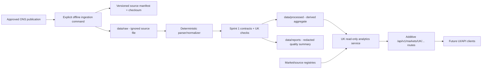

# Sprint 2 Architecture Design (Proposed)

**State:** Proposed, pending explicit approval. No Sprint 2 implementation has begun. The existing Sprint 1 architecture is the baseline.

## Objective and boundary

Deliver one UK descriptive salary/occupation vertical slice only if a specific ONS aggregate dataset and its intended use pass source review. Keep the new functionality read-only and additive. Preserve India/USA routers, service behavior, schemas, artifacts, feature dimensions, frontend workflows, and deployment configuration. There is no proposed UK prediction model, model training, or employer dataset in this sprint.

## Component view

The API process must not download, parse, or refresh source files at startup or on requests. Ingestion is a deliberate offline operation with an explicit source ID and input file. No paid service, database, scheduler, or new dependency is assumed. Raw/processed/reports paths remain ignored and local; never serialize a filesystem path into an API response.

## Reuse and module boundaries

| Responsibility | Existing / proposed location | Design |
|---|---|---|
| Market identity and capability | `src/backend/markets/registry.py` | Extend UK capability states only when each implemented service is verified. Do not mark UK analytics available based on a planned dataset. |
| Source terms and provenance | `src/backend/data_catalog/registry.py`, `src/backend/schemas/data.py` | Reuse `DataSource`, `DataProvenance`, and source IDs; preserve `REVIEW_REQUIRED` until exact-asset review. Add only missing safe metadata such as asset edition/checksum through a justified typed ingestion record. |
| Quality rules | `src/backend/data_catalog/validation.py` | Reuse structured stable issue codes and redacted rejected summaries; add UK-specific source schema/code/geography/measure rules without echoing input. |
| UK ingestion | Proposed `src/backend/ingestion/` | Offline manifest-driven command, parser adapter and deterministic transform. No import-time work or API startup coupling. |
| UK occupation registry | Proposed `src/backend/occupations/` or market service module (choose after inspecting canonical patterns) | Store source-native SOC code, hierarchy, official label, source edition, and mapping evidence. Do not infer an exact SOC from an ambiguous title. |
| UK salary analytics | Proposed `src/backend/services/uk_analytics_service.py` | Reads only validated processed data; aggregates are descriptive, native GBP and source-period/measure aware. |
| API | Extend `src/backend/routers/v1.py` or add a UK router mounted only below `/api/v1` | GET-only, typed response models; explicit unavailable/empty states; no prediction routes or mutation endpoints. |
| Frontend | Later approved change only | After backend data and HTTP contract are verified, add a UK path reusing existing components/tokens. Do not touch during Phase 0 approval gate. |

## Data flow and reproducibility

1. Human selects an approved source record and exact edition. The source remains `REVIEW_REQUIRED` until exact file conditions and attribution have been reviewed.
2. Offline ingestion checks known filename/type, computes SHA-256, and writes an immutable asset/version record. A differing file is a new version; it does not silently overwrite raw data.
3. Parser records original column names and maps selected fields to a versioned data contract. Source-native currency, period, earnings definition, occupation code, region, missingness and quality fields are retained.
4. Validation produces accepted/rejected counts, stable issue codes and aggregate coverage counts. Rejected record content and sensitive raw values never appear in logs/API/reports.
5. Deterministic transforms produce a versioned processed artifact; manifest stores checksum, source edition, parser/transform version and quality summary.
6. Service reads only validated processed artifact and returns records with source, reference period, measure, currency and limitations. No individual-level distribution is inferred from aggregated statistics.

## Free-tier/resource posture

The serving process stays compatible with Render Free: no large download or ETL during cold start, no background worker, and bounded read-only access to a preprocessed local artifact. Keep raw source files out of Git and deployment packages. ASHE’s candidate 64 MB compressed/download size warrants checking parsed memory/processed size before choosing the exact table. XLSX reader availability is unresolved because no direct `openpyxl` dependency was found; prefer a published CSV or existing declared reader, and stop for approval if a dependency is required. Labour-demand’s current 47.7 MB workbook is deferred.

## Failure and empty-state policy

- Missing source artifact: return an explicit unavailable state (planned HTTP contract to be decided) and never fabricate empty values as observations.
- Invalid or unreviewed source: ingestion is blocked; API does not publish it.
- Unknown SOC code: return not found for exact lookup and preserve source-code record in validation summary without echoing row content.
- Suppressed/not reported measures: represent explicit missingness; never impute or substitute.
- Stale/bad checksum: do not serve the artifact until integrity is restored and validation rerun.

## Compatibility guarantees

No edits to `src/backend/routers/india.py`, `usa.py`, their prediction schemas/services, `src/backend/models/`, model artifacts, feature contracts, existing frontend workflows, requirements, CI, or deployment configuration. The UK integration is additive and isolated. New `/api/v1` routes are read-only. Verification must include the existing backend CI subset and India/USA golden and HTTP checks before completion.
