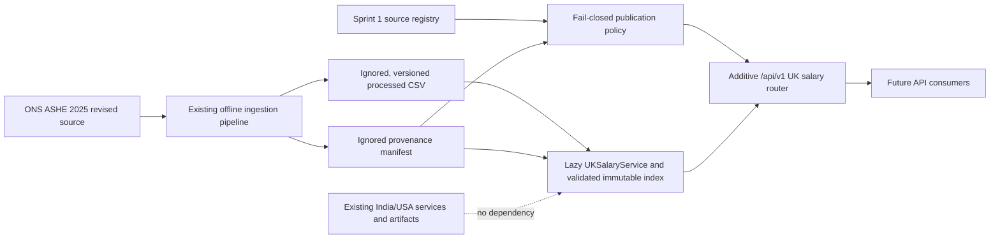

# Sprint 2 Phase 2B — UK Descriptive Salary Architecture

**Design state:** corrective lifecycle update reviewed on 2026-11-12.
**Publication:** disabled. The design does not change ASHE reuse (`REVIEW_REQUIRED`), catalog validation (`NOT_COLLECTED`), or the false manifest eligibility flag.

## Scope and component boundaries

### Existing components reused

- `src/backend/ingestion/` remains the only source-to-processed transformation path. API requests never read raw workbooks or run ingestion.
- `src/backend/data_catalog/registry.py` remains authoritative for `uk.ons.ashe`; no duplicate source registry is created.
- `src/backend/markets/registry.py` remains authoritative for product capabilities. Since publication is blocked, this phase will not mark UK public salary analytics `AVAILABLE` or prediction available.
- Existing FastAPI app, Pydantic v2, router registration pattern and 404/422 conventions are reused.

### New components

- `src/backend/services/uk_salary_service.py`: validates the local processed CSV and manifest, then builds one immutable in-process index keyed by SOC 2020 code and source work-region label. It supports exact code lookup, deterministic case-insensitive substring search across code/title/source description, region coverage and bounded pagination. It does not make HTTP calls, mutate source files, normalize occupations across classifications, rank across occupations, or calculate new salary statistics.
- `src/backend/routers/uk_salary.py`: defines additive GET-only versioned routes. Each route checks the publication dependency before obtaining the data service. No static mount or CSV download is added.
- `src/backend/schemas/uk_salary.py`: market-specific typed response and error contracts, retaining source values and statuses without forcing ASHE records into the generic India/USA salary prediction shape.
- `tests/test_uk_salary_service.py` and `tests/test_uk_salary_api.py`: deterministic synthetic fixtures; tests do not require the local raw workbooks.

## Data loading and validation

The 6,302,989-byte (about 6.0 MiB) processed CSV is small enough for a one-time lightweight in-process index, but not loaded into the model registry. The service is created lazily and cached once per process. Startup does not load or validate UK data, so a missing or corrupt UK artifact cannot prevent India/USA model startup. The first request that reaches the service validates the manifest and file, then loads rows once; later lookups use the immutable index. The publication gate runs before service construction, so while disabled, endpoints return without opening the CSV.

Validation is fail-closed:

1. Require the expected source ID, transformation version, source measure, SOC 2020, GB work-region set, source reference period and 2025 revised edition in the manifest.
2. Validate the manifest lifecycle consistently: `LOCAL_PREPARATION_ONLY` requires `publication_eligible=false`, reuse `REVIEW_REQUIRED`, and no catalog approval; `PUBLICATION_APPROVED` requires a complete approval record, reuse `APPROVED`, catalog validation `VALIDATED`, and `publication_eligible=true`.
3. Confirm archive verification, zero rejected rows, accepted row count and exact status counts are internally consistent.
4. Stream the processed file to calculate SHA-256 and compare it with the manifest before parsing it.
5. Require the full Phase 2A column contract. Parse only fields needed by this service, but reject malformed rows rather than skipping them.
6. Enforce 4,532 unique `(SOC 2020 code, GB work-region label)` rows, 412 codes, 11 regions, finite positive numeric medians with valid paired CVs at or below 20%, and distinct reported/suppressed/blank status semantics.
7. Preserve original ONS median and CV cells and source labels. Empty cells remain `BLANK_UNKNOWN`; `x` remains quality-suppressed. Neither becomes zero.

Source metadata must resolve from the existing registry. A missing registry entry is a service-unavailable error, never a reason to serve stale embedded data. The catalog's existing source URL differs from the canonical Table 15 URL in the manifest; Phase 2B documents a proposed correction but does not silently mutate the registry.

Safe service errors use stable internal codes, including manifest/catalog source-reference mismatch and approval-integrity codes, with generic messages. Logs record only an error code and event, not row contents or local absolute paths. The API maps service unavailability to HTTP 503 with a public-safe generic error.

## Publication gate

The shared dependency checks these conditions on every request that can return salary data:

- live source exists and its ID is `uk.ons.ashe`;
- live `reuse_review_status == APPROVED` and `validation_status == VALIDATED`;
- live catalog URL, geography and reference period exactly match the reviewed dataset and manifest;
- manifest is `PUBLICATION_APPROVED` with `publication_eligible is True` and coherent manifest/provenance/source-reference fields;
- approval metadata identifies the source, exact source references and matching flag, states the approved statuses and `public_salary_display` use, has an aware timestamp, and binds the processed CSV SHA-256;
- actual processed CSV bytes hash to the same approved checksum on every request.

Any lookup failure, missing manifest, unexpected value, or unavailable catalog fails closed. There is no environment variable, query parameter, header, admin route or default-open behavior. While current states remain `REVIEW_REQUIRED`, `NOT_COLLECTED` and `false`, every UK salary route returns HTTP 503 and **does not instantiate the dataset service or return observations**. The current Phase 2A manifest contract is explicitly local-only; a future source-approval/release process must produce a reviewed publishable artifact before an actual 200 response is possible.

The service's artifact validator accepts both a valid local-only manifest and a separately reviewed publication manifest. It does not authorize public access. The router separately checks the catalog's current reuse/validation statuses and the manifest approval record before constructing the service. It also compares exact source reference, catalog reference, geography and reference period; it hashes the approved CSV against both manifest and approval checksums on every request. This live check is intentionally uncached so source approval revocation or artifact replacement takes effect on the next request. `_make_context()` reports `NOT_PUBLISHED` unless the manifest and live catalog both meet those publication conditions; local-only data cannot be labelled `PUBLISHED`.

## Manifest and approval lifecycle

| Lifecycle state | `processing_mode` | Reuse status | Catalog validation | `publication_eligible` | Approval record | Public API |
|---|---|---|---|---:|---|---|
| Local preparation (current) | `LOCAL_PREPARATION_ONLY` | `REVIEW_REQUIRED` | `NOT_COLLECTED` (field may be absent in the existing Phase 2A manifest) | `false` | Absent | Denied with 503 before service load |
| Separately reviewed artifact (future) | `PUBLICATION_APPROVED` | `APPROVED` | `VALIDATED` | `true` | Required; includes approval ID, reviewer, timestamp, source ID, authorized public display use, and approved dataset SHA-256 | Available only if the live catalog states and artifact integrity also pass |

The current local Phase 2A manifest remains byte-for-byte unchanged. Its `source_reference_matches_catalog=false` is accurate: the table-data URL and live catalog URL differ. In local mode, integrity validation checks that the dataset rows and manifest record those exact two URLs consistently and that the catalog URL equals the current registry; it does not pretend the URLs match. A publication-mode artifact must instead have `source_reference_matches_catalog=true`, and the dataset, manifest, approval, and live catalog reference must be the exact same string. The false local flag can never pass publication approval validation.

Artifact validation means validating manifest shape, source/edition identity, checksum, rows, and provenance. It is not licensing permission. Reuse approval, catalog validation, manifest publication eligibility, and runtime API availability are distinct controls. A future approval record is a separate reviewed artifact, never an in-place promotion of the local-only manifest. Synthetic tests exercise that lifecycle shape but do not grant or record real ONS permission.

API tests may override the publication dependency in-process to exercise successful response serialization against synthetic data. That test-only dependency injection adds no runtime bypass and does not alter source/manifest state.

## API and service boundaries

The router will use `/api/v1/markets/UK/salary/...`, keeping the established uppercase market ID. It is mounted once under `/api`; the existing `/api/v1/markets` and `/api/v1/markets/{market_id}` paths are exact routes and do not shadow the deeper salary paths. All routes are GET-only.

The service supports occupation listing/search, one-occupation detail with all 11 region states, regional comparison for the same occupation, paginated regional occupation listing with a selectable source status, and source metadata/coverage. API methods do not calculate salary averages, new percentiles/distributions, major-group salary summaries or cross-market currency conversions.

Responses share a typed context containing market, source, exact reference period, measure/population definition, SOC version, geography coverage, transformation version and source-data validation status. A reported region cell includes the published median in GBP/year and source-published CV; suppressed/blank cells have no numeric amount and preserve their distinct state. Occupation and regional listings are sorted deterministically by four-digit SOC code. Pages are bounded to at most 100 items.

While publication is disabled, every route uses the same FastAPI-compatible `{"detail":{"code":"UK_DATA_NOT_PUBLISHED","message":"UK salary analytics are not currently published."}}` body at status 503. Invalid syntax is rejected by FastAPI with 422 before route execution. After a future approved release only, unknown valid SOC codes or source region labels use 404; data/manifest failures use safe 503 errors.

## Statistical boundaries

- A reported annual gross median is the ONS-published full-time employee-job median for the tax year ending 5 April 2025. It is not a prediction, mean, distribution or individual salary.
- CV is the source's coefficient of variation in percent; it communicates relative estimate precision and is not a confidence interval or a significance test.
- Comparisons are only between available reported observations for the same SOC 2020 occupation and the same source measure. Coverage counts always show the 11-region denominator and preserve suppression/blank counts.
- No missing-value imputation, rank-based product claims, aggregation of occupation medians, annualization, FX conversion, or UK-wide/Northern Ireland claim is allowed.

## Runtime isolation and performance verification

No UK service work is added to FastAPI lifespan or `ModelRegistry`. The CSV is hashed and parsed once on first service use after publication is permitted. The service uses standard-library CSV parsing and bounded indexed lookups; no extra dependency is needed. Verification will measure cold validation/load time, repeated lookup latency, process-memory delta, and file size on the local processed artifact. These measurements will be reported as local evidence, not as Render production measurements. Missing/corrupt UK data returns a UK-specific 503 and does not mutate or affect India/USA service state.

## Source metadata correction proposal

Do not edit the current catalog record in Phase 2B. Proposed separately reviewed metadata correction for `uk.ons.ashe`:

- canonical reference: `https://www.ons.gov.uk/employmentandlabourmarket/peopleinwork/earningsandworkinghours/datasets/regionbyoccupation4digitsoc2010ashetable15`;
- dataset description: ASHE Table 15 (4), 2025 revised; full-time annual gross median and paired CV by SOC 2020 unit group and 11 Great Britain work regions; no UK total or Northern Ireland;
- reference period: tax year ending 5 April 2025;
- reuse remains `REVIEW_REQUIRED`, catalog validation remains `NOT_COLLECTED` until approval/evidence is supplied.

The [official ONS Table 15 page](https://www.ons.gov.uk/employmentandlabourmarket/peopleinwork/earningsandworkinghours/datasets/regionbyoccupation4digitsoc2010ashetable15) identifies the dataset and lists a 2025 revised archive; it also links to the Open Government Licence v3.0 terms. The live source catalog currently contains a different URL (`...regionbyoccupation4digitsocashetable15`), which did not resolve during this audit. The catalog also describes UK-wide/2026 coverage, while this asset is Great Britain-only for 2025; its SOC 2020 classification is supported by the inspected workbook and official classification reference. These discrepancies and the intended public-display reuse approval remain unresolved. No URL, geography, period, classification, reuse or validation state was changed in code or registry.

## Design review checks

- No route overlaps an existing exact route; new paths are below the existing market resource namespace.
- API response schemas are market-specific and retain the source status/CV fields missing from generic `SalaryObservation`.
- Publication gate checks exact source identity and live approval states, re-hashes the approved asset each request, denies before service loading, and has no production bypass.
- No registry is duplicated; no UK prediction capability is enabled; AU/SG metadata remains unchanged.
- All transformations remain in Phase 2A ingestion; service and router are read-only.
