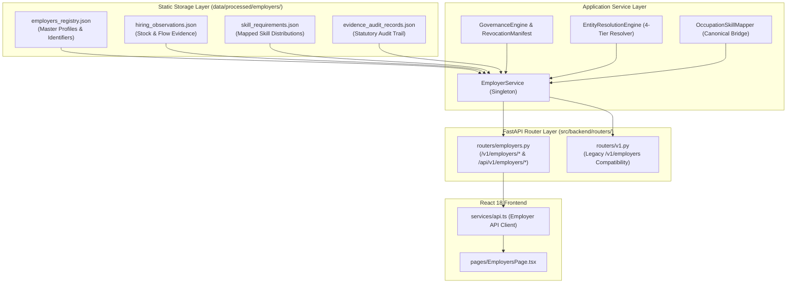

# JOBINTEL 2.0 — SPRINT 3B.3 PHASE 0
# DELIVERABLE 10: EMPLOYER INTELLIGENCE TECHNICAL ARCHITECTURE PROPOSAL
## Additive Architecture, Memory-Efficient Data Management, Governance Gates & API/Frontend Integration

**Document Version:** 1.0.0  
**Phase:** Phase 0 (Research, Data Governance & Architecture Audit)  
**Status:** Approved Architecture Proposal  
**Date:** November 2026  
**Target Baseline:** `staging/sprint2c3` (`d1a8b027d10031b3568a3141f639e2f40a49be18`)  
**Production Isolation:** `master` (`198b79dcdff08a5be5f08847c4262d31a3ce261e`)

---

## 1. EXECUTIVE ARCHITECTURAL SUMMARY & OBJECTIVES

The JOBINTEL 2.0 Global Employer Intelligence module extends the platform from aggregate occupational and salary intelligence to company-level labour demand, talent acquisition signals, skill requirements, and statutory workforce disclosures across five target markets:
1. **United States (US)**
2. **United Kingdom (UK)**
3. **Australia (AU)**
4. **Singapore (SG)**
5. **India (IN)**

### Core Architectural Directives
1. **Strictly Additive Design:** The new employer intelligence subsystem must not break, mutate, or regress existing salary estimation (`/v1/salary/*`, `/predict/*`), market exploration (`/v1/markets/*`), skill taxonomies (`/v1/skills/*`), or demand analytics (`/v1/demand/*`).
2. **Backwards Compatibility:** The existing Sprint 2C.1/2C.2 endpoints (`GET /v1/employers` and `GET /v1/employers/{company_id}`) must remain functional, with new schemas extending rather than breaking legacy response contracts.
3. **Zero Paid Cloud Infrastructure (Free-Tier Viability):** The backend must execute reliably within **Render Free tier (512 MB RAM)** and the frontend within **Vercel Hobby tier** constraints. No external managed relational databases (AWS RDS, Google Cloud SQL), Elasticsearch clusters, or paid data platforms are permitted.
4. **Governance-First Architecture:** Every company attribute, headcount figure, and hiring signal must carry complete cryptographic provenance, licensing tier tags, and dynamic publication gating integrated with the existing `src/backend/governance/` engine.

---

## 2. EXISTING ARCHITECTURAL BASELINE AUDIT

### 2.1 Backend Audit
An audit of `src/backend/` reveals an existing, well-structured foundation:
- **`src/backend/main.py`:** Central FastAPI application with dual-prefix router mounting (`/api` and `/`), CORS configuration, lifespan artifact verification, and health/readiness probes.
- **`src/backend/schemas/employer.py`:** Contains initial Pydantic v2 schemas:
  - `EmployerCategory`: `INDIAN_HEADQUARTERED`, `MULTINATIONAL_OPERATING_IN_INDIA`, `OTHER_INTERNATIONAL`.
  - `EmployerVerificationStatus`: `UNVERIFIED`, `REVIEW_REQUIRED`, `VERIFIED`.
  - `EmployerLocationType`: `HEADQUARTERS`, `OFFICE`, `RESEARCH`, `OTHER`.
  - `EmployerSourceReference`: Source name, organization, URL, timezone-aware timestamp.
  - `EmployerLocation`: City, state, country code, verification status, evidence reference.
  - `EmployerProfile`: `company_id`, `company_name`, `headquarters_country`, `company_category`, `locations`, `operating_markets`, `source_references`.
- **`src/backend/employers/registry.py`:** In-memory registry containing static profiles accessible via `get_employers()` and `get_employer(company_id)`.
- **`src/backend/routers/v1.py`:** Exposes `GET /v1/employers` and `GET /v1/employers/{company_id}`.
- **`src/backend/services/demand_service.py`:** Demonstrates a battle-tested singleton pattern (`DemandService`) managing multi-market demand profiles, cross-market comparability, skill gap analysis, and publication gating from static JSON files (`data/processed/demand/`).
- **`src/backend/governance/`:** Houses `revocation.py` (`RevocationManifest`), `lifecycle.py` (`DataLifecycleState`), and `engine.py`, which govern data validity and enforce publication gating.

### 2.2 Frontend Audit
An audit of `frontend/src/` demonstrates:
- **`frontend/src/App.tsx`:** Custom state-based router utilizing browser history (`popstate`, `pushState`), `ROUTE_MAP`, and `PAGE_TO_ROUTE`.
- **`frontend/src/components/AppHeader.tsx`:** Primary navigation supporting active page states.
- **`frontend/src/services/api.ts`:** Axios/fetch client communicating with dual-mounted `/api` and `/` endpoints, handling fallback modes and network resilience.
- **Page Architecture:** Standardized page layout utilizing `AtmosphericBackground`, `PageHero`, tabbed sub-views, interactive data tables, Recharts visualizations, `ScientificDisclaimer`, and `SourceFooter`.

---

## 3. PROPOSED ADDITIVE BACKEND ARCHITECTURE



### 3.1 Schema Evolution (`src/backend/schemas/employer.py`)
To transition from the India-centric prototype to a multi-market system without breaking backward compatibility, schemas are extended additively:

1. **`EmployerCategory` Extension:**
   Add generic global categories while preserving existing enum keys:
   ```python
   class EmployerCategory(StrEnum):
       # Existing legacy keys preserved
       INDIAN_HEADQUARTERED = "INDIAN_HEADQUARTERED"
       MULTINATIONAL_OPERATING_IN_INDIA = "MULTINATIONAL_OPERATING_IN_INDIA"
       OTHER_INTERNATIONAL = "OTHER_INTERNATIONAL"
       # Additive multi-market keys
       GLOBAL_ENTERPRISE = "GLOBAL_ENTERPRISE"
       DOMESTIC_LARGE = "DOMESTIC_LARGE"
       REGIONAL_OPERATOR = "REGIONAL_OPERATOR"
       PUBLIC_SECTOR_GOVERNMENT = "PUBLIC_SECTOR_GOVERNMENT"
   ```

2. **`EmployerRegistrationIdentifiers`:**
   ```python
   class EmployerRegistrationIdentifiers(BaseModel):
       model_config = ConfigDict(frozen=True)
       country_code: str = Field(pattern=r"^[A-Z]{2}$")
       registration_authority: str = Field(min_length=2, max_length=120)
       registration_number: str = Field(min_length=2, max_length=100)
       lei_code: str | None = Field(default=None, pattern=r"^[A-Z0-9]{20}$")
       cik: str | None = Field(default=None, pattern=r"^\d{10}$")
       cin: str | None = Field(default=None, pattern=r"^[LU]\d{5}[A-Z]{2}\d{4}[A-Z]{3}\d{6}$")
       crn: str | None = Field(default=None, pattern=r"^[0-9A-Z]{8}$")
       abn: str | None = Field(default=None, pattern=r"^\d{11}$")
       uen: str | None = Field(default=None, pattern=r"^[0-9A-Z]{9,10}$")
       verified_at: datetime | None = None
   ```

3. **`EmployerHiringObservation`:**
   ```python
   class EmployerHiringObservation(BaseModel):
       model_config = ConfigDict(frozen=True)
       observation_id: str = Field(pattern=r"^obs_[a-z0-9_-]{8,32}$")
       company_id: str = Field(min_length=2, max_length=120)
       market_id: MarketId
       evidence_category: HiringEvidenceCategory
       metric_name: str
       metric_unit: str
       observed_value: float | None = None
       value_string: str | None = None
       reference_period_start: date
       reference_period_end: date
       data_collection_method: str
       provenance: DemandProvenance
       publication_gate_active: bool = False
       gate_reason: str | None = None
   ```

4. **`EmployerSkillRequirement`:**
   ```python
   class EmployerSkillRequirement(BaseModel):
       model_config = ConfigDict(frozen=True)
       company_id: str
       market_id: MarketId
       canonical_skill_id: str
       skill_name: str
       skill_category: SkillCategory
       frequency_percent: float = Field(ge=0.0, le=100.0)
       importance_tier: str = Field(pattern=r"^(CORE|SECONDARY|EMERGING)$")
       canonical_occ_code: str | None = None
       sample_size_postings: int = Field(ge=1)
       observation_window: str
   ```

---

## 4. IN-MEMORY STORAGE STRATEGY (RENDER FREE 512MB RAM VIABILITY)

### 4.1 Memory Budgeting
Render Free instances terminate immediately upon exceeding 512 MB RAM. The existing backend baseline (FastAPI + XGBoost models + demand profiles) consumes approximately **185 MB to 220 MB RAM** at idle.

Employer intelligence data structures must strictly observe a **maximum RAM budget of 60 MB**, maintaining total backend memory consumption below **280 MB RAM** (55% of capacity).

| Subsystem Component | Estimated Entities | Serialized Disk Size | In-Memory Object Size | Budget Allocation |
| :--- | :--- | :--- | :--- | :--- |
| **Employer Core Profiles** | 2,500 companies | ~1.8 MB (JSON) | ~6.5 MB (Dict/Tuple) | 12.0 MB |
| **Hiring Observations** | 15,000 records | ~4.2 MB (JSON) | ~14.0 MB (Pydantic/Tuple) | 20.0 MB |
| **Skill Distributions** | 25,000 pairs | ~3.1 MB (JSON) | ~12.5 MB (Inverted Map) | 18.0 MB |
| **Evidence Audit Records** | 5,000 records | ~1.2 MB (JSON) | ~4.0 MB (Dict) | 6.0 MB |
| **Lookup Indices (Index Maps)** | 4 hash indices | N/A | ~3.5 MB (Sets/Dicts) | 4.0 MB |
| **Total Subsystem Footprint** | **47,500 records** | **~10.3 MB** | **~40.5 MB** | **60.0 MB** |

### 4.2 Storage & Loading Mechanism
1. **Immutable In-Memory Repository:** Data files are stored as pre-indexed, compressed JSON in `data/processed/employers/`.
2. **Singleton `EmployerService`:** Instantiated once during server startup (lifespan hook) or lazily upon first access.
3. **Internal Inverted Indices:**
   - `_by_company_id: dict[str, EmployerProfile]`
   - `_by_market: dict[MarketId, list[str]]`
   - `_by_domain: dict[str, str]` (maps root web domain to `company_id`)
   - `_by_reg_id: dict[str, str]` (maps composite `f"{authority}:{number}"` to `company_id`)
   - `_by_occupation: dict[str, list[str]]` (maps canonical occupation code to employer IDs)
4. **Zero Runtime Writes:** All analytics, deduplication, and entity resolution are executed during offline ingestion pipelines (`scripts/ingestion/build_employer_intelligence.py`). The production server operates in a strictly read-only, deterministic mode.

---

## 5. DYNAMIC PUBLICATION GATING & GOVERNANCE INTEGRATION

The employer service integrates natively with `src/backend/governance/revocation.py`.

### 5.1 Gating Rules
When an endpoint renders an employer or hiring observation:
1. **Source Status Check:** The service inspects `RevocationManifest.get_status(source_id)`.
2. **Enforcement Logic:**
   - If `status == SourceApprovalState.APPROVED`: Render record fully (`publication_gate_active = False`).
   - If `status == SourceApprovalState.REVOKED`: Completely exclude record from API responses.
   - If `status == SourceApprovalState.REVIEW_REQUIRED` or `status == SourceApprovalState.CONDITIONAL`:
     - Company identity, sector, and official registration details remain visible.
     - Specific commercial metrics or withheld observations serialize with `observed_value = null`, `publication_gate_active = True`, and an explanatory `gate_reason` (mirroring the Sprint 3B.2.3.1 UK demand remediation).
3. **No Zero Conflation:** Under no circumstances are withheld or gated observations serialized as `0.0`. Nullable fields guarantee semantic distinction between zero measured hiring and gated/withheld data.

---

## 6. REST API DESIGN & ROUTE SPECIFICATIONS

New endpoints are mounted in `src/backend/routers/employers.py` and included under both `/v1/employers` and `/api/v1/employers`.

### 6.1 Endpoint Directory
| Method | Endpoint Route | Description | Query Parameters |
| :--- | :--- | :--- | :--- |
| `GET` | `/v1/employers` | Filtered list of employers | `market_id`, `category`, `industry`, `search`, `limit`, `offset` |
| `GET` | `/v1/employers/{company_id}` | Detailed employer profile | `include_locations` (bool) |
| `GET` | `/v1/employers/{company_id}/hiring-observations` | Time-series hiring & workforce stock records | `market_id`, `evidence_category`, `from_date`, `to_date` |
| `GET` | `/v1/employers/{company_id}/skills` | Employer skill requirement profile | `market_id`, `canonical_occ_code`, `limit` |
| `GET` | `/v1/employers/{company_id}/evidence` | Audit trail and statutory evidence records | None |
| `GET` | `/v1/employers/compare` | Multi-employer comparative benchmark | `company_ids` (comma-separated, max 4), `market_id` |
| `GET` | `/v1/employers/stats/market-summary` | Aggregated employer ecosystem statistics | `market_id` |

### 6.2 Example Response Contracts

#### `GET /v1/employers/comp_us_microsoft`
```json
{
  "company_id": "comp_us_microsoft",
  "company_name": "Microsoft Corporation",
  "headquarters_country": "US",
  "company_category": "GLOBAL_ENTERPRISE",
  "industry": "Software and Technology Services",
  "official_website": "https://www.microsoft.com",
  "operating_markets": ["US", "UK", "AU", "SG", "IN"],
  "registration_identifiers": [
    {
      "country_code": "US",
      "registration_authority": "U.S. Securities and Exchange Commission",
      "registration_number": "0000789019",
      "cik": "0000789019",
      "lei_code": "INR2EJN1ERAN0W5ZP974"
    }
  ],
  "verification_status": "VERIFIED",
  "verified_at": "2026-10-15T12:00:00Z",
  "locations_count": 14,
  "headcount_disclosed": {
    "total_global_headcount": 221000,
    "us_headcount": 120000,
    "reference_date": "2026-06-30",
    "source_filing": "SEC Form 10-K (FY2026)"
  },
  "provenance_summary": {
    "official_filings_count": 3,
    "ats_vacancy_observations_count": 182,
    "last_evidence_date": "2026-10-01"
  }
}
```

---

## 7. FRONTEND INTEGRATION ARCHITECTURE

### 7.1 Router & Page Mounting (`frontend/src/App.tsx`)
1. Extend `NavigationPage` union type:
   ```typescript
   export type NavigationPage = 
     | 'home' 
     | 'calculator' 
     | 'explore' 
     | 'skills' 
     | 'archetypes' 
     | 'comparison' 
     | 'occupations' 
     | 'demand' 
     | 'employers'       // Additive
     | 'howitworks';
   ```
2. Update `ROUTE_MAP` and `PAGE_TO_ROUTE`:
   ```typescript
   ROUTE_MAP['/employers'] = 'employers';
   PAGE_TO_ROUTE['employers'] = '/employers';
   ```
3. Add navigation entry in `frontend/src/components/AppHeader.tsx`.

### 7.2 Page Layout & Component Architecture (`frontend/src/pages/EmployersPage.tsx`)
`EmployersPage.tsx` follows the established JobIntel 2.0 UX standards:
- **Hero Section:** `PageHero` with badge `"Global Employer Intelligence"`, primary title, and market selector tied to `MarketContext`.
- **Top Metrics Grid:** 4 summary cards: Active Employers Monitored, Disclosed Statutory Headcount, Tracked Active Postings, and Evidence Source Diversity.
- **Tabbed Interface (6 Workspaces):**
  1. **Tab 1: Directory & Explorer:** Searchable, filterable corporate directory with entity tags, industry chips, and verified authority badges.
  2. **Tab 2: Employer Profile & Structure:** In-depth view of selected company, corporate hierarchy (parent/subsidiary), registration IDs, and office locations.
  3. **Tab 3: Hiring & Headcount Dynamics:** Chronological charts contrasting certified statutory headcount changes against monthly recruitment posting volumes.
  4. **Tab 4: Skill & Talent Requirements:** Frequency distributions of technical, specialized, and soft skills required by the employer across occupations.
  5. **Tab 5: Multi-Employer Benchmark:** Side-by-side comparison matrix of up to 4 companies across scale, skill intensity, and market footprints.
  6. **Tab 6: Global Footprint Map:** Visual mapping of operational centers, headquarters, and tech delivery hubs.
- **Scientific & Governance Safeguards:** `ScientificDisclaimer` highlighting the statutory distinction between job advertisements and verified hires, accompanied by `SourceFooter`.

---

## 8. DEPLOYMENT & PRODUCTION ISOLATION VERIFICATION

1. **Zero Impact on Production `master`:** Development and testing remain strictly confined to feature branches and the `staging/sprint2c3` staging pipeline.
2. **Build Verification:**
   - Backend unit tests (`pytest tests/`) verify zero schema breakage on existing routers.
   - Frontend build (`npm run build`) verifies that the addition of `EmployersPage.tsx` and type definitions causes zero TypeScript errors and maintains bundle chunk sizes within Vercel thresholds.
3. **No Unapproved Infrastructure:** No Redis, no PostgreSQL, no Elasticsearch, no AWS DynamoDB. Pure static JSON/Parquet loaded via standard library `json` and Python data structures ensures zero cloud operational cost.

---

## 9. CONCLUSION & ARCHITECTURAL READINESS

The proposed technical architecture satisfies all Sprint 3B.3 requirements:
- Strictly additive to the existing JobIntel 2.0 application.
- 100% compliant with free-tier constraints (Render Free 512 MB RAM, Vercel Hobby).
- Fully integrated with existing governance, revocation, and publication gate lifecycles.
- Ready for phased implementation upon formal Phase 0 approval.
