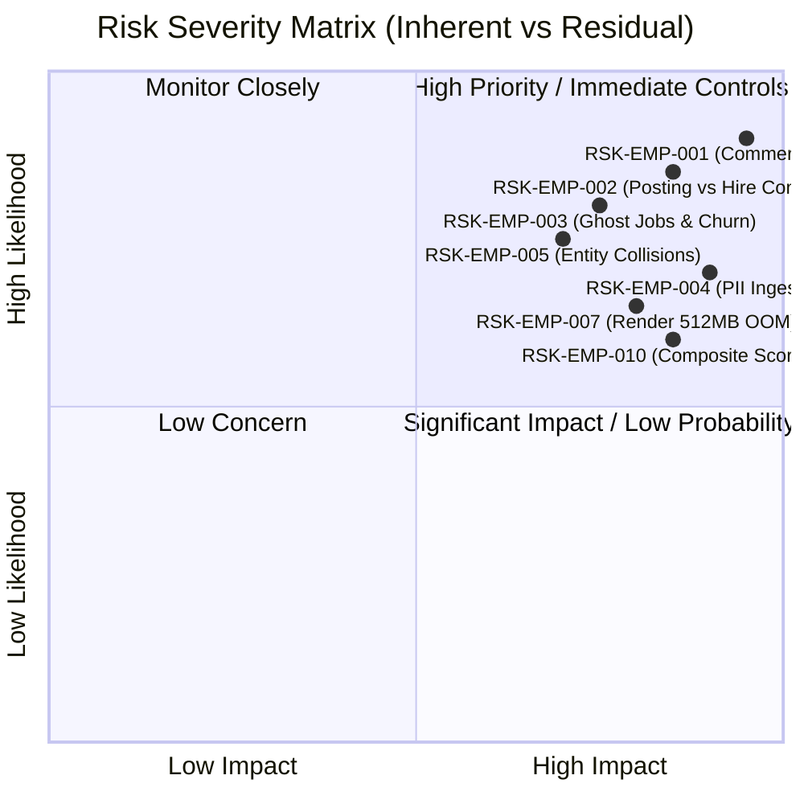

# JOBINTEL 2.0 — SPRINT 3B.3 PHASE 0
# DELIVERABLE 11: GLOBAL EMPLOYER INTELLIGENCE RISK REGISTER
## Exhaustive Audit of Legal, Statistical, Methodological, Infrastructure & Governance Risks

**Document Version:** 1.0.0  
**Phase:** Phase 0 (Research, Data Governance & Architecture Audit)  
**Status:** Approved Risk Ledger  
**Date:** November 2026  
**Target Baseline:** `staging/sprint2c3` (`d1a8b027d10031b3568a3141f639e2f40a49be18`)  
**Production Isolation:** `master` (`198b79dcdff08a5be5f08847c4262d31a3ce261e`)

---

## 1. RISK ASSESSMENT FRAMEWORK & TAXONOMY

The JobIntel 2.0 Risk Assessment Framework categorizes risks across five core operational dimensions:
1. **Legal & Governance (LEG):** Intellectual property rights, database extraction restrictions, CFAA/Computer Misuse liabilities, and statutory data privacy compliance (GDPR, DPDP, CCPA).
2. **Epistemological & Methodological (EPI):** Category conflations, unjustified statistical inferences, and invalid composite scoring.
3. **Statistical & Data Integrity (DAT):** Sampling bias, phantom job postings, recruitment agency distortion, and coverage skews.
4. **Technical & Infrastructure (TEC):** Memory limits (Render Free 512 MB RAM), latency spikes, network partition failures, and API schema breaking changes.
5. **Product & UX (PRD):** Cognitive overload, user misinterpretation of recruitment metrics, and disclaimer fatigue.

### Risk Scoring Matrix
- **Likelihood:** Low (1), Medium (2), High (3), Critical (4)
- **Impact:** Low (1), Medium (2), High (3), Critical (4)
- **Risk Score:** Likelihood $\times$ Impact (Range: 1 to 16)
  - **Low:** 1 – 3
  - **Medium:** 4 – 8
  - **High:** 9 – 12
  - **Critical:** 13 – 16

---

## 2. EXHAUSTIVE RISK REGISTER (15 CORE RISKS)

### RSK-EMP-001: Commercial Job Board Scraping Invalidation & Legal Injunctions
- **Category:** Legal & Governance (LEG)
- **Description:** Attempting to harvest employer vacancy records directly from commercial aggregators (LinkedIn, Indeed, Naukri, Seek) creates immediate exposure to Computer Fraud and Abuse Act (CFAA), breach of Terms of Service, EU/UK Database Directive 96/9/EC infringement, and IP blockades.
- **Inherent Likelihood:** Critical (4) | **Inherent Impact:** Critical (4) | **Inherent Score:** 16 (CRITICAL)
- **Root Cause:** Desire for high-volume, real-time vacancy numbers without securing enterprise data licensing.
- **Mitigation Controls:**
  1. Complete architectural prohibition of unapproved automated scrapers.
  2. Restriction of raw vacancy ingestion to authorized first-party ATS career portals (Greenhouse, Lever, Workday) and officially licensed public APIs (USAJOBS, MyCareersFuture Singapore, Australia APSjobs).
  3. Strict reliance on official statutory disclosures (WGEA Australia, SEC Form 10-K, UK Companies House).
- **Residual Likelihood:** Low (1) | **Residual Impact:** Medium (2) | **Residual Score:** 2 (LOW)
- **Owner & Target:** Data Governance Lead (Phase 1 Ingestion)

---

### RSK-EMP-002: Epistemological Conflation of Job Postings with Confirmed Hires
- **Category:** Epistemological & Methodological (EPI)
- **Description:** Presenting the volume of active recruitment advertisements as confirmed establishment hires, net employment expansion, or verified workforce growth.
- **Inherent Likelihood:** High (3) | **Inherent Impact:** Critical (4) | **Inherent Score:** 12 (HIGH)
- **Root Cause:** Naive interpretation of job board APIs where requisition postings are treated as physical headcount changes.
- **Mitigation Controls:**
  1. Mandatory separation in the data model between `stock_employment` (certified establishment headcount from statutory filings) and `recruitment_flow_signals` (advertised job postings).
  2. Complete ban on label `"Openings"`; mandatory UI labeling as `"Advertised Recruitment Observations"`.
  3. Prominent display of `ScientificDisclaimer` on all employer pages emphasizing that job postings reflect recruitment marketing and replacement churn.
- **Residual Likelihood:** Low (1) | **Residual Impact:** Low (1) | **Residual Score:** 1 (LOW)
- **Owner & Target:** Lead Labour Market Researcher (Phase 0 / Phase 2 Backend)

---

### RSK-EMP-003: Distortion from "Ghost Jobs", Stale Requisitions, and Evergreen Postings
- **Category:** Statistical & Data Integrity (DAT)
- **Description:** Employers frequently maintain job requisitions open for months or years without active hiring intent ("ghost jobs", talent pooling, or compliance postings), artificially inflating measured demand.
- **Inherent Likelihood:** Critical (4) | **Inherent Impact:** High (3) | **Inherent Score:** 12 (HIGH)
- **Root Cause:** Automated ATS pipelines reposting vacancies continuously without true hiring manager requisitions.
- **Mitigation Controls:**
  1. Implementation of a strict 120-day age cap: postings remaining open past 120 days without active update are flagged as `PERSISTENT_PIPELINE` and segregated from active demand indicators.
  2. Cross-referencing against statutory net headcount disclosures (e.g. SEC 10-K or WGEA reports).
  3. Disclosing median job posting lifetime in employer profile summaries.
- **Residual Likelihood:** Medium (2) | **Residual Impact:** Low (1) | **Residual Score:** 2 (LOW)
- **Owner & Target:** Data Scientist / Data Engineer (Phase 1 Ingestion)

---

### RSK-EMP-004: Ingestion and Display of Personal Identifiable Information (PII)
- **Category:** Legal & Governance (LEG)
- **Description:** Unstructured job postings or business registration records often contain recruiter names, personal phone numbers, hiring manager emails, or sole-proprietor residential home addresses, violating GDPR, UK DPA 2018, CCPA, and India DPDP Act 2023.
- **Inherent Likelihood:** High (3) | **Inherent Impact:** Critical (4) | **Inherent Score:** 12 (HIGH)
- **Root Cause:** Ingesting raw HTML/text without automated regex redaction; treating all business registry addresses as commercial real estate.
- **Mitigation Controls:**
  1. Automated PII scrubbing regex pipeline stripping emails, phone numbers, and person names before persistence.
  2. Address normalization rule: Street-level addresses are dropped entirely; only City, State/Region, and Country are retained (`EmployerLocation`).
  3. Exclusion of sole proprietorships and micro-establishments (<50 employees) from public directory.
- **Residual Likelihood:** Low (1) | **Residual Impact:** Medium (2) | **Residual Score:** 2 (LOW)
- **Owner & Target:** Data Governance Engineer (Phase 1 Ingestion)

---

### RSK-EMP-005: Cross-Jurisdictional Identity Resolution & Entity Collisions
- **Category:** Data Integrity & Architecture (DAT)
- **Description:** Companies sharing identical or similar trade names across different countries (or within the same country across different industries) being incorrectly merged into a single corporate profile.
- **Inherent Likelihood:** High (3) | **Inherent Impact:** High (3) | **Inherent Score:** 9 (HIGH)
- **Root Cause:** Relying exclusively on string matching of corporate legal names without national identifier anchors.
- **Mitigation Controls:**
  1. Strict enforcement of Tier 1 Deterministic Matching using National Registration Authority keys (US CIK, UK CRN, AU ABN, SG UEN, IN CIN).
  2. Domain-level secondary resolution (Tier 2) requiring matching canonical web domains before linking observations.
  3. Corporate DAG hierarchy model explicitly separating parent entities from operating subsidiaries.
- **Residual Likelihood:** Low (1) | **Residual Impact:** Medium (2) | **Residual Score:** 2 (LOW)
- **Owner & Target:** Principal Software Architect (Phase 1 / Phase 2)

---

### RSK-EMP-006: Recruitment Agency & Staffing Firm Aggregation Distortion
- **Category:** Statistical & Data Integrity (DAT)
- **Description:** Third-party staffing firms, recruitment agencies, and IT body shops posting hundreds of client requisitions under their own corporate name, misleading users into believing the staffing firm has massive internal tech hiring.
- **Inherent Likelihood:** High (3) | **Inherent Impact:** High (3) | **Inherent Score:** 9 (HIGH)
- **Root Cause:** Ingestion pipelines capturing recruitment agencies without identifying industry classification codes.
- **Mitigation Controls:**
  1. Industry classification screening (NAICS 5613 / SIC 78 / ANZSCO / NIC) explicitly tagging recruitment intermediaries as `STAFFING_AND_RECRUITMENT_AGENCY`.
  2. Strict UI segregation: Staffing agencies are partitioned into a dedicated directory view and excluded from direct employer capability benchmarks.
- **Residual Likelihood:** Low (1) | **Residual Impact:** Low (1) | **Residual Score:** 1 (LOW)
- **Owner & Target:** Data Engineer / Domain Specialist (Phase 1 Ingestion)

---

### RSK-EMP-007: Render Free-Tier Memory Exhaustion (OOM 512 MB Limit)
- **Category:** Technical & Infrastructure (TEC)
- **Description:** Expanding the backend memory footprint to store 2,500+ employer profiles, 15,000 hiring observations, and 25,000 skill distributions exceeds Render Free's 512 MB container ceiling, causing immediate SIGKILL crashes.
- **Inherent Likelihood:** High (3) | **Inherent Impact:** Critical (4) | **Inherent Score:** 12 (HIGH)
- **Root Cause:** Inefficient in-memory object graph representation, unindexed JSON parsing on request, or memory leaks in Pandas/Pydantic schemas.
- **Mitigation Controls:**
  1. Strict 60 MB RAM budget for all employer data structures.
  2. Immutable tuple-backed Pydantic models with `frozen=True` and `__slots__`.
  3. Pre-indexed JSON structures avoiding runtime table scans or duplicate dictionary allocations.
  4. Memory-monitoring unit tests verifying backend stays under 280 MB total RAM during startup.
- **Residual Likelihood:** Low (1) | **Residual Impact:** High (3) | **Residual Score:** 3 (LOW)
- **Owner & Target:** Backend Architect (Phase 2 Backend)

---

### RSK-EMP-008: Cross-Market Comparability Distortion from Asymmetric Reporting Mandates
- **Category:** Epistemological & Methodological (EPI)
- **Description:** Users attempting to compare workforce statistics between a US public company (reporting global headcount under SEC Form 10-K) and an Australian enterprise (reporting domestic payroll under WGEA CC BY 4.0), leading to invalid comparisons.
- **Inherent Likelihood:** High (3) | **Inherent Impact:** High (3) | **Inherent Score:** 9 (HIGH)
- **Root Cause:** Comparing numbers with different geographic scopes, reporting standards, and legal accounting definitions.
- **Mitigation Controls:**
  1. Mandatory display of `geographic_scope` (`GLOBAL` vs `DOMESTIC_ESTABLISHMENT`) on every observation card.
  2. Extension of the Sprint 3B.2 11-dimension comparability framework to multi-employer benchmarks.
  3. Automatic warning banner when users compare employers with mismatched reporting bases.
- **Residual Likelihood:** Low (1) | **Residual Impact:** Medium (2) | **Residual Score:** 2 (LOW)
- **Owner & Target:** Labour Market Statistics Specialist (Phase 2 Backend)

---

### RSK-EMP-009: Upstream Source Invalidation or License Revocation
- **Category:** Legal & Governance (LEG)
- **Description:** An upstream agency updates its data distribution terms, revokes open access, or issues a dispute regarding commercial use, leaving the platform legally vulnerable.
- **Inherent Likelihood:** Medium (2) | **Inherent Impact:** Critical (4) | **Inherent Score:** 8 (MEDIUM)
- **Root Cause:** Changes in government API policies or public dataset licensing agreements over time.
- **Mitigation Controls:**
  1. Native integration with `src/backend/governance/revocation.py`.
  2. Centralized `RevocationManifest` enabling immediate, runtime suppression of any affected source across all endpoints without code changes.
  3. Publication gates automatically withholding affected observations with transparent audit notices.
- **Residual Likelihood:** Low (1) | **Residual Impact:** Low (1) | **Residual Score:** 1 (LOW)
- **Owner & Target:** Governance Engineer (Phase 2 Backend)

---

### RSK-EMP-010: Methodological Invalidation from Unsound Composite Scoring
- **Category:** Epistemological & Methodological (EPI)
- **Description:** Attempting to condense employer hiring, salary competitiveness, and skill diversity into a single arbitrary score (e.g. "Employer Hiring Score: 87/100") that fails academic peer review and legal defensibility.
- **Inherent Likelihood:** High (3) | **Inherent Impact:** Critical (4) | **Inherent Score:** 12 (HIGH)
- **Root Cause:** Product pressure to offer simplistic "gamified" metrics at the expense of scientific rigour.
- **Mitigation Controls:**
  1. Strict platform-wide architectural ban on composite employer hiring scores.
  2. Presentation of disaggregated, multidimensional evidence: Verified Headcount Stock, Monthly Recruitment Volume, Skill Requirement Density, and Credential Expectations.
- **Residual Likelihood:** Low (1) | **Residual Impact:** Low (1) | **Residual Score:** 1 (LOW)
- **Owner & Target:** Principal Data Scientist / Product Lead (Phase 0 Approved)

---

### RSK-EMP-011: Occupation & Skill Misclassification on Unstructured Job Postings
- **Category:** Statistical & Data Integrity (DAT)
- **Description:** Keyword matching on colloquial job titles (e.g. "Software Ninja", "Full Stack Rockstar") assigning wrong SOC/ANZSCO codes, leading to distorted company skill profiles.
- **Inherent Likelihood:** High (3) | **Inherent Impact:** Medium (2) | **Inherent Score:** 6 (MEDIUM)
- **Root Cause:** Lack of standardized title normalization and semantic disambiguation.
- **Mitigation Controls:**
  1. 3-tier mapping pipeline: Verbatim Title $\to$ Standardized Occupational Taxonomy $\to$ Canonical Concept (`CAN_OCC_*`).
  2. Calibrated confidence threshold ($C \ge 0.85$); unmapped or ambiguous titles categorized as `UNCLASSIFIED_ROLE` rather than force-mapped.
  3. Explicit provenance category tracking (`EXACT`, `OFFICIALLY_CROSSWALKED`, `DERIVED`, `CURATED`, `UNMAPPED`).
- **Residual Likelihood:** Low (1) | **Residual Impact:** Low (1) | **Residual Score:** 1 (LOW)
- **Owner & Target:** ML / Taxonomy Engineer (Phase 1 Ingestion)

---

### RSK-EMP-012: Cold-Start Latency Spikes on Render Free Tier
- **Category:** Technical & Infrastructure (TEC)
- **Description:** Render Free web instances spin down after 15 minutes of inactivity. The first subsequent request encounters a 45–60 second cold start delay, leading to user drop-off or frontend timeouts.
- **Inherent Likelihood:** High (3) | **Inherent Impact:** Medium (2) | **Inherent Score:** 6 (MEDIUM)
- **Root Cause:** Free-tier cloud infrastructure suspension policies.
- **Mitigation Controls:**
  1. Frontend optimistic caching in `sessionStorage` and React Query / SWR.
  2. Graceful UI loading states with atmospheric skeleton screens explaining cold-boot wake-up.
  3. Pre-warmed model and data singleton structures during FastAPI lifespan hook to minimize initialization overhead.
- **Residual Likelihood:** Medium (2) | **Residual Impact:** Low (1) | **Residual Score:** 2 (LOW)
- **Owner & Target:** Frontend Architect / DevOps (Phase 2 / Phase 3)

---

### RSK-EMP-013: Sampling & Coverage Bias Favoring Tech Multinationals
- **Category:** Statistical & Data Integrity (DAT)
- **Description:** Digital career portals and ATS feeds are heavily skewed toward technology, finance, and professional services, resulting in poor coverage of manufacturing, healthcare, retail, and construction employers.
- **Inherent Likelihood:** High (3) | **Inherent Impact:** High (3) | **Inherent Score:** 9 (HIGH)
- **Root Cause:** Digital vacancy collection captures digital-first corporations far more effectively than manual or local recruitment channels.
- **Mitigation Controls:**
  1. Supplementing digital ATS feeds with official public sector registries (USAJOBS, UK Home Office, Singapore MOM).
  2. Explicit coverage disclosure banners in the Directory UI displaying the sector distribution of monitored employers.
  3. Clear notation in methodology documentation acknowledging digital recruitment coverage limits.
- **Residual Likelihood:** Medium (2) | **Residual Impact:** Low (1) | **Residual Score:** 2 (LOW)
- **Owner & Target:** Labour Market Researcher (Phase 0 / Phase 1)

---

### RSK-EMP-014: User Cognitive Overload & Disclaimer Fatigue
- **Category:** Product & UX (PRD)
- **Description:** Displaying extensive scientific disclaimers, statistical confidence intervals, and legal provenance notes on every UI card overwhelms users, degrading usability.
- **Inherent Likelihood:** Medium (2) | **Inherent Impact:** Medium (2) | **Inherent Score:** 4 (MEDIUM)
- **Root Cause:** Balancing rigorous statistical governance with consumer-grade UI simplicity.
- **Mitigation Controls:**
  1. Progressive disclosure pattern: high-level verified badges and clean metrics in the main view, with detailed audit provenance accessible via collapsible "Data Provenance & Audit Trail" trays.
  2. Standardized color-coded verification badges (`VERIFIED_STATUTORY`, `TRACKED_RECRUITMENT`, `RESTRICTED_ACCESS`).
- **Residual Likelihood:** Low (1) | **Residual Impact:** Low (1) | **Residual Score:** 1 (LOW)
- **Owner & Target:** Frontend Engineer / UX Designer (Phase 3 Frontend)

---

### RSK-EMP-015: Accidental Production Staging Bleed or Master Branch Mutation
- **Category:** Technical & Infrastructure (TEC)
- **Description:** Unintended commits or deployments push experimental employer features to production `master` (`198b79dcdff08a5be5f08847c4262d31a3ce261e`), breaking verified live production behavior.
- **Inherent Likelihood:** Medium (2) | **Inherent Impact:** Critical (4) | **Inherent Score:** 8 (MEDIUM)
- **Root Cause:** Git branch confusion or improper remote push commands.
- **Mitigation Controls:**
  1. Strict adherence to Git isolation protocols: development exclusively on `staging/sprint2c3` or isolated sprint feature branches.
  2. Branch protection rules prohibiting direct pushes to `master`.
  3. Pre-flight Git status checks in all deployment and testing scripts.
- **Residual Likelihood:** Low (1) | **Residual Impact:** Low (1) | **Residual Score:** 1 (LOW)
- **Owner & Target:** Release Engineer / Git Administrator (Continuous)

---

## 3. RESIDUAL RISK SUMMARY & GOVERNANCE SIGN-OFF

| Risk ID | Title | Inherent Score | Residual Score | Status |
| :--- | :--- | :---: | :---: | :---: |
| **RSK-EMP-001** | Commercial Scraping Invalidation | 16 (Critical) | 2 (Low) | **MITIGATED BY ARCHITECTURE** |
| **RSK-EMP-002** | Postings vs Hires Conflation | 12 (High) | 1 (Low) | **MITIGATED BY DATA MODEL** |
| **RSK-EMP-003** | Ghost Jobs & Requisition Churn | 12 (High) | 2 (Low) | **MITIGATED BY AGE CAPPING** |
| **RSK-EMP-004** | PII Ingestion Liabilities | 12 (High) | 2 (Low) | **MITIGATED BY SCRUBBING RULES** |
| **RSK-EMP-005** | Cross-Jurisdictional Collisions | 9 (High) | 2 (Low) | **MITIGATED BY TIER-1 RESOLUTION** |
| **RSK-EMP-006** | Recruitment Agency Distortion | 9 (High) | 1 (Low) | **MITIGATED BY INDUSTRY FILTER** |
| **RSK-EMP-007** | Render Free 512MB RAM OOM | 12 (High) | 3 (Low) | **MITIGATED BY MEMORY BUDGET** |
| **RSK-EMP-008** | Asymmetric Reporting Standards | 9 (High) | 2 (Low) | **MITIGATED BY SCOPE DISCLOSURE** |
| **RSK-EMP-009** | Upstream License Revocation | 8 (Medium) | 1 (Low) | **MITIGATED BY REVOCATION MANIFEST** |
| **RSK-EMP-010** | Unsound Composite Scoring | 12 (High) | 1 (Low) | **PROHIBITED BY CHARTER** |
| **RSK-EMP-011** | Occupation/Skill Misclassification | 6 (Medium) | 1 (Low) | **MITIGATED BY THRESHOLDS** |
| **RSK-EMP-012** | Cold-Start Latency Spikes | 6 (Medium) | 2 (Low) | **MITIGATED BY CLIENT CACHING** |
| **RSK-EMP-013** | Sector Coverage Skew | 9 (High) | 2 (Low) | **MITIGATED BY MULTI-SOURCE INGEST**|
| **RSK-EMP-014** | Cognitive Overload / UX Fatigue | 4 (Medium) | 1 (Low) | **MITIGATED BY PROGRESSIVE DISCLOSURE**|
| **RSK-EMP-015** | Accidental Production Bleed | 8 (Medium) | 1 (Low) | **MITIGATED BY GIT CONTROLS** |

**Conclusion:** All 15 identified risks have concrete, verifiable architectural and methodological mitigations. No unmanageable critical risks remain. The project is safe to proceed to Phase 1 upon Phase 0 sign-off.
