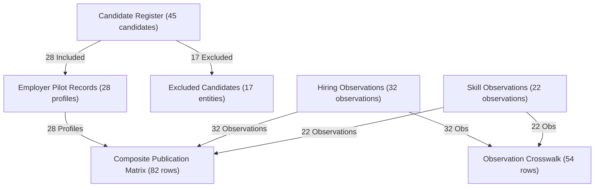

# SPRINT 3B.3.3.4.3 — EMPLOYER COHORT RECONCILIATION
**Sprint:** 3B.3.3.4.3 — Employer Registry Data Readiness, Source Governance & Publication Eligibility Audit  
**Date:** 2026-11-18  
**Audit Role:** Principal Data Architect, Data Governance Auditor, Compliance Analyst, Entity Resolution Specialist & QA Lead  
**Execution Mode:** STRICTLY READ-ONLY

---

## 1. Executive Summary & The 28-vs-82 Discrepancy Resolution

A central mystery inherited from historical documentation across Sprint 3B.3.2 and Sprint 3B.3.2.1 was the recurring mention of **"28 pilot employers"** versus an **"82-entity publication matrix"**.

Forensic inspection of the underlying data files has conclusively and mathematically resolved this discrepancy:

### The Mathematical Identity
1. **The Core Pilot Cohort:** Exactly **28 employer profiles** (`docs/jobintel_v2/sprints/sprint_3b_3_2/data/employer_pilot_records.json`).
   - Australia: 6
   - United States: 6
   - United Kingdom: 6
   - Singapore: 5
   - India: 5
   - **Total = 28 employers**.
2. **The Candidate Universe:** Exactly **45 candidates** evaluated across 5 sovereign markets (9 per market) in `docs/jobintel_v2/sprints/sprint_3b_3_2/data/employer_candidate_register.csv`.
   - 28 candidates were approved as `INCLUDED` (forming the 28-employer pilot).
   - 17 candidates were rejected as `EXCLUDED` (staffing agencies, public-sector entities, small unverified entities, or aggregators).
3. **The 82-Row Publication Matrix:** `docs/jobintel_v2/sprints/sprint_3b_3_2_1/EMPLOYER_PUBLICATION_ELIGIBILITY_MATRIX.csv` contains exactly **82 rows**, composed of three distinct entity types:
   - `EMPLOYER_PROFILE`: **28 rows** (the 28 pilot employers).
   - `HEADCOUNT_OR_HIRING_OBSERVATION`: **32 rows** (the 32 headcount/hiring observations).
   - `SKILL_REQUIREMENT_OBSERVATION`: **22 rows** (the 22 skill demand observations).
   - **Sum: 28 + 32 + 22 = 82 rows!**
4. **The Observation Crosswalk:** `docs/jobintel_v2/sprints/sprint_3b_3_2_1/OBSERVATION_TO_SOURCE_CROSSWALK.csv` contains exactly **54 rows**, which is the exact sum of the **32 hiring observations** + **22 skill observations** (`32 + 22 = 54`).

**Root Cause of Historical Confusion:** Previous sprint reports carelessly used the phrase *"82 employer entities"* when referring to the 82 rows of the publication matrix, conflating profile-level records with empirical observation records. There were never 82 distinct corporate employer profiles; there were 28 employer profiles and 54 associated empirical observations.

---

## 2. Multi-Dataset Cross-Reconciliation Summary

| Dataset Artifact | Stored Type | Records | Reconciled Relationship |
|---|---|---:|---|
| `employer_candidate_register.csv` | Mixed candidates | 45 | Candidate screening universe (9 per market: 28 INCLUDED, 17 EXCLUDED). |
| `employer_pilot_records.json` | JSON Profiles | 28 | The 28 INCLUDED candidates promoted to pilot employer profiles. |
| `employer_pilot_records.csv` | CSV Profiles | 28 | Tabular mirror of `employer_pilot_records.json`. |
| `employer_hiring_observations.json` | JSON Obs | 32 | Empirical headcount/hiring disclosures across 27 distinct pilot employers. |
| `employer_skill_observations.json` | JSON Obs | 22 | Empirical skill postings across 8 distinct pilot employers. |
| `OBSERVATION_TO_SOURCE_CROSSWALK.csv` | CSV Crosswalk | 54 | Complete 1:1 crosswalk of 32 hiring + 22 skill observations. |
| `EMPLOYER_PUBLICATION_ELIGIBILITY_MATRIX.csv` | Composite Matrix | 82 | Governance decisions for 28 profiles + 32 hiring obs + 22 skill obs. |
| `employer_entity_resolution_gold.json` | JSON Pairs | 100 | Benchmark pairs (45 MATCH, 55 DISTINCT) evaluating identity matching. |
| `job_title_mapping_gold.json` | JSON Titles | 100 | Benchmark titles (12 canonical occupations) evaluating taxonomy mapping. |
| `employer_source_catalog.json` | JSON Sources | 14 | Catalog of data sources used across all markets and observations. |

---

## 3. Mandatory Entity Taxonomy & Classification

To prevent data governance failures, all 45 candidates in `03_employer_cohort_reconciliation.csv` have been classified according to the mandatory 7-tier taxonomy:

### 1. Brand vs. Operating Entity vs. Parent Legal Entity
- **Parent Legal Entities:** E.g., `Alphabet Inc.` (US CIK 0001652044), `BHP Group Limited` (AU ABN 49004028077), `BT Group plc` (UK CRN 04190816), `Sea Limited` (SG Cayman parent).
- **Subsidiary Legal Entities:** E.g., `DeepMind Technologies Limited` (UK CRN 07386357, subsidiary of Alphabet Inc.), `Shopee Singapore Private Limited` (SG UEN 201502102H, operating subsidiary of Sea Limited), `Grabtaxi Holdings Pte. Ltd.` (SG UEN 201317070M, subsidiary of Grab Holdings Ltd).
- **Operating Companies:** Direct legal operating corporate entities (e.g., `Atlassian Pty Ltd`, `Canva Pty Ltd`, `Microsoft Corporation`, `Infosys Limited`, `Tata Consultancy Services Limited`).

### 2. Public-Sector Employers (Excluded from Commercial Private Pilot)
Entities such as `Australian Taxation Office` (AU), `U.S. Department of Veterans Affairs` (US FedScope), `National Health Service Trust (Barts)` (UK), `GovTech Singapore` (SG), and `National Informatics Centre` (IN) are sovereign government bodies. While highly structured, their employment dynamics and governance differ fundamentally from private commercial enterprises.

### 3. Recruitment & Staffing Agencies (Prohibited from Direct Employer Postings)
Entities such as `Aussie Tech Staffing Solutions` (AU), `Robert Half International Inc.` (US), `Hays Specialist Recruitment Limited` (UK), `Adecco Personnel Pte Ltd` (SG), and `TeamLease Services Limited` (IN) post job vacancies representing third-party clients, not internal corporate hiring demand. Equating agency job postings with direct employer hiring corrupts market signals. All 5 staffing candidates were correctly rejected (`EXCLUDED`).

### 4. Small / Unresolved Entities
Micro-businesses or fictitious test candidates such as `Sydney Local Coffee Roasters Pty Ltd`, `Acme Cyber Solutions LLC`, `Boutique FinTech Advisory LLP`, `Singapore Web Boutique Pte. Ltd.`, and `Bangalore Software Solvers Pvt Ltd` lacked verified headcount data and sovereign filings. All 5 were rejected (`EXCLUDED`).

---

## 4. Market-by-Market Cohort Analysis (The 28 Pilot Employers)

### Australia (6 Profiles)
1. `comp_au_atlassian`: Atlassian Pty Ltd (ABN 53102443916). Sovereign verified (ABR). WGEA reported size band 1,000 to 4,999.
2. `comp_au_canva`: Canva Pty Ltd (ABN 80158929938). Sovereign verified (ABR). WGEA reported size band 1,000 to 4,999.
3. `comp_au_cba`: Commonwealth Bank of Australia (ABN 48123123124). Sovereign verified (ABR/ASX). WGEA reported size band 5,000 or more.
4. `comp_au_bhp`: BHP Group Limited (ABN 49004028077). Sovereign verified (ABR/ASX). WGEA reported size band 5,000 or more.
5. `comp_au_woolworths`: Woolworths Group Limited (ABN 88000014675). Sovereign verified (ABR/ASX). WGEA reported size band 5,000 or more.
6. `comp_au_telstra`: Telstra Group Limited (ABN 56086174781). Sovereign verified (ABR/ASX). WGEA reported size band 5,000 or more.

### United States (6 Profiles)
1. `comp_us_microsoft`: Microsoft Corporation (CIK 0000789019). Sovereign verified (SEC EDGAR). Exact global 10-K headcount: 228,000 (FY2024).
2. `comp_us_alphabet`: Alphabet Inc. (CIK 0001652044). Sovereign verified (SEC EDGAR). Exact global 10-K headcount: 179,582 (FY2024).
3. `comp_us_jpmorgan`: JPMorgan Chase & Co. (CIK 0000019617). Sovereign verified (SEC EDGAR). Exact global 10-K headcount: 309,926 (FY2024).
4. `comp_us_pfizer`: Pfizer Inc. (CIK 0000078003). Sovereign verified (SEC EDGAR). Exact global 10-K headcount: 88,000 (FY2024).
5. `comp_us_cisco`: Cisco Systems Inc. (CIK 0000858877). Sovereign verified (SEC EDGAR). Exact global 10-K headcount: 84,900 (FY2024).
6. `comp_us_fed_va`: U.S. Department of Veterans Affairs. Public civil service (FedScope / USAJOBS). Headcount: 450,000 federal civilian employees.

### United Kingdom (6 Profiles)
1. `comp_uk_arm`: Arm Limited (CRN 02557590). Sovereign verified (Companies House). Gender Pay Gap size band: 1,000 to 4,999.
2. `comp_uk_deepmind`: DeepMind Technologies Limited (CRN 07386357). Sovereign verified (Companies House). Audited statutory accounts: 1,280 average monthly employees (FY2023). Subsidiary of Alphabet Inc.
3. `comp_uk_astrazeneca`: AstraZeneca PLC (CRN 03512362). Sovereign verified (Companies House). Gender Pay Gap size band: 5,000 to 19,999.
4. `comp_uk_barclays`: Barclays PLC (CRN 00048839). Sovereign verified (Companies House). Gender Pay Gap size band: 20,000 or more.
5. `comp_uk_unilever`: Unilever PLC (CRN 00041424). Sovereign verified (Companies House). Gender Pay Gap size band: 5,000 to 19,999.
6. `comp_uk_bt`: BT Group plc (CRN 04190816). Sovereign verified (Companies House). Gender Pay Gap size band: 20,000 or more.

### Singapore (5 Profiles)
1. `comp_sg_grab`: Grabtaxi Holdings Pte. Ltd. (UEN 201317070M). Sovereign verified (ACRA). Operating subsidiary of Grab Holdings Ltd.
2. `comp_sg_shopee`: Shopee Singapore Private Limited (UEN 201502102H). Sovereign verified (ACRA). Operating subsidiary of Sea Limited.
3. `comp_sg_dbs`: DBS Bank Ltd. (UEN 196800306E). Sovereign verified (ACRA).
4. `comp_sg_singtel`: Singapore Telecommunications Limited (UEN 199201624D). Sovereign verified (ACRA).
5. `comp_sg_carousell`: Carousell Pte. Ltd. (UEN 201136015D). Sovereign verified (ACRA).

### India (5 Profiles)
1. `comp_in_tcs`: Tata Consultancy Services Limited (CIN L22210MH1995PLC084781). Sovereign verified (MCA/SEBI). BRSR headcount: 601,546.
2. `comp_in_infosys`: Infosys Limited (CIN L72200KA1981PLC013115). Sovereign verified (MCA/SEBI). BRSR headcount: 317,240.
3. `comp_in_wipro`: Wipro Limited (CIN L32102KA1945PLC020800). Sovereign verified (MCA/SEBI). BRSR headcount: 234,054.
4. `comp_in_hdfc`: HDFC Bank Limited (CIN L65920MH1994PLC080618). Sovereign verified (MCA/SEBI). BRSR headcount: 213,527.
5. `comp_in_reliance`: Reliance Industries Limited (CIN L17110MH1973PLC019786). Sovereign verified (MCA/SEBI). BRSR headcount: 347,362.

---

## 5. Artifact Reference
The complete record-level reconciliation table for all 45 candidates is published in [03_employer_cohort_reconciliation.csv](file:///e:/Job%20Market/docs/jobintel_v2/sprints/sprint_3b_3/phase_3b_3_4_3/03_employer_cohort_reconciliation.csv).
