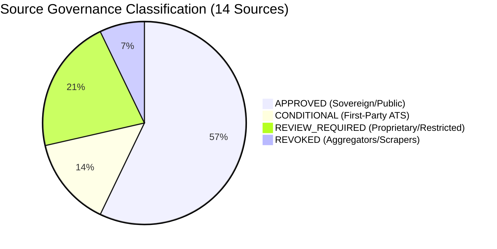

# SPRINT 3B.3.3.4.3 — SOURCE LICENSING AND PERMISSIONS AUDIT
**Sprint:** 3B.3.3.4.3 — Employer Registry Data Readiness, Source Governance & Publication Eligibility Audit  
**Date:** 2026-11-18  
**Audit Role:** Principal Data Architect, Data Governance Auditor, Compliance Analyst & QA Lead  
**Execution Mode:** STRICTLY READ-ONLY

---

## 1. Executive Summary

This audit evaluates the legal, contractual, and operational permissions of the **14 candidate sources** cataloged in `docs/jobintel_v2/sprints/sprint_3b_3_2/data/employer_source_catalog.json`.

In prior sprints (notably Sprint 3B.3.2 and 3B.3.2.1), source governance classifications were recorded without independent verification of upstream license contracts. Most egregiously, proprietary vendor data (Lightcast) was marked as `APPROVED` for commercial SaaS deployment, and third-party scrapers were conflated with direct employer feeds.

### Audited Source Classification Breakdown
- **`APPROVED` (8 sources):** Sovereign statutory and open public registries permitting commercial reuse with attribution (WGEA, ABR, SEC EDGAR, USAJOBS, Companies House, UK Gender Pay Gap, ACRA, SEBI BRSR).
- **`CONDITIONAL` (2 sources):** First-party employer career feeds (Greenhouse, Lever) permitted strictly for ephemeral job discovery with mandatory candidate redirection.
- **`REVIEW_REQUIRED` (3 sources):** Sources with unresolved licensing, automation restrictions, or terms prohibiting commercial SaaS aggregation (Lightcast Open Skills, Singapore MyCareersFuture, India MCA21).
- **`REVOKED` (1 source):** Commercial aggregators (LinkedIn, Indeed, Naukri, Seek) strictly prohibited and revoked under `src/backend/config/revocation_manifest.json`.



---

## 2. Market-by-Market Jurisdictional Review

### United States
1. **SEC EDGAR (`src_us_sec_edgar`) — `APPROVED`**
   - *Statutory Basis:* Securities Exchange Act of 1934 s 13/15(d); 17 CFR § 229.101 (Item 101 Human Capital Disclosures).
   - *Permissions:* Public domain work of the U.S. Federal Government. Commercial SaaS storage, API exposure, and redistribution permitted.
   - *Operating Restrictions:* Automated queries must include a specific User-Agent header disclosing the requesting entity and contact email; traffic capped at 10 requests/second.
   - *Audit Finding:* Gold standard for exact global corporate headcount. However, disclosures represent **consolidated global parent headcount**, not domestic or operating subsidiaries.
2. **USAJOBS Open Data API (`src_us_usajobs`) — `APPROVED`**
   - *Statutory Basis:* 5 U.S.C. § 3327; OPM Developer Terms of Service.
   - *Permissions:* Public domain. Programmatic API distribution permitted with attribution.
   - *Operating Restrictions:* Restricted strictly to U.S. Federal Civil Service executive branch vacancies. Must flush closed vacancies daily.

### United Kingdom
1. **Companies House (`src_uk_companies_house`) — `APPROVED`**
   - *Statutory Basis:* Companies Act 2006 s 1080; UK Open Government Licence v3.0 (OGL v3).
   - *Permissions:* Commercial storage, derivative creation, and API exposure permitted with attribution: *"Contains public sector information licensed under the Open Government Licence v3.0"*.
   - *Audit Finding — CRITICAL HEADCOUNT DISTINCTION:* The basic REST API returns company status, registered office, SIC codes, and filing history, but **does not emit employee headcount fields**. Employee numbers exist only within filed audited annual accounts (PDF/iXBRL).
2. **UK Gender Pay Gap Portal (`src_uk_gender_pay_gap`) — `APPROVED`**
   - *Statutory Basis:* Equality Act 2010 (Gender Pay Gap Information) Regulations 2017; OGL v3.0.
   - *Permissions:* Public statutory disclosure. Commercial reuse and derivative statistics permitted with attribution.
   - *Audit Finding — BAND PRESERVATION:* Headcount is disclosed strictly in broad size categories: `250 to 499`, `500 to 999`, `1,000 to 4,999`, `5,000 to 19,999`, `20,000 or more`. It is **strictly prohibited** to synthesize an exact employee count from a size band.

### Australia
1. **Australian Business Register (`src_au_abr`) — `APPROVED`**
   - *Statutory Basis:* A New Tax System (Australian Business Number) Act 1999 (Cth); Creative Commons Attribution 3.0 Australia (CC-BY 3.0 AU).
   - *Permissions:* Authoritative sovereign corporate identity registry. Open commercial use permitted with attribution to data.gov.au.
   - *Audit Finding:* Validates ABN, legal name, entity status, and GST registration. Contains zero workforce or employee figures.
2. **Workplace Gender Equality Agency (`src_au_wgea`) — `APPROVED`**
   - *Statutory Basis:* Workplace Gender Equality Act 2012 (Cth) s 13; Creative Commons Attribution 4.0 International (CC-BY 4.0).
   - *Permissions:* Public statutory employer reporting. Permitted for analytical and commercial derivative use with attribution.
   - *Audit Finding — POPULATION RESTRICTION:* Mandatory only for Australian non-public employers with 100 or more employees. Headcount is categorized in bands (`1,000 to 4,999`, `5,000 or more`) and covers domestic Australian headcount only.

### Singapore
1. **ACRA / data.gov.sg (`src_sg_acra`) — `APPROVED`**
   - *Statutory Basis:* Accounting and Corporate Regulatory Authority Act 2004 (Cap 2A); Singapore Open Data Licence.
   - *Permissions:* Sovereign company identity (UEN), incorporation date, and entity status. Permitted for commercial reuse with attribution.
   - *Audit Finding:* Financial statements, shareholder registers, and employee counts are not included in the open API; obtaining them requires fee-based extracts via BizFile.
2. **MyCareersFuture (`src_sg_mycareersfuture`) — `REVIEW_REQUIRED`**
   - *Statutory Basis:* Workforce Singapore (WSG) Employment Portal Terms of Use Section 6.
   - *Permissions:* Strictly prohibits automated scraping, bots, and commercial aggregation without prior written authorization from WSG.
   - *Audit Finding:* Reclassified from historical claims. Without an explicit data-sharing MOU with WSG, automated ingestion is legally blocked.

### India
1. **SEBI BRSR Disclosures (`src_in_sebi_brsr`) — `APPROVED`**
   - *Statutory Basis:* SEBI (LODR) Regulations 2015, Regulation 34(2)(f); Circular SEBI/HO/CFD/CMD-2/P/CIR/2021/562.
   - *Permissions:* Mandatory statutory reporting for the top 1,000 listed entities on BSE/NSE. Certified public regulatory filings.
   - *Audit Finding:* Discloses exact audited figures for permanent employees, contract workers, and gender breakdown. Highly reliable for major Indian corporations.
2. **MCA21 Registry (`src_in_mca21`) — `REVIEW_REQUIRED`**
   - *Statutory Basis:* Ministry of Corporate Affairs, Government of India; Information Technology Act 2000.
   - *Permissions:* The MCA21 portal enforces CAPTCHA challenges and explicitly prohibits automated scraping.
   - *Audit Finding:* While CIN and company master data are public, automated harvesting without an official API gateway agreement violates portal terms. Reclassified to `REVIEW_REQUIRED`.

---

## 3. Special Scrutiny Deep Dives

### Special Scrutiny 1: Lightcast Proprietary Data (`src_global_lightcast_skills`)
- **The Defect in Prior Sprints:** Sprint 3B.3.2 and 3B.3.2.1 marked Lightcast as `APPROVED` for commercial SaaS.
- **The Forensic Reality:** Lightcast operates under strict commercial End User License Agreements (EULAs). While Lightcast publishes an "Open Skills" taxonomy for academic and individual non-commercial research, **commercial SaaS products (like JOBINTEL) are strictly prohibited from redistributing, caching for external query, exposing via open APIs, or using extracts to train external ML models without an executed enterprise distribution contract.**
- **Corrective Classification:** Reclassified from `APPROVED` to **`REVIEW_REQUIRED`**. Ingestion of raw Lightcast extracts into staging or production databases is BLOCKED pending enterprise commercial licensing.

### Special Scrutiny 2: Commercial Job Aggregators (`src_commercial_aggregators`)
- **Entities Covered:** LinkedIn, Indeed, Naukri, Seek, Glassdoor.
- **Legal Risk:** Scraping aggregator feeds violates Terms of Service, anti-hacking statutes (CFAA in the US, Computer Misuse Act in the UK), and breaches established contract precedents (e.g. *hiQ Labs, Inc. v. LinkedIn Corp.* breach of contract rulings).
- **Enforcement Status:** Permanently revoked in `src/backend/config/revocation_manifest.json`:
  ```json
  {
    "revocation_manifest_version": "1.0.0",
    "revoked_sources": [
      {
        "source_id": "src_commercial_aggregators",
        "reason": "Commercial scraping prohibited by platform terms of service"
      }
    ]
  }
  ```
- **Audit Finding:** **`REVOKED`**. Zero data from commercial aggregators may be persisted or exposed.

---

## 4. Artifact Reference
The complete source governance matrix is published in [04_source_governance_matrix.csv](file:///e:/Job%20Market/docs/jobintel_v2/sprints/sprint_3b_3/phase_3b_3_4_3/04_source_governance_matrix.csv).
