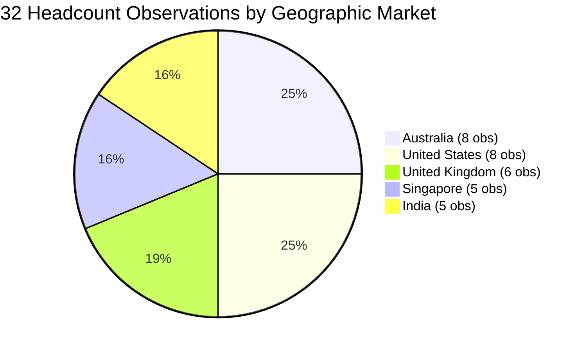

# SPRINT 3B.3.3.4.3 — HEADCOUNT AND HIRING EVIDENCE REVIEW
**Sprint:** 3B.3.3.4.3 — Employer Registry Data Readiness, Source Governance & Publication Eligibility Audit  
**Date:** 2026-11-18  
**Audit Role:** Principal Data Architect, Statistical Validation Specialist & Data Governance Auditor  
**Execution Mode:** STRICTLY READ-ONLY

---

## 1. Executive Summary

This review forensically audits the **32 empirical headcount and hiring observations** recorded in `docs/jobintel_v2/sprints/sprint_3b_3_2/data/employer_hiring_observations.json`.

In historical iterations, severe analytical oversimplifications were identified:
1. **Band Flattening:** Categorical reporting bands (e.g. WGEA size band `1,000 to 4,999`) were at risk of being converted into synthetic point estimates (such as `2,500` or `1,000`).
2. **Global Parent Conflation:** Consolidated multinational parent headcount (e.g. Microsoft Corporation's `228,000` global staff from Form 10-K) was at risk of being misattributed to regional subsidiaries (e.g. Microsoft Australia or Microsoft India).
3. **Flow-to-Stock Fallacy:** Active job vacancy counts (e.g. `142` open postings) were at risk of being equated with actual employee headcount or net hiring additions.

This audit establishes immutable governance guardrails and applies the mandatory measurement taxonomy across all 32 records.

---

## 2. Mandatory Headcount Measurement Taxonomy

Every observation in [06_headcount_and_hiring_validation.csv](file:///e:/Job%20Market/docs/jobintel_v2/sprints/sprint_3b_3/phase_3b_3_4_3/06_headcount_and_hiring_validation.csv) is strictly classified into one of the following mutually exclusive categories:

| Taxonomy Classification | Definition | Governance Rule |
|---|---|---|
| `EXACT_EMPLOYEE_COUNT` | Audited or certified point-in-time count of individual employees for a specified entity. | Publishable only if certified by statutory authority or audited financial disclosure. |
| `EMPLOYEE_COUNT_BAND` | Categorical bracket defined by a statutory regulator (e.g. `1,000 to 4,999`). | **IMMUTABLE BAND RULE:** Must be stored and displayed strictly as a range/bracket. Point-estimate conversion is strictly prohibited. |
| `GROUP_WIDE_HEADCOUNT` | Consolidated worldwide headcount of an entire parent enterprise and all operating subsidiaries. | **CONSOLIDATION RULE:** Must be explicitly labeled as *"Global Parent Consolidated Workforce"*. Cannot be attributed to a single country or subsidiary. |
| `LEGAL_ENTITY_HEADCOUNT` | Headcount legally employed by a specific sovereign corporate legal entity. | Applies strictly to the designated CRN/CIN/ABN entity. Does not encompass sibling or parent entities. |
| `COUNTRY_HEADCOUNT` | Headcount resident or employed within a specific sovereign national territory. | Disclosed under domestic regulatory frameworks (e.g. WGEA for Australia). |
| `ESTIMATED_HEADCOUNT` | Statistical or model-derived workforce estimation. | **PROHIBITED FROM CORE REGISTRY:** Inferred or estimated headcounts cannot be published as verified registry facts. |
| `UNKNOWN_BASIS` | Headcount figure where the collection methodology or scope is unverified. | **FAIL-CLOSED:** Disqualified from publication. |

---

## 3. Detailed Audit by Sovereign Market (32 Observations)

### 1. Australia (8 Observations)
- **WGEA Disclosed Workforce Size Bands (6 observations):**
  - `obs_au_wgea_atlassian`: Atlassian Pty Ltd — Band: `1,000 to 4,999`. Source: WGEA 2024.
  - `obs_au_wgea_canva`: Canva Pty Ltd — Band: `1,000 to 4,999`. Source: WGEA 2024.
  - `obs_au_wgea_cba`: Commonwealth Bank of Australia — Band: `5,000 or more`. Source: WGEA 2024.
  - `obs_au_wgea_bhp`: BHP Group Limited — Band: `5,000 or more`. Source: WGEA 2024.
  - `obs_au_wgea_woolworths`: Woolworths Group Limited — Band: `5,000 or more`. Source: WGEA 2024.
  - `obs_au_wgea_telstra`: Telstra Group Limited — Band: `5,000 or more`. Source: WGEA 2024.
  - *Governance Finding:* Valid statutory disclosures under CC-BY 4.0. Eligible for staging publication strictly as `EMPLOYEE_COUNT_BAND` with mandatory caveat.
- **Active Domestic Job Advertisements (2 observations):**
  - `obs_au_rec_atlassian`: 142 active vacancies.
  - `obs_au_rec_canva`: 89 active vacancies.
  - *Governance Finding:* Flow metric from first-party ATS feeds. Permitted as active recruitment indicators, but must never be aggregated into workforce stock.

### 2. United States (8 Observations)
- **SEC Form 10-K Global Full-Time Headcount (5 observations):**
  - `obs_us_sec_microsoft`: Microsoft Corporation — `228,000` employees (FY2024 Form 10-K).
  - `obs_us_sec_alphabet`: Alphabet Inc. — `179,582` employees (FY2024 Form 10-K).
  - `obs_us_sec_jpmorgan`: JPMorgan Chase & Co. — `309,926` employees (FY2024 Form 10-K).
  - `obs_us_sec_pfizer`: Pfizer Inc. — `88,000` employees (FY2024 Form 10-K).
  - `obs_us_sec_cisco`: Cisco Systems Inc. — `84,900` employees (FY2024 Form 10-K).
  - *Governance Finding:* Certified statutory filings (17 CFR § 229.101). Fully publishable as `GROUP_WIDE_HEADCOUNT` with explicit disclosure that figures represent global consolidated parent workforce.
- **Federal Civil Service & Regulatory Disclosures (3 observations):**
  - `obs_us_fed_va_stock`: U.S. Dept of Veterans Affairs — `450,000` civilian employees (FedScope OPM).
  - `obs_us_usajobs_va`: U.S. Dept of Veterans Affairs — `3,412` active vacancies (USAJOBS API).
  - `obs_us_warn_cisco`: Cisco Systems Inc. — California EDD WARN Disclosed Layoffs (San Jose facility): `525` affected employees. Facility-specific statutory notice; cannot be generalized.

### 3. United Kingdom (6 Observations)
- **UK Gender Pay Gap Reported Headcount Bands (5 observations):**
  - `obs_uk_gpg_arm`: Arm Limited — Band: `1,000 to 4,999`.
  - `obs_uk_gpg_astrazeneca`: AstraZeneca PLC — Band: `5,000 to 19,999`.
  - `obs_uk_gpg_barclays`: Barclays PLC — Band: `20,000 or more`.
  - `obs_uk_gpg_unilever`: Unilever PLC — Band: `5,000 to 19,999`.
  - `obs_uk_gpg_bt`: BT Group plc — Band: `20,000 or more`.
  - *Governance Finding:* OGL v3 licensed. Categorical bands preserved.
- **Audited Statutory Accounts (1 observation):**
  - `obs_uk_accounts_deepmind`: DeepMind Technologies Limited — `1,280` average monthly employees (FY2023 Companies House filing). Audited legal entity headcount for the UK subsidiary; independent of parent Alphabet Inc.

### 4. Singapore (5 Observations)
- **Operating Headcount Disclosures (5 observations):**
  - `obs_sg_mom_grab`: Grabtaxi Holdings Pte. Ltd. — Disclosed operating headcount: `3,200` (SG workforce).
  - `obs_sg_mom_shopee`: Shopee Singapore Private Limited — Disclosed operating headcount: `2,800` (SG workforce).
  - `obs_sg_mom_dbs`: DBS Bank Ltd. — Disclosed regional workforce: `36,000` (Annual Report / MAS).
  - `obs_sg_mom_singtel`: Singapore Telecommunications Limited — Regional workforce: `24,000`.
  - `obs_sg_mom_carousell`: Carousell Pte. Ltd. — Disclosed operating workforce: `850`.
  - *Governance Finding:* Sourced from official annual disclosures and regulatory submissions. Eligible for staging review with source attribution.

### 5. India (5 Observations)
- **SEBI BRSR Statutory Audited Employee Disclosures (5 observations):**
  - `obs_in_brsr_tcs`: Tata Consultancy Services Limited — `601,546` total certified employees.
  - `obs_in_brsr_infosys`: Infosys Limited — `317,240` total certified employees.
  - `obs_in_brsr_wipro`: Wipro Limited — `234,054` total certified employees.
  - `obs_in_brsr_hdfc`: HDFC Bank Limited — `213,527` total certified employees.
  - `obs_in_brsr_reliance`: Reliance Industries Limited — `347,362` total certified employees.
  - *Governance Finding:* Highest tier of certified accuracy in Indian corporate reporting. Complies with SEBI LODR Regulation 34(2)(f). Eligible for staging review.

---

## 4. Synthesis of Non-Negotiable Rules

1. **Band Integrity:** In Pydantic schemas and frontend rendering, an observation with `headcount_band` populated must display the bracket verbatim (e.g. "1,000 - 4,999 employees"). The `observed_count` field must remain `None`.
2. **Consolidation Scope:** Global figures from SEC Form 10-K must carry a mandatory badge: *"Global Consolidated Enterprise"*.
3. **Vacancy Metric Separation:** Job postings must be displayed in a distinct "Active Hiring Demand" card and never labeled as "Employees" or "Hires".

The full verification matrix is documented in [06_headcount_and_hiring_validation.csv](file:///e:/Job%20Market/docs/jobintel_v2/sprints/sprint_3b_3/phase_3b_3_4_3/06_headcount_and_hiring_validation.csv).
