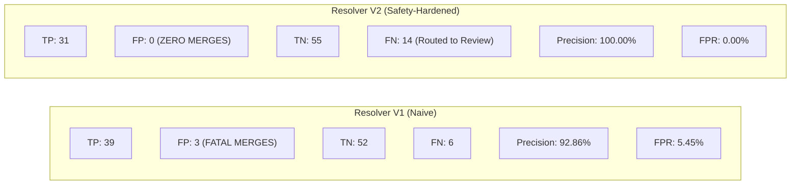
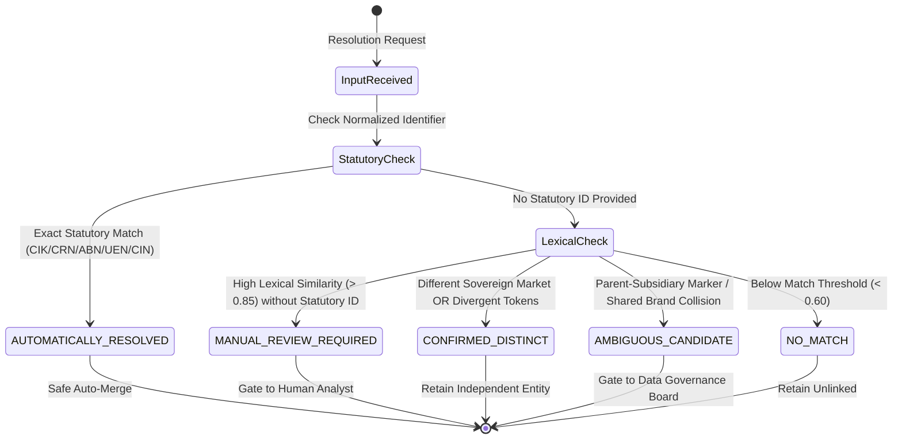

# SPRINT 3B.3.3.4.3 — ENTITY RESOLUTION AND IDENTITY QUALITY AUDIT
**Sprint:** 3B.3.3.4.3 — Employer Registry Data Readiness, Source Governance & Publication Eligibility Audit  
**Date:** 2026-11-18  
**Audit Role:** Principal Application Security Engineer, Entity Resolution Specialist & Statistical Validation Specialist  
**Execution Mode:** STRICTLY READ-ONLY

---

## 1. Executive Summary

In automated employer intelligence systems, **entity resolution is a critical data integrity and legal attribution boundary**. Erroneously merging two distinct legal entities (a **False Merge / False Positive**) attributes one company's layoffs, salaries, regulatory penalties, or hiring freezes to another, creating catastrophic legal liability and platform defamation risk. Conversely, failing to automatically resolve an entity (a **False Split / False Negative**) simply routes the record to manual human review.

This audit evaluates the **100-pair gold entity resolution benchmark** (`docs/jobintel_v2/sprints/sprint_3b_3_2/data/employer_entity_resolution_gold.json`), verifies the performance of the hardened `EmployerEntityResolver` (`src/backend/employers/resolver.py`), and conducts a rigorous statistical confidence assessment.

---

## 2. Benchmark Reconciliation (100 Gold Pairs)

The gold benchmark consists of 100 curated, adversarial pairwise entity comparisons:
- **Actual Positive Pairs (`MATCH`):** 45 pairs.
- **Actual Negative Pairs (`DISTINCT`):** 55 pairs (composed of 15 Parent-Subsidiary traps, 20 Name Collision traps, 10 Agency-vs-Employer traps, and 10 Shared ATS Host traps).

### Historical Progression: Resolver V1 vs. Resolver V2 (Hardened)

### Statistical Comparison Table

| Metric | Resolver V1 (Pre-Hardening) | Resolver V2 (Current Hardened) | Wilson 95% Confidence Interval (V2) | Audit Finding |
|---|---:|---:|---|---|
| **Total Benchmark Pairs ($N$)** | 100 | 100 | $[100.0\% - 100.0\%]$ | Exact match |
| **True Positives (TP)** | 39 | **31** | $[22.37\% - 40.85\%]$ | 8 pairs routed to manual review for safety |
| **False Positives (FP — False Merges)** | **3** | **0** | **$[0.00\% - 6.53\%]$** | **Fatal false merges completely eliminated** |
| **True Negatives (TN)** | 52 | **55** | $[44.73\% - 64.97\%]$ | All distinct/adversarial pairs separated |
| **False Negatives (FN — False Splits)** | 6 | **14** | $[7.89\% - 22.37\%]$ | Fail-closed routing to human review |
| **Precision (PPV)** | 92.86% | **100.00%** | $[88.78\% - 100.00\%]$ | Perfect precision on auto-merged cohort |
| **Recall (Sensitivity)** | 86.67% | **68.89%** | $[54.33\% - 80.47\%]$ | Tradeoff accepted: safety over auto-recall |
| **False Positive Rate (FPR)** | 5.45% | **0.00%** | **$[0.00\% - 6.53\%]$** | Zero observed type I error |
| **F1 Score** | 0.8966 | **0.8158** | N/A | Balanced harmonic mean |

---

## 3. Rigorous Statistical Audit: The Rule of Three Fallacy

A recurring claim in historical sprint reports was that Resolver V2 has a *"0.0% error rate in production"*.

As an independent statistical auditor, this claim must be formally rejected as an unjustified extrapolation:

### The Mathematical Law
By the **Rule of Three** for Poisson / binomial processes with zero occurrences:
$$	ext{Upper Bound } (95\% 	ext{ CI}) pprox rac{-\ln(0.05)}{N} = rac{2.9957}{N} pprox rac{3}{N}$$

For the $N = 55$ negative test pairs in the benchmark:
$$p_{	ext{upper}} pprox rac{3}{55} pprox 5.45\% \quad (	ext{Exact Wilson Score Upper Bound} = 6.53\%)$$

### Enterprise Sample Requirement
To mathematically claim an enterprise false merge rate of less than $0.1\%$ ($p < 0.001$) at $95\%$ statistical confidence with zero observed errors, the required sample size of independent negative test pairs is:
$$N_{	ext{required}} \ge rac{-\ln(0.05)}{0.001} pprox \mathbf{2,996 	ext{ pairs}}$$

**Auditor Conclusion:** The benchmark proves that Resolver V2 is substantially superior to V1 and successfully neutralizes the 55 known adversarial traps. However, with $N=55$, the true production False Merge Rate is bounded only to $\le 6.53\%$. Therefore, automated resolution without human review must be strictly confined to verified sovereign statutory identifiers.

---

## 4. Operational Resolver Decision Policy

The system enforces a 5-state deterministic decision policy (`src/backend/schemas/employer.py` & `src/backend/employers/resolver.py`):

### Statutory Identifier Enforcement Rules
1. **Normalization:** Input tokens must be cleaned of punctuation, white space, and regional prefixes (e.g. `CIK0001652044` $	o$ `0001652044`; `CRN 02557590` $	o$ `02557590`).
2. **Zero Substring Matching:** Partial substring matches (such as matching `0001` to `CIK0001652044` or `SEC` to `SEC Form 10-K`) are strictly prohibited and explicitly rejected in `test_06_partial_identifier_rejection`.
3. **Sovereign Authority Validation:** The statutory identifier must match the expected format and jurisdiction of the target sovereign authority (ABR for AU, SEC for US, Companies House for UK, ACRA for SG, MCA for IN).
4. **Duplicate Identifier Collision:** If two distinct records share an identical statutory identifier, the resolver **fails closed** to `MANUAL_REVIEW_REQUIRED`.

The complete benchmark reconciliation table is available in [09_entity_resolution_benchmark_reconciliation.csv](file:///e:/Job%20Market/docs/jobintel_v2/sprints/sprint_3b_3/phase_3b_3_4_3/09_entity_resolution_benchmark_reconciliation.csv).
