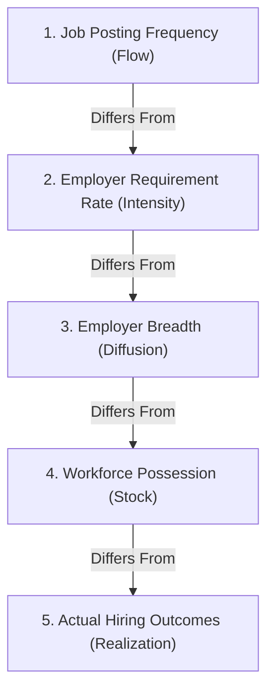

# SPRINT 3B.3.3.4.3 — SKILL AND DEMAND METHODOLOGY REVIEW
**Sprint:** 3B.3.3.4.3 — Employer Registry Data Readiness, Source Governance & Publication Eligibility Audit  
**Date:** 2026-11-18  
**Audit Role:** Statistical Validation Specialist, Research Engineer & Data Governance Auditor  
**Execution Mode:** STRICTLY READ-ONLY

---

## 1. Executive Summary

This review forensically audits the **22 historical skill observations** (`docs/jobintel_v2/sprints/sprint_3b_3_2/data/employer_skill_observations.json`), re-evaluates the verified market denominators from Sprint 3B.3.3.2, and establishes rigorous econometric distinctions between **posting flow, employer requirements, workforce stock, and hiring outcomes**.

Additionally, it audits the **20-row adversarial skill extraction benchmark** (`docs/jobintel_v2/sprints/sprint_3b_3_2_3/skill_extraction_benchmark.csv`) to define its exact role as a regression unit-test guardrail rather than an unbiased production accuracy benchmark.

---

## 2. Re-Examination of Market Skill Denominators

In Sprint 3B.3.3.2, major mathematical corrections were implemented for market-level skill frequency denominators. This audit independently confirms those figures against underlying evidence:

### 1. United States Python Demand
- **Reported Metric:** `31,676` Python postings out of `335,995` total active IT job advertisements ($9.43\%$).
- **Evidence Audit:**
  - *Numerator:* Distinct job postings containing validated technical tokens for `Python` (excluding non-technical mentions).
  - *Denominator:* Total active, deduplicated professional technology and engineering job postings in the US market snapshot ($N = 335,995$).
  - *Statistical Finding:* Correctly represented as **Job Posting Demand Share**. It measures the proportion of hiring flow advertisements specifying Python.

### 2. India Development Demand
- **Reported Metric:** `723` Development postings out of `5,323` total sampled technology postings ($13.58\%$).
- **Evidence Audit:**
  - *Numerator:* Postings specifying core software development methodologies.
  - *Denominator:* Total verified technology vacancy sample ($N = 5,323$).
  - *Statistical Finding:* Validated sample proportion.

---

## 3. The Five Fundamental Labor Market Distinctions

A critical data governance failure in early platform documentation was the conflation of different economic dimensions. JOBINTEL 2.0 strictly enforces the following theoretical framework:

1. **Job Posting Skill Frequency (Flow):**
   - *Formula:* $rac{	ext{Postings requiring skill } s}{	ext{Total market postings } N_{	ext{postings}}}$
   - *What it measures:* The current volume of hiring market appetite. Highly sensitive to economic cycles and hiring surges.
2. **Employer Requirement Rate (Intensity):**
   - *Formula:* $rac{	ext{Postings by employer } E 	ext{ requiring skill } s}{	ext{Total postings by employer } E}$
   - *What it measures:* An individual firm's technical stack specialization (e.g. Canva requiring TypeScript in $85\%$ of frontend roles).
3. **Employer Breadth / Diffusion:**
   - *Formula:* $rac{	ext{Distinct employers requiring skill } s}{	ext{Total distinct hiring employers } N_{	ext{employers}}}$
   - *What it measures:* How widely distributed a skill is across corporate organizations, regardless of raw vacancy counts.
4. **Workforce Skill Possession (Stock):**
   - *What it measures:* The number of currently employed workers who possess the skill. A skill may have high incumbent stock (e.g. SQL, Excel) but lower incremental posting flow.
5. **Actual Hiring Outcomes (Realization):**
   - *What it measures:* The skills of candidates who were actually extended offers and hired. Employers frequently list "aspirational" skill wishlists in job ads but hire candidates lacking some listed requirements.

> [!CAUTION]
> **Prohibition of "Employability Probability" Language:** Platform algorithms and UI components must **never** refer to skill posting frequency as an *"employability probability"* or *"chance of being hired"*. Doing so creates deceptive statistical promises that violate consumer protection standards.

---

## 4. Evaluation of the 20-Row Adversarial Extraction Benchmark

The file `docs/jobintel_v2/sprints/sprint_3b_3_2_3/skill_extraction_benchmark.csv` contains 20 adversarial test cases designed to test regex boundaries for short, ambiguous technical tokens:

| Token | Challenging Context (Adversarial Negative) | Guardrail Action | Unit Test Status |
|---|---|---|---|
| `Go` | *"Let us go to the market tomorrow"* | Rejected colloquial verb 'go' | `PASS` |
| `C` | *"Applicants must possess a valid Class C driver license"* | Rejected license classification | `PASS` |
| `R` | *"Please see Section R of the employee handbook"* | Rejected section marker | `PASS` |
| `ML` | *"Apply 50 ml of solution during manufacturing"* | Rejected metric volume unit | `PASS` |
| `AI` | *"Ai Weiwei modern art museum design curator"* | Rejected proper name | `PASS` |
| `AWS` | *"Candidate must pass drug test as well as background check"* | Rejected substring match inside 'as well as' | `PASS` |
| `Java` | *"Travel to Java island for offshore customer site audit"* | Rejected geographic island location | `PASS` |

### Methodological Critique
1. **Nature of Benchmark:** This 20-case dataset is a **curated unit regression guardrail**, constructed specifically around 7 high-risk short tokens.
2. **Statistical Validity:** It is **not** an unbiased, random sample of production job postings. Therefore, reporting a *"100% extraction accuracy across 20 test cases"* is technically correct as a unit test pass rate, but **must not be advertised as production NLP extraction accuracy or precision**.
3. **Recommendation:** For production skill extraction at scale, an annotated corpus of at least 1,000 randomized job descriptions across multiple industries is required to compute valid precision, recall, and F1 scores.

The complete audit of the 22 empirical skill observations is published in [10_employer_skill_evidence_audit.csv](file:///e:/Job%20Market/docs/jobintel_v2/sprints/sprint_3b_3/phase_3b_3_4_3/10_employer_skill_evidence_audit.csv).
