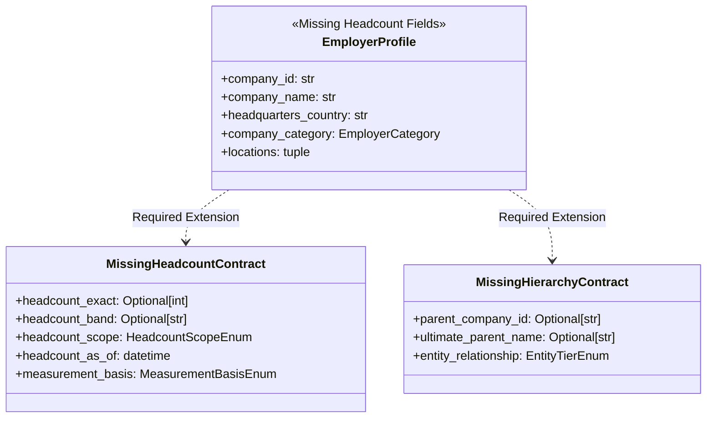

# SPRINT 3B.3.3.4.3 — EMPLOYER PUBLICATION CONTRACT REVIEW
**Sprint:** 3B.3.3.4.3 — Employer Registry Data Readiness, Source Governance & Publication Eligibility Audit  
**Date:** 2026-11-18  
**Audit Role:** Principal Backend Architect, Full-Stack Contract Engineer & Data Governance Specialist  
**Execution Mode:** STRICTLY READ-ONLY

---

## 1. Executive Summary

This review audits the existing **backend Pydantic schemas** (`src/backend/schemas/employer.py`), **API response contracts**, and **frontend TypeScript interfaces** (`frontend/src/types/index.ts` & `frontend/src/pages/EmployersPage.tsx`) against the operational requirements of publishing real-world employer intelligence.

The current schemas enforce high standards for validation (e.g., timezone-aware datetimes, frozen Pydantic models, strict regex validation on company IDs and country codes). However, several significant architectural gaps exist between the current schema contracts and the data structures necessary to faithfully represent empirical employer observations without distortion.

---

## 2. Evaluation of Current Pydantic & TypeScript Schemas

### 1. `EmployerProfile` Schema Analysis
```python
class EmployerProfile(BaseModel):
    model_config = ConfigDict(frozen=True)

    company_id: str = Field(pattern=r"^[a-z0-9][a-z0-9._-]{1,119}$")
    company_name: str = Field(min_length=2, max_length=180)
    headquarters_country: str = Field(pattern=r"^[A-Z]{2}$")
    company_category: EmployerCategory
    industry: str | None = Field(default=None, max_length=160)
    official_website: AnyHttpUrl | None = None
    operating_markets: tuple[MarketId, ...] = ()
    source_references: tuple[EmployerSourceReference, ...] = Field(min_length=1)
    verification_status: EmployerVerificationStatus = EmployerVerificationStatus.REVIEW_REQUIRED
    verified_at: datetime | None = None
    locations: tuple[EmployerLocation, ...] = ()
```

### Strengths Identified
- **Frozen Immutability:** Enforces thread-safe, immutable data structures across service workers.
- **Strict Validations:** Mandatory timezone-awareness on all datetimes (`verified_at`, `collected_at`); operating markets uniqueness validator.
- **Evidence Requirement:** `source_references` requires at least 1 verified source reference; verified status requires explicit `verified_at` timestamp.

---

## 3. Critical Contract & Capability Gaps

The following architectural gaps exist in the current data model:



### Gap 1: Absence of Headcount and Workforce Fields
- **Finding:** Neither `EmployerProfile` nor `EmployerLocation` contains any field for employee headcount (neither exact count nor headcount band).
- **Risk:** If a future developer attempts to force headcount into the profile without schema support, they might abuse `industry` or add unstructured text to `source_references`, preventing structured querying and UI badge rendering.
- **Recommendation:** Add a structured `headcount_disclosure` sub-model supporting both exact counts and categorical bands with explicit geographic scope (`GLOBAL_CONSOLIDATED`, `DOMESTIC_OPERATING`, `FACILITY_LOCAL`).

### Gap 2: Inability to Represent Corporate Hierarchy
- **Finding:** The schema treats every employer as a flat, standalone entity. It lacks `parent_company_id`, `subsidiary_relationship`, and `ultimate_parent_name`.
- **Risk:** A subsidiary (e.g. DeepMind Technologies Limited) cannot be programmatically linked to its ultimate parent (Alphabet Inc.), risking duplicate brand confusion or misattribution of parent metrics.

### Gap 3: Sovereign Statutory Identifiers Omitted from Profile
- **Finding:** While `EmployerResolutionRequest` accepts `statutory_identifier` and `statutory_authority`, the resulting `EmployerProfile` does not expose these as top-level canonical fields. They are buried inside unstructured `source_references`.
- **Recommendation:** Elevate sovereign identifiers (e.g. `statutory_identifier: str`, `statutory_authority: str`) to primary fields on `EmployerProfile`.

### Gap 4: Freshness and Revocation Metadata
- **Finding:** No field exists for `data_expiry_date`, `license_tier`, or `attribution_markdown`.
- **Risk:** The frontend cannot automatically display required statutory attribution notices (e.g. OGL v3, CC-BY 4.0) without hardcoded UI logic.

---

## 4. Contract Governance Recommendations (For Future Implementation Sprints)

> [!NOTE]
> Under strict read-only constraints, **no schema files were modified during Sprint 3B.3.3.4.3**. The following recommendations are formally submitted for the subsequent schema evolution phase:

1. **Schema Enhancement — `EmployerHeadcount` Submodel:**
   ```python
   class HeadcountScope(StrEnum):
       GLOBAL_CONSOLIDATED = "GLOBAL_CONSOLIDATED"
       NATIONAL_DOMESTIC = "NATIONAL_DOMESTIC"
       FACILITY_LOCAL = "FACILITY_LOCAL"

   class EmployerHeadcount(BaseModel):
       model_config = ConfigDict(frozen=True)
       measurement_basis: str  # EXACT_COUNT or SIZE_BAND
       exact_count: int | None = None
       size_band: str | None = None
       geographic_scope: HeadcountScope
       as_of_date: date
       statutory_source: str
   ```
2. **Profile Hierarchy Extension:**
   ```python
   parent_company_id: str | None = None
   subsidiary_relationship: str | None = None
   ```
3. **Canonical Statutory Identity:**
   ```python
   statutory_identifier: str | None = None
   statutory_authority: str | None = None
   ```
