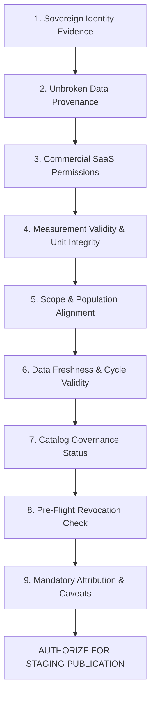

# SPRINT 3B.3.3.4.3 — PUBLICATION ELIGIBILITY RULES
**Sprint:** 3B.3.3.4.3 — Employer Registry Data Readiness, Source Governance & Publication Eligibility Audit  
**Date:** 2026-11-18  
**Audit Role:** Principal Data Architect & Data Governance Specialist  
**Execution Mode:** STRICTLY READ-ONLY

---

## 1. Principles of Publication Eligibility

A corporate record or empirical observation must **never** become publishable merely because:
- It possesses a recognized company brand name.
- It has an accessible corporate website or Wikipedia page.
- It has an accessible web URL or API endpoint.
- It achieved a high lexical similarity score during entity resolution.
- It appears in a marketing press release or executive blog post.
- Its data source was classified as "approved" for an unrelated analytical purpose.

Publication authorization in JOBINTEL 2.0 requires passing the **Mandatory Nine-Point Publication Protocol**.

---

## 2. The Mandatory Nine-Point Publication Protocol

### Rule 1: Authoritative Sovereign Identity Evidence
The employer profile must be verified against an official sovereign corporate registrar (ABR for Australia, SEC EDGAR for United States, Companies House for United Kingdom, ACRA for Singapore, MCA for India). Unregistered trading names or unverified entities must fail closed.

### Rule 2: Unbroken Data Provenance
Every metric or observation must trace back to an immutable retrieval record containing:
- Specific source ID (`data_source_id`).
- Collection timestamp with timezone (`collected_at`).
- Formal statutory citation or canonical URL.
- Cryptographic content hash (SHA-256) of the raw extract.

### Rule 3: Validated Commercial SaaS Permissions
The data source license must explicitly grant permission for the exact intended technical use:
- Persistent database storage.
- Multi-tenant commercial SaaS exposure.
- Machine-learning feature input (if applicable).
- No uncontracted proprietary datasets (e.g. Lightcast) may be exposed.

### Rule 4: Measurement Validity & Unit Integrity
- **Categorical Band Preservation:** Headcount bands (e.g. WGEA `1,000 to 4,999`) must remain categorical bands. Synthesizing a point estimate is strictly prohibited.
- **Unit Consistency:** Active vacancies (`OPEN_VACANCIES`) must never be added to employee headcount (`EMPLOYEES`).

### Rule 5: Scope & Population Alignment
- **Consolidation Scope:** Global parent figures from SEC Form 10-K cannot be attributed to regional subsidiaries.
- **Operating Scope:** Regional headcount must specify domestic coverage.
- **Agency Exclusion:** Third-party staffing and recruitment agencies are strictly barred from direct corporate employer profiles.

### Rule 6: Temporal Freshness & Reporting Cycle
Observations must reflect active statutory reporting cycles (annual filings within 18 months, active job vacancies within 30 days). Expired filings must be marked with a staleness warning.

### Rule 7: Catalog Governance Status
The source must be marked `APPROVED` or `CONDITIONAL` in the active `employer_source_catalog.json`. Sources marked `REVIEW_REQUIRED`, `REVOKED`, or `EXPIRED` automatically block publication.

### Rule 8: Pre-Flight Revocation Check
Before any record or observation is served by backend APIs or rendered on frontend pages, it must pass an automated pre-flight query against `src/backend/config/revocation_manifest.json`. Any revoked source triggers immediate fail-closed redaction.

### Rule 9: Mandatory Attribution & Disclosures
Every published record must present the legally mandated license attribution string (e.g. OGL v3, CC-BY 4.0, SEC Public Domain notice) and statutory caveats directly in the UI.

---

## 3. Strict Separation of Governance Dimensions

The platform must maintain absolute separation between three distinct dimensions:
1. **Identity Confidence:** How certain we are that entity $A$ is corporate entity $B$ (e.g. 100% certainty via CRN).
2. **Data Source Confidence:** How certain we are that the reported figure is accurate (e.g. 100% certainty via audited financial statements).
3. **Publication Authorization:** Whether we have the legal, contractual, and regulatory right to publish that figure in a commercial SaaS product.

A record may have 100% Identity Confidence and 100% Data Source Confidence, but **0% Publication Authorization** if the source terms prohibit commercial redistribution (e.g. proprietary vendor data or scraped aggregator feeds).
