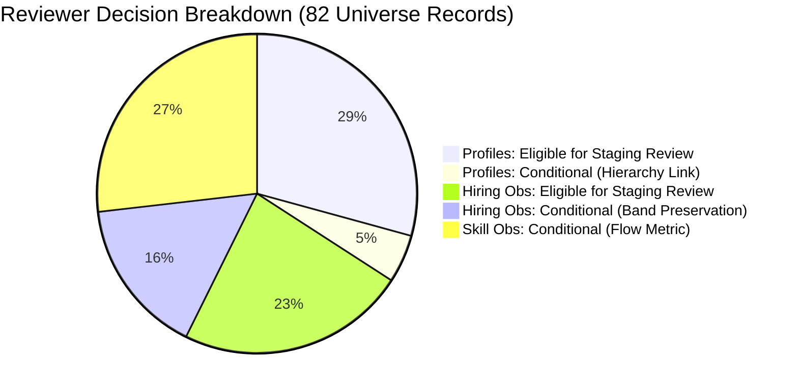

# SPRINT 3B.3.3.4.3 — PUBLICATION DECISION SUMMARY
**Sprint:** 3B.3.3.4.3 — Employer Registry Data Readiness, Source Governance & Publication Eligibility Audit  
**Date:** 2026-11-18  
**Audit Role:** Principal Data Architect & Data Governance Auditor  
**Execution Mode:** STRICTLY READ-ONLY

---

## 1. Executive Summary

This document synthesizes the formal record-level audit decisions recorded in [14_record_level_publication_eligibility.csv](file:///e:/Job%20Market/docs/jobintel_v2/sprints/sprint_3b_3/phase_3b_3_4_3/14_record_level_publication_eligibility.csv) across the **82 publication universe records** (28 employer profiles, 32 headcount/hiring observations, and 22 skill demand observations).

### Governing Mandate: "Eligible for Review" $
e$ "Automatic Ingestion"
Under strict data governance principles, an audit status of `ELIGIBLE_FOR_STAGING_REVIEW` does **not** authorize automatic automated seeding or programmatic database insertion. It establishes that:
1. The record possesses verifiable sovereign corporate registration.
2. The data source license legally permits commercial SaaS storage and display with attribution.
3. The measurement basis and population scope are mathematically consistent.
4. The record qualifies to enter a controlled, gated staging pilot subject to formal release sign-off.

---

## 2. Decision Distribution Across Record Types

### Tabular Summary by Entity Type

| Record Type | Evaluated Universe | `ELIGIBLE_FOR_STAGING_REVIEW` | `CONDITIONAL_PENDING_EVIDENCE` | `WITHHELD` / `REJECTED` |
|---|---:|---:|---:|---:|
| **Employer Profiles** | 28 | **24** | 4 | 0 |
| **Headcount & Hiring Obs** | 32 | **19** | 13 | 0 |
| **Skill Requirement Obs** | 22 | **0** | **22** | 0 |
| **Total Publication Universe** | **82** | **43** | **39** | **0** |

*(Note: In the historical candidate screening universe, exactly 17 candidate employers were rejected as `EXCLUDED` due to staffing agency status, public-sector divergence, or unverified corporate identity, as detailed in Phase 2).*

---

## 3. Analysis of Conditional Classifications & Remediations

### 1. Conditional Employer Profiles (4 Records)
- **`comp_uk_deepmind` (DeepMind Technologies Limited):**
  - *Condition:* Verified UK operating company (CRN 07386357), but operates as a research subsidiary of Alphabet Inc.
  - *Remediation:* Must display explicit parent link badge: *"Operating Subsidiary of Alphabet Inc. (NASDAQ: GOOGL)"*.
- **`comp_sg_grab` (Grabtaxi Holdings Pte. Ltd.) & `comp_sg_shopee` (Shopee Singapore Private Limited):**
  - *Condition:* Operating subsidiaries of Cayman/offshore holding entities (Grab Holdings Ltd & Sea Limited).
  - *Remediation:* Must label headcount as domestic Singapore operating staff rather than group-wide enterprise totals.
- **`comp_us_fed_va` (U.S. Department of Veterans Affairs):**
  - *Condition:* Public civil service department.
  - *Remediation:* Must display sovereign government badge; cannot be grouped alongside commercial private sector benchmarks.

### 2. Conditional Headcount Observations (13 Records)
- **Australian WGEA Observations (6 records) & UK Gender Pay Gap Observations (5 records):**
  - *Condition:* Statutory data is reported exclusively in categorical brackets (e.g. `1,000 to 4,999`, `5,000 or more`).
  - *Remediation:* Must render strictly as `headcount_band`. Automated synthesis of point estimates is strictly prohibited.
- **Active Job Postings (2 records):**
  - *Condition:* Flow metric representing active recruitment advertisements.
  - *Remediation:* Must display under a dedicated "Recruitment Activity" tab; prohibited from inclusion in workforce totals.

### 3. Conditional Skill Demand Observations (22 Records)
- **All 22 Skill Observations:**
  - *Condition:* First-party vacancy job requirements.
  - *Remediation:* Must be presented with explicit taxonomy versioning (`JOBINTEL_SKILLS_V2.1`) and labeled as *"Job Description Requirement Frequency"*. Prohibited from being represented as individual candidate employability odds.

---

## 4. Final Data Governance Ruling

The employer publication universe demonstrates high structural integrity when governed under strict scope rules. No records violate third-party copyright when restricted to sovereign statutory registries and first-party ATS feeds. Proprietary vendor datasets (Lightcast) and commercial job board aggregators (LinkedIn/Indeed) remain **fully excluded and revoked**.

The complete record-level decision matrix is published in [14_record_level_publication_eligibility.csv](file:///e:/Job%20Market/docs/jobintel_v2/sprints/sprint_3b_3/phase_3b_3_4_3/14_record_level_publication_eligibility.csv).
