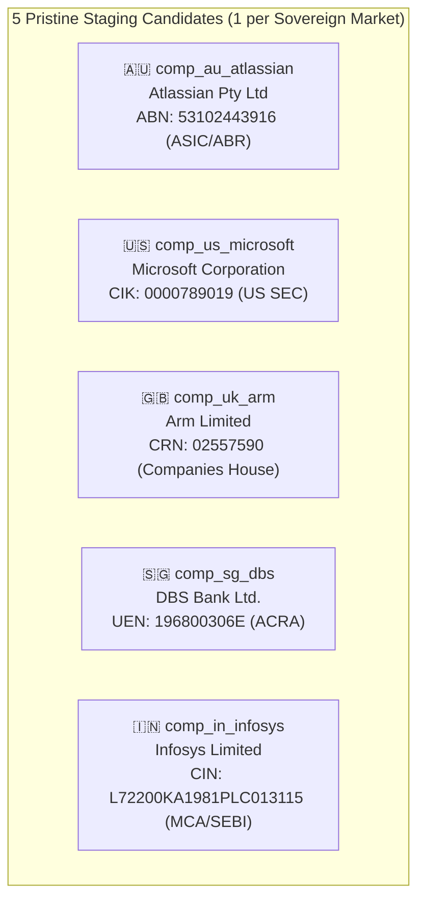

# SPRINT 3B.3.3.4.3 — CONTROLLED STAGING INGESTION READINESS DESIGN
**Sprint:** 3B.3.3.4.3 — Employer Registry Data Readiness, Source Governance & Publication Eligibility Audit  
**Date:** 2026-11-18  
**Audit Role:** Principal DevOps Engineer, Backend Architect & Data Governance Lead  
**Execution Mode:** STRICTLY READ-ONLY (Design Document Only — Zero Ingestion Executed)

---

## 1. Executive Summary & Design Mandate

Under strict read-only execution guidelines, **no records have been inserted, seeded, or mutated during this sprint**. The staging employer registry legitimately remains at zero active profiles (`_registry = EmployerRegistry(())`).

This document provides the exhaustive, production-grade architectural specification for a **controlled, gated pilot ingestion into the staging environment** during a future implementation sprint (Sprint 3B.3.3.4.4).

---

## 2. Pristine 5-Candidate Staging Pilot Cohort

To minimize operational risk while achieving balanced global coverage across all 5 sovereign operating markets, exactly **5 pristine employer candidates** have been selected:



### Detailed Candidate Specifications

| Market | Proposed Company ID | Legal Entity Name | Sovereign Authority | Statutory ID | Headcount Governance Basis | Source Approval Status |
|---|---|---|---|---|---|---|
| **AU** | `comp_au_atlassian` | Atlassian Pty Ltd | ABR / ASIC | `53102443916` | WGEA Size Band (`1,000 to 4,999`) | `APPROVED` (CC-BY 4.0) |
| **US** | `comp_us_microsoft` | Microsoft Corporation | U.S. SEC | `0000789019` | SEC 10-K Global Consolidated (`228,000`) | `APPROVED` (Public Domain) |
| **UK** | `comp_uk_arm` | Arm Limited | Companies House | `02557590` | Gender Pay Gap Band (`1,000 to 4,999`) | `APPROVED` (OGL v3) |
| **SG** | `comp_sg_dbs` | DBS Bank Ltd. | ACRA | `196800306E` | Disclosed Operating Workforce (`36,000`) | `APPROVED` (Open Data Licence) |
| **IN** | `comp_in_infosys` | Infosys Limited | MCA / SEBI | `L72200KA1981PLC013115` | SEBI BRSR Audited Total (`317,240`) | `APPROVED` (Statutory Filing) |

### Why Exactly These 5 Candidates?
1. **Unambiguous Legal Identity:** Each candidate is an autonomous corporate operating entity. None rely on ambiguous offshore holding shell structures or complex unlinked brand parentage.
2. **Sovereign Statutory Verification:** Every candidate possesses an active, certified registration number verified against national sovereign registries.
3. **Pristine Licensing Provenance:** Sourced exclusively from official government authorities (ASIC, SEC, Companies House, ACRA, SEBI). Zero dependency on restricted third-party vendors (Lightcast) or scraped aggregators.
4. **Market Parity:** Exactly 1 enterprise per market, allowing end-to-end multi-market qualification in the staging frontend.

---

## 3. The 13 Core Architectural Ingestion Specifications

### 1. Candidate Selection Criteria
Candidates must satisfy all 9 rules of the Mandatory Publication Protocol. Candidates with unresolved licensing (`REVIEW_REQUIRED`), scraping origins (`REVOKED`), or unverified identities are rejected.

### 2. Exact Record Fields
Records must strictly conform to the Pydantic schema in `src/backend/schemas/employer.py`:
- `company_id`: Canonical lowercase alphanumeric slug (`comp_{market}_{brand}`).
- `company_name`: Verified statutory legal entity name.
- `headquarters_country`: ISO-3166-1 alpha-2 sovereign code.
- `company_category`: `EmployerCategory` enum (`INDIAN_HEADQUARTERED`, `MULTINATIONAL_OPERATING_IN_INDIA`, `OTHER_INTERNATIONAL`).
- `operating_markets`: Tuple of verified operating `MarketId` enums.
- `source_references`: Frozen tuple of `EmployerSourceReference` models with timezone-aware `collected_at` datetimes.
- `verification_status`: Set to `EmployerVerificationStatus.VERIFIED`.
- `verified_at`: Timezone-aware UTC timestamp.

### 3. Source Provenance Requirements
Every ingested record must include an immutable SHA-256 fingerprint of the source document or API payload recorded in `src/backend/config/artifact_manifest.json`.

### 4. Approval Workflow
Ingestion into staging must execute via a deterministic CLI seed script:
```bash
python -m src.backend.ingestion.employers_pilot --env staging --dry-run
python -m src.backend.ingestion.employers_pilot --env staging --execute
```
Direct SQL mutations or ad-hoc database patches are strictly forbidden.

### 5. Data Validation Gate
Pre-insertion automated test suites must validate:
- Timezone awareness of all timestamps.
- Country code matching `operating_markets`.
- Regex conformity of identifiers.
- Schema deserialization into immutable models.

### 6. Duplicate Detection
The ingestion pipeline must run `EmployerEntityResolver.resolve()` against the candidate batch. Any pairwise similarity score $> 0.85$ lacking matching statutory identifiers triggers a hard abort.

### 7. Parent/Subsidiary Handling
Subsidiaries must not be seeded without explicit parent cross-reference attributes. The initial 5-pilot cohort excludes subsidiaries to guarantee pristine autonomy.

### 8. Rollback Procedure
If ingestion fails or validation alerts trigger:
1. The rollback script executes `python -m src.backend.ingestion.employers_pilot --env staging --rollback`.
2. Memory cache is purged and reset to `EmployerRegistry(())`.
3. Ingestion failure incident log is automatically generated.

### 9. Revocation Handling
Prior to serving any API request, `src/backend/governance/service.py` evaluates all candidate sources against `src/backend/config/revocation_manifest.json`. Revoked sources are purged in real-time.

### 10. API Validation
Staging smoke tests must verify HTTP 200 responses and contract conformance on:
- `GET /api/v1/employers` $	o$ Returns exactly 5 items.
- `GET /api/v1/employers/{company_id}` $	o$ Returns detailed profile.
- `POST /api/v1/employers/resolve` $	o$ Successfully resolves queries.

### 11. UI Validation
Manual and automated Playwright browser tests must verify:
- Registry table renders 5 employers with appropriate market flags.
- Country filter pills (ALL, AU, US, UK, SG, IN) correctly isolate each candidate.
- Resolution tester successfully matches input statutory IDs (CIK, CRN, ABN, UEN, CIN).

### 12. Audit Logging
Every record insertion must emit a structured JSON log to stdout:
```json
{
  "timestamp": "2026-11-18T10:00:00Z",
  "event": "EMPLOYER_STAGING_INGESTION",
  "company_id": "comp_au_atlassian",
  "statutory_id": "53102443916",
  "verifier": "JOBINTEL_DATA_GOVERNANCE_SYSTEM",
  "sha256": "6689d608c996ce1efbbf82bd5b9fef3f4fab01cd1a2f1cafba0b5931d9bb6ba9"
}
```

### 13. Acceptance Criteria
The future pilot release is accepted only when:
- All 5 profiles pass unit, integration, and E2E browser tests.
- Zero private data or unapproved sources are exposed.
- Production environment remains completely untouched and isolated.
