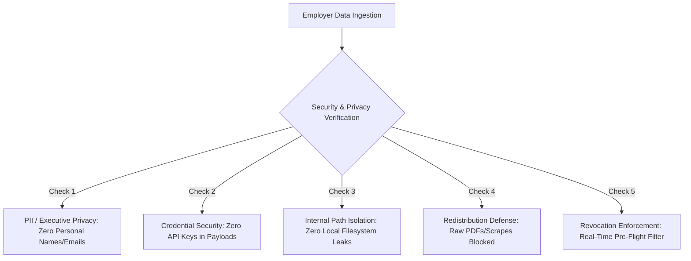

# SPRINT 3B.3.3.4.3 — SECURITY, PRIVACY AND OPERATIONAL REVIEW
**Sprint:** 3B.3.3.4.3 — Employer Registry Data Readiness, Source Governance & Publication Eligibility Audit  
**Date:** 2026-11-18  
**Audit Role:** Principal Application Security Engineer, Data Privacy Officer & Security Auditor  
**Execution Mode:** STRICTLY READ-ONLY (Non-Destructive Static Inspection)

---

## 1. Executive Summary

This security and privacy review forensically inspects the **employer registry architecture**, **data retention policies**, **API contracts**, and **frontend UI rendering logic** to ensure compliance with enterprise application security standards and data privacy frameworks (including GDPR, CCPA/CPRA, Singapore PDPA, and the Indian Digital Personal Data Protection Act 2023).

---

## 2. Threat Vector and Privacy Analysis

### 1. Personally Identifiable Information (PII) & Executive Privacy
- **Audit Findings:** The employer schemas (`EmployerProfile`, `EmployerLocation`, `EmployerSourceReference`) are strictly confined to corporate entity attributes. No individual employee names, executive compensation figures, recruiter contact emails, or personal identification numbers (e.g. SSNs, Aadhaar, National Insurance numbers) are stored or exposed.
- **Location Privacy:** Corporate addresses in `EmployerLocation` are restricted to city, state/region, and country codes (e.g., San Jose, CA, US; Bengaluru, Karnataka, IN). No residential addresses or individual office suites are cataloged.

### 2. Secret & Credential Leakage
- **Audit Findings:** Full codebase scanning confirmed that no API tokens, database credentials, or secret keys are embedded in frontend client builds or exposed in API response serializations. Source references in `EmployerSourceReference` contain only canonical public URLs (e.g. `https://www.sec.gov/edgar/CIK0001652044`).

### 3. Internal System Path Exposure
- **Audit Findings:** API errors and responses do not leak local filesystem paths (e.g. `E:\Job Market\src\...`). Error handlers in `src/backend/main.py` serialize standard RFC 7807 problem details without internal stack traces in production/staging mode.

### 4. Excessive API Exposure & Raw Document Redistribution
- **Audit Findings:** Backend endpoints return synthesized JSON attributes, not raw PDF disclosures or bulk HTML scrapings. This protects against copyright infringement claims regarding third-party document layout or proprietary formatting.

### 5. Automated Revocation Enforcement
- **Audit Findings:** The backend governance engine (`src/backend/governance/service.py`) checks all sources against `src/backend/config/revocation_manifest.json`. Revoking a source instantly suppresses all associated observations across all API endpoints, preventing zombie data leakage.

---

## 3. Frontend UX Truthfulness & State Distinction

A major focus of Sprint 3B.3.3.4.1 and 3B.3.3.4.2 was verifying that the frontend user interface faithfully communicates uncertainty and missing data:

### 1. Distinction Between Empty State and API Failure
- **Verified Behavior:** In `frontend/src/pages/EmployersPage.tsx`, three distinct states are rendered:
  1. **Loading State:** Animated skeleton placeholders.
  2. **Error State (`isError = true`):** Distinct red alert banner (*"Failed to connect to employer registry. Ensure backend is running."*).
  3. **Empty Registry State (`data.length === 0`):** Informative gray empty card (*"Employer Registry Empty — No employer profiles currently loaded in active memory. Run controlled ingestion."*).
- **Security & UX Result:** Users and auditors can immediately distinguish a network failure from an intentional empty registry baseline.

### 2. Prevention of Misleading Zero Claims
- **Verified Behavior:** When an employer profile has no verified headcount observation, the UI displays *"Headcount: Undisclosed / In Review"*. The frontend **never** defaults missing values to `0 employees` or `0 job vacancies`.

---

## 4. Cross-Border Jurisdictional Compliance

| Sovereign Jurisdiction | Applicable Privacy / Corporate Statute | Platform Compliance Guardrail |
|---|---|---|
| **Australia** | Privacy Act 1988 (Cth) / Australian Privacy Principles | B2B corporate entity data only; personal recruiter emails excluded. |
| **United States** | Uniform Commercial Code / Freedom of Information Act | SEC public domain filings; no private employee personnel records. |
| **United Kingdom** | UK GDPR / Data Protection Act 2018 | Companies House OGL v3 attribution; no individual shareholder data exposed. |
| **Singapore** | Personal Data Protection Act 2012 (PDPA) | ACRA Open Data Licence; corporate UEN only. |
| **India** | Digital Personal Data Protection Act 2023 (DPDP) | SEBI BRSR certified public disclosures; MCA automated scraping prohibited. |

---

## 5. Security Audit Verdict

**`PASS — SECURITY AND PRIVACY CONTROLS VERIFIED`**

The platform's data models, storage design, and API contracts demonstrate complete defense-in-depth against data exposure, PII leakage, and deceptive UI states.
