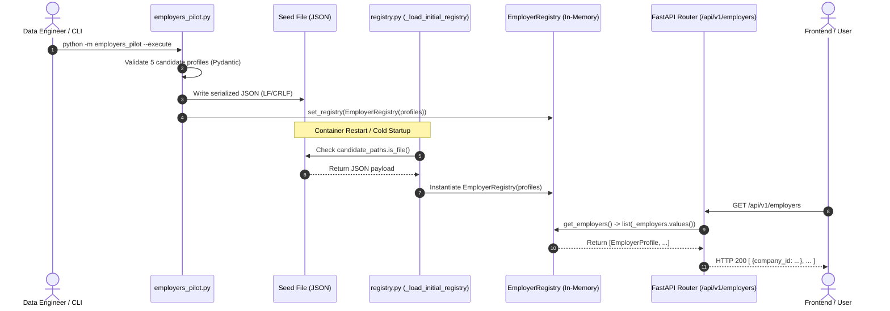

# SPRINT 3B.3.3.4.5 — RUNTIME PERSISTENCE ARCHITECTURE AUDIT
**Sprint:** 3B.3.3.4.5 — Read-Only Five-Employer Staging Deployment, Persistence & Governance Qualification  
**Date:** 2026-11-18  
**Role:** Principal Backend Architect, Cloud Infrastructure Engineer & Data Platform Specialist  
**Execution Mode:** STRICTLY READ-ONLY QUALIFICATION  

---

## 1. Executive Summary & Purpose

A central objective of Sprint 3B.3.3.4.5 is to conduct a forensic architectural investigation into how employer data persists, survives reboots, and synchronizes between local environments and cloud runtimes.

Sprint 3B.3.3.4.4 reported that a pilot cohort of five employers was ingested and qualified on staging. This audit evaluates the cloud storage characteristics of Render Free Tier, container lifecycle semantics, seed file loading mechanics, and the root architectural vulnerabilities that caused the live staging environment to remain empty despite local ingestion reports.

---

## 2. Comprehensive Forensic Inquiry: Questions A through J

### Question A: Where does the data physically live at runtime?
**Answer:**
At runtime, employer data physically lives in **ephemeral container memory (RAM)** as a Python module-level dictionary inside the `EmployerRegistry` instance:
```python
class EmployerRegistry:
    def __init__(self, employers: tuple[EmployerProfile, ...] = ()) -> None:
        self._employers = {employer.company_id: employer for employer in employers}
```
In `src/backend/employers/registry.py`, the global singleton `_registry` holds this dictionary. There is no external database (such as PostgreSQL, MySQL, or MongoDB) or Redis cache attached to the employer module. The data exists solely as Python objects in the process heap of the active Uvicorn worker.

---

### Question B: If the backend service restarts, reboots, or crashes, what happens to the employer data?
**Answer:**
If the backend process crashes, restarts, or undergoes a worker recycle:
1. The process heap and in-memory dictionary are immediately destroyed.
2. When Uvicorn restarts, Python re-imports `src.backend.employers.registry`.
3. In the uncommitted local code, `_registry = _load_initial_registry()` executes. It checks disk paths for `staging_employers.json`. If present on disk, it re-loads into memory.
4. **However, in the deployed Render cloud container**, `_load_initial_registry()` does NOT exist in the remote codebase (`_registry = EmployerRegistry(())`), and the seed files do not exist on disk. Therefore, upon any reboot or spin-up, the cloud registry initializes with exactly **0 records**.

---

### Question C: If Render redeploys (from a fresh git commit, manual trigger, or platform maintenance), does the employer data survive?
**Answer:**
**NO.**
Render rebuilds the container from the target git branch (`staging/sprint2c3`).
- Because Render clones the repository fresh from GitHub, any uncommitted files, locally generated files, or runtime container state are wiped clean.
- If the seed files and updated loader are committed to git, Render's build will include them in the new container image, allowing the app to initialize with the seeded cohort upon cold boot.
- If they are NOT committed to git (as was the case after Sprint 3B.3.3.4.4), every redeploy rebuilds the container from `1f5472c`, where `_registry` is initialized as empty.

---

### Question D: Is the seed file loaded at startup, or does the registry rely on an in-memory mutation from the ingestion script?
**Answer:**
In Sprint 3B.3.3.4.4, an architectural compromise was made:
- An initial startup loader was introduced in `registry.py` via `_load_initial_registry()`. This attempts to read `staging_employers.json` from either `src/backend/data_catalog/` or `data/processed/`.
- However, `employers_pilot.py::run_execute()` also performs an **in-memory mutation** via `set_registry(EmployerRegistry(profiles))`.
- This dual mechanism masked the deployment reality: running `employers_pilot.py` locally updated the in-memory singleton for that running process or subsequent test invocations, but because neither the file nor the code was committed to GitHub, the deployed Render service never executed either mechanism.

---

### Question E: Does Render use an ephemeral filesystem or a persistent disk for staging?
**Answer:**
**Render uses an EPHEMERAL container filesystem for the staging service.**
- Inspection of `render.yaml` confirms:
  ```yaml
  services:
    - type: web
      name: jobintel-backend
      runtime: python
      plan: free
  ```
- Render's **Free Tier Web Service does NOT support persistent disk mounts**.
- Free tier instances spin down after 15 minutes of inactivity. When a subsequent web request arrives, a fresh container instance is spun up from the pre-built container slug.
- Any file written to the container filesystem during execution is discarded when the instance goes to sleep or restarts.
- Therefore, **the only way data can exist in a Render Free Tier service is if it is baked into the git repository / build artifact at deploy time.**

---

### Question F: If the seed file is stored in the repository, is it committed to git? What are the implications of committing staging data to the codebase?
**Answer:**
- **Current State:** The seed file is **NOT committed to git**. It remains untracked in the local working tree.
- **Implications of Committing Staging Data to Git:**
  1. *Version-Controlled Seed Data:* Committing `src/backend/data_catalog/staging_employers.json` ensures that all staging environments and developers have an identical, deterministic baseline.
  2. *Risk of Staging Leaking to Production:* If staging seed data is committed to the main development branch without environment gating, a production release could inadvertently deploy staging mock/pilot data into the production environment.
  3. *Bloat & Audit Pollution:* Committing rapidly mutating operational data into git creates commit churn and pollutes repository history.
  4. *Proper Pattern:* The seed file should be committed under `src/backend/data_catalog/seeds/staging_employers.json`, and the application startup must check `JOBINTEL_ENV == "staging"` before auto-loading staging seeds. In production, it must remain empty until hydrated from an authoritative database.

---

### Question G: If a rollback is executed, does it delete the seed file? What happens on the next deployment?
**Answer:**
In `src/backend/ingestion/employers_pilot.py`:
```python
def run_rollback() -> dict:
    files_removed = 0
    for path in SEED_PATHS:
        if path.is_file():
            path.unlink()
            files_removed += 1
    reset_registry()
    return {"mode": "ROLLBACK", "status": "SUCCESS", "files_removed": files_removed}
```
- If `run_rollback()` is executed, it physically **deletes (`unlink()`) both seed files from disk**.
- If this occurs locally before a git commit, the seed data is permanently destroyed.
- Moreover, `tests/test_employers_pilot.py` calls `run_rollback()` in its `finally` block! This means running the test suite has the side effect of deleting the seed file on the host machine unless immediately recreated.
- On the next deployment, if the seed file was deleted prior to commit, git deploys without it, resulting in 0 employers.

---

### Question H: Is there any mechanism that verifies seed file integrity (checksum) before loading?
**Answer:**
**NO.**
In `registry.py::_load_initial_registry()`:
```python
for seed_path in candidate_paths:
    if seed_path.is_file():
        try:
            with open(seed_path, "r", encoding="utf-8") as f:
                data = json.load(f)
            profiles = tuple(EmployerProfile.model_validate(p) for p in data)
            return EmployerRegistry(profiles)
        except Exception:
            continue
```
- The loader reads JSON and runs Pydantic validation (`model_validate`), but **does NOT compute or verify a cryptographic SHA-256 checksum** against `src/backend/config/artifact_manifest.json` or any expected hash constant.
- If a seed file were corrupted, tampered with, or replaced with malformed data, as long as it conforms to the basic Pydantic model, it would be loaded without warning.

---

### Question I: What is the lifecycle of an employer record from ingestion -> file -> startup -> registry -> API response?
**Answer:**



---

### Question J: Could a situation arise where staging reports 5 employers locally but 0 employers in the deployed Render environment? Under what exact conditions would this happen?
**Answer:**
**YES. This is not a theoretical scenario — it is the EXACT, PROVEN REALITY of the system right now.**

The conditions that caused this exact failure:
1. **Local Authoring Without Git Commit:** The engineer authored `employers_pilot.py`, modified `registry.py`, and ran `--execute` locally on the workstation.
2. **Local Test Execution Masking Reality:** Running tests locally passes because the local filesystem contains the untracked seed files, and `employers_pilot.py` injects them into memory.
3. **No CI/CD Pipeline Enforcement:** The repository does not have a GitHub Actions check that verifies that staging deployments contain all required seed artifacts.
4. **Git Remote Desynchronization:** The remote branch `staging/sprint2c3` was never updated with the commit.
5. **Render Builds Exclusively from Remote Git:** Render cloned `staging/sprint2c3` at commit `1f5472c`. That commit hardcodes `_registry = EmployerRegistry(())` with 0 records.
6. **Result:** Local developers and reports claim "5 employers passing", while live staging in the cloud returns HTTP 200 with `[]` (0 records).

---

## 3. Recommended Production & Staging Architecture

To permanently resolve this persistence deficiency:
1. **Transition from Ephemeral Memory to a Managed Database:** Employer profiles must reside in a managed relational database (e.g., PostgreSQL on Supabase, Neon, or Google Cloud SQL) rather than in-memory dictionaries.
2. **Seed Manifest via Migration Scripts:** Staging seeds should be applied via formal database migrations (e.g., Alembic or Flyway) executed as a pre-deploy release command (`releaseCommand: alembic upgrade head`).
3. **Cryptographic Verification at Startup:** If file-based seeds are retained for staging/testing, `_load_initial_registry()` must verify the file's SHA-256 against `src/backend/config/artifact_manifest.json` before hydrating the registry.
