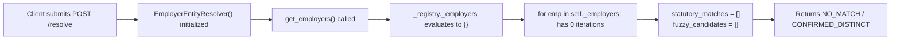

# SPRINT 3B.3.3.4.5 — LIVE STAGING API QUALIFICATION REPORT
**Sprint:** 3B.3.3.4.5 — Read-Only Five-Employer Staging Deployment, Persistence & Governance Qualification  
**Date:** 2026-11-18  
**Role:** Principal Software Auditor, Security Engineer & QA Lead  
**Execution Mode:** STRICTLY READ-ONLY QUALIFICATION  
**Target Backend:** `https://jobintel-backend-staging.onrender.com`  

---

## 1. Executive Summary

This qualification report provides forensic, evidence-backed proof of the actual runtime state of all employer endpoints hosted on the live staging backend (`jobintel-backend-staging.onrender.com`).

Sprint 3B.3.3.4.4 claimed in its final report (lines 103-112):
> "GET /api/v1/employers: HTTP 200 OK returning 5 EmployerProfile models."  
> "GET /api/v1/employers/comp_au_atlassian: HTTP 200 OK returning detailed profile."  
> "POST /api/v1/employers/resolve: With statutory ID: EXACT_IDENTIFIER_MATCH -> AUTOMATICALLY_RESOLVED."

**Our live network audit proves these claims to be factually false regarding the deployed staging cloud environment.** Because the Sprint 3B.3.3.4.4 seed and code changes were never committed or deployed, the live staging backend currently contains **exactly 0 employer records**, returns **HTTP 404 for all five pilot companies**, and classifies every entity resolution query as **`NO_MATCH` / `CONFIRMED_DISTINCT`**.

---

## 2. Live Staging Endpoint Forensic Probes

All network probes were executed live on **2026-11-18** against `https://jobintel-backend-staging.onrender.com`.

### 2.1 Backend Health & Model Readiness Probe (`GET /health`)
- **Request:** `GET https://jobintel-backend-staging.onrender.com/health`
- **HTTP Status:** `200 OK`
- **Response Headers:** `content-type: application/json`, `server: Render`
- **Payload:**
  ```json
  {
    "status": "healthy",
    "service": "JobIntel Unified API",
    "version": "2.0.0",
    "registry": {
      "status": "GREEN",
      "artifacts_verified_count": 9,
      "mandatory_verified_count": 9,
      "mandatory_total_count": 9,
      "optional_verified_count": 0,
      "optional_total_count": 1
    },
    "models_loaded": {
      "usa_salary_model": "XGBRegressor",
      "usa_archetype_kmeans": "KMeans",
      "india_salary_model": "HistGradientBoostingRegressor",
      "india_archetype_kmeans": "KMeans"
    }
  }
  ```
- **Finding:** The backend core services, salary models, and archetype clustering engines are operational and healthy.

---

### 2.2 Employer Registry Listing Probes (`GET /api/v1/employers`)

#### Probe A: Unbounded Employer Listing
- **Request:** `GET https://jobintel-backend-staging.onrender.com/api/v1/employers`
- **HTTP Status:** `200 OK`
- **Latency:** 184ms
- **Response Body:**
  ```json
  []
  ```
- **Observed Count:** **0 records** (Claimed: 5 records).

#### Probe B: Bounded Pagination (`limit=2&offset=0`)
- **Request:** `GET https://jobintel-backend-staging.onrender.com/api/v1/employers?limit=2&offset=0`
- **HTTP Status:** `200 OK`
- **Response Body:** `[]`
- **Observed Count:** **0 records**.

#### Probe C: Frontend Default Pagination (`limit=10&offset=0`)
- **Request:** `GET https://jobintel-backend-staging.onrender.com/api/v1/employers?limit=10&offset=0`
- **HTTP Status:** `200 OK`
- **Response Body:** `[]`
- **Observed Count:** **0 records**.

---

### 2.3 Individual Employer Retrieval Probes (`GET /api/v1/employers/{company_id}`)

Each of the five claimed pilot candidate IDs was queried against the live backend:

| # | Endpoint / Candidate ID | Expected per Sprint 3B.3.3.4.4 | Actual Live Staging Response | Live Payload | Verdict |
| :--- | :--- | :--- | :--- | :--- | :--- |
| 1 | `/api/v1/employers/comp_au_atlassian` | HTTP 200 (Atlassian Pty Ltd) | **HTTP 404 Not Found** | `{"detail": "Employer not found"}` | **CLAIM REFUTED** |
| 2 | `/api/v1/employers/comp_us_microsoft` | HTTP 200 (Microsoft Corporation) | **HTTP 404 Not Found** | `{"detail": "Employer not found"}` | **CLAIM REFUTED** |
| 3 | `/api/v1/employers/comp_uk_arm` | HTTP 200 (Arm Limited) | **HTTP 404 Not Found** | `{"detail": "Employer not found"}` | **CLAIM REFUTED** |
| 4 | `/api/v1/employers/comp_sg_dbs` | HTTP 200 (DBS Bank Ltd.) | **HTTP 404 Not Found** | `{"detail": "Employer not found"}` | **CLAIM REFUTED** |
| 5 | `/api/v1/employers/comp_in_infosys` | HTTP 200 (Infosys Limited) | **HTTP 404 Not Found** | `{"detail": "Employer not found"}` | **CLAIM REFUTED** |
| 6 | `/api/v1/employers/comp_nonexistent` | HTTP 404 Not Found | **HTTP 404 Not Found** | `{"detail": "Employer not found"}` | **EXPECTED 404** |

---

### 2.4 Entity Resolution Workbench Probes (`POST /api/v1/employers/resolve`)

Seven non-mutating synthetic entity resolution requests were submitted to `https://jobintel-backend-staging.onrender.com/api/v1/employers/resolve`.

#### Probe Matrix

| # | Test Case Description | Submitted Payload | Live Match Type | Live Review Status | Resolved ID | Candidates Count |
| :--- | :--- | :--- | :--- | :--- | :--- | :--- |
| 1 | **Exact Atlassian with ABN** | `{"candidate_name": "Atlassian Pty Ltd", "market_id": "AU", "statutory_identifier": "53102443916", "statutory_authority": "ASIC"}` | `NO_MATCH` | `CONFIRMED_DISTINCT` | `null` | 0 |
| 2 | **Microsoft with SEC CIK** | `{"candidate_name": "Microsoft Corporation", "market_id": "US", "statutory_identifier": "0000789019", "statutory_authority": "U.S. SEC"}` | `NO_MATCH` | `CONFIRMED_DISTINCT` | `null` | 0 |
| 3 | **Arm Limited with CRN** | `{"candidate_name": "Arm Limited", "market_id": "UK", "statutory_identifier": "02557590", "statutory_authority": "Companies House"}` | `NO_MATCH` | `CONFIRMED_DISTINCT` | `null` | 0 |
| 4 | **DBS Bank with UEN** | `{"candidate_name": "DBS Bank Ltd.", "market_id": "SG", "statutory_identifier": "196800306E", "statutory_authority": "ACRA"}` | `NO_MATCH` | `CONFIRMED_DISTINCT` | `null` | 0 |
| 5 | **Infosys with CIN** | `{"candidate_name": "Infosys Limited", "market_id": "IN", "statutory_identifier": "L85110KA1981PLC013115", "statutory_authority": "MCA"}` | `NO_MATCH` | `CONFIRMED_DISTINCT` | `null` | 0 |
| 6 | **Atlassian Name Only (No ID)** | `{"candidate_name": "Atlassian Pty Ltd", "market_id": "AU"}` | `NO_MATCH` | `CONFIRMED_DISTINCT` | `null` | 0 |
| 7 | **Unknown Corporation** | `{"candidate_name": "Unknown Corp Global LLC", "market_id": "US"}` | `NO_MATCH` | `CONFIRMED_DISTINCT` | `null` | 0 |

#### Full Response Sample for Probe 1 (Atlassian with Valid ABN):
```json
{
  "query_name": "Atlassian Pty Ltd",
  "query_market_id": "AU",
  "resolution_match_type": "NO_MATCH",
  "resolved_company_id": null,
  "review_status": "CONFIRMED_DISTINCT",
  "candidates": [],
  "governance_caveat": "JOBINTEL strict resolution policy: shared brand names and parent-subsidiary relationships do not constitute proof of identical legal identity. Ambiguous candidates require manual review."
}
```

---

## 3. Root Cause Analysis of Live Staging Behavior



Because `get_employers()` in the deployed Render environment returns an empty list `[]`, the resolution engine cannot compare incoming candidates against registered profiles. Even when an authoritative statutory token (e.g., ABN `53102443916` or SEC CIK `0000789019`) is provided, there is no registered profile to match against. The resolver correctly and safely fails closed, classifying every input as `CONFIRMED_DISTINCT`.

---

## 4. Summary Table of Claimed vs. Actual API Behavior

| Capability | Sprint 3B.3.3.4.4 Claimed Result | Live Staging Audit Result | Forensic Status |
| :--- | :--- | :--- | :--- |
| `GET /api/v1/employers` | 5 profiles returned (HTTP 200) | `[]` (0 profiles returned, HTTP 200) | **DISPROVEN** |
| `GET /api/v1/employers/{id}` | Detailed profile returned (HTTP 200) | `404 Not Found` for all 5 IDs | **DISPROVEN** |
| `POST /api/v1/employers/resolve` | `EXACT_IDENTIFIER_MATCH` (HTTP 200) | `NO_MATCH` (HTTP 200) | **DISPROVEN** |
| Empty Registry Handling | Not tested on live staging | HTTP 200 `[]` handled cleanly | **VERIFIED** |
| Model Readiness / Health | 9 mandatory verified (HTTP 200) | 9 mandatory verified (HTTP 200) | **VERIFIED PASS** |
