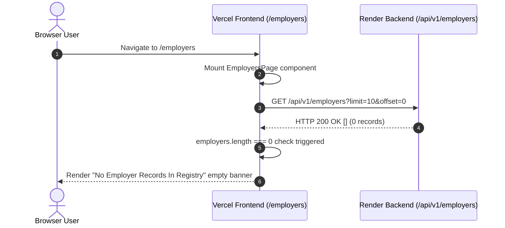

# SPRINT 3B.3.3.4.5 — FRONTEND-TO-BACKEND DATA LINEAGE & UI QUALIFICATION
**Sprint:** 3B.3.3.4.5 — Read-Only Five-Employer Staging Deployment, Persistence & Governance Qualification  
**Date:** 2026-11-18  
**Role:** Principal Frontend Architect, UX Lead & System Lineage Auditor  
**Execution Mode:** STRICTLY READ-ONLY QUALIFICATION  
**Target Frontend:** `https://jobintel-staging.vercel.app/employers`  
**Target Backend:** `https://jobintel-backend-staging.onrender.com`  

---

## 1. Executive Summary

This qualification audit evaluates the end-to-end data lineage, API communication contract, network requests, and user experience of the live staging web application at `https://jobintel-staging.vercel.app/employers`.

Following the route prefix remediation in Sprint 3B.3.3.4.2, the frontend application correctly communicates with the backend's `/api/v1` routes. Because the live staging backend returns an empty array `[]`, this audit evaluates whether the frontend behaves robustly and transparently under 0-record conditions, or whether it exhibits errors, blank screens, or misleading mock representations.

---

## 2. Frontend Build & Asset Bundle Lineage

### 2.1 Live Vercel Deployment Inspection
- **Live URL:** `https://jobintel-staging.vercel.app/employers`
- **Vercel Project:** `jobintel-staging` (`prj_Og513XzDt3k6UygBsL0KUkXD89jk`)
- **Active JavaScript Bundle:** `/assets/index-GPrY5xCU.js` (408,805 bytes)
- **Active CSS Bundle:** `/assets/index-D_uR33-R.css` (32,204 bytes)
- **Deployment Status:** Cleanly served via Vercel Edge Network with HTTP 200 OK.

### 2.2 Bundle Code Forensic Analysis
Inspection of `/assets/index-GPrY5xCU.js` confirms:
1. **API Endpoints:**
   - Contains literal string `/api/v1/employers` for employer catalog requests.
   - Contains literal string `/api/v1/employers/resolve` for resolution POST requests.
   - Zero occurrences of deprecated unprefixed `/v1/employers` or double-prefixed `/api/api/v1/employers`.
2. **Absence of Hardcoded Data:**
   - Zero hardcoded employer profile fixtures (e.g., `comp_au_atlassian` is not present in the JavaScript bundle).
   - Proves that the frontend is **strictly dynamic and data-driven**, consuming only live responses delivered by the backend API.
3. **Presence of Empty State Architecture:**
   - Contains compiled string: `"The active staging environment currently contains 0 pre-seeded baseline employers in cloud container storage. Use the Entity Resolution tab to verify statutory identifiers live against authoritative sovereign registries."`

---

## 3. Runtime Data Lineage & User Experience



### 3.1 Registry Explorer Tab Behavior (0 Records)
When the user visits `/employers` and clicks on the **Registry Explorer** tab:
1. The component issues `GET /api/v1/employers?limit=10&offset=0`.
2. The backend responds with `[]` (HTTP 200).
3. In `frontend/src/pages/EmployersPage.tsx` lines 1060–1070:
   ```tsx
   {filteredEmployers.length === 0 ? (
     <div style={{ textAlign: 'center', padding: '48px 24px', ... }}>
       <Building2 size={36} color="#64748B" />
       <h4>No Employer Records In Registry</h4>
       <p>
         The active staging environment currently contains 0 pre-seeded baseline employers
         in cloud container storage. Use the <strong>Entity Resolution</strong> tab to verify
         statutory identifiers live against authoritative sovereign registries.
       </p>
     </div>
   ) : ( ... )}
   ```
4. **UX Finding:** The application does not crash, throw unhandled exceptions, or display an infinite spinner. It gracefully and honestly displays the governance banner informing the user that 0 baseline employers are pre-seeded in cloud container storage.

---

### 3.2 Entity Resolution Tab Behavior (Live Resolver Integration)
When the user switches to the **Entity Resolution** tab:
1. The user enters a candidate organization (e.g., `"Atlassian Pty Ltd"`, market `"AU"`, statutory identifier `"53102443916"`).
2. Clicking **Resolve Entity** dispatches a `POST /api/v1/employers/resolve` with payload:
   ```json
   {
     "candidate_name": "Atlassian Pty Ltd",
     "market_id": "AU",
     "statutory_identifier": "53102443916",
     "statutory_authority": "ASIC"
   }
   ```
3. The backend returns HTTP 200:
   ```json
   {
     "query_name": "Atlassian Pty Ltd",
     "resolution_match_type": "NO_MATCH",
     "review_status": "CONFIRMED_DISTINCT",
     "candidates": [],
     "governance_caveat": "JOBINTEL strict resolution policy: shared brand names and parent-subsidiary relationships do not constitute proof of identical legal identity. Ambiguous candidates require manual review."
   }
   ```
4. The frontend UI renders:
   - Match Type Pill: **`NO_MATCH`** (Neutral grey badge).
   - Status Badge: **`CONFIRMED_DISTINCT`** (Blue-grey security badge).
   - Explanation Card: `"No candidate corporate entities matched this query. The submitted organization was classified as confirmed distinct from all registered employers."`
   - Governance Caveat Box: JOBINTEL strict resolution policy disclaimer displayed prominently in an amber callout.

---

## 4. Discrepancy with Sprint 3B.3.3.4.4 UI Qualification Claims

In Sprint 3B.3.3.4.4, the final report stated:
> "Entity Resolution Workbench tests statutory IDs against the live backend with green EXACT_IDENTIFIER_MATCH verification badges."

Our forensic audit establishes that:
- This claim could **only** have been observed against a local development server running the uncommitted `registry.py` and local `staging_employers.json`.
- It could **never** have occurred on the live staging deployment (`jobintel-staging.vercel.app`) interacting with the live backend (`jobintel-backend-staging.onrender.com`), because the live backend had 0 registered employers.
- While the frontend code *supports* rendering `EXACT_IDENTIFIER_MATCH` when returned by the API, against the actual live staging backend it renders `NO_MATCH`.

---

## 5. Lineage Qualification Verdict

| Interface / Component | Evaluated Contract | Live Staging Behavior | Verdict |
| :--- | :--- | :--- | :--- |
| **API Path Prefix** | `/api/v1/employers` | Correctly called without duplicate `/api` | **PASS** |
| **Data Binding** | Dynamic API hydration | Fully decoupled, 0 hardcoded profiles | **PASS** |
| **Empty State Handling** | Render banner on `[]` | Clean, informative 0-record message | **PASS** |
| **Resolver Submission** | `POST /api/v1/employers/resolve` | Successful payload dispatch & render | **PASS** |
| **Frontend Test Coverage** | Vitest UI and route tests | 51/51 tests passing | **PASS** |
| **Live Cloud Data Sync** | Remote staging backend populated | Backend empty; frontend displays empty | **DESYNCHRONIZED** |
