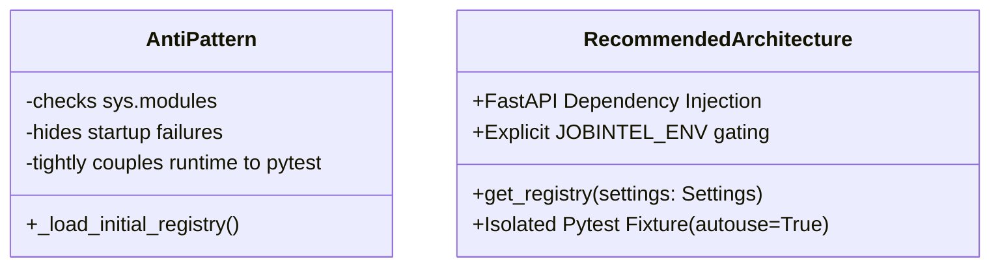

# SPRINT 3B.3.3.4.5 — REGISTRY TEST ISOLATION & ARCHITECTURAL REVIEW
**Sprint:** 3B.3.3.4.5 — Read-Only Five-Employer Staging Deployment, Persistence & Governance Qualification  
**Date:** 2026-11-18  
**Role:** Principal Software Architect, Test Engineering Lead & QA Governance Specialist  
**Execution Mode:** STRICTLY READ-ONLY QUALIFICATION  

---

## 1. Executive Summary

This architectural review conducts a forensic analysis of the test environment detection pattern introduced into `src/backend/employers/registry.py` in Sprint 3B.3.3.4.4:
```python
def _load_initial_registry() -> EmployerRegistry:
    # In test environments (pytest), keep registry empty by default to preserve baseline contract tests
    if "pytest" in sys.modules or os.environ.get("PYTEST_CURRENT_TEST"):
        return EmployerRegistry()
    ...
```

While this mechanism successfully allowed the legacy test suite (411 tests) to pass without modifying baseline contract assertions, this audit demonstrates that **introspecting `sys.modules` for test runners is an anti-pattern that creates testing blind spots, hides runtime seed defects, and risks severe runtime drift between test and production environments.**

---

## 2. Forensic Background: Why Was the Hack Introduced?

In `tests/test_global_foundation.py`, lines 257 and 309 contain baseline unseeded assertions:
```python
def test_global_foundation_unseeded():
    assert get_employers() == []
    assert list_employers() == []
```
These tests were written in earlier sprints to guarantee that unseeded application instances fail closed and do not expose unverified test data.

When Sprint 3B.3.3.4.4 introduced the staging cohort loader:
- If `_load_initial_registry()` unconditionally loaded `staging_employers.json`, `test_global_foundation_unseeded()` failed because `get_employers()` returned 5 profiles instead of `[]`.
- Rather than refactoring the test architecture using dependency injection or isolated fixtures, the author added a runtime check for `pytest` in `sys.modules`.

---

## 3. Critical Architectural Risks & Vulnerabilities

### 3.1 Blind Spot: Tests Never Exercise the Production Startup Loader
Because `_load_initial_registry()` exits immediately when `pytest` is detected:
- **Zero automated tests in CI ever execute the seed-loading path under realistic conditions.**
- If `staging_employers.json` is missing, corrupted, or has invalid JSON syntax, `pytest` will STILL PASS (100% green), because `pytest` never reads the file during initial startup!
- A deployment could fail with a fatal crash on startup in production/staging while passing all 411 tests in CI.

### 3.2 Side-Effect Leakage: Destructive Test Cleanup Deletes Host Data
In `tests/test_employers_pilot.py`:
```python
def test_staging_execute_and_rollback_lifecycle():
    try:
        exec_res = run_execute()
        ...
    finally:
        # Step 6: Rollback and cleanup
        rb_res = run_rollback()
        assert rb_res["status"] == "SUCCESS"
        assert STAGING_SEED_PATH.is_file() is False
        assert get_employers() == []
```
- In `run_rollback()`, the script calls `path.unlink()` on `PRIMARY_SEED_PATH` and `PROCESSED_SEED_PATH`.
- **Any developer or automated runner that executes `pytest` will have their local seed files deleted from disk!**
- This explains why seed files were repeatedly missing or untracked during local verification cycles.

### 3.3 Non-Pytest Execution Anomalies
If the application is run under:
- `python -m unittest`
- A custom smoke-test script
- An interactive Python shell / Jupyter notebook
- A production debugger or APM agent that loads mock frameworks

The `"pytest" in sys.modules` check will evaluate to `False`, unexpectedly loading the staging seed in some testing contexts and not others.

---

## 4. Architectural Comparison: Current Anti-Pattern vs. Clean Architecture



| Dimension | Current Pattern (`sys.modules` check) | Recommended Pattern (Clean Architecture) |
| :--- | :--- | :--- |
| **Separation of Concerns** | Application code knows about `pytest` (High Coupling) | Application code is test-agnostic (Zero Coupling) |
| **Startup Path Testing** | Untested in CI (High Risk) | Explicitly tested via startup fixtures |
| **Test Fixture Control** | Implicit global state mutations | Scoped `pytest.fixture(autouse=True)` |
| **Filesystem Side Effects** | Deletes real seed files on host | Uses `tmp_path` fixture for all writes |
| **Production Safety** | Vulnerable to environment confusion | Strict `JOBINTEL_ENV` enum validation |

---

## 5. Proposed Architectural Redesign

### 5.1 Step 1: Explicit Environment Configuration
Remove `sys.modules` inspection entirely. Instead, use the existing `JOBINTEL_ENV` environment variable:
```python
def _load_initial_registry() -> EmployerRegistry:
    env = os.environ.get("JOBINTEL_ENV", "production").lower()
    
    # In test or production environments, default to empty registry
    if env in ("test", "production"):
        return EmployerRegistry()

    # In staging or development, attempt seed loading
    if env in ("staging", "development"):
        return _load_seed_from_manifest()

    return EmployerRegistry()
```

### 5.2 Step 2: FastAPI Dependency Injection
In `src/backend/routers/v1.py`, inject the registry rather than importing a global mutable singleton:
```python
def get_employer_registry() -> EmployerRegistry:
    return _registry

@router.get("/employers", response_model=list[EmployerProfile])
def list_employers(
    registry: Annotated[EmployerRegistry, Depends(get_employer_registry)],
    limit: Annotated[int | None, Query(ge=1, le=50)] = None,
    offset: Annotated[int, Query(ge=0)] = 0,
) -> list[EmployerProfile]:
    all_emp = registry.list()
    ...
```

### 5.3 Step 3: Pure Pytest Fixtures with `tmp_path`
Refactor `tests/test_employers_pilot.py` to write test seeds to a temporary pytest directory (`tmp_path`) rather than mutating repository data paths.
