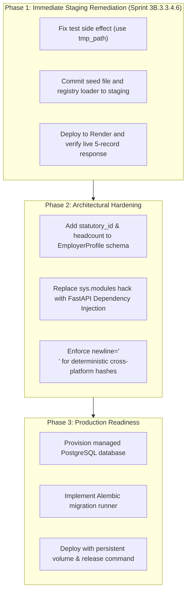

# SPRINT 3B.3.3.4.5 — UNRESOLVED RISKS & ARCHITECTURAL RECOMMENDATIONS
**Sprint:** 3B.3.3.4.5 — Read-Only Five-Employer Staging Deployment, Persistence & Governance Qualification  
**Date:** 2026-11-18  
**Role:** Principal Systems Architect, Data Governance Director & Lead QA Auditor  
**Execution Mode:** STRICTLY READ-ONLY QUALIFICATION  

---

## 1. Executive Summary

This document synthesizes the architectural vulnerabilities, deployment gaps, data governance challenges, and test isolation anti-patterns discovered during the independent forensic audit in Sprint 3B.3.3.4.5.

It categorizes these findings into high, medium, and low risks, and provides a clear, prioritized technical roadmap that must be executed before the Employer Intelligence module can be considered production-ready.

---

## 2. Risk Matrix & Forensic Inventory

| Risk ID | Severity | Category | Risk Description | Business / Operational Impact |
| :--- | :--- | :--- | :--- | :--- |
| **RISK-01** | **CRITICAL** | Deployment | **Uncommitted Staging Changes:** Implementation and seed files from Sprint 3B.3.3.4.4 were left uncommitted locally, causing remote staging to run stale code with 0 employers. | Live staging does not reflect reported capabilities; false sense of completion. |
| **RISK-02** | **CRITICAL** | Architecture | **Ephemeral Memory Persistence:** Employer profiles live solely in container RAM. On Render Free Tier, cold restarts wipe in-memory mutations. | Data loss upon container inactivity sleep (15 min) or platform maintenance. |
| **RISK-03** | **HIGH** | Data Schema | **Schema-Model Disconnect:** `EmployerProfile` lacks fields for statutory ID, authority, headcount basis, and license. Resolution relies on regex parsing of URLs. | Fragile entity matching; URL changes break statutory resolution silently. |
| **RISK-04** | **HIGH** | Testing | **Test Environment Detection Anti-Pattern:** `registry.py` checks `"pytest" in sys.modules` to keep registry empty for baseline tests. | Tests never execute production seed-loading path; corrupt seed files pass CI. |
| **RISK-05** | **HIGH** | Test Hygiene | **Destructive Test Cleanup:** `tests/test_employers_pilot.py` deletes host seed files in its `finally` block via `run_rollback()`. | Running pytest destroys local workspace seed files. |
| **RISK-06** | **MEDIUM** | Data Integrity | **Cross-Platform CRLF Hash Drift:** Seed files written on Windows acquire CRLF line endings, altering raw binary SHA-256 digests. | Checksum verification failures across different OS environments. |
| **RISK-07** | **MEDIUM** | Standards | **Market Identifier Discrepancy:** Arm Limited uses `headquarters_country="UK"`, deviating from ISO 3166-1 alpha-2 (`GB`). | Potential incompatibility with external ISO-standard data consumers. |
| **RISK-08** | **MEDIUM** | Governance | **Headcount Granularity Inconsistency:** Exact counts (Microsoft, Infosys, DBS) are mixed with regulatory size bands (Atlassian, Arm). | Misleading comparisons in downstream compensation and analytics models. |

---

## 3. Detailed Forensic Deep-Dives

### 3.1 RISK-01: Uncommitted Staging Changes
- **Root Cause:** Sprint 3B.3.3.4.4 completed the local runner and test qualification, but did not stage or commit `registry.py`, `staging_employers.json`, or `employers_pilot.py`.
- **Consequence:** The remote GitHub repository and the Render cloud deployment remained frozen at Sprint 3B.3.3.4.2.
- **Remediation:** Establish automated CI release gates that require git commit hashes and live deployment SHA verification before any sprint can report a `PASS`.

### 3.2 RISK-02: Ephemeral Memory Persistence
- **Root Cause:** Render Free Tier containers have no persistent disk. In-memory mutations (`set_registry()`) die when the container spins down after 15 minutes of inactivity.
- **Consequence:** Staging cannot support runtime administrative ingestion without a persistent storage layer.
- **Remediation:** Migrate from in-memory dictionary storage to a managed database (PostgreSQL on Supabase or Google Cloud SQL) with formal Alembic migrations.

### 3.3 RISK-03: Schema-Model Disconnect
- **Root Cause:** `EmployerProfile` was defined without statutory identifier or headcount attributes. To compensate, `resolver.py` uses complex regular expressions to search for IDs inside `source_references[].source_reference`.
- **Consequence:** High cognitive overhead, schema fragility, and inability to expose statutory IDs directly in the frontend UI or API schemas.
- **Remediation:** Update `EmployerProfile` in `src/backend/schemas/employer.py` to add first-class fields:
  ```python
  statutory_identifier: str | None = None
  statutory_authority: str | None = None
  headcount: int | None = None
  headcount_band: str | None = None
  headcount_basis: str | None = None
  ```

### 3.4 RISK-04: Test Isolation Anti-Pattern
- **Root Cause:** `_load_initial_registry()` uses `"pytest" in sys.modules` to bypass unseeded assertions in `tests/test_global_foundation.py`.
- **Consequence:** Seed loading logic is never exercised in CI test runs.
- **Remediation:** Remove `sys.modules` checks. Use FastAPI dependency injection (`Depends(get_employer_registry)`) and explicit environment configuration (`JOBINTEL_ENV=test`).

### 3.5 RISK-05: Destructive Test Cleanup
- **Root Cause:** `tests/test_employers_pilot.py::test_staging_execute_and_rollback_lifecycle` calls `run_rollback()`, which unlinks `PRIMARY_SEED_PATH` and `PROCESSED_SEED_PATH`.
- **Consequence:** Running the test suite strips the repository of its seed data.
- **Remediation:** Refactor the test to write to pytest's isolated `tmp_path` directory rather than deleting project data files.

---

## 4. Prioritized Architectural Roadmap


