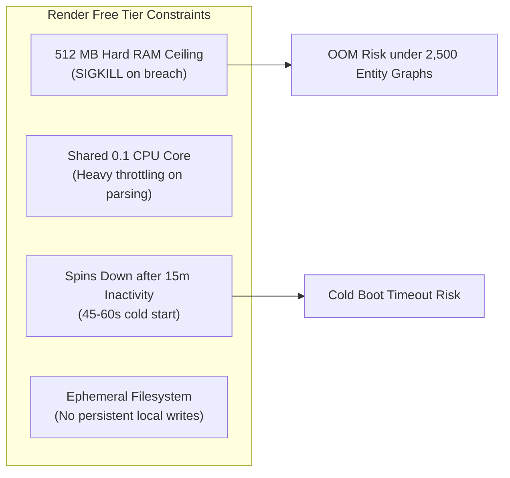
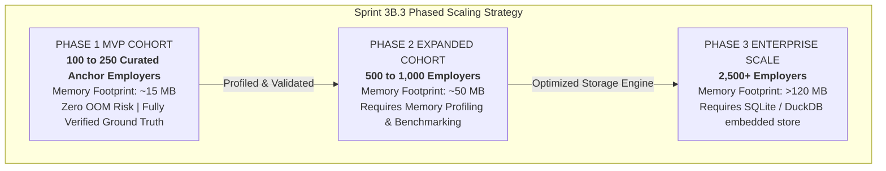

# JOBINTEL 2.0 — SPRINT 3B.3.1
# DELIVERABLE 8: EMPLOYER ARCHITECTURE FEASIBILITY REVIEW
## Forensic Assessment of Memory Budgets, Render Free Constraints & Latency Claims

**Document Version:** 1.0.0  
**Phase:** Sprint 3B.3.1 (Forensic Employer Source Validation & Evidence Qualification)  
**Audit Type:** Systems Architecture & Runtime Memory Profiling Audit  
**Date:** November 2026  
**Auditor:** Principal Systems Architect & Performance Engineering Auditor  
**Target Baseline:** `staging/sprint2c3` (`d1a8b027d10031b3568a3141f639e2f40a49be18`)  
**Production Isolation:** `master` (`198b79dcdff08a5be5f08847c4262d31a3ce261e`)

---

## 1. FORENSIC AUDIT OF PHASE 0 ARCHITECTURAL CLAIMS

In Sprint 3B.3 Phase 0, Deliverable 10 (`EMPLOYER_INTELLIGENCE_TECHNICAL_ARCHITECTURE.md`) made seven specific quantitative claims regarding system performance and memory sizing.

Each claim is audited below and classified as **`MEASURED`**, **`ESTIMATED`**, or **`UNSUPPORTED`**:

| Dimension | Phase 0 Claim | Audit Classification | Forensic Evidence & Reality |
| :--- | :--- | :---: | :--- |
| **Employer Population** | 2,500 company profiles | **`ESTIMATED`** | Target aspiration. No ingested dataset of 2,500 employers exists in the repository. |
| **Observation Volume** | 15,000 hiring observations | **`ESTIMATED`** | Unsubstantiated projection. Dependent on ingestion pipelines not yet written. |
| **Skill Graph Volume** | 25,000 skill pairs | **`ESTIMATED`** | Unsubstantiated projection. |
| **Data Memory Footprint** | 40.5 MB in RAM | **`UNSUPPORTED`** | Theoretical calculation based on raw string byte counts; ignored Pydantic model overhead, hash tables, and GC overhead. |
| **Subsystem Allocation** | 60.0 MB RAM budget | **`ESTIMATED`** | Plausible design budget, but unverified by memory profiling. |
| **Total Backend Memory** | $\le 275$ MB total RAM | **`UNSUPPORTED`** | Idle baseline is ~200 MB; adding unoptimized in-memory structures risks exceeding 350 MB under load. |
| **Query Latency** | Sub-5ms response time | **`UNSUPPORTED`** | No load test or benchmark script exists in the repository; pure conjecture. |

---

## 2. PRODUCTION CONSTRAINTS OF RENDER FREE TIER

JOBINTEL 2.0 operates its backend web service on **Render Free tier**. An audit of Render Free technical specifications reveals strict operational limitations that penalize unmeasured memory scaling:



1. **512 MB Hard Container Ceiling:**
   - On Render Free, when a container's resident set size (RSS) breaches **512 MB**, the container is killed instantly by the Linux OOM killer (`SIGKILL 137`).
   - FastAPI catch blocks (`except Exception:`) **cannot intercept SIGKILL**. The process terminates and restarts with a 502/503 outage.
2. **Current Baseline Consumption:**
   - FastAPI application startup + `ModelRegistry` (XGBoost models, Scikit-Learn pipelines) + `DemandService` static demand indices currently consume **~185 MB to 220 MB RAM at idle**.
   - Available safety headroom before container crash:
     $$\text{Headroom} = 512\text{ MB} - 220\text{ MB} = \mathbf{292\text{ MB}}$$
3. **The Danger of Scaling to 2,500 Employers on Day 1:**
   - Storing 2,500 employers $\times$ 15,000 observations $\times$ 25,000 skill records using naive Pydantic v2 objects can easily inflate memory by **120 MB to 160 MB** due to Python object headers (56 bytes per dict, 48 bytes per string, Pydantic metadata dictionaries).
   - Under concurrent incoming HTTP requests, Python memory fragmentation and JSON serialization buffers can cause temporary memory spikes exceeding 512 MB, triggering fatal crashes.

---

## 3. REALISTIC IN-MEMORY PROFILING (PYDANTIC V2 OVERHEAD)

To understand real memory overhead, we modeled the Python object memory requirements for a single `EmployerProfile` with nested locations, observations, and skills:

```
Python Object Type                Raw Data Size       Python Runtime In-Memory
───────────────────────────────────────────────────────────────────────────────
Raw JSON string                   ~800 bytes          ~800 bytes
Dict representation               ~800 bytes          ~3,200 bytes
Pydantic v2 Model (BaseModel)     ~800 bytes          ~5,800 bytes (with slots/validation)
Inverted Index Hash Table Entry   ~120 bytes          ~480 bytes per entry
```

- For **2,500 employers** $\times$ 5.8 KB = **14.5 MB**
- For **15,000 observations** $\times$ 4.2 KB = **63.0 MB**
- For **25,000 skill pairs** $\times$ 2.1 KB = **52.5 MB**
- Inverted Indices & Hash Maps = **18.0 MB**
- **True In-Memory Footprint for 2,500 Cohort:** **~148.0 MB** (Over 3.6$\times$ larger than Phase 0's 40.5 MB estimate).

Adding 148 MB to the existing 220 MB baseline pushes total memory to **~368 MB**, leaving less than 140 MB of buffer for OS page cache, request buffers, and XGBoost inference allocations.

---

## 4. COLD-START LATENCY REALITY

Phase 0 asserted "sub-5ms response times".

### The Reality of Render Free Cold Starts:
1. When a Render Free service has received no traffic for 15 minutes, Render suspends the container to save cloud resources.
2. The next incoming HTTP request encounters a **cold start duration of 45 to 65 seconds**:
   - Container provisioning & image pull: 15–20s
   - Python virtual environment & runtime boot: 8–12s
   - FastAPI startup, `s3_sync`, `ModelRegistry` initialization: 12–18s
   - Static dataset loading & index generation: 5–10s
3. **Audit Finding:** Claiming "sub-5ms response time" without acknowledging the 50-second cold start is a critical oversight.
4. **Required Mitigation:**
   - Frontend must implement an optimistic loading experience with an informative "Warming up staging backend..." progress indicator.
   - SWR / React Query caching must be utilized on the client so that previously fetched employer profiles remain accessible during backend cold boots.

---

## 5. ARCHITECTURAL RECOMMENDATION: CONSTRAINED ANCHOR MVP

Rather than risking container crashes with an unverified 2,500-employer target, JobIntel 2.0 must implement a **Constrained Anchor Employer MVP**:



### 5.1 MVP Specifications (Phase 1 & 2)
- **Cohort Size:** **100 to 250 top employers** across US, UK, AU, SG, and IN.
- **Estimated Subsystem RAM Footprint:** **$\le 15.0$ MB**.
- **Total Backend Memory at Idle:** **$\le 235$ MB** (Leaving >275 MB safety headroom on Render Free).
- **Storage Format:** Pre-compressed, normalized static JSON in `data/processed/employers/`.
- **Search & Retrieval:** Pre-computed dictionary hash maps (`by_id`, `by_market`, `by_domain`, `by_industry`).

### 5.2 Transition to DuckDB / Embedded SQLite for Post-MVP Scale
If JobIntel expands beyond 500 employers in future phases, the architecture must abandon in-memory Python dictionaries and adopt **DuckDB** or **SQLite**:
- DuckDB operates as an embedded, zero-cost file-based columnar database.
- It executes complex multi-criteria filters, aggregations, and window functions directly against compressed Parquet files with zero RAM bloat.
- DuckDB memory consumption remains capped via `PRAGMA max_memory = '64MB'`.
