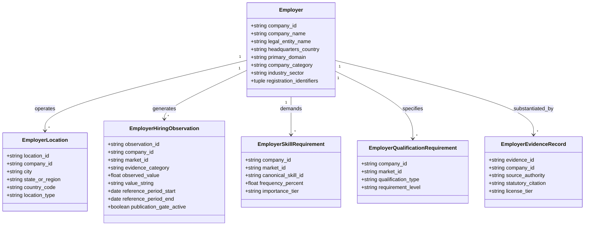

# JOBINTEL 2.0 — SPRINT 3B.3.1
# DELIVERABLE 4: EMPLOYER DATA MODEL REVIEW
## Forensic Evaluation of the Six-Entity Data Schema, Normalization Defects & Structural Refinements

**Document Version:** 1.0.0  
**Phase:** Sprint 3B.3.1 (Forensic Employer Source Validation & Evidence Qualification)  
**Audit Type:** Data Architecture & Relational Normalization Audit  
**Date:** November 2026  
**Auditor:** Principal Data Architect & Pydantic v2 Specialist  
**Target Baseline:** `staging/sprint2c3` (`d1a8b027d10031b3568a3141f639e2f40a49be18`)  
**Production Isolation:** `master` (`198b79dcdff08a5be5f08847c4262d31a3ce261e`)

---

## 1. EXECUTIVE DATA MODEL AUDIT SUMMARY

The six-entity data model proposed in Sprint 3B.3 Phase 0 (`EMPLOYER_DATA_DICTIONARY.md`) established an initial conceptual foundation. However, a forensic inspection reveals **four major structural defects** that would lead to data corruption, epistemological conflation, and compliance violations if implemented without remediation:

1. **Enterprise vs. Establishment Conflation:** The Phase 0 schema conflates corporate-level parent entities with local establishment operating units. A global headcount figure from SEC Form 10-K (221,000 employees) was mapped onto the same entity that holds a local branch office location.
2. **Missing First-Class Temporal Validity:** The data model relied on static snapshots and reference period dates without bi-temporal tracking (`effective_from`, `effective_to`, `superseded_at`), making it impossible to audit corporate restructuring or historical revisions.
3. **Inadequate Corporate Hierarchy Modeling:** Parent-subsidiary relationships were modeled as single optional string foreign keys rather than a directed corporate hierarchy graph, failing for complex multi-jurisdictional conglomerates.
4. **Conflation of Headcount Scalars and Categorical Bands:** The schema used a single floating-point `observed_value` field, forcing categorical size bands (e.g. WGEA `"100 to 249"` or UK Gender Pay Gap `"250 to 499"`) into synthetic float midpoints, violating statistical integrity.

---

## 2. DETAILED AUDIT OF THE SIX PHASE 0 ENTITIES



### 2.1 Entity 1: `Employer` (Enterprise vs Establishment Conflation)
- **Phase 0 Specification:** Single model representing corporate identity, industry, category, and website.
- **Defect 1: Missing Entity Scope Distinction:** Under statistical methodology (US Census, UK ONS, ABS), an **Enterprise** (the legal business organization or conglomerate) is distinct from an **Establishment** (a single physical location where business is conducted).
  - *Example:* "Amazon.com, Inc." is an Enterprise; "Amazon Fulfillment Center DCA1 in Baltimore, MD" is an Establishment.
  - Storing headcount observations against a single flat `Employer` table conflates Amazon's 1.5 million global workforce with an individual warehouse's 1,200 workers.
- **Defect 2: Corporate Structure DAG Missing:** Companies have complex multi-tiered structures:
  - Global Parent: Alphabet Inc. (US)
  - Regional Operating Subsidiary: Google UK Limited (UK)
  - Specialized Subsidiary: DeepMind Technologies Limited (UK)
  - Holding a single `parent_company_id` fails to capture ultimate global parent vs. immediate legal entity parent.
- **Defect 3: Intermediary Agency Flag Missing:** Recruitment agencies and staffing firms (e.g. Adecco, Randstad, TeamLease) must carry an explicit, immutable flag `is_recruitment_agency: bool` to prevent them from masquerading as direct tech employers.

### 2.2 Entity 2: `EmployerLocation` (Privacy & Granularity Flaws)
- **Phase 0 Specification:** City, state, country, location type, verification source.
- **Defect 1: Over-Specification of Micro-Locations:** For companies with hundreds of retail or branch outlets (e.g. banks, supermarket chains), attempting to store all individual branch locations in in-memory JSON exceeds memory ceilings.
- **Defect 2: Residential Address Leakage Risk:** In business registration data (UK Companies House, ACRA), small businesses often list residential director homes as registered offices.
- **Remediation:** Introduce an explicit `geographic_granularity` enum (`HEADQUARTERS_ONLY`, `MAJOR_TECH_HUB`, `REGIONAL_OFFICE`, `AGGREGATED_METRO`). Strip all street-level addresses unconditionally.

### 2.3 Entity 3: `EmployerHiringObservation` (Scalar vs Band Conflation)
- **Phase 0 Specification:** `observed_value: float | None`, `reference_period_start`, `reference_period_end`.
- **Defect 1: Conflation of Discrete Counts and Size Bands:** 
  - WGEA and UK Gender Pay Gap do **not** publish exact scalar floats; they publish categorical size bands (`"100 to 249"`, `"250 to 499"`, `"1000 to 4999"`).
  - Forcing `"100 to 249"` into a synthetic float midpoint (e.g. `175.0`) violates empirical truth and creates false precision.
  - The schema must support a dedicated `headcount_band: str | None` field.
- **Defect 2: Conflation of Stock vs Flow:**
  - `observed_value = 221000.0` for SEC Form 10-K represents **Stock** (total employed workers at date $T$).
  - `observed_value = 182.0` for Greenhouse ATS represents **Flow** (active job advertisements observed in month $M$).
  - Comparing or summing stock and flow leads to nonsensical figures.
  - The schema must introduce `metric_basis: Literal["EMPLOYMENT_STOCK", "RECRUITMENT_FLOW", "NET_EMPLOYMENT_CHANGE", "REDUNDANCY_ACTION"]`.

### 2.4 Entity 4: `EmployerSkillRequirement` (Sample Size & Aggregation Flaws)
- **Phase 0 Specification:** Frequency percentage, importance tier (`CORE`, `SECONDARY`, `EMERGING`), sample size.
- **Defect 1: Missing Temporal Observation Window:** A company's skill demand changes dynamically. A skill profile from 2024 (e.g. Kubernetes, React) may shift by 2026. Without `observation_window_start` and `observation_window_end`, skill profiles become unmaintainable stale averages.
- **Defect 2: Low Sample Size Noise:** Employers with only 2 or 3 job postings can show 100% frequency for an obscure technology. An explicit `min_sample_threshold_met: bool` flag is required ($N \ge 15$ postings minimum).

### 2.5 Entity 5: `EmployerQualificationRequirement` (Over-Simplification)
- **Phase 0 Specification:** Qualification type and requirement level.
- **Defect:** Unstructured job descriptions state qualifications conditionally (e.g. "Bachelor's degree in CS OR 4 years equivalent experience"). Flattening this into a mandatory degree flag misrepresents employer flexibility.
- **Remediation:** Model qualification as `educational_level: str | None`, `years_experience_min: float | None`, and `alternative_experience_accepted: bool`.

### 2.6 Entity 6: `EmployerEvidenceRecord` (Audit Trail & Verification)
- **Phase 0 Specification:** Source authority, statutory citation, license tier.
- **Defect:** Missing cryptographic hash of the raw downloaded file/response, making independent verification impossible.
- **Remediation:** Add `raw_artifact_sha256: str`, `retrieval_timestamp: datetime`, and `license_identifier: str`.

---

## 3. REFINED PYDANTIC V2 SCHEMAS (PRODUCTION READY)

Below are the refined, normalized Pydantic v2 schemas resolving all identified defects while preserving zero-breakage backward compatibility with existing `src/backend/schemas/employer.py`.

```python
from __future__ import annotations
from datetime import date, datetime
from enum import StrEnum
from typing import Literal
from pydantic import AnyHttpUrl, BaseModel, ConfigDict, Field, field_validator, model_validator
from src.backend.schemas.market import MarketId

class EmployerCategory(StrEnum):
    # Preserved backward-compatible keys
    INDIAN_HEADQUARTERED = "INDIAN_HEADQUARTERED"
    MULTINATIONAL_OPERATING_IN_INDIA = "MULTINATIONAL_OPERATING_IN_INDIA"
    OTHER_INTERNATIONAL = "OTHER_INTERNATIONAL"
    # Refined global keys
    GLOBAL_ENTERPRISE = "GLOBAL_ENTERPRISE"
    DOMESTIC_CORPORATION = "DOMESTIC_CORPORATION"
    PUBLIC_SECTOR_GOVERNMENT = "PUBLIC_SECTOR_GOVERNMENT"
    HIGHER_EDUCATION_RESEARCH = "HIGHER_EDUCATION_RESEARCH"
    STAFFING_AND_RECRUITMENT_AGENCY = "STAFFING_AND_RECRUITMENT_AGENCY"

class MetricMeasurementBasis(StrEnum):
    EMPLOYMENT_STOCK = "EMPLOYMENT_STOCK"           # Certified point-in-time headcount
    RECRUITMENT_FLOW = "RECRUITMENT_FLOW"           # Job advertisements / open requisitions
    NET_EMPLOYMENT_CHANGE = "NET_EMPLOYMENT_CHANGE" # Disclosed year-over-year additions/losses
    REDUNDANCY_ACTION = "REDUNDANCY_ACTION"         # Statutory WARN / layoff notifications

class GeographicScope(StrEnum):
    GLOBAL_WORLDWIDE = "GLOBAL_WORLDWIDE"
    NATIONAL_DOMESTIC = "NATIONAL_DOMESTIC"
    REGIONAL_STATE = "REGIONAL_STATE"
    ESTABLISHMENT_FACILITY = "ESTABLISHMENT_FACILITY"

class EmployerRegistrationIdentifier(BaseModel):
    model_config = ConfigDict(frozen=True)
    country_code: str = Field(pattern=r"^[A-Z]{2}$")
    authority_name: str = Field(min_length=2, max_length=120)
    identifier_type: Literal["CIK", "CRN", "ABN", "UEN", "CIN", "LEI"]
    identifier_value: str = Field(min_length=2, max_length=60)
    verified_at: datetime | None = None

class EmployerHierarchyLink(BaseModel):
    model_config = ConfigDict(frozen=True)
    parent_company_id: str
    relationship_type: Literal["ULTIMATE_GLOBAL_PARENT", "REGIONAL_OPERATING_SUBSIDIARY", "BRANCH"]
    ownership_percentage: float | None = Field(default=None, ge=0.0, le=100.0)

class EmployerProfileV2(BaseModel):
    model_config = ConfigDict(frozen=True)
    company_id: str = Field(pattern=r"^[a-z0-9][a-z0-9._-]{1,119}$")
    legal_name: str = Field(min_length=2, max_length=200)
    trade_names: tuple[str, ...] = ()
    headquarters_country: str = Field(pattern=r"^[A-Z]{2}$")
    primary_domain: str = Field(pattern=r"^[a-z0-9.-]+\.[a-z]{2,}$")
    company_category: EmployerCategory
    is_recruitment_agency: bool = False
    industry_code: str | None = None
    industry_taxonomy: Literal["NAICS_2022", "UK_SIC_2007", "ANZSIC_2006", "NIC_2008", "SSIC_2020"] | None = None
    industry_name: str | None = None
    official_website: AnyHttpUrl | None = None
    operating_markets: tuple[MarketId, ...] = ()
    registrations: tuple[EmployerRegistrationIdentifier, ...] = ()
    hierarchy: EmployerHierarchyLink | None = None
    verification_status: str = "REVIEW_REQUIRED"
    verified_at: datetime | None = None

class EmployerHiringObservationV2(BaseModel):
    model_config = ConfigDict(frozen=True)
    observation_id: str = Field(pattern=r"^obs_[a-z0-9_-]{8,32}$")
    company_id: str
    market_id: MarketId
    evidence_category: str
    measurement_basis: MetricMeasurementBasis
    geographic_scope: GeographicScope
    metric_name: str
    # Dual representation: exact float OR categorical band
    observed_count: float | None = None
    headcount_band: str | None = None
    reference_period_start: date
    reference_period_end: date
    data_source_id: str
    statutory_citation: str | None = None
    publication_gate_active: bool = False
    gate_reason: str | None = None

    @model_validator(mode="after")
    def validate_metric_representation(self) -> EmployerHiringObservationV2:
        if self.observed_count is None and self.headcount_band is None and not self.publication_gate_active:
            raise ValueError("Observation must provide either observed_count or headcount_band unless gated")
        return self

class EmployerSkillRequirementV2(BaseModel):
    model_config = ConfigDict(frozen=True)
    company_id: str
    market_id: MarketId
    canonical_skill_id: str
    skill_name: str
    skill_category: str
    frequency_percent: float = Field(ge=0.0, le=100.0)
    importance_tier: Literal["CORE", "SECONDARY", "EMERGING"]
    canonical_occ_code: str | None = None
    sample_size_postings: int = Field(ge=1)
    observation_window_start: date
    observation_window_end: date
    is_statistically_reliable: bool = True

    @field_validator("is_statistically_reliable")
    @classmethod
    def evaluate_reliability(cls, v: bool, info) -> bool:
        sample_size = info.data.get("sample_size_postings", 0)
        return sample_size >= 15
```

---

## 4. NORMALIZATION & INTEGRITY SUMMARY

| Audit Concern | Original Phase 0 Flaw | Refined Architecture Solution |
| :--- | :--- | :--- |
| **Enterprise vs Establishment** | Conflated into single flat model | Separated via `GeographicScope` (`GLOBAL`, `DOMESTIC`, `FACILITY`) |
| **Banded vs Scalar Counts** | Forced bands into synthetic float midpoints | Dual representation: `observed_count` (float) OR `headcount_band` (string) |
| **Stock vs Flow Conflation** | Treated postings as equivalent to headcount | Explicit `MetricMeasurementBasis` (`EMPLOYMENT_STOCK` vs `RECRUITMENT_FLOW`) |
| **Recruitment Agency Bleed** | Staffing firms masqueraded as tech employers | Mandatory `is_recruitment_agency: bool` with strict UI filtering |
| **Corporate Hierarchy** | Single string parent ID | Structured `EmployerHierarchyLink` modeling DAG relationships |
| **Skill Sample Reliability** | 2 postings could produce 100% skill frequency | Mandatory `min_sample_threshold_met` ($N \ge 15$) |
| **PII & Address Exposure** | Full street addresses stored in profiles | Truncated to City/State/Country; no street numbers or sole traders |
