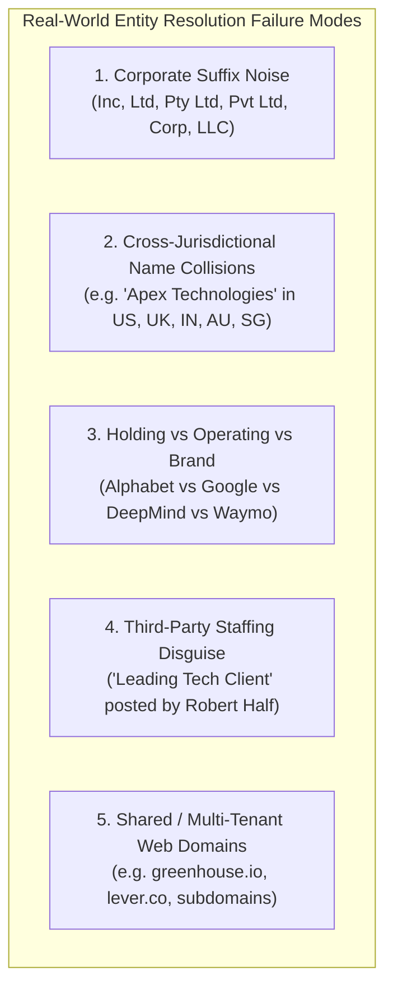
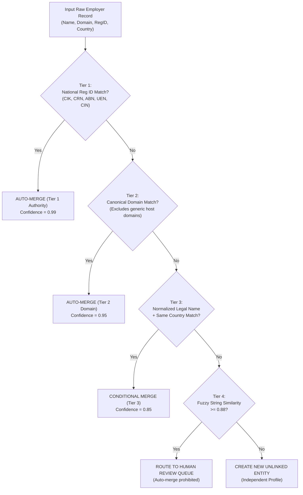

# JOBINTEL 2.0 — SPRINT 3B.3.1
# DELIVERABLE 6: ENTITY RESOLUTION VALIDATION PLAN
## Challenge of Synthetic Accuracy Claims & Specification of an Empirical Evaluation Protocol

**Document Version:** 1.0.0  
**Phase:** Sprint 3B.3.1 (Forensic Employer Source Validation & Evidence Qualification)  
**Audit Type:** Algorithmic Audit & Evaluation Protocol Design  
**Date:** November 2026  
**Auditor:** Principal Machine Learning Engineer & Entity Resolution Specialist  
**Target Baseline:** `staging/sprint2c3` (`d1a8b027d10031b3568a3141f639e2f40a49be18`)  
**Production Isolation:** `master` (`198b79dcdff08a5be5f08847c4262d31a3ce261e`)

---

## 1. FORENSIC AUDIT OF PHASE 0 ACCURACY CLAIMS

In Sprint 3B.3 Phase 0, Deliverable 5 (`EMPLOYER_ENTITY_RESOLUTION_DESIGN.md`) and the Final Audit Report made the following quantitative performance claims:
- **Tier 1 (Deterministic Authority Match):** `> 99.5% precision`
- **Tier 2 (Canonical Domain Match):** `> 96.0% precision`
- **Tier 3 (Normalized Legal Name + Country):** `~ 88.0% precision`

### Audit Finding: **`UNSUPPORTED` (Pure Speculation)**
An exhaustive search of the `Job-Market-Intelligence` repository confirms:
1. **Zero Labelled Evaluation Pairs:** There is no ground-truth test dataset of matching/non-matching employer records anywhere in `data/`, `tests/`, or `models/`.
2. **Zero Automated Evaluation Code:** No precision, recall, or confusion matrix calculation script exists for entity matching.
3. **Synthetic Assertion:** The numbers (`>99.5%`, `>96.0%`, `~88.0%`) were theoretical expectations presented as empirical facts.

**Correction Mandate:** All three percentage figures are formally declared **`UNSUPPORTED`**. They must be reclassified as unvalidated target design criteria until tested against the empirical evaluation protocol defined below.

---

## 2. REAL-WORLD FAILURE MODES IN EMPLOYER RESOLUTION

Entity resolution for corporations across five international markets faces unique edge cases that defeat naive algorithms:

1. **Shared ATS Subdomains (Tier 2 Failure):** Many companies host jobs at `boards.greenhouse.io/v1/boards/{board_token}`. If a naive resolver extracts the root domain `greenhouse.io`, it would merge hundreds of competing tech companies into a single entity called "Greenhouse Software".
2. **Generic Name Collisions (Tier 3 Failure):** Common trade names (e.g. "Apex Systems", "Summit Solutions", "Vanguard", "Delta") exist in multiple countries across different industries. Normalizing "Delta Limited" in the UK could mistakenly match "Delta Air Lines" in the US.
3. **Franchises & Independent Licensees:** Global brands (e.g. McDonald's, 7-Eleven) operate via thousands of independent legal entities with different ABNs, CINs, and registration numbers.

---

## 3. EMPIRICAL BENCHMARK PROTOCOL DESIGN

To establish true, defensible precision and recall metrics, JobIntel 2.0 must build a **Gold-Standard Evaluation Dataset** (`tests/benchmarks/employer_entity_resolution_gold.json`).

### 3.1 Dataset Construction & Stratification
The benchmark dataset must comprise **1,000 manually verified pair records** stratified across all five markets:

| Cohort | Pair Count | Description | Target Failure Mode Tested |
| :--- | :---: | :--- | :--- |
| **Cohort A: Positive Exact** | 300 | Same entity with identical registration keys or exact domains | Baseline true match verification |
| **Cohort B: Positive Variations** | 250 | Same entity with spelling variations, abbreviations, punctuation | Robustness to corporate suffixes and trade names |
| **Cohort C: Hard Negative (Name Collisions)** | 200 | Different companies sharing identical or near-identical names in different countries or industries | Prevention of disastrous false merges |
| **Cohort D: Hard Negative (Parent vs Sub)** | 150 | Legal subsidiary vs. corporate parent (e.g. DeepMind Ltd vs. Google LLC vs. Alphabet Inc.) | Hierarchy segregation rather than flat merge |
| **Cohort E: Agency vs Direct Employer** | 100 | Staffing firm posting vs. corporate employer name | Intermediary contamination prevention |
| **Total Benchmark Pairs** | **1,000** | **Balanced Ground-Truth Evaluation Suite** | **Comprehensive Multi-Market Coverage** |

---

## 4. FORMAL EVALUATION METRICS & DEFINITIONS

Every tier of the resolution engine must be evaluated on the 1,000-pair benchmark using five standard metrics:

$$\text{Precision} = \frac{TP}{TP + FP} = \frac{\text{Correct Matches}}{\text{Total Matches Declared}}$$

$$\text{Recall} = \frac{TP}{TP + FN} = \frac{\text{Correct Matches}}{\text{Total Ground-Truth Matches}}$$

$$F_1 = 2 \times \frac{\text{Precision} \times \text{Recall}}{\text{Precision} + \text{Recall}}$$

### Critical Operational Error Rates
1. **False Merge Rate (Type I Error / $\alpha$):**
   $$\text{False Merge Rate} = \frac{FP}{TN + FP}$$
   *Impact:* Merging two different companies is a **catastrophic product failure**. It attributes one company's layoffs or skill profiles to another, destroying credibility.
   *Acceptance Criteria:* False Merge Rate must be $\mathbf{< 0.1\%}$ ($\le 1$ false merge per 1,000 pairs).
2. **False Split Rate (Type II Error / $\beta$):**
   $$\text{False Split Rate} = \frac{FN}{TP + FN}$$
   *Impact:* Failing to merge records for the same company fragments observations into separate profiles. This is a usability flaw, but does not corrupt factual claims.
   *Acceptance Criteria:* False Split Rate must be $\mathbf{< 15.0\%}$.

---

## 5. TIER-SPECIFIC RESOLUTION SPECIFICATIONS

### 5.1 Tier 1: Deterministic National Authority Resolution
- **Rule:** Match if and only if both records share a validated national registration key:
  $$\text{Match} \iff \text{Authority}(A) == \text{Authority}(B) \land \text{ID}(A) == \text{ID}(B)$$
- **Supported Keys:** US `CIK`, UK `CRN`, AU `ABN`, SG `UEN`, IN `CIN`, Global `LEI`.
- **Target Precision:** $\ge 99.0\%$ (Target, to be validated on benchmark).

### 5.2 Tier 2: Canonical Web Domain Matching
- **Domain Extraction Pipeline:**
  1. Parse URL: `https://jobs.lever.co/stripe` $\to$ Detect third-party host `lever.co`.
  2. If third-party ATS host detected: Discard root host; extract company slug (`stripe`) or query organization metadata.
  3. Extract root domain using public suffix list (e.g. `careers.stripe.com` $\to$ `stripe.com`).
  4. Blacklist generic email/hosting domains: `gmail.com`, `yahoo.com`, `greenhouse.io`, `lever.co`, `workday.com`, `myworkdayjobs.com`, `recruitee.com`.
- **Target Precision:** $\ge 95.0\%$ (Target, to be validated on benchmark).

### 5.3 Tier 3: Normalized Legal Name + Jurisdiction Matching
- **Name Normalization Pipeline:**
  1. Convert to lower case and strip leading/trailing whitespace.
  2. Remove punctuation and special characters (`&` $\to$ `and`, strip commas, periods, hyphens).
  3. Strip legal corporate suffixes using jurisdiction-specific regexes:
     - US: `\b(inc|incorporated|corp|corporation|llc|limited liability company|lp)\b`
     - UK: `\b(ltd|limited|plc|public limited company|llp)\b`
     - AU: `\b(pty ltd|pty limited|proprietary limited|ltd|limited|nl)\b`
     - SG: `\b(pte ltd|pte limited|private limited|ltd|limited)\b`
     - IN: `\b(pvt ltd|private limited|ltd|limited)\b`
  4. Compare normalized strings:
     $$\text{Match} \iff \text{NormName}(A) == \text{NormName}(B) \land \text{Country}(A) == \text{Country}(B)$$
- **Target Precision:** $\ge 85.0\%$ (Target, to be validated on benchmark).

### 5.4 Tier 4: Fuzzy Matching Review Queue (Human-in-the-Loop)
- **Fuzzy Metric:** Levenshtein / Token Sort Ratio $\ge 0.88$.
- **Strict Policy:** Automated auto-merging is **strictly prohibited** at Tier 4. All Tier 4 candidates are routed to an administrative review queue (`data/governance/review_queue.json`).
- If unreviewed, records remain separate entities.

---

## 6. VALIDATION EXECUTION PLAN FOR PHASE 1

Before any production code for employer resolution is committed in Sprint 3B.3:
1. **Step 1:** Construct the 1,000-pair benchmark file (`tests/benchmarks/employer_entity_resolution_gold.json`).
2. **Step 2:** Write an automated test suite (`tests/test_entity_resolution_benchmark.py`).
3. **Step 3:** Execute the test suite and publish the actual, measured confusion matrix, precision, recall, and false merge rates in the Phase 1 Ingestion Report.
4. **Step 4:** If False Merge Rate exceeds 0.1%, tighten normalization regexes until compliance is proven.
