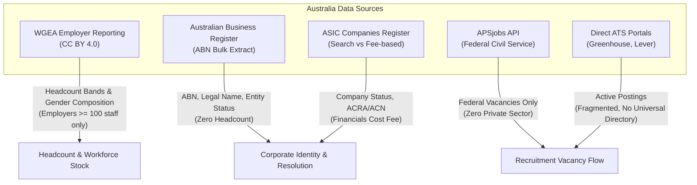
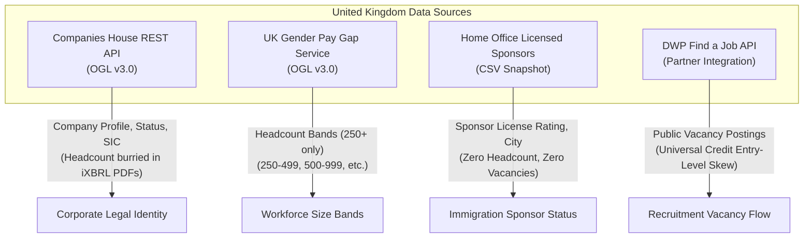
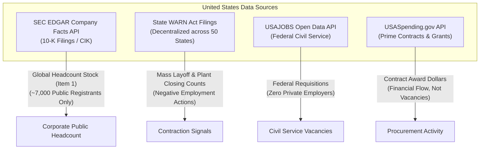
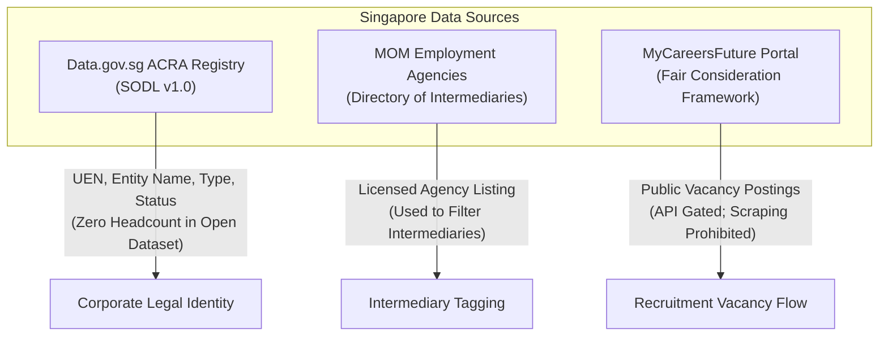
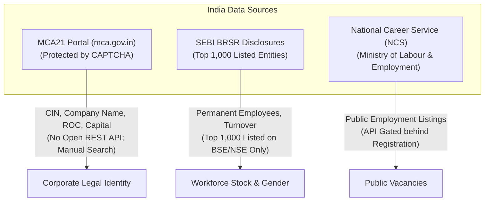

# JOBINTEL 2.0 — SPRINT 3B.3.1
# DELIVERABLE 2: FIVE-MARKET SOURCE VALIDATION
## Deep Forensic Investigation of Statutory Registers, Public Data Portals & Vacancy Feeds

**Document Version:** 1.0.0  
**Phase:** Sprint 3B.3.1 (Forensic Employer Source Validation & Evidence Qualification)  
**Audit Type:** Primary Evidence & Regulatory Specification Audit  
**Date:** November 2026  
**Auditor:** Principal Data Governance Auditor & Forensic Researcher  
**Target Baseline:** `staging/sprint2c3` (`d1a8b027d10031b3568a3141f639e2f40a49be18`)  
**Production Isolation:** `master` (`198b79dcdff08a5be5f08847c4262d31a3ce261e`)

---

## 1. INVESTIGATION METHODOLOGY & CRITERIA

Each candidate employer source across Australia, the United Kingdom, the United States, Singapore, and India was audited against seven strict empirical criteria:
1. **API / Programmatic Access:** Is there a live, documented, public REST/JSON API, or only a human-facing web portal?
2. **Authentication & Barriers:** Does access require API keys, commercial licenses, enterprise contracts, or visual CAPTCHAs?
3. **Data Granularity:** Does the source provide exact headcount numbers, categorical size bands, or legal registration metadata only?
4. **Geographic Resolution:** Does the source provide establishment-level (branch/facility) or corporate global/national parent numbers?
5. **Coverage & Population:** What exact subset of employers is covered (e.g. public listed only, $\ge 100$ staff only, civil service only)?
6. **Redistribution Rights:** Does the statutory license permit commercial display, data processing, and public presentation?
7. **Temporal Freshness & Update Cadence:** How frequently is the dataset refreshed (real-time, monthly, annually)?

---

## 2. AUSTRALIA (AU) SOURCE AUDIT

### 2.1 Workplace Gender Equality Agency (WGEA) Public Employer Reporting
- **Primary Source URL:** `https://www.wgea.gov.au/data-and-insights/data-explorer`
- **Statutory Authority:** Workplace Gender Equality Act 2012 (Cth) (§ 13) and Workplace Gender Equality Amendment (Closing the Gender Pay Gap) Act 2023.
- **Access Mechanism:** Web data explorer and bulk downloadable CSV datasets via `data.gov.au` / WGEA website.
- **Authentication & Rate Limits:** Open public download; no authentication or rate limits.
- **Exact Data Fields Provided:**
  - `Employer Name`, `ABN`, `Industry (ANZSCO / ANZSIC Division)`, `Workforce Size Band` (100–249, 250–499, 500–999, 1000–4999, 5000+), `Gender Pay Gap (Median and Average)`, `Composition by Gender (Manager vs Non-Manager)`.
  - In detailed reporting tables, employee counts by employment type (full-time, part-time, casual) and gender are provided.
- **Does it provide exact employee counts?** **Partially.** The main summary explorer displays size bands; detailed reporting tables contain aggregated counts for reporting units, but not facility-level establishment counts.
- **Does it cover the whole economy?** **ABSOLUTELY NOT.** It legally excludes all employers with fewer than 100 employees. According to the Australian Bureau of Statistics (ABS 8165.0 - *Counts of Australian Businesses*), businesses with <100 employees represent **98.2% of all Australian businesses** and employ ~42% of the private sector workforce. It also excludes state and local government public sector agencies.
- **Redistribution Rights:** Published under **Creative Commons Attribution 4.0 International (CC BY 4.0)**. Commercial reuse, transformation, and display are permitted with mandatory attribution: *"Source: Workplace Gender Equality Agency (WGEA), Commonwealth of Australia"*.
- **Audit Verdict:** **`PARTIALLY_VERIFIED`** — The highest-quality corporate headcount and gender stock dataset discovered, but covers only large private and Commonwealth employers.

### 2.2 Australian Business Register (ABR) & ABN Lookup
- **Primary Source URL:** `https://abr.business.gov.au/` and `https://data.gov.au/data/dataset/abn-bulk-extract`
- **Statutory Authority:** A New Tax System (Australian Business Number) Act 1999 (Cth).
- **Access Mechanism:** ABN Lookup Web Services (XML/JSON with registration GUID) and monthly ABN Bulk Extract CSV dumps.
- **Authentication:** Free registration required for Web Services GUID; bulk CSV download is public.
- **Exact Data Fields Provided:** `ABN`, `Entity Name`, `Trading Name`, `Entity Type Description`, `ABN Status`, `Address State`, `Postcode`.
- **Does it provide employee headcount?** **NO.** The ABR contains zero employee or payroll data.
- **Audit Verdict:** **`VERIFIED` for Entity Resolution; `UNAVAILABLE` for Headcount.**

### 2.3 Australian Securities and Investments Commission (ASIC)
- **Primary Source URL:** `https://asic.gov.au/online-services/search-asic-registers/`
- **Statutory Authority:** Corporations Act 2001 (Cth).
- **Access Mechanism:** Basic web search is free. Detailed extracts (Form 388 financial reports, share structures, director details) require statutory search fees ($10 to $40 per document via ASIC Connect or commercial brokers).
- **Audit Verdict:** **`PARTIALLY_VERIFIED`** — Good for validating Australian Company Numbers (ACN), but financial reports and employee disclosures are paywalled behind statutory search fees.

### 2.4 APSjobs (Australian Public Service)
- **Primary Source URL:** `https://www.apsjobs.gov.au/`
- **Statutory Authority:** Public Service Act 1999 (Cth) / Australian Public Service Commission (APSC).
- **Access Mechanism:** Web portal and RSS feeds.
- **Population:** Strictly covers Commonwealth Australian Public Service departments and agencies. Zero private sector or state government coverage.
- **Audit Verdict:** **`PARTIALLY_VERIFIED`** — High validity for federal civil service vacancies; zero commercial applicability.

---

## 3. UNITED KINGDOM (UK) SOURCE AUDIT

### 3.1 Companies House REST API
- **Primary Source URL:** `https://developer.company-information.service.gov.uk/api-details`
- **Statutory Authority:** Companies Act 2006 (UK).
- **Access Mechanism:** RESTful JSON API using an authorized API key.
- **Authentication & Rate Limits:** Free developer account; 600 requests per 5-minute rolling window per IP.
- **Exact Data Fields in `/company/{company_number}`:**
  - `company_name`, `company_number` (CRN), `company_status`, `type`, `date_of_creation`, `registered_office_address` (address lines, postal code), `sic_codes`.
  - **Employee Headcount Field:** **DOES NOT EXIST** in the REST API profile endpoint.
- **Headcount Investigation:** Under the Companies Act 2006, employee counts are disclosed in the notes to annual financial statements (`filing-history` transaction type `AA`). However:
  1. Micro-entities filing under the micro-entity regime (FRS 105) do not disclose full employee notes.
  2. Small companies filing under FRS 102 Section 1A file abridged balance sheets.
  3. Retrieving employee counts requires downloading and parsing unstructured iXBRL or PDF filings, which has high extraction error rates.
- **Audit Verdict:** **`VERIFIED` for Legal Entity Verification (CRN / SIC); `MISREPRESENTED` for Programmatic Headcount Access.**

### 3.2 UK Gender Pay Gap Reporting Service
- **Primary Source URL:** `https://gender-pay-gap.service.gov.uk/viewing/download`
- **Statutory Authority:** Equality Act 2010 (Gender Pay Gap Information) Regulations 2017.
- **Access Mechanism:** Direct public CSV download per reporting year (2017/18 to 2025/26).
- **Population:** Mandated for all UK private, voluntary, and public sector employers with **250 or more employees**.
- **Exact Data Fields Provided:**
  - `EmployerName`, `EmployerId`, `Address`, `PostCode`, `CompanyNumber`, `SicCodes`.
  - `EmployerSize`: Strictly categorical bands (`"250 to 499"`, `"500 to 999"`, `"1000 to 4999"`, `"5000 to 19999"`, `"20000 or more"`).
  - Hourly pay gap metrics, bonus pay gaps, quartile gender representations.
- **Audit Verdict:** **`PARTIALLY_VERIFIED`** — Authoritative, high-quality annual dataset under OGL v3.0, but provides **headcount bands only**, not exact headcount figures.

### 3.3 Home Office Register of Licensed Sponsors (Worker and Temporary Worker)
- **Primary Source URL:** `https://www.gov.uk/government/publications/register-of-licensed-sponsors-workers`
- **Statutory Authority:** Immigration Act 1971 / UK Visas and Immigration (UKVI).
- **Access Mechanism:** Daily updated downloadable CSV.
- **Exact Data Fields Provided:** `Organisation Name`, `Town/City`, `County`, `Type & Rating` (Worker / Temporary Worker, A-rating), `Route` (Skilled Worker, Global Business Mobility, etc.).
- **Does it provide employee headcount or vacancies?** **NO.** It confirms only that an organization is licensed to sponsor foreign skilled worker visas.
- **Audit Verdict:** **`VERIFIED` for Visa Sponsorship Status; `UNAVAILABLE` for Headcount and Vacancies.**

### 3.4 DWP Find a Job
- **Primary Source URL:** `https://www.gov.uk/find-a-job` and API developer portal (`https://findajob.dwp.gov.uk/`)
- **Statutory Authority:** Department for Work and Pensions (DWP).
- **Access Mechanism:** Partner integration API (requires formal application and data-sharing agreement).
- **Population:** Skewed toward entry-level, retail, logistics, and hospitality vacancies connected to Jobcentre Plus claimants.
- **Audit Verdict:** **`PARTIALLY_VERIFIED`** — Viable public vacancy feed, but requires formal integration approval and exhibits significant occupational coverage skew.

---

## 4. UNITED STATES (US) SOURCE AUDIT

### 4.1 SEC EDGAR Company Facts API & Form 10-K
- **Primary Source URL:** `https://data.sec.gov/api/xbrl/companyfacts/CIK{cik.zfill(10)}.json`
- **Statutory Authority:** Securities Exchange Act of 1934 (§ 13 / § 15(d)) and 17 CFR § 229.101 (Item 101 - Human Capital Disclosures).
- **Access Mechanism:** RESTful JSON API.
- **Authentication & Technical Constraints:**
  - Free and publicly accessible.
  - Mandatory User-Agent header in exact format: `Sample Company Name AdminContact@<sample company domain>.com`.
  - Enforced rate limit: Maximum **10 requests per second**. Automated IP bans occur upon exceeding limit.
- **Data Granularity & Scope:**
  - Filings disclose **total global enterprise headcount** as of fiscal year-end.
  - Geographic breakdowns (e.g. US domestic vs. foreign subsidiaries) are voluntary and inconsistent across filers.
  - Establishment-level (facility, store, branch) headcount is virtually never disclosed in 10-K filings.
  - Covers publicly traded issuers (~7,000 active filers). Excludes 99.8% of US employer businesses (private corporations, LLCs, partnerships).
- **Audit Verdict:** **`PARTIALLY_VERIFIED`** — Highly authoritative for public corporate headcount; zero coverage for private employers and establishment-level granularity.

### 4.2 State WARN Notices (Worker Adjustment and Retraining Notification)
- **Primary Source URL:** Decentralized across 50 state workforce agencies (e.g. California EDD `edd.ca.gov`, New York DOL, Texas Workforce Commission).
- **Statutory Authority:** 29 U.S.C. § 2101 et seq. (Worker Adjustment and Retraining Notification Act of 1988).
- **Access Mechanism:** No unified federal API. States publish disparate monthly Excel spreadsheets, HTML tables, and PDF notices.
- **Exact Data Fields Provided:** `Company Name`, `Notice Date`, `Effective Layoff Date`, `Number of Affected Workers`, `Reason for Layoff`, `City / County`.
- **Epistemological Character:** Measures **employment destruction / contraction**, NOT positive hiring.
- **Audit Verdict:** **`PARTIALLY_VERIFIED`** — Valuable negative employment signal; must never be categorized as positive hiring evidence.

### 4.3 USAJOBS Open Data API
- **Primary Source URL:** `https://developer.usajobs.gov/`
- **Statutory Authority:** Office of Personnel Management (OPM).
- **Access Mechanism:** REST API requiring an API key (obtained via free developer registration) and `User-Agent` / `Authorization-Key` headers.
- **Rate Limits:** 10 requests per second.
- **Data Provided:** Federal job postings, GS pay grades, duty locations, qualification requirements, closing dates.
- **Audit Verdict:** **`VERIFIED` for Federal Public Sector Vacancies; `UNAVAILABLE` for Private Sector.**

---

## 5. SINGAPORE (SG) SOURCE AUDIT

### 5.1 ACRA Business Registry (via Data.gov.sg)
- **Primary Source URL:** `https://data.gov.sg/datasets/d_688b934f82c1059ed0a6993d2a829089/view`
- **Statutory Authority:** Accounting and Corporate Regulatory Authority Act (Cap. 2A).
- **Access Mechanism:** Direct CSV download or CKAN DataStore API on Data.gov.sg.
- **Licensing:** Singapore Open Data Licence (SODL v1.0).
- **Exact Schema Fields:** `uen`, `entity_name`, `entity_type_description`, `entity_status_description`, `uen_issue_date`, `reg_street_name`, `postal_code`.
- **Does it provide employee headcount?** **NO.** The public dataset contains zero employee, payroll, or revenue numbers.
- **Audit Verdict:** **`VERIFIED` for Corporate Entity Resolution (UEN); `UNAVAILABLE` for Headcount.**

### 5.2 Ministry of Manpower (MOM) Employment Agencies Directory
- **Primary Source URL:** `https://data.gov.sg/datasets/d_60d3d57d07c08a406085a6e87f2ffbe8/view`
- **Statutory Authority:** Employment Agencies Act (Cap. 92).
- **Access Mechanism:** Downloadable CSV via Data.gov.sg under SODL v1.0.
- **Value:** Comprehensive listing of licensed recruitment and staffing agencies in Singapore. Essential for filtering out third-party staffing intermediaries.
- **Audit Verdict:** **`VERIFIED` as a Staffing Agency Filter.**

### 5.3 MyCareersFuture Singapore
- **Primary Source URL:** `https://www.mycareersfuture.gov.sg/`
- **Statutory Authority:** Workforce Singapore (WSG) under the Fair Consideration Framework (FCF).
- **Access Mechanism:** The portal displays vacancies for Singapore citizens and PRs.
- **API Availability:** **Restricted.** WSG does not offer an open public REST API for commercial data syndication. Developer access is gated behind government partner agreements and SingPass onboarding. Direct automated scraping is prohibited by website terms of use.
- **Audit Verdict:** **`LEGAL_REVIEW_REQUIRED`** — High data quality, but legally and technically gated behind partner access controls.

---

## 6. INDIA (IN) SOURCE AUDIT

### 6.1 Ministry of Corporate Affairs (MCA21)
- **Primary Source URL:** `https://www.mca.gov.in/content/mca/global/en/home.html` and `https://data.gov.in`
- **Statutory Authority:** Companies Act 2013 (India).
- **Access Reality:**
  - The official MCA21 portal (`mca.gov.in`) has **no open public REST API**. Queries are protected by mandatory session tokens, web application firewalls, and visual CAPTCHAs.
  - Programmatic scraping triggers IP blocking.
  - `data.gov.in` hosts historical bulk CSV dumps of registered companies containing CIN, company name, ROC, and capital. However, these dumps are updated infrequently and contain **zero employee headcount data**.
  - Programmatic access to Indian corporate filings requires commercial subscriptions to licensed private aggregators (e.g. Probe42, Zauba Corp, Tofler).
- **Audit Verdict:** **`MISREPRESENTED` for Programmatic API Access; `VERIFIED` for CIN Identity Structure.**

### 6.2 SEBI Business Responsibility and Sustainability Reporting (BRSR)
- **Primary Source URL:** `https://www.sebi.gov.in/` and BSE/NSE Corporate Disclosure Portals.
- **Statutory Authority:** SEBI (Listing Obligations and Disclosure Requirements) Regulations, 2015 (Regulation 34(2)(f)) and SEBI Circular SEBI/HO/CFD/CMD-2/P/CIR/2021/562.
- **Access Mechanism:** Mandatory annual filing submitted by the **top 1,000 listed entities** by market capitalization on BSE and NSE. Available in XBRL and PDF format through stock exchange portals.
- **Exact Data Fields in Principle 3 (Employee Well-being):**
  - Total permanent employees (male, female, other).
  - Total contractual / non-permanent employees.
  - Differently-abled employees.
  - Turnover rates (permanent vs. contractual).
- **Coverage Reality:** Covers strictly the top 1,000 listed corporations in India. Excludes the remaining 1.5 million registered private companies and the vast informal economy.
- **Audit Verdict:** **`PARTIALLY_VERIFIED`** — High-precision workforce stock for India's top 1,000 listed corporations; zero coverage for private enterprises.

### 6.3 National Career Service (NCS)
- **Primary Source URL:** `https://www.ncs.gov.in/`
- **Statutory Authority:** Ministry of Labour and Employment (MoLE).
- **Access Mechanism:** Web portal and mobile app.
- **API Availability:** Requires institutional registration, MoLE approval, and data-sharing agreements.
- **Audit Verdict:** **`PARTIALLY_VERIFIED`** — Portal exists, but open programmatic bulk API ingestion is not publicly accessible without formal ministerial clearance.

---

## 7. COMPARATIVE FIVE-MARKET SOURCE SUMMARY

| Dimension | Australia (AU) | United Kingdom (UK) | United States (US) | Singapore (SG) | India (IN) |
| :--- | :---: | :---: | :---: | :---: | :---: |
| **Best Official Headcount Source** | WGEA Employer Reporting | UK Gender Pay Gap Service | SEC EDGAR Form 10-K | *None Available in Open Data* | SEBI BRSR Filings |
| **Headcount Type Provided** | Workforce Size Bands & Detailed Summaries | Workforce Size Bands (250+) | Global Corporate Headcount | *None (Zero Headcount in ACRA)* | Exact Permanent & Contractual Headcount |
| **Coverage Population** | Non-public $\ge 100$ staff (~4.5k employers) | Employers $\ge 250$ staff (~11k employers) | Public Filers Only (~7k registrants) | *Zero Coverage in Open Data* | Top 1,000 Listed Entities Only |
| **Best Corporate Identity Register** | ABR (ABN) / ASIC | Companies House API (CRN) | SEC EDGAR (CIK) | ACRA DataStore (UEN) | MCA21 (CIN) |
| **Best Open Vacancy Channel** | First-Party ATS Feeds / APSjobs | Direct ATS Feeds / DWP API | Direct ATS Feeds / USAJOBS API | Direct ATS Feeds / MCF (Gated) | Direct ATS Feeds / NCS (Gated) |
| **Commercial Scraping Status** | Legally Prohibited / ToS Breach | Legally Prohibited / Database Right | Legally Prohibited / CFAA & ToS Breach | Legally Prohibited / ToS Breach | Legally Prohibited / ToS Breach |
| **Recommended Staging Priority** | **Primary Anchor (Rank #1)** | **Secondary Anchor (Rank #2)** | **Public Anchor (Rank #3)** | **Registration Anchor (Rank #4)** | **Top 1,000 Anchor (Rank #5)** |

---

## 8. STRATEGIC IMPLICATIONS FOR SPRINT 3B.3 IMPLEMENTATION

1. **Abandon the Illusion of Universal Corporate Headcount:**
   No government on Earth publishes universal, establishment-level employee headcount for all private enterprises in open data. Claims of a "100% census" must be permanently removed from all product copy.
2. **Standardize on Categorical Size Bands for AU and UK:**
   Because WGEA and UK Gender Pay Gap data natively publish size bands (`"100 to 249"`, `"250 to 499"`, etc.), the data model must support categorical bands as a first-class citizen alongside discrete scalar floats.
3. **Anchor US Employer Data in SEC 10-K Global Totals:**
   US employer profiles must explicitly label headcount as `"Global Disclosed Headcount (SEC Form 10-K)"` and must never claim to represent individual US state or establishment headcounts.
4. **Direct ATS Ingestion Is the Only Clean Vacancy Path:**
   Because commercial aggregators are legally off-limits and government job boards are public-sector biased, the only viable method for private sector vacancies is ingesting authorized first-party ATS board endpoints (Greenhouse, Lever) for participating anchor employers.
