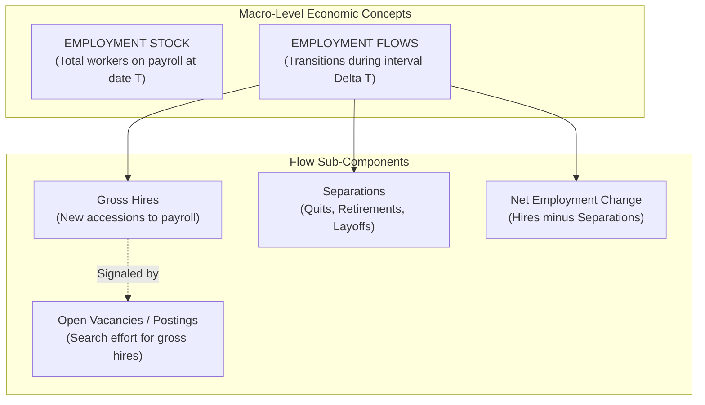

# JOBINTEL 2.0 — SPRINT 3B.3.1
# DELIVERABLE 5: HIRING EVIDENCE TAXONOMY REVIEW
## Epistemological Audit of Evidence Tiers, Stock-Flow Disentanglement & Stale Posting Dynamics

**Document Version:** 1.0.0  
**Phase:** Sprint 3B.3.1 (Forensic Employer Source Validation & Evidence Qualification)  
**Audit Type:** Epistemological & Labour Statistics Methodology Audit  
**Date:** November 2026  
**Auditor:** Principal Labour Market Economist & Statistical Auditor  
**Target Baseline:** `staging/sprint2c3` (`d1a8b027d10031b3568a3141f639e2f40a49be18`)  
**Production Isolation:** `master` (`198b79dcdff08a5be5f08847c4262d31a3ce261e`)

---

## 1. THE CENTRAL METHODOLOGICAL FLAW IN PHASE 0: HIERARCHICAL CONFLATION

In Sprint 3B.3 Phase 0, the seven evidence categories were structured as a linear 1-to-7 hierarchy:
$$\text{Tier 1} \to \text{Tier 2} \to \text{Tier 3} \to \text{Tier 4} \to \text{Tier 5} \to \text{Tier 6} \to \text{Tier 7}$$

This linear hierarchy creates a severe epistemological error: **it implies that Tier 1 is universally superior to Tier 4**.

In labour economics, **Employment Stock** (the total number of employees on payroll at date $T$) and **Recruitment Flow** (the number of vacancies advertised or hires made during interval $\Delta T$) measure two fundamentally different economic phenomena:
- An official statutory census (Tier 1: WGEA, SEC 10-K) is high quality for measuring **Employment Stock**, but it contains **zero information about current open vacancies**.
- A direct first-party ATS feed (Tier 4: Greenhouse, Lever) is high quality for observing **Active Vacancies**, but it cannot measure total company headcount.

Tier 1 is **not** a "better" vacancy metric than Tier 4. Tier 1 is **not a vacancy metric at all**.

---

## 2. THE CARDINAL DISTINCTIONS IN LABOUR MARKET MEASUREMENT



### 2.1 Stock vs. Flow
- **Employment Stock ($S_t$):** The number of filled positions at a point in time (e.g. 50,000 employees as of Dec 31, 2025).
- **Recruitment Flow ($F_{\Delta t}$):** The rate of hiring, vacancy announcements, or separations over time:
  $$S_{t+1} = S_t + \text{Hires}_{\Delta t} - \text{Separations}_{\Delta t}$$
- **The Error:** A company with 10,000 employees that advertises 500 jobs is not necessarily expanding by 500 employees. If annual employee turnover is 15% (1,500 separations), advertising 500 jobs means the company is **contracting** (replacing only one-third of departing workers).

### 2.2 Net Headcount Change vs. Gross Hires
- When a corporate 10-K filing reports that headcount increased from 100,000 to 105,000 ($\Delta S = +5,000$), this reflects **net change**, not gross hiring.
- If the firm experienced 10,000 resignations and retirements during that year, it actually completed **15,000 gross hires** to achieve a net gain of 5,000.
- Net change cannot be equated to gross recruitment volume.

### 2.3 Job Advertisements $\neq$ Confirmed Hires
- A job advertisement represents a **recruitment signal / search effort**, not a confirmed transaction.
- Empirical studies (e.g. Davis, Faberman, and Haltiwanger, 2013; Hershbein and Kahn, 2018) establish that:
  1. Multiple job postings may be placed to hire a single individual.
  2. A single job posting may be used to hire a cohort of 50 customer service agents.
  3. Up to 20% to 35% of digital job postings result in **no hire at all** (cancelled requisitions, phantom postings, budget freezes).
  4. Many hires (internal promotions, referrals, executive search) occur without any public job advertisement.
- Job postings must **never** be presented as confirmed hires.

### 2.4 WARN Notices Represent Redundancies, Not General Hiring
- WARN filings capture **statutory mass layoffs and plant shutdowns** affecting 50+ workers.
- They are essential indicators of workforce restructuring and contraction, but must be segregated from positive hiring indicators.

### 2.5 Inferred Hiring Activity Is Not Observed Data
- Statistical indices, machine-learning imputations, and search-intensity ratios are synthetic constructs.
- They must carry prominent visual and schema tags (`is_synthetic_inference: true`) and must never be co-mingled with empirical records.

---

## 3. AUDIT OF THE SEVEN PROPOSED EVIDENCE CATEGORIES

| Category ID | Category Name | Underlying Economic Phenomenon | Best Real-World Source | Statistical Validity | Fatal Conflation Risk |
| :---: | :--- | :--- | :--- | :---: | :--- |
| **CAT-01** | `OFFICIAL_EMPLOYMENT_STATISTIC` | Statutory Employment Stock | WGEA (AU), UK Gender Pay Gap | **High (Certified)** | Conflating annual stock with real-time vacancies |
| **CAT-02** | `COMPANY_DISCLOSED_HIRING` | Net Annual Workforce Growth | SEC 10-K, SEBI BRSR | **High (Audited)** | Conflating net change with gross recruitment |
| **CAT-03** | `EXPLICIT_VACANCY_COUNT` | Open Public Sector Requisitions | USAJOBS, APSjobs | **High (Verified)** | Conflating public civil service with private commercial market |
| **CAT-04** | `JOB_ADVERTISEMENT` | Active Search / Recruitment Flow | Direct ATS Portals (Greenhouse) | **Medium-High (Observed)** | Treating job postings as confirmed hires |
| **CAT-05** | `HISTORICAL_RECRUITMENT_OBSERVATION`| Recruitment Dynamics & Velocity | Longitudinal ATS Archives | **Medium (Derived)** | Treating historical duration as future certainty |
| **CAT-06** | `EMPLOYMENT_CHANGE` | Workforce Reductions & Contractions| State WARN Filings | **High (Statutory)** | Misinterpreting mass layoffs as hiring activity |
| **CAT-07** | `INFERRED_HIRING_ACTIVITY` | Econometric Intensity Index | Modeled Estimations | **Low (Synthetic)** | Presenting mathematical models as empirical facts |

---

## 4. CRITICAL AUDIT OF THE 120-DAY "GHOST JOB" THRESHOLD

Phase 0 proposed a universal 120-day age cap, asserting that any requisition open past 120 days is an automated "ghost job" or stale requisition.

### 4.1 Empirical Findings on Job Posting Duration
Labour economics literature and empirical ATS data reveal that job posting duration is heavily heterogeneous across occupational families:
- **Fast-Churn Roles (Retail, Hospitality, Warehouse):** Median duration is **18 to 28 days**. Requisitions open beyond 45 days in retail are almost universally stale or evergreen recruitment pipelines.
- **Mid-Tier Professional (Marketing, Operations, General Tech):** Median duration is **35 to 55 days**.
- **Specialized / High-Skill (Cloud Architects, AI/ML Researchers, Staff Engineers, Medical Specialists):** Median duration is **75 to 140 days**. Legitimate, aggressive search efforts for specialized talent regularly extend past 120 days due to candidate scarcity and lengthy interview loops.
- **Executive Leadership (VP, C-Suite):** Median duration is **120 to 210 days**.

### 4.2 The Danger of a Static 120-Day Boundary
1. A static 120-day rule produces **high false-positive rates** for legitimate, hard-to-fill senior engineering and medical roles (flagging real demand as "ghost jobs").
2. It produces **high false-negative rates** for entry-level and retail postings (allowing stale 90-day retail ghost postings to pass as active demand).
3. **Audit Verdict:** The 120-day age cap is an **arbitrary operational heuristic**, not an empirical law.

### 4.3 Refined Operational Policy
Rather than deleting or invalidating postings at 120 days:
1. Classify postings into three dynamic duration bands:
   - `ACTIVE_PRIMARY`: $0 \le \text{age} \le 60\text{ days}$ (Peak active recruitment).
   - `EXTENDED_SEARCH`: $61 \le \text{age} \le 120\text{ days}$ (Prolonged search or high-specialization role).
   - `PERSISTENT_PIPELINE`: $\text{age} > 120\text{ days}$ (Evergreen talent pool or stale listing).
2. Display the duration band clearly in the UI. Exclude `PERSISTENT_PIPELINE` from active monthly flow totals, but retain them in employer talent intelligence as an indicator of specialized talent shortages.

---

## 5. THE 2D EVIDENCE QUALIFICATION MATRIX (PROPOSED REPLACEMENT)

To eliminate the flawed linear 1-to-7 hierarchy, JobIntel 2.0 must adopt a **two-dimensional matrix** separating the **Economic Dimension** from the **Evidence Reliability Tier**:

```
                              ECONOMIC DIMENSION
                    EMPLOYMENT STOCK        RECRUITMENT FLOW
                ┌───────────────────────┬───────────────────────┐
   CERTIFIED    │ SEC Form 10-K (US)    │ USAJOBS API (US)      │
   STATUTORY    │ WGEA Reporting (AU)   │ APSjobs (AU)          │
   (Tier A)     │ UK Gender Pay Gap     │                       │
E               ├───────────────────────┼───────────────────────┤
V  VERIFIED     │ SEBI BRSR Filings(IN) │ First-Party ATS Feeds │
I  OBSERVED     │ Companies House Accounts│ (Greenhouse, Lever) │
D  (Tier B)     │                       │                       │
E               ├───────────────────────┼───────────────────────┤
N  STATUTORY    │ State WARN Filings    │ DWP Find a Job (UK)   │
C  ACTIONS /    │ (Layoffs/Plant Closings) (Civilian Vacancies) │
E  PARTNER      │                       │                       │
   (Tier C)     │                       │                       │
T               ├───────────────────────┼───────────────────────┤
I  SYNTHETIC    │ Econometric Stock     │ Modeled Recruitment   │
E  INFERRED     │ Imputations           │ Intensity Indices     │
R  (Tier D)     │                       │                       │
                └───────────────────────┴───────────────────────┘
```

### Core Rule of Presentation
In the UI and API, observations must display both coordinates:
- `Economic Dimension`: `EMPLOYMENT_STOCK` vs. `RECRUITMENT_FLOW`.
- `Reliability Tier`: `TIER_A_CERTIFIED_STATUTORY`, `TIER_B_VERIFIED_OBSERVED`, `TIER_C_PARTNER_ACTION`, or `TIER_D_SYNTHETIC_INFERRED`.

This structure guarantees that users, auditors, and researchers never confuse certified corporate headcount stock with digital recruitment advertising flow.
