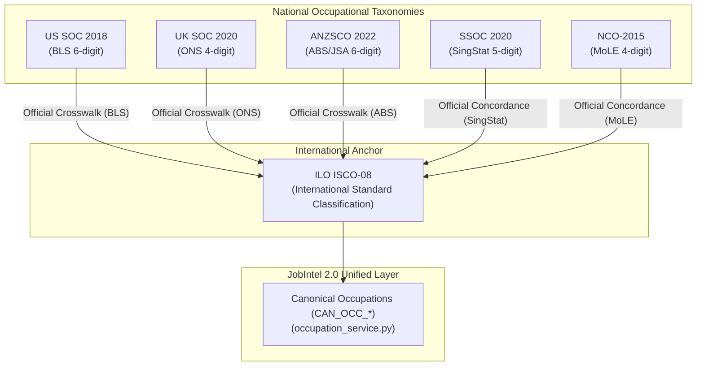

# JOBINTEL 2.0 — SPRINT 3B.3.1
# DELIVERABLE 7: OCCUPATION & SKILL MAPPING VALIDATION
## Forensic Audit of Occupational Taxonomies, Crosswalks, Skill Ontologies & Confidence Calibration

**Document Version:** 1.0.0  
**Phase:** Sprint 3B.3.1 (Forensic Employer Source Validation & Evidence Qualification)  
**Audit Type:** Taxonomy Integrity, Crosswalk Availability & Calibration Protocol Audit  
**Date:** November 2026  
**Auditor:** Principal Taxonomy Engineer & Machine Learning Specialist  
**Target Baseline:** `staging/sprint2c3` (`d1a8b027d10031b3568a3141f639e2f40a49be18`)  
**Production Isolation:** `master` (`198b79dcdff08a5be5f08847c4262d31a3ce261e`)

---

## 1. OCCUPATIONAL TAXONOMY BASELINE AUDIT

Across the five target economies, JobIntel 2.0 must bridge national occupational classifications to a unified canonical concept layer (`CAN_OCC_*`).

### 1.1 Detailed Audit of National Classifications
1. **United States — SOC 2018 (BLS):**
   - **Authority:** U.S. Bureau of Labor Statistics.
   - **Structure:** 4-tier hierarchy (Major 2-digit, Minor 3-digit, Broad 5-digit, Detailed 6-digit). 867 detailed occupations.
   - **Crosswalk Availability:** Official crosswalk published by BLS to ISCO-08 and from 2010 SOC $\to$ 2018 SOC. High quality, public domain.
2. **United Kingdom — SOC 2020 (ONS):**
   - **Authority:** Office for National Statistics (ONS).
   - **Structure:** 4-digit codes (Major 1-digit, Sub-Major 2-digit, Minor 3-digit, Unit 4-digit). 412 unit groups.
   - **Crosswalk Availability:** Official ONS crosswalk published between SOC 2010 and SOC 2020, and to ISCO-08. Open under OGL v3.0.
3. **Australia — ANZSCO 2022 (ABS / JSA):**
   - **Authority:** Australian Bureau of Statistics (ABS) & Jobs and Skills Australia (JSA).
   - **Structure:** 6-digit codes (Major 1-digit, Sub-Major 2-digit, Minor 3-digit, Unit 4-digit, Occupation 6-digit).
   - **Crosswalk Availability:** Official concordance tables published by ABS linking ANZSCO 2013 to ANZSCO 2022, and to ISCO-08. Published under CC BY 4.0.
4. **Singapore — SSOC 2020 (SingStat):**
   - **Authority:** Singapore Department of Statistics (DOS).
   - **Structure:** 5-digit codes aligned conceptually with ISCO-08.
   - **Crosswalk Availability:** SingStat publishes the SSOC 2020 alphabetical and numerical index; direct concordance to ISCO-08 is built into the hierarchical structure. Available under SODL v1.0.
5. **India — NCO-2015 (MoLE / DGE):**
   - **Authority:** Directorate General of Employment, Ministry of Labour and Employment.
   - **Structure:** 4-digit code directly adapted from ILO ISCO-08.
   - **Crosswalk Availability:** NCO-2015 was directly derived from ISCO-08 (1:1 mapping for major groups). However, tech titles (e.g. Cloud Architect, DevOps Engineer) are missing from detailed 4-digit descriptions and require semantic derivation.

### 1.2 The Crosswalk Reality: No Direct Bilateral Crosswalks
- An official direct crosswalk between Australian ANZSCO and Indian NCO-2015 **does not exist**.
- Direct mapping between UK SOC 2020 and US SOC 2018 exists only via research crosswalks (e.g. O*NET-to-SOC).
- **Architecture Mandate:** International bridging must operate via a **Hub-and-Spoke Architecture**:
  $$\text{National Taxonomy} \xrightarrow{\text{Official Concordance}} \text{ISCO-08} \xrightarrow{\text{Deterministic Mapping}} \text{JobIntel Canonical Concept (CAN\_OCC\_*)}$$

---

## 2. SKILL TAXONOMIES & REUSE RIGHTS AUDIT

### 2.1 ESCO v1.1.1 (European Skills, Competences, Qualifications and Occupations)
- **Publisher:** European Commission, Directorate-General for Employment, Social Affairs and Inclusion.
- **Coverage:** 13,890 skill and competence concepts, multilingual, with hierarchical relations (broader/narrower).
- **Licensing:** Published under Creative Commons Attribution 4.0 International (CC BY 4.0).
- **Usability:** 100% legally clear for commercial and open use with attribution. Excellent taxonomy of technical, digital, and transferable skills.

### 2.2 Lightcast Open Skills Taxonomy
- **Publisher:** Lightcast (formerly Emsi Burning Glass).
- **Coverage:** Approximately 32,000 skills categorized into Specialized Skills, Common Skills, and Software Skills.
- **Licensing & Scope:**
  - The **Open Skills Taxonomy** (terms and definitions) is published under **Creative Commons Attribution 4.0 International (CC BY 4.0)**.
  - **Permitted Use:** Ingesting skill names, IDs, and categories for standardized labeling is fully permitted with attribution: *"This product includes skills data from the Lightcast Open Skills Taxonomy (CC BY 4.0)"*.
  - **Prohibited / Proprietary Use:** Lightcast's proprietary skill frequency algorithms, salary premia, and job posting analytics are **NOT open source**. JobIntel cannot claim to use "Lightcast analytics" without an enterprise commercial contract.

---

## 3. CHALLENGE OF THE $C \ge 0.85$ CONFIDENCE THRESHOLD

In Phase 0, the research asserted:
> *"Skill extraction and occupation crosswalking uses a calibrated confidence threshold ($C \ge 0.85$)."*

### 3.1 Forensic Audit Finding: **`UNSUPPORTED`**
1. **No Calibration Methodology Was Executed:** In statistical machine learning, a "calibrated confidence" means that for all predictions assigned confidence $C \approx 0.85$, exactly 85% are correct.
2. **Arbitrary Number Selection:** The value $0.85$ was an arbitrary operational cutoff picked without plotting a calibration curve, computing a Brier score, or applying Platt scaling.
3. **Risk of Misclassification:** On unstructured job advertisement titles (e.g. "Lead Ninja", "Full Stack Evangelist"), a naive keyword string matcher or embeddings model can output high cosine similarity ($\ge 0.85$) while matching the completely wrong SOC code (e.g. matching "Evangelist" to Religious Workers SOC 21-2000).

---

## 4. OCCUPATION & SKILL EVALUATION PROTOCOL

To establish a calibrated, scientifically defensible mapping engine, Sprint 3B.3 must implement a formal evaluation protocol.

### 4.1 Gold-Standard Title Dataset (`tests/benchmarks/job_title_mapping_gold.json`)
Construct a ground-truth dataset of **500 real-world job posting titles** sampled across the 5 markets:

| Occupational Sector | Title Count | Challenge Characteristic | Example Difficult Title |
| :--- | :---: | :--- | :--- |
| **Software & Cloud** | 120 | Jargon, non-standard titles, modern stacks | *"Staff Infrastructure Reliability Platform Engineer"* |
| **Data & AI/ML** | 80 | Rapidly shifting terminology | *"Principal AI Prompt Solutions Architect"* |
| **Business & Product** | 100 | Ambiguous scope across industries | *"Growth Product Lead - Enterprise Fintech"* |
| **Operations & Healthcare** | 100 | Licensing and statutory credential requirements | *"Clinical Nurse Specialist - Acute Oncology"* |
| **Administrative & Sales** | 100 | Highly colloquial commercial titles | *"Account Executive - Mid Market Hunters"* |
| **Total Test Suite** | **500** | **Multi-Market Benchmark Evaluation Suite** | — |

### 4.2 Mathematical Calibration Protocol
1. **Cosine / Classifier Output ($s \in [0, 1]$):**
   Apply Temperature Scaling or Isotonic Regression on held-out validation data to convert raw similarity scores into true posterior probabilities:
   $$\hat{P}(Y = 1 | s) = \sigma\left(\frac{s - a}{T}\right)$$
2. **Reliability Diagram & Expected Calibration Error (ECE):**
   Partition predictions into $M = 10$ bins. Calculate ECE:
   $$\text{ECE} = \sum_{m=1}^{M} \frac{|B_m|}{N} \left| \text{acc}(B_m) - \text{conf}(B_m) \right|$$
   *Acceptance Criteria:* ECE must be **$< 0.05$** before claiming a calibrated model.
3. **Dual-Threshold Routing Engine:**
   - **Tier 1 (Automated Acceptance):** Calibrated Confidence $\ge 0.90 \implies$ Record mapped automatically with provenance `DERIVED_HIGH_CONFIDENCE`.
   - **Tier 2 (Qualified Acceptance):** $0.75 \le \text{Calibrated Confidence} < 0.90 \implies$ Record mapped with warning banner `DERIVED_PROVISIONAL`.
   - **Tier 3 (Unmapped Fallback):** $\text{Calibrated Confidence} < 0.75 \implies$ Mapped to `UNCLASSIFIED_ROLE` (SOC 99-9999). **Force-mapping is strictly prohibited.**

---

## 5. SKILL EXTRACTION VALIDATION STANDARDS

1. **Context-Aware Disambiguation:**
   Naive string matching creates catastrophic false positives on common English words that match tech acronyms:
   - "Go" (Programming Language) matched against "go-getter" or "go to market".
   - "R" (Statistical Language) matched against "R&D".
   - "Rust" (Language) matched against "corrosion and rust protection".
   - "C" (Language) matched against "C-suite" or "vitamin C".
2. **Mandatory Context Window Rules:**
   - Single-letter and two-letter skills (`R`, `C`, `Go`, `AI`, `ML`, `CI`, `CD`) must require explicit contextual co-occurrence terms (e.g. `golang`, `compiler`, `package`, `programming`, `developer`, `CRAN`, `ggplot`) within a 5-token window.
   - Without contextual reinforcement, isolated short tokens are discarded.
