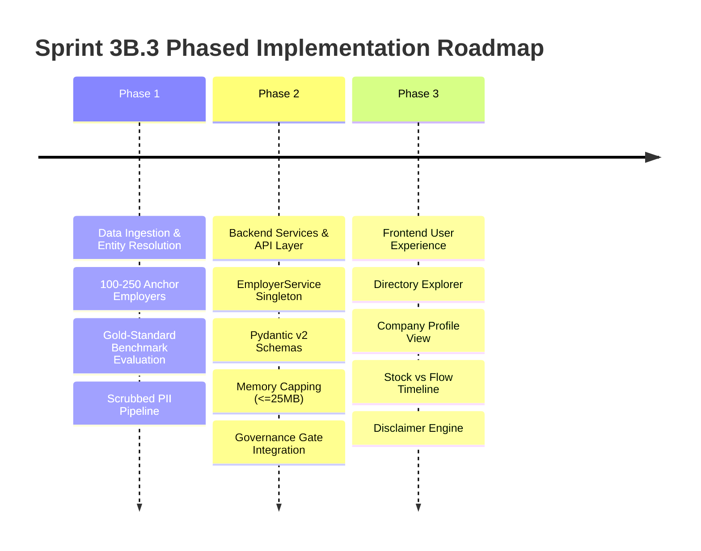

# JOBINTEL 2.0 — SPRINT 3B.3.1
# DELIVERABLE 9: REVISED EMPLOYER MVP SCOPE & QUALIFIED FEASIBILITY MATRIX
## Empirical Boundary Specification, Restricted Feature Set & Implementation Roadmap

**Document Version:** 1.0.0  
**Phase:** Sprint 3B.3.1 (Forensic Employer Source Validation & Evidence Qualification)  
**Audit Type:** Scope Qualification & Feasibility Realignment  
**Date:** November 2026  
**Auditor:** Principal Product Strategist, Data Governance Auditor & Labour Market Specialist  
**Target Baseline:** `staging/sprint2c3` (`d1a8b027d10031b3568a3141f639e2f40a49be18`)  
**Production Isolation:** `master` (`198b79dcdff08a5be5f08847c4262d31a3ce261e`)

---

## 1. REVISED FIVE-MARKET FEASIBILITY MATRIX

Every dimension across the five target economies is classified using strictly allowed statuses:
`VERIFIED`, `PARTIALLY_VERIFIED`, `REVIEW_REQUIRED`, `UNAVAILABLE`, `UNKNOWN`.
All subjective numerical "readiness scores" have been permanently excised.

| Feature / Data Dimension | Australia (AU) | United Kingdom (UK) | United States (US) | Singapore (SG) | India (IN) |
| :--- | :---: | :---: | :---: | :---: | :---: |
| **Employer Identity Availability** | **`VERIFIED`** (ABR/ASIC) | **`VERIFIED`** (Companies House) | **`VERIFIED`** (SEC CIK) | **`VERIFIED`** (ACRA UEN) | **`VERIFIED`** (MCA21 CIN) |
| **Legal Entity Information** | **`VERIFIED`** (ABN/ACN) | **`VERIFIED`** (CRN/SIC) | **`VERIFIED`** (SEC/SIC) | **`VERIFIED`** (UEN/SSIC) | **`PARTIALLY_VERIFIED`** (Static CSV) |
| **Company Headcount Stock** | **`PARTIALLY_VERIFIED`** (WGEA Bands $\ge 100$) | **`PARTIALLY_VERIFIED`** (GPG Bands $\ge 250$) | **`PARTIALLY_VERIFIED`** (SEC 10-K Public) | **`UNAVAILABLE`** (Zero in Open Data) | **`PARTIALLY_VERIFIED`** (Top 1,000 BRSR) |
| **Job Advertisements (Private)** | **`PARTIALLY_VERIFIED`** (Direct ATS Feeds) | **`PARTIALLY_VERIFIED`** (Direct ATS Feeds) | **`PARTIALLY_VERIFIED`** (Direct ATS Feeds) | **`PARTIALLY_VERIFIED`** (Direct ATS Feeds) | **`PARTIALLY_VERIFIED`** (Direct ATS Feeds) |
| **Official Vacancy Counts** | **`PARTIALLY_VERIFIED`** (APSjobs Civil Service) | **`PARTIALLY_VERIFIED`** (DWP Partner API) | **`PARTIALLY_VERIFIED`** (USAJOBS Civil Service) | **`REVIEW_REQUIRED`** (MCF Gated API) | **`REVIEW_REQUIRED`** (NCS Gated API) |
| **Skill Requirements** | **`PARTIALLY_VERIFIED`** (Extracted from ATS) | **`PARTIALLY_VERIFIED`** (Extracted from ATS) | **`PARTIALLY_VERIFIED`** (Extracted from ATS) | **`PARTIALLY_VERIFIED`** (Extracted from ATS) | **`PARTIALLY_VERIFIED`** (Extracted from ATS) |
| **Qualification Requirements** | **`PARTIALLY_VERIFIED`** (Extracted from ATS) | **`PARTIALLY_VERIFIED`** (Extracted from ATS) | **`PARTIALLY_VERIFIED`** (Extracted from ATS) | **`PARTIALLY_VERIFIED`** (Extracted from ATS) | **`PARTIALLY_VERIFIED`** (Extracted from ATS) |
| **Historical Hiring / Churn Data**| **`PARTIALLY_VERIFIED`** (Annual WGEA Stock) | **`PARTIALLY_VERIFIED`** (Annual GPG Stock) | **`PARTIALLY_VERIFIED`** (WARN Filings) | **`UNAVAILABLE`** | **`PARTIALLY_VERIFIED`** (Annual BRSR Stock) |
| **Geographic Resolution** | **`PARTIALLY_VERIFIED`** (State / Postcode) | **`PARTIALLY_VERIFIED`** (City / Postcode) | **`PARTIALLY_VERIFIED`** (City / State / WARN)| **`PARTIALLY_VERIFIED`** (Postal Code / Sector)| **`PARTIALLY_VERIFIED`** (ROC / State) |
| **Open Programmatic API Access** | **`PARTIALLY_VERIFIED`** (ABN Lookup / ATS) | **`VERIFIED`** (Companies House REST) | **`VERIFIED`** (SEC EDGAR REST) | **`PARTIALLY_VERIFIED`** (DataStore API) | **`UNAVAILABLE`** (No Free Public API) |
| **Commercial Use Permission** | **`VERIFIED`** (CC BY 4.0) | **`VERIFIED`** (OGL v3.0) | **`VERIFIED`** (Public Domain) | **`VERIFIED`** (SODL v1.0) | **`PARTIALLY_VERIFIED`** (NDSAP Terms) |
| **Update Frequency** | **`PARTIALLY_VERIFIED`** (Annual Reports) | **`VERIFIED`** (Daily CH / Annual GPG) | **`VERIFIED`** (Quarterly / Annual) | **`PARTIALLY_VERIFIED`** (Monthly Dumps) | **`PARTIALLY_VERIFIED`** (Annual Filings) |

---

## 2. FORMAL IMPLEMENTATION RECOMMENDATION

```
========================================================================================
RECOMMENDATION: B. CONDITIONAL GO
========================================================================================
A limited, market-specific Employer Intelligence MVP can proceed to Phase 1 Ingestion
and Phase 2 Backend Implementation UNDER STRICTLY ENFORCED OPERATIONAL RESTRICTIONS.
Universal scaling to 2,500 employers is prohibited; implementation must anchor on an
empirically validated cohort of 100 to 250 verified employers across the 5 markets.
========================================================================================
```

---

## 3. SPECIFIC SCOPE DEFINITION FOR THE CONDITIONAL MVP

### 3.1 Target Monitored Cohort (100–250 Anchor Employers)
The MVP cohort is restricted to established enterprises with dual-source validation (certified statutory corporate identity + verified first-party career feeds):
- **Australia (30–50 Employers):** Large private enterprises reporting to WGEA with published ABNs (e.g. Atlassian, Canva, Commonwealth Bank, BHP, Woolworths).
- **United States (40–60 Employers):** Major public issuers reporting to SEC EDGAR with verified CIKs and public ATS feeds (e.g. Microsoft, Google, Apple, Amazon, Salesforce, Nvidia).
- **United Kingdom (30–50 Employers):** Active Companies House registrants reporting to the UK Gender Pay Gap portal (e.g. DeepMind, ARM, AstraZeneca, Unilever, Barclays).
- **Singapore (15–25 Employers):** ACRA-registered regional technology headquarters with active career feeds (e.g. Grab, Sea Group, Shopee, DBS Bank).
- **India (20–35 Employers):** Top BSE/NSE listed corporations filing mandatory SEBI BRSR workforce disclosures (e.g. Tata Consultancy Services, Infosys, Wipro, Reliance Industries).
- **Total Initial Cohort:** **135 to 220 Anchor Employers**.

### 3.2 Authorized Source Datasets
1. **Corporate Identity:**
   - AU: Australian Business Register (ABR) bulk data via `data.gov.au`.
   - UK: Companies House REST API (`/company/{crn}`).
   - US: SEC EDGAR Company Facts API (`CIK`).
   - SG: ACRA Entities API via Data.gov.sg.
   - IN: Curated seed list of top 1,000 listed entities from BSE/NSE.
2. **Workforce Headcount Stock:**
   - AU: WGEA Corporate Data Explorer (CC BY 4.0) — Categorical bands + detailed reporting counts.
   - UK: UK Gender Pay Gap Reporting Data (OGL v3.0) — Categorical size bands.
   - US: SEC Form 10-K Human Capital Disclosures (Item 101) — Disclosed global headcount.
   - IN: SEBI BRSR Principle 3 filings — Permanent and contractual headcount.
3. **Recruitment Flow Vacancy Signals:**
   - First-party ATS JSON board feeds (`boards-api.greenhouse.io` and `api.lever.co`) for anchor employers with public endpoints.
   - US Civil Service: USAJOBS Open Data API.
   - AU Public Service: APSjobs public feeds.

### 3.3 Obtainable Employer Attributes
- `company_id` (Canonical system identifier)
- `legal_name` and `trading_names`
- `headquarters_country`
- `primary_domain` (Validated corporate domain)
- `company_category` (`GLOBAL_ENTERPRISE`, `DOMESTIC_CORPORATION`, `PUBLIC_SECTOR_GOVERNMENT`)
- `is_recruitment_agency` (Boolean filter flag; defaults to `False`)
- `industry_code` (SIC/NAICS/ANZSIC/NIC)
- `registrations` (Array of verified national authority IDs: CIK, CRN, ABN, UEN, CIN)
- `headcount_stock` (Dual representation: exact certified float OR categorical string band)
- `locations` (Aggregated metro hubs: City, State/Region, Country only. No street addresses)

### 3.4 Permitted Hiring Evidence Categories
1. **`OFFICIAL_EMPLOYMENT_STATISTIC`:** Certified annual headcount from WGEA, SEC 10-K, UK GPG, SEBI BRSR.
2. **`JOB_ADVERTISEMENT`:** Active vacancy counts observed via first-party ATS board feeds.
3. **`EMPLOYMENT_CHANGE`:** State WARN notifications explicitly labeled as workforce restructuring/layoffs.

---

## 4. STRICTLY PROHIBITED & WITHHELD FEATURES (EXPLICIT BOUNDARIES)

| Prohibited / Withheld Feature | Rationale & Regulatory Basis | Operational Enforcement |
| :--- | :--- | :--- |
| **Commercial Job Board Scraping** | CFAA liability, breach of contract, EU/UK Database Directive 96/9/EC. | Zero automated scrapers targeting LinkedIn, Indeed, Naukri, Seek. |
| **Single Composite "Employer Score"** | Methodologically unsound, ungrounded, gamified metric. | Permanently banned from product specification and API schemas. |
| **Micro-Businesses & Sole Proprietors** | Severe PII and home-office address leakage risk under GDPR/CCPA. | Minimum entity threshold: $\ge 50$ employees or public corporation. |
| **Predictive Net Headcount Forecasting** | Absence of multi-year longitudinal microdata; produces hallucinations. | Excluded from MVP; replaced by static historical timelines. |
| **UK Vacancy Flow Signals** | Pre-existing Sprint 3B.2.3.1 UK demand publication gate. | UK employer profiles show statutory registration & GPG bands; vacancy flow is gated. |
| **Establishment-Level US Headcount** | SEC 10-K provides global corporate numbers, not branch-level census. | Labeled explicitly as `"Global Disclosed Headcount (SEC Form 10-K)"`. |

---

## 5. THREE-PHASE IMPLEMENTATION ROADMAP



### Phase 1: Ingestion Pipeline & Ground-Truth Entity Resolution
- Ingest 100–250 anchor employers across AU, UK, US, SG, IN.
- Execute the 1,000-pair entity resolution benchmark (`tests/test_entity_resolution_benchmark.py`).
- Prove False Merge Rate is $< 0.1\%$ before persisting master profiles.
- Generate scrubbed, immutable JSON datasets in `data/processed/employers/`.

### Phase 2: Additive Backend & Governance Integration
- Implement `src/backend/services/employer_service.py` with in-memory hash maps.
- Profile runtime memory on boot; enforce $< 25$ MB subsystem memory ceiling.
- Mount API endpoints under `/v1/employers/*` and `/api/v1/employers/*`.
- Integrate `RevocationManifest` to enforce runtime publication gating.

### Phase 3: Frontend User Experience
- Mount `/employers` route in `frontend/src/App.tsx`.
- Build `EmployersPage.tsx` with Directory, Profile, Headcount Stock vs. Recruitment Flow Timeline, and Skill Distribution tabs.
- Render mandatory `ScientificDisclaimer` highlighting that job advertisements do not equal confirmed hires.
