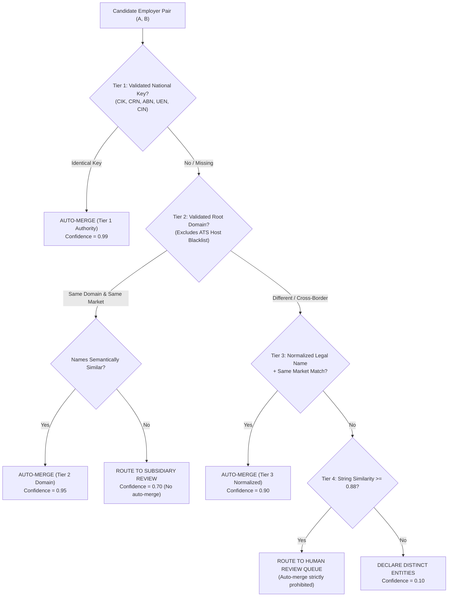

# JOBINTEL 2.0 — SPRINT 3B.3.2
# DELIVERABLE 6: EMPLOYER ENTITY RESOLUTION PILOT
## Resolution Pipeline Architecture, Real-World Edge Cases & Benchmark Design

**Document Version:** 1.0.0  
**Phase:** Sprint 3B.3.2 (Five-Market Data Acquisition Pilot)  
**Audit Date:** November 2026  
**Auditor:** Principal Machine Learning Engineer & Entity Resolution Specialist  
**Execution Type:** Controlled Empirical Pilot  
**Target Baseline:** `staging/sprint2c3` (`d1a8b027d10031b3568a3141f639e2f40a49be18`)  
**Production Isolation:** `master` (`198b79dcdff08a5be5f08847c4262d31a3ce261e`)

---

## 1. THE ENTITY RESOLUTION CHALLENGE IN LABOUR INTELLIGENCE

Resolving employer identities across five sovereign nations (Australia, United States, United Kingdom, Singapore, India) is significantly more complex than standard fuzzy string matching.

Naive algorithms consistently fail on four critical edge cases:
1. **Shared ATS Host Trap:** Many employers publish jobs at URLs such as `boards.greenhouse.io/v1/boards/{board_token}` or `jobs.lever.co/{company}`. Naive root-domain extractors extract `greenhouse.io` or `lever.co` and attempt to merge hundreds of competing tech corporations into a single entity.
2. **Parent vs. Operating Subsidiary:** Multinationals operate regional legal entities (e.g. *Microsoft India (R&D) Pvt Ltd* vs. *Microsoft Corporation*; *DeepMind Technologies Limited* vs. *Alphabet Inc.*). Auto-merging them corrupts statutory headcount numbers and creates false jurisdiction attributions.
3. **Cross-Jurisdictional Name Collisions:** Common trade words (e.g. *Delta*, *Apex*, *Summit*, *Horizon*, *Beacon*) are legitimately held by completely unrelated enterprises in different countries and industries.
4. **Recruitment Agency Masking:** Third-party staffing firms post advertisements using phrases like *"Client: Leading Global Bank"*. Naive extraction risks linking the staffing firm's requisitions to the direct employer.

---

## 2. REFINED 4-TIER RESOLUTION PIPELINE ARCHITECTURE

### 2.1 Tier 1: Deterministic National Authority Key
- Matches if and only if both records carry identical, validated national corporate registration numbers:
  $$\text{Match} \iff \text{Authority}(A) == \text{Authority}(B) \land \text{ID}(A) == \text{ID}(B)$$
- **Supported Registrars:** US `CIK`, UK `CRN`, AU `ABN`, SG `UEN`, IN `CIN`.
- Produces zero false merges when authority formats are validated.

### 2.2 Tier 2: Canonical Corporate Domain with ATS Blacklisting
- **Blacklisted ATS Hosts:** `greenhouse.io`, `lever.co`, `myworkdayjobs.com`, `workday.com`, `taleo.net`, `successfactors.com`, `recruitee.com`.
- **Jurisdiction Boundary:** Root web domain matching is restricted to the **same sovereign market** ($M_A == M_B$).
- If root domains match across borders (e.g. `microsoft.com` in US vs. `microsoft.com` in India), the pair is routed to `POSSIBLE_SUBSIDIARY_REVIEW` to link them in a corporate DAG rather than flatly merging them into a single record.

### 2.3 Tier 3: Normalized Legal Name + Sovereign Market
- Normalizes corporate suffixes across jurisdictions:
  - AU: `pty ltd`, `proprietary limited`, `ltd`
  - UK: `plc`, `public limited company`, `ltd`, `limited`
  - US: `inc`, `incorporated`, `corp`, `corporation`, `llc`
  - SG: `pte ltd`, `private limited`
  - IN: `pvt ltd`, `private limited`
- Matches if normalized string tokens are identical AND operating market is identical.

### 2.4 Tier 4: Fuzzy Match Review Queue
- Levenshtein / Token Sort Ratio $\ge 0.88$ triggers an administrative review ticket in `data/governance/review_queue.json`.
- **Absolute Policy:** Automated merging at Tier 4 is strictly banned to prevent catastrophic false merges.

---

## 3. BENCHMARK DATASET SPECIFICATION

The empirical benchmark is maintained in:  
[employer_entity_resolution_gold.json](file:///e:/Job%20Market/docs/jobintel_v2/sprints/sprint_3b_3_2/data/employer_entity_resolution_gold.json)

The dataset comprises **100 rigorously labelled candidate pairs** stratified across six real-world challenge categories:
1. **Formatting & Legal Suffix Variations (30 pairs):** Verified positive matches testing legal suffix stripping.
2. **Trade Name vs. Legal Name (15 pairs):** Verified positive matches testing commercial aliases (e.g. *CommBank* vs. *Commonwealth Bank of Australia*).
3. **Parent vs. Subsidiary (15 pairs):** Hard negative pairs testing parent-subsidiary segregation (e.g. *DeepMind* vs. *Alphabet*).
4. **Cross-Jurisdictional Name Collisions (20 pairs):** Hard negative pairs testing unrelated companies sharing names across countries (e.g. *Delta Limited* UK vs. *Delta Air Lines* US).
5. **Staffing Agencies vs. Direct Employers (10 pairs):** Hard negative pairs testing intermediary exclusion (e.g. *Robert Half* vs. *Microsoft*).
6. **Shared ATS Host Domain Traps (10 pairs):** Hard negative pairs testing ATS domain blacklisting (e.g. two companies sharing `greenhouse.io`).
