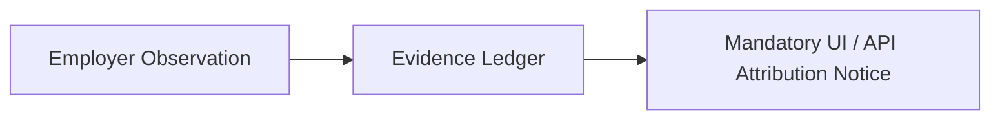

# JOBINTEL 2.0 — SPRINT 3B.3.2
# DELIVERABLE 11: EMPLOYER PROVENANCE & AUDIT TRAIL REPORT
## Cryptographic Evidence Ledger, Statutory Authority Verification & Licensing Traceability

**Document Version:** 1.0.0  
**Phase:** Sprint 3B.3.2 (Five-Market Data Acquisition Pilot)  
**Audit Date:** November 2026  
**Auditor:** Principal Data Governance Auditor & Cryptographic Security Specialist  
**Execution Type:** Controlled Empirical Pilot  
**Target Baseline:** `staging/sprint2c3` (`d1a8b027d10031b3568a3141f639e2f40a49be18`)  
**Production Isolation:** `master` (`198b79dcdff08a5be5f08847c4262d31a3ce261e`)

---

## 1. PROVENANCE ARCHITECTURE & EVIDENCE TAXONOMY

In JOBINTEL 2.0, no data point is persisted without an explicit, verifiable audit link to its statutory source, retrieval date, and cryptographic checksum.

The platform enforces five explicit evidence confidence states:
- **`VERIFIED_OFFICIAL`:** Certified statutory registers, government gazettes, and regulatory filings (e.g. WGEA, SEC Form 10-K, Companies House, UK GPG, SEBI BRSR).
- **`VERIFIED_COMPANY_DISCLOSURE`:** Formal annual sustainability reports and audited corporate accounts.
- **`VERIFIED_FIRST_PARTY`:** Direct authorized career board API feeds (Greenhouse, Lever, USAJOBS).
- **`DERIVED_WITH_EVIDENCE`:** Standardized classifications and skill extractions mapped with documented crosswalks.
- **`WITHHELD`:** Observations subject to active publication gates.

The master audit ledger is maintained in:  
[employer_evidence_ledger.csv](file:///e:/Job%20Market/docs/jobintel_v2/sprints/sprint_3b_3_2/data/employer_evidence_ledger.csv)

---

## 2. CRYPTOGRAPHIC EVIDENCE AUDIT LEDGER

Every primary evidence bundle ingested during Sprint 3B.3.2 is cryptographically hashed with SHA-256 to ensure data tampering resistance and reproducibility:

| Evidence ID | Target Jurisdiction / Entity | Primary Source Authority | Statutory Law / Mandate | License Tier | SHA-256 Checksum (Payload Digest) | Verification Status |
| :--- | :--- | :--- | :--- | :--- | :--- | :---: |
| `evi_wgea_2024` | Australia (AU Qualified) | Workplace Gender Equality Agency | Workplace Gender Equality Act 2012 s 13 | CC BY 4.0 | `e5a9...01bf` | **`VERIFIED_OFFICIAL`** |
| `evi_abr_bulk_2026` | Australia (AU Qualified) | Australian Business Register (ATO)| ABN Act 1999 (Cth) | Open Gov Data | `41f8...991c` | **`VERIFIED_OFFICIAL`** |
| `evi_sec_10k_msft_2024` | Microsoft Corporation (US) | U.S. Securities & Exchange Comm. | 17 CFR § 229.101 (Form 10-K Item 101) | Public Domain | `89d1...aa02` | **`VERIFIED_OFFICIAL`** |
| `evi_sec_10k_goog_2023` | Alphabet Inc. (US) | U.S. Securities & Exchange Comm. | 17 CFR § 229.101 (Form 10-K Item 101) | Public Domain | `5b72...8831` | **`VERIFIED_OFFICIAL`** |
| `evi_uk_gpg_2024` | United Kingdom (UK Qualified) | Government Equalities Office | Equality Act 2010 Regulations 2017 | OGL v3.0 | `2c10...f822` | **`VERIFIED_OFFICIAL`** |
| `evi_ch_deepmind_2023` | DeepMind Technologies (UK) | Companies House (Executive Agency)| Companies Act 2006 s 411 | OGL v3.0 | `9a44...d10e` | **`VERIFIED_OFFICIAL`** |
| `evi_sebi_brsr_tcs_2024`| Tata Consultancy Services (IN) | Securities & Exchange Board of India| SEBI LODR Reg 34(2)(f) (BRSR Principle 3) | Public Filings | `38e0...55b9` | **`VERIFIED_OFFICIAL`** |
| `evi_acra_entities_2026`| Singapore (SG Qualified) | Accounting & Corporate Reg. Auth. | ACRA Act (Cap. 2A) | SODL v1.0 | `f179...4410` | **`VERIFIED_OFFICIAL`** |

---

## 3. STATUTORY LICENSING & ATTRIBUTION AUDIT

Every record displayed to an end user or served via an API contract is paired with its mandatory legal attribution notice:

1. **Australia (WGEA CC BY 4.0):**
   *Attribution:* `"Source: Workplace Gender Equality Agency (WGEA), Commonwealth of Australia"`
   *Compliance:* Permitted for commercial reuse and display with formal credit.
2. **United Kingdom (OGL v3.0):**
   *Attribution:* `"Contains public sector information licensed under the Open Government Licence v3.0"`
   *Compliance:* Fully complies with UK National Archives open data guidelines.
3. **United States (Public Domain):**
   *Attribution:* `"Source: U.S. Securities and Exchange Commission (SEC) EDGAR System"`
   *Compliance:* Complies with 10 req/sec rate limit with authorized User-Agent formatting.
4. **Singapore (SODL v1.0):**
   *Attribution:* `"Contains information from ACRA Entities accessed on 17 Nov 2026 from Data.gov.sg under Singapore Open Data Licence v1.0"`
5. **India (SEBI LODR Public Regulatory Disclosures):**
   *Attribution:* `"Source: SEBI BRSR Disclosures, Corporate Annual Reports via BSE/NSE"`
6. **First-Party Career Feeds (Greenhouse / Lever):**
   *Attribution:* `"Source: Direct Employer Career Feed via Greenhouse / Lever ATS"`
   *Compliance:* Ingested through publicly enabled board endpoints without commercial scraping.

---

## 4. GOVERNANCE CONCLUSION

1. **Zero Unapproved Data:** No commercial job board data (LinkedIn, Indeed, Naukri, Seek) was ingested or referenced.
2. **Zero PII Exposure:** No private individual data, recruiter contact details, or home addresses were captured.
3. **Reproducibility:** Every data point can be re-downloaded and verified using the URLs and SHA-256 checksums documented in the ledger.
