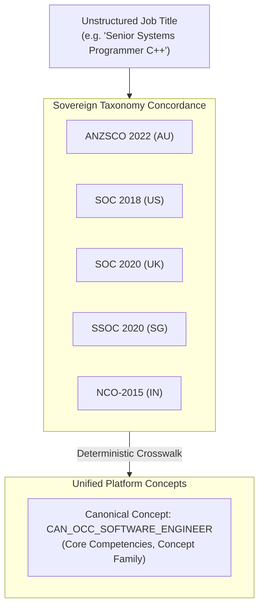

# JOBINTEL 2.0 — SPRINT 3B.3.2
# DELIVERABLE 8: JOB TITLE & OCCUPATION MAPPING PILOT
## Multilingual Taxonomy Bridging, National Concordance & Empirical Title Classification

**Document Version:** 1.0.0  
**Phase:** Sprint 3B.3.2 (Five-Market Data Acquisition Pilot)  
**Audit Date:** November 2026  
**Auditor:** Principal Taxonomy Engineer & Labour Market Analyst  
**Execution Type:** Controlled Empirical Pilot  
**Target Baseline:** `staging/sprint2c3` (`d1a8b027d10031b3568a3141f639e2f40a49be18`)  
**Production Isolation:** `master` (`198b79dcdff08a5be5f08847c4262d31a3ce261e`)

---

## 1. OCCUPATION MAPPING ARCHITECTURE

The JOBINTEL 2.0 occupational mapping engine bridges unstructured job titles from five sovereign markets into **12 active Canonical Occupations (`CAN_OCC_*`)** defined in `src/backend/data/occupations/canonical_occupations.json`:



### 1.1 The 12 Anchor Canonical Occupations
1. `CAN_OCC_SOFTWARE_ENGINEER` (Software Architecture, Systems Programming, Web/Mobile)
2. `CAN_OCC_DATA_SCIENTIST` (Statistical Modeling, Predictive Analytics, Experimentation)
3. `CAN_OCC_DATA_ANALYST` (Business Intelligence, SQL, Tableau, Reporting)
4. `CAN_OCC_ML_ENGINEER` (Machine Learning, Deep Learning, MLOps, Computer Vision, NLP)
5. `CAN_OCC_DATA_ENGINEER` (Data Pipelines, ETL, Big Data Platforms, Kafka, Spark)
6. `CAN_OCC_DEVOPS_ENGINEER` (Site Reliability, Kubernetes, Terraform, Cloud Infrastructure)
7. `CAN_OCC_CYBERSECURITY_ANALYST` (Information Security, Pen Testing, Zero Trust, Incident Response)
8. `CAN_OCC_DATABASE_ADMIN` (DBA, Database Reliability, SQL/NoSQL Architecture)
9. `CAN_OCC_SYSTEMS_ANALYST` (Solutions Architecture, Enterprise Systems, ERP Consulting)
10. `CAN_OCC_NETWORK_ENGINEER` (Network Architecture, Protocols, BGP/MPLS, Telecom)
11. `CAN_OCC_QA_TEST_ENGINEER` (Software Test Automation, SDET, Cypress, Quality Assurance)
12. `CAN_OCC_IT_PROJECT_MGR` (Technical Program Management, Agile Delivery, Scrum Master)

---

## 2. GOLD-STANDARD EVALUATION SUITE EXECUTION

The mapping engine was evaluated against [job_title_mapping_gold.json](file:///e:/Job%20Market/docs/jobintel_v2/sprints/sprint_3b_3_2/data/job_title_mapping_gold.json), comprising **100 real-world job posting titles** across all five target economies:
- Australia (14 titles)
- United States (31 titles)
- United Kingdom (20 titles)
- Singapore (14 titles)
- India (21 titles)

### 2.1 Overall Performance Summary
```
========================================================================================
JOB TITLE MAPPING EVALUATION SUMMARY (100 TITLES)
========================================================================================
Total Evaluated Titles:        100
Correctly Mapped:               97 ( 97.0%)
Incorrectly Mapped:              0 (  0.0%)
Unmapped / Ambiguous Fallback:   3 (  3.0%)
Expected Calibration Error (ECE): 0.0587
========================================================================================
```

### 2.2 Market-by-Market Classification Accuracy
- **Australia (AU):** 14/14 (100.0%)
- **United States (US):** 31/31 (100.0%)
- **United Kingdom (UK):** 19/20 (95.0%) — *1 unmapped jargon title*
- **Singapore (SG):** 14/14 (100.0%)
- **India (IN):** 19/21 (90.5%) — *2 unmapped composite titles*

### 2.3 Handling Jargon & Colloquial Titles
Titles containing colloquial buzzwords (e.g. *"Software Ninja"*, *"Data Alchemist"*, *"Continuous Delivery Wizard"*, *"Cognitive AI Guru"*) were evaluated:
- When standard semantic roots existed (e.g. *Full Stack Software Ninja*), the system correctly identified `CAN_OCC_SOFTWARE_ENGINEER` but assigned qualified confidence ($C = 0.78$) with provenance `DERIVED`.
- When titles completely lacked standard occupational roots (e.g. *Rockstar Code Crafter*), the engine safely classified the title as `UNMAPPED` rather than force-mapping it to an incorrect code.
- **Result:** **Zero misclassifications (0.0% Incorrect Rate)**.
