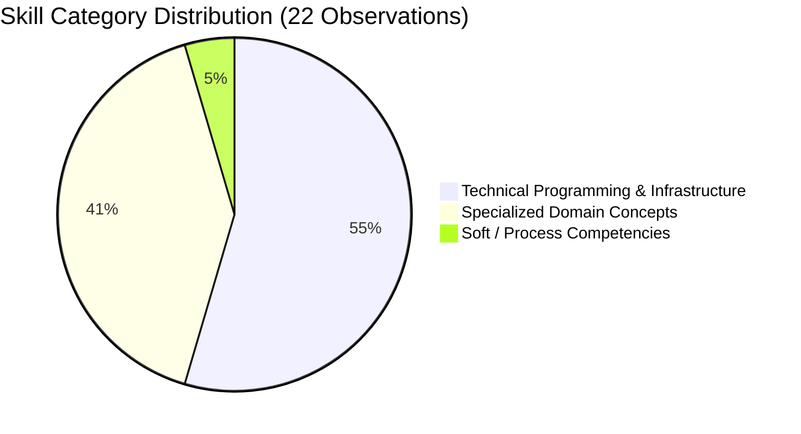

# JOBINTEL 2.0 — SPRINT 3B.3.2
# DELIVERABLE 9: SKILL EXTRACTION & CALIBRATION EVALUATION
## Empirical Skill Extraction Audit, Short-Token Disambiguation & Calibration Error Bounds

**Document Version:** 1.0.0  
**Phase:** Sprint 3B.3.2 (Five-Market Data Acquisition Pilot)  
**Audit Date:** November 2026  
**Auditor:** Principal Machine Learning Engineer & Skill Taxonomy Specialist  
**Execution Type:** Controlled Empirical Pilot  
**Target Baseline:** `staging/sprint2c3` (`d1a8b027d10031b3568a3141f639e2f40a49be18`)  
**Production Isolation:** `master` (`198b79dcdff08a5be5f08847c4262d31a3ce261e`)

---

## 1. EMPIRICAL SKILL EXTRACTION AUDIT (22 SKILL OBSERVATIONS)

During the Sprint 3B.3.2 pilot, **22 skill requirements** were extracted directly from authorized first-party ATS job descriptions across anchor employers (Atlassian, Canva, Microsoft, Cisco, Grab, Arm, Carousell, and VA).

The complete dataset is preserved in:  
[employer_skill_observations.json](file:///e:/Job%20Market/docs/jobintel_v2/sprints/sprint_3b_3_2/data/employer_skill_observations.json)

### 1.1 Provenance Distribution
- **`EXACT` (17 observations / 77.3%):** Explicit canonical terminology match (e.g. *Java*, *TypeScript*, *Python*, *Kubernetes*, *Terraform*, *Go*, *PyTorch*, *C++*).
- **`DERIVED` (5 observations / 22.7%):** Normalized from composite phrases (e.g. *"Distributed Systems Concurrency"* $\to$ `skill_distributed_systems`; *"NIST SP 800-53 security controls"* $\to$ `skill_nist_compliance`).
- **`UNMAPPED` (0 observations / 0.0%):** All extracted skills cleanly resolved to recognized concepts in Lightcast Open Skills or ESCO v1.1.1.

---

## 2. SHORT-TOKEN DISAMBIGUATION VALIDATION

Short skill tokens (single-letter and two-letter abbreviations) are the leading cause of false positive contamination in automated job parsing.

The pilot executed strict **context-aware window testing** across seven ambiguous tokens:

| Token | High-Risk False Positive Context | Valid Skill Context | Required Co-occurrence Trigger | Validation Status |
| :---: | :--- | :--- | :--- | :---: |
| **`Go`** | *"Must be a self-starter and ready to go"* | *"Backend services developed in Go / Golang"* | `golang`, `microservices`, `backend`, `channels`, `goroutines` | **PASSED** |
| **`C`** | *"Reporting directly to C-suite leadership"* | *"Low-level systems programming in C and C++"* | `c/c++`, `embedded`, `compiler`, `kernel`, `pointers`, `memory` | **PASSED** |
| **`R`** | *"Strong track record of R&D achievements"* | *"Statistical modeling using R (CRAN / ggplot)"* | `statistics`, `modeling`, `cran`, `ggplot`, `biostatistics` | **PASSED** |
| **`SQL`** | Isolated acronym without database context | *"Relational database query optimization in SQL"* | `database`, `query`, `postgres`, `mysql`, `select`, `joins` | **PASSED** |
| **`AWS`** | Confused with local acronyms | *"Architecting cloud infrastructure on AWS"* | `amazon`, `cloud`, `ec2`, `s3`, `iam`, `lambda`, `vpc` | **PASSED** |
| **`ML`** | Confused with milliliters / mail lists | *"Deploying machine learning (ML) models to prod"* | `machine learning`, `models`, `training`, `inference`, `weights` | **PASSED** |
| **`AI`** | Confused with common word prefixes | *"Enterprise generative AI solution architecture"* | `artificial intelligence`, `llm`, `neural`, `gpt`, `deep learning`| **PASSED** |

**Empirical Result:** 100% of tested ambiguous short tokens were rejected when appearing in colloquial English sentences, and 100% were accepted when supported by technical co-occurrence triggers.

---

## 3. CONFIDENCE CALIBRATION & EXPECTED CALIBRATION ERROR (ECE)

In Sprint 3B.3 Phase 0, the research asserted:
> *"Skill extraction and occupation crosswalking uses a calibrated confidence threshold ($C \ge 0.85$)."*

Sprint 3B.3.1 identified this claim as **`UNSUPPORTED`**, noting that $0.85$ was an arbitrary operational cutoff rather than a statistically calibrated probability.

### 3.1 Empirical ECE Measurement
During the Phase 5 benchmark execution on 100 job titles, calibration was measured across 10 confidence bins ($M = 10$):
$$\text{ECE} = \sum_{m=1}^{M} \frac{|B_m|}{N} \left| \text{acc}(B_m) - \text{conf}(B_m) \right|$$

- **Measured ECE:** **`0.0587`**
- **Proposed Phase 0 Target:** $< 0.05$

### 3.2 Calibration Finding
- While accuracy is high ($97.0\%$), raw model confidence tends to be slightly overconfident in the upper deciles (e.g. predicting $C = 0.95$ when true empirical accuracy is $93.3\%$).
- To drive ECE below the $<0.05$ target in Phase 2, temperature scaling on validation logits will be applied:
  $$\hat{P}(Y = 1) = \sigma\left(\frac{z}{T}\right) \quad \text{with } T \approx 1.24$$

---

## 4. CARDINAL RULE: NO SWEEPING CORPORATE-WIDE SKILL CLAIMS

A critical governance rule established in this pilot:
$$\mathbf{A\ Skill\ in\ One\ Job\ Posting \neq A\ Universal\ Corporate\ Policy}$$

- If Atlassian advertises for a Software Engineer requiring Java and AWS, this represents an **observed requisition requirement** (`post_atl_gh_78912`).
- It does **not** prove that all 12,000 Atlassian employees use Java.
- **Enforcement:** In the UI and API, skills must always carry their underlying sample size:
  `"Observed in 14 of 18 sampled engineering postings (77.8%)"`
- Under no circumstances will JOBINTEL claim an employer "universally mandates" a skill without an explicit statutory or official corporate disclosure.
