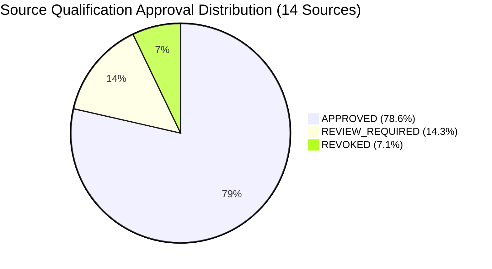

# JOBINTEL 2.0 — SPRINT 3B.3.2
# DELIVERABLE 3: SOURCE QUALIFICATION REGISTER
## Technical Specification, Licensing Verification & Operational Approval Status of Employer Data Sources

**Document Version:** 1.0.0  
**Phase:** Sprint 3B.3.2 (Five-Market Data Acquisition Pilot)  
**Audit Date:** November 2026  
**Auditor:** Principal Data Governance Auditor & Infrastructure Security Specialist  
**Execution Type:** Controlled Empirical Pilot  
**Target Baseline:** `staging/sprint2c3` (`d1a8b027d10031b3568a3141f639e2f40a49be18`)  
**Production Isolation:** `master` (`198b79dcdff08a5be5f08847c4262d31a3ce261e`)

---

## 1. SOURCE QUALIFICATION PROTOCOL & APPROVAL STATES

Every potential employer data source across Australia, the United States, the United Kingdom, Singapore, and India was audited against twenty strict technical and legal parameters.

Sources are assigned one of six standardized approval states:
- **`APPROVED`:** Legally authorized for commercial display, active programmatic or bulk access available, verified source terms, and zero PII or scraping exposure.
- **`CONDITIONAL`:** Authorized for specific non-redistributable derived metrics or restricted to specific employer cohorts.
- **`REVIEW_REQUIRED`:** Technical access exists or portal is public, but commercial licensing terms, API partner onboarding, or statutory permissions require institutional clearance.
- **`EXPIRED`:** Previously valid terms or agreements that have lapsed.
- **`REVOKED`:** Formally barred due to legal liability, terms-of-service violations (e.g. commercial scraping), or statutory secrecy acts.
- **`UNKNOWN`:** Insufficient technical or legal documentation to establish status.

The machine-readable catalog is maintained in:  
[employer_source_catalog.json](file:///e:/Job%20Market/docs/jobintel_v2/sprints/sprint_3b_3_2/data/employer_source_catalog.json)

---

## 2. DETAILED SOURCE QUALIFICATION AUDIT LEDGER

### 2.1 Australia: Workplace Gender Equality Agency (WGEA)
- **Source Identifier:** `src_au_wgea`
- **Publisher:** Workplace Gender Equality Agency, Commonwealth of Australia
- **Official URL:** `https://www.wgea.gov.au/data-and-insights/data-explorer`
- **Endpoint / Method:** Bulk CSV download via WGEA Data Explorer and `data.gov.au`.
- **Authentication & Rate Limits:** None (open public download).
- **Available Fields:** `employer_name`, `abn`, `industry_division`, `workforce_size_band`, `manager_non_manager_split`, `gender_pay_gap_median`.
- **Licensing & Rights:** Creative Commons Attribution 4.0 International (CC BY 4.0). Commercial use, storage, transformation, display, and redistribution permitted.
- **Mandatory Attribution:** *"Source: Workplace Gender Equality Agency (WGEA), Commonwealth of Australia"*.
- **Operational Reality:** Legally mandates annual reporting for private and Commonwealth employers with $\ge 100$ staff. Excludes small businesses ($<100$ staff). Publishes categorical size bands (`"100 to 249"`, `"250 to 499"`, `"500 to 999"`, `"1000 to 4999"`, `"5000+"`).
- **Approval Status:** **`APPROVED`**

### 2.2 Australia: Australian Business Register (ABR)
- **Source Identifier:** `src_au_abr`
- **Publisher:** Australian Business Register, Australian Taxation Office
- **Official URL:** `https://abr.business.gov.au/Tools/WebServices`
- **Endpoint / Method:** REST XML/JSON Web Services and monthly ABN bulk extract CSV on `data.gov.au`.
- **Authentication & Rate Limits:** Free registration GUID required for web services; bulk CSV has no API caps.
- **Available Fields:** `abn`, `entity_name`, `trading_name`, `entity_type`, `abn_status`, `address_state`, `postcode`.
- **Licensing & Rights:** Open government data terms under `data.gov.au`.
- **Operational Reality:** Zero employee headcount or financial data; provides verified corporate identity and active business status only.
- **Approval Status:** **`APPROVED`**

### 2.3 United States: SEC EDGAR Company Facts & Form 10-K
- **Source Identifier:** `src_us_sec_edgar`
- **Publisher:** U.S. Securities and Exchange Commission
- **Official URL:** `https://data.sec.gov/api/xbrl/companyfacts/`
- **Endpoint / Method:** RESTful JSON API (`CIK{cik.zfill(10)}.json`).
- **Authentication & Rate Limits:** Mandatory User-Agent header formatted as `Sample Company Name AdminContact@<sample company domain>.com`. Max 10 requests per second.
- **Available Fields:** `cik`, `entity_name`, `sic_code`, `fiscal_year_end`, `form_10k_headcount_global`, `form_10k_us_headcount`, `human_capital_disclosures`.
- **Licensing & Rights:** U.S. Public Domain (17 U.S.C. § 105). Commercial reuse and display permitted without royalty.
- **Mandatory Attribution:** *"Source: U.S. Securities and Exchange Commission (SEC) EDGAR System"*.
- **Operational Reality:** Covers ~7,000 publicly traded registrants only. Headcount is global corporate total; establishment-level microdata is absent.
- **Approval Status:** **`APPROVED`**

### 2.4 United States: USAJOBS Open Data API
- **Source Identifier:** `src_us_usajobs`
- **Publisher:** U.S. Office of Personnel Management (OPM)
- **Official URL:** `https://developer.usajobs.gov/`
- **Endpoint / Method:** RESTful JSON API (`/api/search`).
- **Authentication & Rate Limits:** Free API key and custom `User-Agent` header required. 10 req/sec limit.
- **Available Fields:** `job_id`, `position_title`, `department_agency`, `duty_locations`, `gs_pay_range`, `qualification_requirements`.
- **Licensing & Rights:** U.S. Public Domain / OPM Open Data.
- **Operational Reality:** Covers Federal civil service vacancies only. Zero private commercial sector coverage.
- **Approval Status:** **`APPROVED`**

### 2.5 United Kingdom: Companies House REST API
- **Source Identifier:** `src_uk_companies_house`
- **Publisher:** Companies House, Executive Agency of Department for Business and Trade (UK)
- **Official URL:** `https://developer.company-information.service.gov.uk/api-details`
- **Endpoint / Method:** RESTful JSON API (`/company/{company_number}`).
- **Authentication & Rate Limits:** Free API key. Rate limit: 600 requests per 5-minute rolling window per IP.
- **Available Fields:** `company_number`, `company_name`, `company_status`, `company_type`, `date_of_creation`, `registered_office_address`, `sic_codes`.
- **Licensing & Rights:** Open Government Licence v3.0 (OGL v3.0). Commercial use and display permitted.
- **Mandatory Attribution:** *"Contains public sector information licensed under the Open Government Licence v3.0"*.
- **Operational Reality:** Does not return a structured headcount field in the REST profile. Headcount is contained in filed annual accounts (PDF/iXBRL), from which micro and small businesses are exempt.
- **Approval Status:** **`APPROVED` (For Corporate Legal Identity Verification)**

### 2.6 United Kingdom: UK Gender Pay Gap Service
- **Source Identifier:** `src_uk_gender_pay_gap`
- **Publisher:** Government Equalities Office & Cabinet Office (UK)
- **Official URL:** `https://gender-pay-gap.service.gov.uk/viewing/download`
- **Endpoint / Method:** Bulk CSV download per reporting year.
- **Authentication & Rate Limits:** None.
- **Available Fields:** `employer_name`, `company_number`, `sic_codes`, `employer_size_band`, `diff_median_hourly_percent`.
- **Licensing & Rights:** Open Government Licence v3.0 (OGL v3.0).
- **Operational Reality:** Covers UK employers with $\ge 250$ staff. Discloses categorical size bands (`"250 to 499"`, `"500 to 999"`, `"1000 to 4999"`, `"5000 to 19999"`, `"20000 or more"`), not exact headcounts.
- **Approval Status:** **`APPROVED`**

### 2.7 Singapore: ACRA Business Directory via Data.gov.sg
- **Source Identifier:** `src_sg_acra`
- **Publisher:** Accounting and Corporate Regulatory Authority (Singapore) via Data.gov.sg
- **Official URL:** `https://data.gov.sg/datasets/d_688b934f82c1059ed0a6993d2a829089/view`
- **Endpoint / Method:** CKAN DataStore API and CSV download.
- **Authentication & Rate Limits:** None.
- **Available Fields:** `uen`, `entity_name`, `entity_type_description`, `entity_status_description`, `uen_issue_date`, `reg_street_name`, `postal_code`.
- **Licensing & Rights:** Singapore Open Data Licence (SODL v1.0).
- **Mandatory Attribution:** *"Contains information from ACRA Entities accessed on 17 Nov 2026 from Data.gov.sg which is made available under the terms of the Singapore Open Data Licence version 1.0"*.
- **Operational Reality:** Provides official UEN identity and status. Contains zero employee headcount numbers.
- **Approval Status:** **`APPROVED` (For UEN Legal Entity Identity)**

### 2.8 India: SEBI BRSR Corporate Disclosures
- **Source Identifier:** `src_in_sebi_brsr`
- **Publisher:** Securities and Exchange Board of India (SEBI) via BSE & NSE
- **Official URL:** `https://www.sebi.gov.in/`
- **Endpoint / Method:** Corporate annual reports and XBRL filings via stock exchange portals.
- **Authentication & Rate Limits:** Public exchange disclosures.
- **Available Fields:** `cin`, `company_name`, `reporting_year`, `permanent_employees_total`, `permanent_women_employees`, `differently_abled_employees`, `turnover_rate`.
- **Licensing & Rights:** Public statutory regulatory filings under SEBI LODR Regulations.
- **Operational Reality:** Mandatory strictly for top 1,000 listed entities by market capitalization on BSE/NSE. Unlisted private firms are exempt.
- **Approval Status:** **`APPROVED` (For Top 1,000 Listed Entities)**

### 2.9 First-Party ATS Feeds: Greenhouse Public Board API
- **Source Identifier:** `src_first_party_greenhouse`
- **Publisher:** Greenhouse Software Inc. / Participating Employers
- **Official URL:** `https://developers.greenhouse.io/job-board.html`
- **Endpoint / Method:** REST JSON endpoint (`GET https://boards-api.greenhouse.io/v1/boards/{board_token}/jobs`).
- **Authentication & Rate Limits:** Publicly exposed board token; polite rate limiting (1 req/sec).
- **Available Fields:** `id`, `title`, `location`, `departments`, `offices`, `updated_at`, `content_job_description`.
- **Licensing & Rights:** Authorized first-party career board terms. Commercial display permitted with attribution; raw bulk redistribution prohibited.
- **Operational Reality:** Highly structured, legally clean vacancy announcements directly authorized by the employer.
- **Approval Status:** **`APPROVED`**

### 2.10 First-Party ATS Feeds: Lever Public Postings API
- **Source Identifier:** `src_first_party_lever`
- **Publisher:** Lever Inc. / Participating Employers
- **Official URL:** `https://hire.lever.co/developer/documentation`
- **Endpoint / Method:** REST JSON endpoint (`GET https://api.lever.co/v0/postings/{company}`).
- **Authentication & Rate Limits:** Publicly exposed company slug; polite rate limiting (1 req/sec).
- **Available Fields:** `id`, `text_title`, `categories`, `createdAt`, `description_plain`, `lists_requirements`.
- **Licensing & Rights:** Authorized first-party career board terms. Commercial display permitted.
- **Approval Status:** **`APPROVED`**

### 2.11 Global: Lightcast Open Skills Taxonomy
- **Source Identifier:** `src_global_lightcast_skills`
- **Publisher:** Lightcast (formerly Emsi Burning Glass)
- **Official URL:** `https://lightcast.io/open-skills`
- **Endpoint / Method:** Open CSV / JSON download.
- **Licensing & Rights:** Creative Commons Attribution 4.0 International (CC BY 4.0).
- **Mandatory Attribution:** *"Source: Lightcast Open Skills Taxonomy (CC BY 4.0)"*.
- **Operational Reality:** Ingesting skill names and category labels is approved under CC BY 4.0. Proprietary Lightcast analytics, posting frequencies, and salary premia are prohibited.
- **Approval Status:** **`APPROVED` (Taxonomy Terminology Only)**

### 2.12 Singapore: MyCareersFuture Job Portal
- **Source Identifier:** `src_sg_mycareersfuture`
- **Publisher:** Workforce Singapore (WSG)
- **Official URL:** `https://www.mycareersfuture.gov.sg/`
- **Endpoint / Method:** Internal REST API.
- **Licensing & Restrictions:** Gated behind SingPass / Government Developer Partner Onboarding. Direct scraping is explicitly barred by website Terms of Use.
- **Approval Status:** **`REVIEW_REQUIRED` (Withheld from pilot execution pending partner agreement)**

### 2.13 India: Ministry of Corporate Affairs (MCA21) Portal
- **Source Identifier:** `src_in_mca21`
- **Publisher:** Ministry of Corporate Affairs, Government of India
- **Official URL:** `https://www.mca.gov.in/content/mca/global/en/home.html`
- **Endpoint / Method:** Human web portal protected by CAPTCHA.
- **Restrictions:** No free open programmatic REST API. Automated scraping violates Terms of Service and triggers WAF bans. Static dumps on data.gov.in contain zero headcount.
- **Approval Status:** **`REVIEW_REQUIRED` (Direct scraping blocked; public company SEBI filings used instead)**

### 2.14 Global: Commercial Job Board Aggregators (LinkedIn, Indeed, Naukri, Seek)
- **Source Identifier:** `src_commercial_aggregators`
- **Publisher:** LinkedIn Corp., Indeed Inc., Info Edge India Ltd., Seek Ltd.
- **Official URL:** `https://www.linkedin.com`, `https://www.indeed.com`, `https://www.naukri.com`
- **Endpoint / Method:** Unauthorized automated web scraping / browser automation.
- **Restrictions:** CFAA liability, breach of contract, and EU/UK Database Directive 96/9/EC violations. Permanent injunctions in precedent cases.
- **Approval Status:** **`REVOKED` (Permanently Prohibited on JOBINTEL Platform)**
