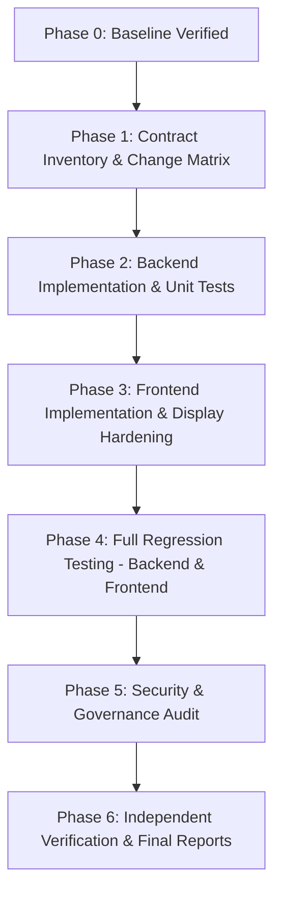

# SPRINT 3B.3.3: IMPLEMENTATION PLAN
## Controlled Implementation of Employer Intelligence & Prediction Presentation

**Sprint ID:** 3B.3.3  
**Execution Mode:** Controlled Implementation & Independent Verification  
**Target Branch:** `staging/sprint2c3`  
**Baseline Commit:** `d1a8b027d10031b3568a3141f639e2f40a49be18`  
**Author:** Principal Software Architect, Senior Full-Stack Engineer, ML Engineer & QA Lead  

---

## 1. Architectural Principles & Invariant Guardrails

1. **Zero Model Retraining / Binary Modification:** All model binaries (`best_model.pkl`, `final_model.pkl`, `scaler_*.pkl`, `pca_*.pkl`, `kmeans_*.pkl`) remain 100% untouched.
2. **Zero Metric Manipulation:** Actual holdout metrics ($N=1,173$, MAE ₹3.71 LPA, $R^2=0.58$ for India; $N=6,808$, MAE $36,381, $R^2=0.42$ for USA) are presented truthfully without artificial alteration.
3. **No Unsupported Prediction Intervals:** The proposed ₹10.4–14.6 LPA interval is NOT a statistically calibrated prediction interval and will not be displayed as such.
4. **Heuristic Scores are NOT Probabilities:** Similarity scores must be designated as `Match Index` or `Similarity Score` (0–100 scale), never as a probability of correctness.
5. **No Automatic Entity Collapsing:** Entity resolution must never collapse subsidiaries into parent entities or treat brand names as legal identity. Ambiguous cases must route to `MANUAL_REVIEW_REQUIRED`.
6. **Sovereign Gating Preservation:** UK demand intelligence remains gated at `null` / `withheld` (`UK_DEMAND_DATA_NOT_PUBLISHED`).
7. **Strict 100% Backward Compatibility:** All existing API routes, schemas, and return formats must continue functioning without breaking existing consumers.

---

## 2. Work Package Implementation Specifications

### WP-01: Honest Salary Prediction Presentation
- **Backend Enhancements (`src/backend/services/india_service.py`, `src/backend/services/usa_service.py`):**
  - Expose verified evaluation metadata in prediction responses (`evaluation_sample_size`, `holdout_mae`, `holdout_r2`, `pay_concept`, `disclaimer`).
  - India `pay_concept`: `"Estimated Annual CTC / Salary Midpoint (Base + Fixed Allowances)"`.
  - USA `pay_concept`: `"Estimated Annual Base Salary (Excludes RSUs, Bonuses, and Equity)"`.
  - Retain existing `confidence_interval` dictionary for API contract backward compatibility, but update documentation and frontend to avoid presenting it as a formal probability interval.
- **Frontend Enhancements (`frontend/src/pages/PredictorPage.tsx`):**
  - Clearly display rounded point estimate with market-specific currency (`₹... LPA` or `$...,...`).
  - Display explicit pay concept badges (`Annual CTC / Fixed Midpoint` for India, `Base Salary Only` for USA).
  - Add explicit model performance card showing holdout sample size $N$, holdout MAE, and $R^2$.
  - Disclose that historical evaluation error does not guarantee individual salary offers.
  - Highlight that variance increases at senior and executive levels.

### WP-02: Occupation Mapping Transparency
- **Frontend Enhancements (`frontend/src/pages/OccupationsPage.tsx`):**
  - Replace `{x}% EXPERT HEURISTIC` with `Match Index: {x}/100` and tooltip explaining it is a heuristic concordance score, not a probability.
  - Handle search queries that return zero matches by displaying an explicit **Unmapped Title Fallback Card** rather than silently showing the default list.
  - Explain why non-standard titles (e.g., "Chief of Staff to CTO", "Growth Hacker") are safely left unmapped rather than forced into an incorrect SOC code.

### WP-03: Employer Entity Resolution Safety
- **Backend Schema & Service (`src/backend/schemas/employer.py`, `src/backend/employers/resolver.py`, `src/backend/routers/v1.py`):**
  - Define `ResolutionMatchType` (`EXACT_IDENTIFIER_MATCH`, `STRONG_CANDIDATE_MATCH`, `AMBIGUOUS_CANDIDATE`, `NO_MATCH`).
  - Define `EntityReviewStatus` (`AUTOMATICALLY_RESOLVED`, `MANUAL_REVIEW_REQUIRED`, `CONFIRMED_DISTINCT`, `HUMAN_VERIFIED_MERGE`).
  - Create `EmployerEntityResolver` that checks statutory registry IDs (CIN, CIK, UEN, ABN, Companies House number) and legal name similarity.
  - Strict Rule: When shared brand is detected across different jurisdictions or parent/subsidiary relationships exist, resolution status MUST be `MANUAL_REVIEW_REQUIRED`. Zero automatic merges of subsidiaries into parents.
  - Expose `/api/v1/employers/resolve` with audit evidence while sanitizing internal paths or secrets.

### WP-04: Skill Extraction Evidence Disclosure
- **Frontend Enhancements (`frontend/src/pages/SkillsPage.tsx`):**
  - Render explicit sample size badges ($N = 34,036$ for USA, $N = 5,859$ for India) on skill demand metrics.
  - Clarify that skill frequencies measure advertised requisition requirements in job postings, not employee competency.
  - Add disclosure regarding the 20-case adversarial regression suite and real-world natural language caveats.

### WP-05: Demand Intelligence Semantics
- Ensure all demand metrics retain source-native units and population definitions.
- Preserve UK demand gating (`UK_DEMAND_DATA_NOT_PUBLISHED` / `null`).
- Verify no synthetic fallbacks or global demand scores are introduced.

### WP-06: API Pagination Review
- **Backend Enhancements (`src/backend/routers/v1.py`):**
  - Add optional `limit: int | None = None` (1 to 50) and `offset: int = 0` query parameters to `GET /v1/employers`.
  - Calling without parameters returns full list, preserving 100% backward compatibility with `test_global_foundation.py`.
  - Calling with `limit` slices results safely.

---

## 3. Execution Sequence & Validation Milestones

Implementation will strictly follow this order, running tests after each modification.
