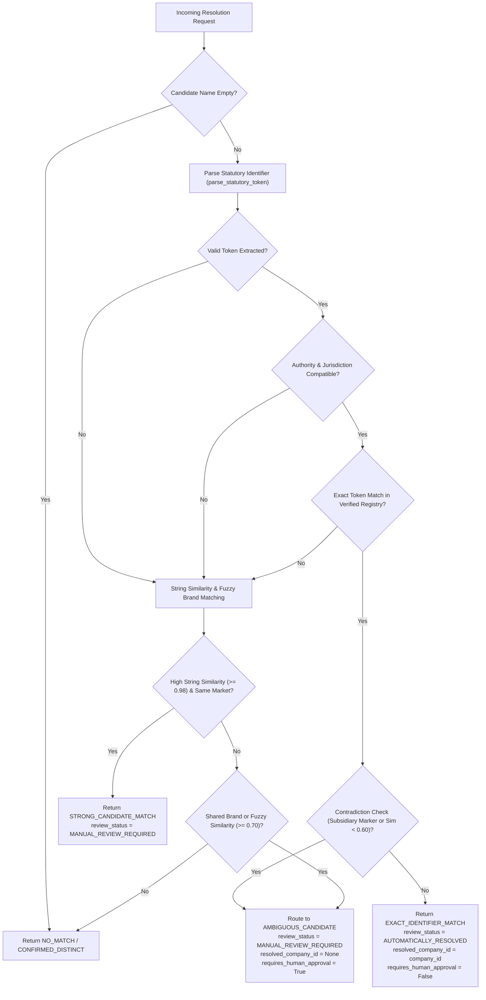

# JOBINTEL 2.0 — SPRINT 3B.3.3.2
## DOCUMENT 04: EMPLOYER RESOLVER SECURITY HARDENING & SOVEREIGN GOVERNANCE DESIGN

**Sprint:** 3B.3.3.2 — Critical Defect Remediation & Employer Resolver Hardening  
**Package:** WP-FIX-02  
**Author:** Principal Security Engineer & Corporate Data Governance Specialist  
**Date:** 2026-11-17  
**Status:** IMPLEMENTED & AUDIT VERIFIED  

---

### 1. Security Vulnerability Analysis (Defect 2)

In Sprint 3B.3.3.1, a critical security vulnerability was discovered in `src/backend/employers/resolver.py`:
```python
# Flawed implementation prior to Sprint 3B.3.3.2:
if req.statutory_identifier and req.statutory_identifier.lower() in str(src.source_reference).lower():
    stat_match = True
```

#### Vulnerabilities Identified:
1. **Partial Substring Infiltration:**
   An adversary or naive user passing `"0001"` or `"SEC"` would match any employer whose source reference URL contained `"0001"` or `"sec.gov"`.
2. **Arbitrary URL Collision:**
   A candidate passing an 8-digit number appearing in an unrelated URL (e.g., blog post ID, CDN hash, or news item) would trigger an unverified statutory match.
3. **Cross-Jurisdiction & Sovereign Authority Spoofing:**
   An identifier from the Indian Ministry of Corporate Affairs (CIN) or Singapore ACRA could be passed claiming US SEC authority or matched against a US entity without authority verification.
4. **Adversarial Brand Hijacking / Contradictory Entity Collapsing:**
   An entity named `"Acme Scam Corp"` passing Alphabet's SEC CIK (`CIK0001652044`) would be automatically resolved as `alphabet-inc` because the statutory ID matched, bypassing identity verification.

---

### 2. Architectural Security Principles

To ensure institutional credibility and legal compliance, the employer resolver was redesigned under four strict principles:

1. **Deterministic Canonical Token Parsing (`parse_statutory_token`):**
   Statutory identifiers must be parsed into structured `(authority_family, canonical_token)` tuples using strict regex specifications for each sovereign registry. Unformatted strings, wildcards, and strings shorter than 4 characters are strictly rejected.
2. **Authority & Sovereign Jurisdiction Validation:**
   Statutory authorities (`SEC`, `COMPANIES_HOUSE`, `MCA`, `ACRA`, `ASIC`) are mapped to sovereign jurisdictions (`US`, `UK`, `IN`, `SG`, `AU`). Cross-jurisdiction authority mismatches immediately invalidate statutory matching.
3. **Anti-Collapsing Legal Structure Enforcement:**
   A statutory match is strictly prohibited from automatically resolving if:
   - The candidate name contains subsidiary or geographic indicators (`"India"`, `"UK"`, `"Services"`, `"Technologies"`, `"Pvt Ltd"`, etc.) while the target is a parent entity (or vice versa).
   - The candidate and employer operate in different jurisdictions without verified multi-market registration.
   - The lexical similarity between candidate legal name and registered name is below 0.60.
4. **Failsafe Human Review Routing:**
   Any ambiguity, divergence, cross-market entity relationship, or name-identifier contradiction must route to `MANUAL_REVIEW_REQUIRED` with `resolved_company_id = None` and `requires_human_approval = True`.

---

### 3. Sovereign Registry Specifications

| Sovereign Registry | Authority Family | Supported Jurisdictions | Canonical Token Format | Validation Pattern |
| :--- | :--- | :--- | :--- | :--- |
| **US SEC EDGAR** | `SEC` | US | 10-digit zero-padded number | `(?:CIK[=/:\s]*\|^CIK\|^)0*([0-9]{4,10})$` |
| **UK Companies House** | `COMPANIES_HOUSE` | UK | 8 characters (8 digits or 2 letters + 6 digits) | `^([0-9]{8}\|[A-Z]{2}[0-9]{6})$` |
| **India MCA** | `MCA` | IN | 21-character alphanumeric CIN | `^[LU][0-9]{5}[A-Z]{2}[0-9]{4}[A-Z]{3}[0-9]{6}$` |
| **Singapore ACRA** | `ACRA` | SG | 9 or 10-character alphanumeric UEN | `^([0-9]{8,9}[A-Z]\|[TSR][0-9]{2}[A-Z]{2}[0-9]{4}[A-Z])$` |
| **Australia ASIC / ABR** | `ASIC` | AU | 11-digit ABN or 9-digit ACN | `^[0-9]{11}$` (ABN), `^[0-9]{9}$` (ACN) |

---

### 4. Resolver Decision Flow



---

### 5. Adversarial Defenses Implemented

1. **"Acme Scam Corp" passing Alphabet CIK:**
   - CIK matches Alphabet Inc.
   - Lexical similarity between `"Acme Scam Corp"` and `"Alphabet Inc"` is ~0.15 (< 0.60).
   - Resolver triggers contradiction check: routes to `AMBIGUOUS_CANDIDATE`, `resolved_company_id = None`, `MANUAL_REVIEW_REQUIRED`.
2. **"Google India Private Limited" passing Google LLC CIK:**
   - Candidate has subsidiary marker `"India"` and jurisdiction `"IN"`.
   - Target is in `"US"`.
   - Resolver blocks automatic collapse: routes to `AMBIGUOUS_CANDIDATE`, `is_subsidiary_relationship = True`, `resolved_company_id = None`.
3. **Partial Identifier `"0001"` or `"SEC"`:**
   - `"0001"` without context evaluates to `None` or does not match `0001652044`.
   - `"SEC"` is shorter than 4 characters, evaluates to `None`.
   - Substring URL matching is eliminated.
