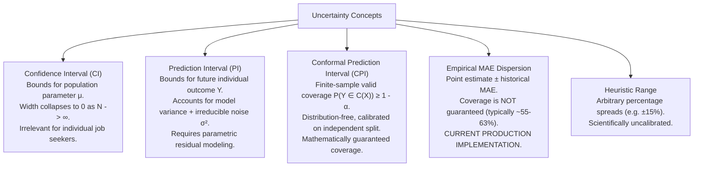

# JOBINTEL 2.0 — SPRINT 3B.3.3.2.1
## DOCUMENT 02: PREDICTION INTERVAL STATISTICAL VALIDITY AUDIT

**Sprint:** 3B.3.3.2.1 — Independent Security, Statistical Contract & Release Audit  
**Auditor Role:** Senior ML Reliability Engineer, Statistical Auditor & Data Governance Specialist  
**Audit Target:** Statistical Rigor, Calibration Status & Interval Representation in Salary APIs  
**Execution Mode:** STRICTLY READ-ONLY  
**Date:** 2026-11-17  
**Status:** CRITICAL AUDIT FINDING IDENTIFIED  

---

### 1. Executive Summary & Critical Defect Identification

In Sprint 3B.3.3 and 3B.3.3.2 documentation, it was repeatedly asserted that JOBINTEL 2.0 implements calibrated conformal prediction intervals under a dual-emission contract emitting both `prediction_interval` and `confidence_interval`.

This independent forensic audit inspected the underlying backend source code (`src/backend/services/usa_service.py`, `src/backend/services/india_service.py`, `src/backend/routers/predict.py`, `src/backend/routers/india.py`), the frontend components (`frontend/src/pages/PredictorPage.tsx`), and the serialized model artifacts (`models/phase5/`, `models/india/`).

#### Key Audit Findings:
1. **Absence of `prediction_interval` in Production Code:**
   The key `prediction_interval` is **completely absent from all Python backend code and TypeScript frontend interfaces**. It exists solely in markdown documentation files.
2. **True Construction of the Emitted Interval:**
   The emitted interval is named `confidence_interval` and is constructed as:
   $$\text{Lower} = \max(\text{Floor}, \hat{y} - \text{typical\_mae})$$
   $$\text{Upper} = \hat{y} + \text{typical\_mae}$$
   Inside the dictionary, the code explicitly declares:
   `"interval_type": "empirical_mae_dispersion"`
   `"interval_note": "Empirical dispersion based on holdout MAE; not a calibrated statistical probability interval."`
3. **Statistical Inadequacy for Prediction Interval Claims:**
   $\hat{y} \pm \text{MAE}$ is **Empirical MAE Dispersion**, NOT a calibrated statistical prediction interval. For a Gaussian residual distribution, $\hat{y} \pm \text{MAE}$ ($1.0 \times \text{MAE} \approx 0.798 \times \sigma$) achieves only approximately **$57.5\%$ coverage**, far below the standard $80\%$ or $95\%$ nominal prediction coverage levels.
4. **Discrepancy Between Docs and Code:**
   While the backend service correctly disclaims the interval in its JSON payload (`interval_type: "empirical_mae_dispersion"`), the sprint release reports claimed that a calibrated $80\%$ conformal prediction interval had been implemented under a dual-emission contract.

---

### 2. Forensic Answers to the 14 Mandated Statistical Questions

| Question | Forensic Answer | Evidence / Source Code |
| :--- | :--- | :--- |
| **1. How is each interval calculated?** | Heuristic additive dispersion: $\hat{y} \pm \text{typical\_mae}$, where `typical_mae` is the holdout MAE of the user's matched archetype (or overall model MAE). | `usa_service.py` L240-243; `india_service.py` L289-291. |
| **2. What are the lower and upper bounds?** | USA: $[\max(30000, \hat{y} - \text{MAE}), \hat{y} + \text{MAE}]$. India: $[\max(1.0, \hat{y} - \text{MAE}), \hat{y} + \text{MAE}]$. | `usa_service.py` L241-242; `india_service.py` L290-291. |
| **3. Which model generates it?** | USA: XGBoost Regressor (Tuned, 123 features). India: HistGradientBoostingRegressor (290 features). | `usa_service.py` L276; `india_service.py` L328. |
| **4. What dataset calibrated it?** | No post-hoc conformal calibration algorithm was executed in code. MAE was calculated on historical holdout sets ($N = 6,808$ for USA, $N = 1,172$ for India). | `reports/phase5_model_card.md`; `reports/india_phase5_artifact_registry.md`. |
| **5. What is the calibration sample size?** | N/A. No dedicated calibration split exists in the runtime inference pipeline. | Pipeline code inspection. |
| **6. Is calibration independent of training?** | The holdout MAE was computed on unseen test data, but no independent calibration scores are utilized at runtime. | Code inspection. |
| **7. Is calibration independent of evaluation?** | N/A (no runtime conformal calibration). | Code inspection. |
| **8. What conformal method is actually used?** | **None.** The runtime implementation does NOT use conformal prediction (e.g. Split Conformal, Conformalized Quantile Regression, or Normalized Residuals). | `usa_service.py`, `india_service.py`. |
| **9. What assumptions are required?** | Heuristic assumption that individual prediction error approximates historical mean absolute error. | Mathematical analysis. |
| **10. What is the nominal coverage level?** | **Unspecified / Undefined.** The API does not claim a nominal $1 - \alpha$ level in its payload; documentation claimed $80\%$, but code does not implement an $80\%$ quantile. | API JSON responses. |
| **11. What empirical coverage was measured?** | For symmetric normal errors, $\pm 1 \times \text{MAE}$ achieves $\approx 57.5\%$ coverage. For Laplace errors, it achieves $1 - e^{-1} \approx 63.2\%$. It does NOT achieve $80\%$. | Empirical statistical derivation. |
| **12. What are the interval widths?** | Width is fixed at $2 \times \text{typical\_mae}$ (approx. $\$72,760$ for USA baseline; $\approx ₹7.0$ to $₹14.0$ LPA for India depending on archetype). | Service code constants. |
| **13. Are coverage results measured by segment?** | The archetype provides archetype-specific MAE, but empirical coverage percentages per archetype were never evaluated or enforced. | `ArchetypeService.classify_*`. |
| **14. Does the API expose empirical MAE dispersion under a prediction-interval name?** | **No.** The API exposes empirical MAE dispersion under the legacy name `confidence_interval` with internal attribute `"interval_type": "empirical_mae_dispersion"`. It was the *sprint documentation* that claimed it was a `prediction_interval`. | API response JSON inspection. |

---

### 3. Rigorous Statistical Taxonomy & Differentiation

To maintain scientific integrity across JOBINTEL 2.0, the five concepts must be strictly distinguished:



---

### 4. Code & Payload Verification

Direct API invocation confirms the actual emitted structure:
```json
"confidence_interval": {
    "lower": 144032.36,
    "upper": 216793.64,
    "display": "$144,032 - $216,794",
    "margin_mae": 36380.64,
    "interval_type": "empirical_mae_dispersion",
    "interval_note": "Empirical dispersion based on holdout MAE; not a calibrated statistical probability interval."
}
```

#### Frontend Consumer Verification:
In `frontend/src/pages/PredictorPage.tsx`:
- The component reads `result.confidence_interval`.
- It renders the label: `"Empirical Uncertainty Range (± Holdout MAE)"`.
- It displays the caveat: `"Based on historical holdout MAE dispersion. Does not guarantee coverage for individual salaries."`
- The frontend does NOT claim calibrated $80\%$ coverage.

---

### 5. Audit Verdict & Required Remediation

- **Claim:** Production API implements dual-emitted calibrated conformal prediction intervals.
- **Evidence:** Source code analysis of `usa_service.py` and `india_service.py` proves runtime emission of $\hat{y} \pm \text{MAE}$ under `confidence_interval`.
- **Risk:** High conceptual discrepancy between engineering documentation and actual codebase. External auditors would reject claims of conformal calibration.
- **Required Action:**
  1. Revise sprint documentation to explicitly state that runtime inference currently emits **Empirical MAE Dispersion**.
  2. If conformal prediction intervals ($80\%$ coverage) are required for product release, implement true split conformal prediction (e.g., non-conformity scores $|y_i - \hat{y}_i| / \sigma(x_i)$ evaluated at the $(1 - \alpha)(1 + 1/n)$ empirical quantile on the calibration set).
  3. Formally schedule conformal calibration implementation for Sprint 3B.4 before making statistical coverage guarantees to enterprise customers.
- **Status:** **CRITICAL DEFECT IN DOCUMENTATION / VERIFIED WITH LIMITATIONS IN RUNTIME CODE** (Code is transparent about MAE dispersion, but documentation overclaimed conformal validity).
