# JOBINTEL 2.0 — SPRINT 3B.3.3.2.1
## DOCUMENT 04: EMPLOYER SIMILARITY, LEGAL IDENTITY & ANTI-COLLAPSING AUDIT

**Sprint:** 3B.3.3.2.1 — Independent Security, Statistical Contract & Release Audit  
**Auditor Role:** Corporate Data Governance Specialist & Full-Stack Architect  
**Audit Target:** Name Normalization, Lexical Similarity Thresholds & Parent/Subsidiary Boundaries  
**Execution Mode:** STRICTLY READ-ONLY  
**Date:** 2026-11-17  
**Status:** VERIFIED WITH LIMITATIONS  

---

### 1. Executive Summary

This audit evaluates the corporate legal identity defenses in `src/backend/employers/resolver.py`, focusing on:
1. Legal entity normalization and suffix stripping.
2. The $0.60$ lexical similarity threshold and its role in auto-resolution.
3. Symmetrical subsidiary marker detection.
4. Prevention of automatic parent/subsidiary collapsing (Google, Microsoft, Amazon, Apple).
5. The artificial score inflation anomaly in line 298 (`max(similarity, 0.75)`).

---

### 2. Legal Normalization & Similarity Architecture

#### 2.1 Normalization Pipeline (`normalize_entity_name`)
- Converts strings to lowercase and replaces non-alphanumeric characters with spaces.
- Strips recognized sovereign legal suffixes sorted by descending length:
  `"private limited"`, `"proprietary limited"`, `"pty ltd"`, `"pte ltd"`, `"pvt ltd"`, `"limited"`, `"ltd"`, `"inc"`, `"incorporated"`, `"llc"`, `"corp"`, `"corporation"`, `"plc"`, `"gmbh"`, `"sa"`, `"srl"`, `"bv"`, `"nv"`, `"co"`, `"company"`.
- Suffix stripping ensures that corporate forms in different formats (e.g. `"Atlassian Pty Ltd"` vs `"Atlassian"`) normalize symmetrically to `"atlassian"`.

#### 2.2 Lexical Similarity Engine
- Implementation: `difflib.SequenceMatcher(None, cand_name_norm, emp_name_norm).ratio()`.
- Calculates Ratcliff/Obershelp pattern matching ratio:
  $$S = \frac{2 \times M}{T_1 + T_2}$$
  where $M$ is the number of matching characters and $T_1, T_2$ are string lengths.

---

### 3. Forensic Evaluation of the 0.60 Threshold

#### 3.1 Function of the 0.60 Threshold in Code
In `EmployerEntityResolver.resolve()`:
```python
if stat_match:
    if subsidiary_indicated or similarity < 0.60:
        # Route to MANUAL_REVIEW_REQUIRED
    else:
        # Return AUTOMATICALLY_RESOLVED
```

#### 3.2 Key Findings on the Threshold:
1. **Anti-Spoofing Gate, NOT Auto-Resolution Grant:**
   A similarity score $\ge 0.60$ **does NOT grant automatic resolution on its own**. A statutory identifier match (`stat_match = True`) is strictly required first.
2. **Behavior on High Similarity Without Statutory Match:**
   Even when `similarity >= 0.98` (e.g., identical names), lines 329-341 assign `STRONG_CANDIDATE_MATCH` and enforce:
   `review_status = EntityReviewStatus.MANUAL_REVIEW_REQUIRED`
   `requires_human_approval = True`
   `resolved_company_id = None`
   Therefore, **high lexical similarity alone NEVER overrides the requirement for human verification**.
3. **Threshold Calibration Limitation:**
   The $0.60$ threshold is an arbitrary heuristic rather than an empirically calibrated boundary. For short entity names (e.g. `"Meta"` vs `"Beta"`), similarity is $0.75$, which exceeds $0.60$. For long entity names, genuine variations might score near $0.60$.
4. **Artificial Score Inflation Anomaly (Line 298):**
   ```python
   similarity_score=round(max(similarity, 0.75), 4)
   ```
   When a statutory match occurs but similarity is $< 0.60$ (such as `"Acme Scam Corp"` passing Alphabet CIK, where similarity is $\approx 0.15$), line 298 artificially clamps the candidate's reported similarity score to **$0.75$**!
   While auto-resolution is properly blocked, presenting a $75\%$ similarity score for a completely divergent name creates misleading audit logs.

---

### 4. Subsidiary & Parent Identity Audit (Anti-Collapsing)

The symmetrical subsidiary detection mechanism was evaluated against four mandatory corporate relationship pairs:

```mermaid
flowchart TD
    subgraph Google
        G1["Candidate: Google India Private Limited (IN)"]
        G2["Target: Google LLC (US)"]
        G1 -.->|"Divergence: 'india' marker + Market IN != US"| G3["AMBIGUOUS_CANDIDATE<br/>resolved_company_id = None<br/>MANUAL_REVIEW_REQUIRED"]
    end
    subgraph Microsoft
        M1["Candidate: Microsoft India R&D Pvt Ltd (IN)"]
        M2["Target: Microsoft Corporation (US)"]
        M1 -.->|"Divergence: 'india' marker + Market IN != US"| M3["AMBIGUOUS_CANDIDATE<br/>resolved_company_id = None<br/>MANUAL_REVIEW_REQUIRED"]
    end
    subgraph Amazon
        A1["Candidate: Amazon UK Services Ltd (UK)"]
        A2["Target: Amazon.com Inc (US)"]
        A1 -.->|"Divergence: 'uk', 'services' markers + Market UK != US"| A3["AMBIGUOUS_CANDIDATE<br/>resolved_company_id = None<br/>MANUAL_REVIEW_REQUIRED"]
    end
    subgraph Apple
        AP1["Candidate: Apple Operations International Ltd (UK)"]
        AP2["Target: Apple Inc (US)"]
        AP1 -.->|"Divergence: 'operations', 'international' markers"| AP3["AMBIGUOUS_CANDIDATE<br/>resolved_company_id = None<br/>MANUAL_REVIEW_REQUIRED"]
    end
```



#### Verification Results:
- **Google India vs. Google LLC:** `test_13` verifies that passing Google LLC's CIK with Google India candidate routes to `AMBIGUOUS_CANDIDATE`, `resolved_company_id = None`, `is_subsidiary_relationship = True`, and `review_status = MANUAL_REVIEW_REQUIRED`.
- **Microsoft India vs. Microsoft Corp:** `test_14` verifies subsidiary routing.
- **Amazon UK Services vs. Amazon.com Inc:** `test_16` verifies cross-market brand distinction.
- **Apple Operations International vs. Apple Inc:** `test_17` verifies subsidiary protection.

---

### 5. Findings Summary & Action Items

- **Claim:** Lexical similarity does not override sovereign legal evidence, and subsidiaries are prevented from collapsing into parents.
- **Evidence:** Code inspection of `src/backend/employers/resolver.py` and test execution of tests 13, 14, 16, 17, and 18.
- **Defects / Limitations Found:**
  1. Clamping similarity to $0.75$ (`max(similarity, 0.75)`) on contradiction candidates misrepresents true lexical distance.
  2. The $0.60$ threshold is uncalibrated and should be reinforced with token overlap checks.
- **Required Action:**
  - Remove `max(similarity, 0.75)` in line 298 to report true empirical similarity.
  - Require both token Jaccard similarity and character Levenshtein distance for corporate name verification.
- **Status:** **VERIFIED WITH LIMITATIONS**.
