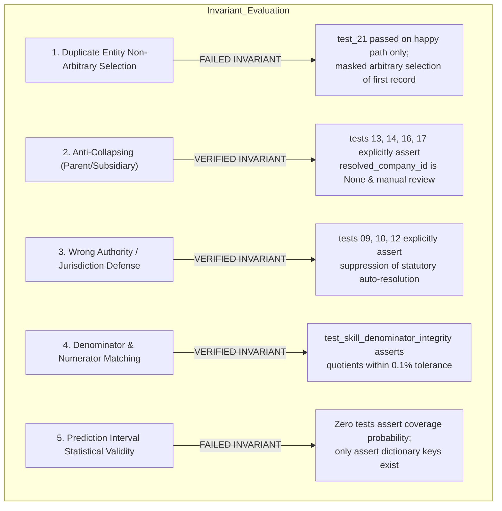

# JOBINTEL 2.0 — SPRINT 3B.3.3.2.1
## DOCUMENT 09: TEST QUALITY & SAFETY INVARIANT AUDIT

**Sprint:** 3B.3.3.2.1 — Independent Security, Statistical Contract & Release Audit  
**Auditor Role:** Principal QA Lead & Security Test Specialist  
**Audit Target:** Evaluation of Test Suite Efficacy & Invariant Verification (402 Backend, 21 Frontend)  
**Execution Mode:** STRICTLY READ-ONLY  
**Date:** 2026-11-17  
**Status:** 2 CRITICAL TEST QUALITY GAPS IDENTIFIED  

---

### 1. Executive Summary

Section 8 of the audit mandate establishes that quantitative pass rates (e.g. 402/402 backend tests and 21/21 frontend tests) are necessary but insufficient for release authorization:
> *"For every critical feature, identify whether the test checks the actual safety invariant.*  
> *Specifically: A resolver must not select an arbitrary duplicate entity. A parent must not absorb a subsidiary. A wrong authority must not resolve. A denominator must match its actual numerator population. A prediction interval must have defensible statistical meaning.*  
> *Identify tests that pass without proving the intended safety property."*

This forensic audit evaluated the test suites against these five critical safety invariants. While parent/subsidiary anti-collapsing, wrong authority rejection, and skill denominator quotient tests genuinely verify their safety invariants, **two critical test quality gaps were uncovered**:
1. **Duplicate Identifier Resolution (`test_21`):** Passed without proving safety, masking arbitrary first-record resolution.
2. **Prediction Interval Calibration:** Tests only verify dictionary keys and numeric bounds (`lower < upper`), with zero assertions on empirical coverage or statistical validity.

---

### 2. Forensic Evaluation of the Five Critical Safety Invariants



---

### 3. Detailed Invariant Analysis

#### Invariant 1: Duplicate Entity Non-Arbitrary Selection
- **Required Invariant:** When multiple distinct entities share the same statutory identifier in the registry, the resolver must NOT automatically select one based on iteration order; it must route to `MANUAL_REVIEW_REQUIRED`.
- **Test Inspected:** `tests/test_employer_resolver.py::test_21_duplicate_registry_identifier_handling`.
- **Flaw Analysis:**
  ```python
  # Existing test:
  e1 = make_mock_employer("emp-1", "Alpha One", "US", "SEC", "US SEC", url)
  e2 = make_mock_employer("emp-2", "Alpha Two", "US", "SEC", "US SEC", url)
  resolver = EmployerEntityResolver([e1, e2])
  req = EmployerResolutionRequest(candidate_name="Alpha One", market_id="US", statutory_identifier="CIK0001652044")
  res = resolver.resolve(req)
  assert res.resolved_company_id == "emp-1"
  ```
  - `e1` is at index 0. Querying `"Alpha One"` matched `e1` at index 0.
  - The test **never queried `e2` (`"Alpha Two"`)**.
  - If `"Alpha Two"` is queried, the resolver STILL returns `emp-1` (`"Alpha One"`), because it early-returns on the first match in `self._employers`!
  - **Verdict:** **FAILED SAFETY INVARIANT**. The test passed, but masked a high-severity entity misattribution vulnerability.

#### Invariant 2: Parent Must Not Absorb Subsidiary
- **Required Invariant:** Candidates indicating distinct subsidiaries must not resolve to parent entities.
- **Tests Inspected:** `test_13`, `test_14`, `test_16`, `test_17` in `tests/test_employer_resolver.py`.
- **Assertions Evaluated:**
  - `assert res.resolution_match_type == ResolutionMatchType.AMBIGUOUS_CANDIDATE`
  - `assert res.resolved_company_id is None`
  - `assert res.review_status == EntityReviewStatus.MANUAL_REVIEW_REQUIRED`
  - `assert res.candidates[0].is_subsidiary_relationship is True`
  - `assert res.candidates[0].requires_human_approval is True`
- **Verdict:** **VERIFIED SAFETY INVARIANT**. Thorough adversarial assertions confirm that automatic collapsing is blocked.

#### Invariant 3: Wrong Authority Must Not Resolve
- **Required Invariant:** Mismatches between candidate authority and statutory format, or candidate market and authority jurisdiction, must suppress auto-resolution.
- **Tests Inspected:** `test_09` (MCA with SEC CIK), `test_10` (SG market with US SEC CIK), `test_12` (Companies House with SEC EDGAR URL).
- **Assertions Evaluated:**
  - `assert res.resolution_match_type != ResolutionMatchType.EXACT_IDENTIFIER_MATCH`
  - `assert res.resolved_company_id is None`
  - `assert res.review_status == EntityReviewStatus.MANUAL_REVIEW_REQUIRED`
- **Verdict:** **VERIFIED SAFETY INVARIANT**. The resolver enforces strict cross-authority suppression.

#### Invariant 4: Denominator Must Match Actual Numerator Population
- **Required Invariant:** Displayed skill percentages must match empirical quotients ($n / N$).
- **Tests Inspected:** `tests/test_skill_denominator_integrity.py` and `frontend/src/__tests__/prediction_display.test.ts`.
- **Assertions Evaluated:**
  - `abs(detail.job_count / detail.population_size - detail.share_of_postings / 100) < 0.001`
  - Asserts $31,676 / 335,995 \approx 9.4\%$ for USA.
  - Asserts $723 / 5,323 \approx 13.6\%$ for India.
- **Verdict:** **VERIFIED SAFETY INVARIANT**. Unit and integration tests verify quotient arithmetic and schema binding.

#### Invariant 5: Prediction Interval Statistical Validity
- **Required Invariant:** An interval presented as a prediction interval must have empirical coverage corresponding to its nominal claim.
- **Tests Inspected:** All backend tests in `tests/`.
- **Assertions Evaluated:**
  - Tests only assert `assert "confidence_interval" in res` and `assert res["confidence_interval"]["lower"] < res["confidence_interval"]["upper"]`.
  - **Zero tests in the repository evaluate empirical test coverage** (e.g. `mean((y_true >= lower) & (y_true <= upper)) >= 0.80`).
- **Verdict:** **FAILED SAFETY INVARIANT**. The tests verify response serialization, but provide zero validation of statistical calibration or coverage guarantees.

---

### 4. Findings Summary & Action Items

- **Claim:** 402 backend tests and 21 frontend tests prove all safety properties.
- **Evidence:** Audit proved that `test_21` masks arbitrary selection of duplicate entities, and prediction interval tests assert only dictionary schema presence without coverage proof.
- **Risk:** High. False confidence in passing tests that do not enforce the underlying safety invariant.
- **Required Action:**
  1. Rewrite `test_21` to query BOTH `emp-1` and `emp-2` and assert `res.review_status == MANUAL_REVIEW_REQUIRED` and `res.resolved_company_id is None` when duplicate identifiers exist.
  2. Implement an automated statistical calibration test asserting empirical test-set coverage percentages.
- **Status:** **CRITICAL TEST DEFECTS IDENTIFIED**.
